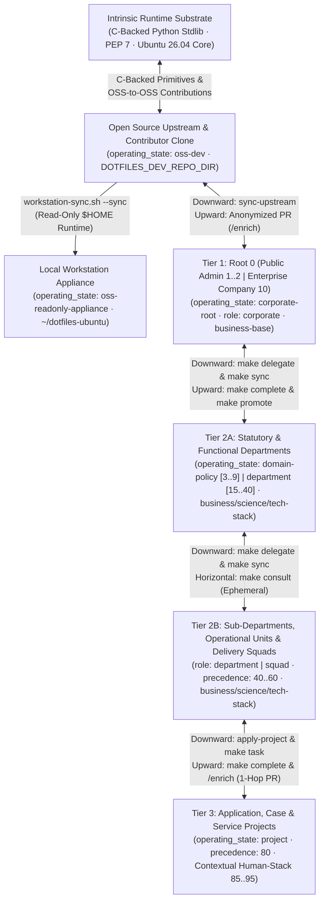
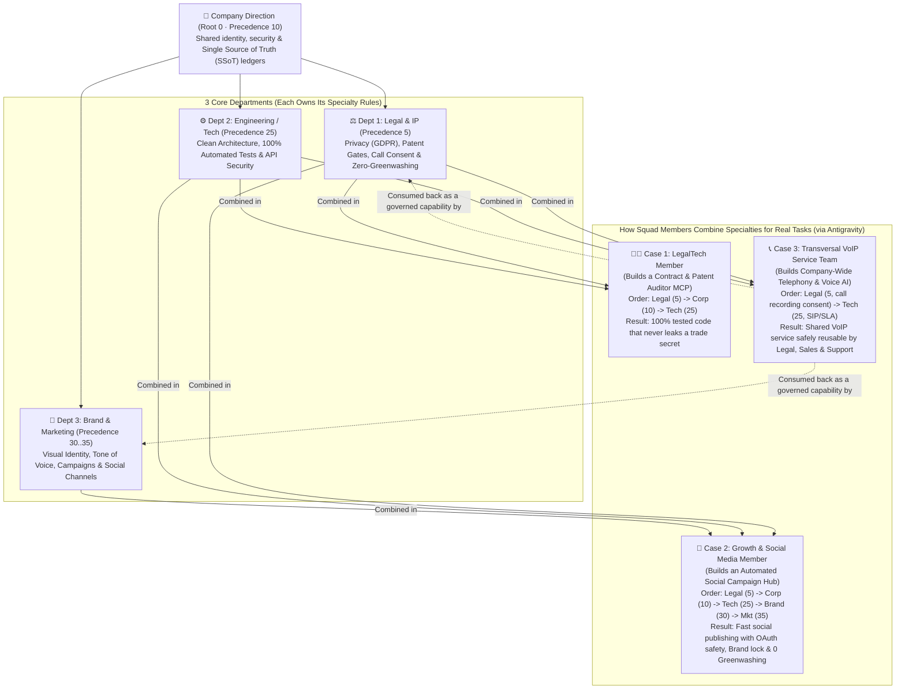
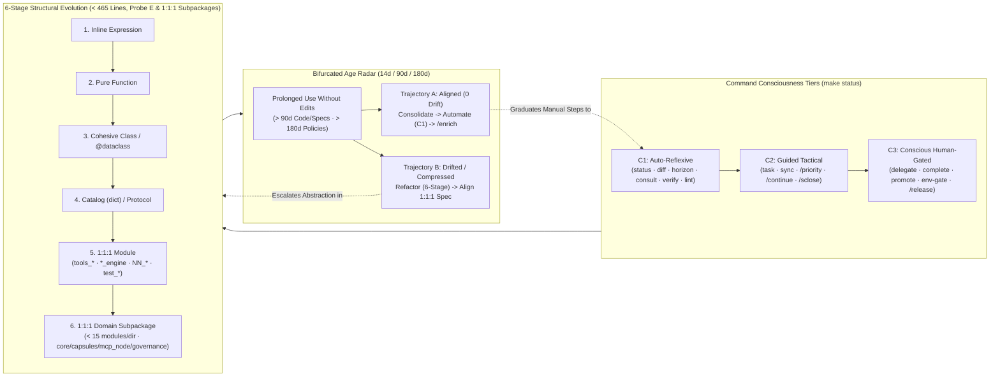

# dotfiles-ubuntu

[](https://github.com/mtwuser/dotfiles-ubuntu/actions/workflows/ci.yml)
[](VERSION)
[-brightgreen.svg)](scripts/verify-repo.sh)
[-3776AB.svg)](pyproject.toml)
[](https://ubuntu.com/)
[](https://antigravity.google/)
[](LICENSE)

Declarative system manager, dotfile engine, and **Distributed Human-AI Governance ("pAIr programming") Platform** for **Ubuntu 26.04 LTS ("Resolute Raccoon")** and **Google Antigravity 2.0 / Gemini** *(directly extrapolable to **VS Code & GitHub Copilot**, **Cursor**, and **Claude Code**)*.

This repository is modular — adopt the full platform or pick only the pieces you need:
1. **Ubuntu System Backup, Audit & Restore ([`backup.sh`](backup.sh), [`audit.sh`](audit.sh), [`bootstrap.sh`](bootstrap.sh))** — snapshot installed APT packages, Snaps, NPM globals, external recipes, and GNOME desktop settings into plain-text manifests, audit system drift, or rebuild a machine from scratch.
2. **Dotfile Symlink Management (`bash/`, `git/`)** — manage `~/.bashrc`, `~/.profile`, and `~/.gitconfig` via [GNU Stow](https://www.gnu.org/software/stow/) while keeping personal identity and secrets in untracked local overrides (`~/.bashrc.local`, `~/.gitconfig.local`).
3. **Google Antigravity 2.0 & Multi-Tier AI Governance (`antigravity/`, `templates/`, `scripts/`, `docs/`)** — composable `AGENTS.md` baselines (`human-core`, `technical-base`, `business-base`), 4 Python 3.14 lifecycle hooks (`PreToolUse`, `PostToolUse`, `PostInvocation`, `Stop`), 19 reusable skills (`10` global + `4` `technical-base` + `5` specialization-stack across `/sopen`, `/sclose`, `/continue`, `/release`, `/enrich`, `/priority`, `/review`, `/full-audit`, `oss-contribute`, `ledger-surface-audit`, `fastapi-testing`, etc.), polymorphic specialization stacks (`business-stack`, `science-stack`, `tech-stack`), and a zero-dependency **Contextual MCP Server** ([`scripts/dotfiles_mcp_server.py`](scripts/dotfiles_mcp_server.py)) shared across **Antigravity 2.0 (`antigravity-agents`)** (`/opt/antigravity-agents`) and **Antigravity CLI (`agy`)**.

---

## Navigation & Progressive Disclosure (`docs/`)

| Tier | Guide / Specification | What You Will Find |
|------|-----------------------|--------------------|
| **Tier 1 (Gateway)** | **[`README.md`](README.md)** *(this file)* · **[`docs/README.md`](docs/README.md)** | Quick-Start paths, repository tree, CLI cheat-sheet, and subsystem lookup map. |
| **Tier 2 (Human Guides)** | **[`docs/guides/01_ubuntu_system_and_multi_machine_guide.md`](docs/guides/01_ubuntu_system_and_multi_machine_guide.md)** | GNU Stow tree unfolding, `system/*` manifests & external recipes, daily usage, all `bootstrap.sh` & `audit.sh` modes, multi-machine setup/migration, portability matrix, and uninstallation. |
| **Tier 2 (Hierarchical Workflows)** | **[`docs/guides/02_hierarchical_layers_and_team_workflows.md`](docs/guides/02_hierarchical_layers_and_team_workflows.md)** | 3-Tier profiles (`human-core`, `technical-base`, `business-base`), 19-skill matrix across 3 Core Bases + 3 Specialization Stacks, scoped `antigravity-agents` workspaces, `Root 0 -> Department -> Case/Unit/Squad -> Project` setup blueprints & kickoff prompts, Git email authority gates, 1-hop horizon radar, and upward PR promotion. |
| **Tier 3A (Normative Specs)** | **[`01: System & Stow`](docs/architecture/01_system_and_stow_engine.md)** · **[`02: Governance & Hooks`](docs/architecture/02_antigravity_governance_and_hooks.md)** · **[`03: Contextual MCP`](docs/architecture/03_contextual_mcp_and_federation.md)** · **[`04: Compaction & Weaver`](docs/architecture/04_compaction_surface_and_promotion_engines.md)** · **[`05: Ephemeral Bots`](docs/architecture/05_ephemeral_forks_and_department_bots.md)** · **[`06: Layer Governance`](docs/architecture/06_layer_governance_and_promotion_engines.md)** | `1:1:1` source-test-spec contracts (`Specification:`) for the Ubuntu engine, lifecycle hooks, MCP server, `rcap1` compaction, surface weaver, ephemeral Department Bots, and layer governance/promotion engines. |
| **Tier 3B (Reference)** | **[`Enterprise Governance`](docs/reference/enterprise_pair_programming_governance.md)** · **[`Cross-Dept & Human-Stack`](docs/reference/cross_departmental_and_human_stack_matrix.md)** · **[`Contextual MCP Mesh`](docs/reference/contextual_mcp_and_multi_service_orchestration.md)** · **[`Maintainer Guide`](docs/reference/developer_and_extension_guide.md)** | Enterprise "pAIr programming" playbook, Cross-Departmental (`0..80`) & `Human-Stack` (`85..95`) Matrix, Docker/SSH MCP orchestration, and maintainer extension workflows. |

---

## Quick Start: 3 Main Ways to Use This Repository

### Path 1: Google Antigravity 2.0 Setup & Usage (Standalone)

Install global rules (`~/.gemini/config/AGENTS.md`), deterministic lifecycle hooks (`hooks.json` + `scripts/`), 10 universal global skills (`~/.gemini/config/skills/`), and desktop launchers without changing your shell, Git config, or Ubuntu packages:

```bash
git clone https://github.com/mtwuser/dotfiles-ubuntu.git ~/dotfiles-ubuntu
cd ~/dotfiles-ubuntu
./bootstrap.sh --workstation   # Sets up read-only runtime, boot auto-sync & dotfiles-sync command
                               # (or ./bootstrap.sh --antigravity for standalone Antigravity links only)

# Optional: install/upgrade Antigravity IDE & Agents binaries from ~/Downloads/
./scripts/antigravity-install.sh --all      # or --agents / --ide

# Any time in terminal: pull latest release, re-apply global profile & re-stow
dotfiles-sync                               # or ./scripts/workstation-sync.sh --status
```

### Path 2: Fork & Manage YOUR Own Ubuntu 26.04 System

Turn a fork of this repository into your personal Ubuntu 26.04 backup, audit, and recovery engine — `./backup.sh` overwrites `system/*` with **your** machine's packages and GNOME settings:

```bash
# Phase A — Initialize your fork from your current Ubuntu 26.04 workstation
git clone https://github.com/<your-user>/dotfiles-ubuntu.git ~/dotfiles-ubuntu
cd ~/dotfiles-ubuntu
./backup.sh                # Captures YOUR APT, Snap, NPM, external recipes & GNOME settings
./audit.sh                 # Verifies 0 drift between your workstation and system/* manifests
./bootstrap.sh --stow      # Symlinks bash/, git/, and antigravity/ (preserves ~/.gitconfig.local)

# Phase B — Restore or provision a fresh Ubuntu 26.04 PC from your fork
./bootstrap.sh             # Interactive mode (or ./bootstrap.sh --all for unattended restore)
                           # Granular flags: --antigravity, --stow, --packages, --external, --nvm, --gnome
```

📖 Full details on GNU Stow tree unfolding, `.audit-ignore`, multi-machine migration, and uninstallation: **[`docs/guides/01_ubuntu_system_and_multi_machine_guide.md`](docs/guides/01_ubuntu_system_and_multi_machine_guide.md)**.

### Path 3: Enterprise & Multi-Tier Human-AI Governance (With or Without MCP)

Orchestrate Human-AI governance across **Open Source (`oss-dev` / `oss-readonly-appliance`) $\leftrightarrow$ `Root 0` (`corporate-root`: Public Administration `1..2` \| Company `10`) $\leftrightarrow$ `Department` (`3..60`, recursive `1..N`: Statutory/Policy `3..9`, Functional `15..40`, Sub-Department / Unit / Squad `40..60`) $\leftrightarrow$ `Project / Case` (`project` `80`)** (**Mode A — Without MCP** via pure Git + Stow + `layer-config.sh` static projection, or **Mode B — With MCP** via [`scripts/dotfiles_mcp_server.py`](scripts/dotfiles_mcp_server.py) and `layers/*` `git subtree` mounts):



📖 Step-by-step multi-tier commands, authority gates, 19-skill matrix, and scoped `antigravity-agents` workspace containment: **[`docs/guides/02_hierarchical_layers_and_team_workflows.md`](docs/guides/02_hierarchical_layers_and_team_workflows.md)** and **[`docs/reference/enterprise_pair_programming_governance.md`](docs/reference/enterprise_pair_programming_governance.md)**.

#### Real-World Business View: 1 Company, 3 Departments & Specialized Squad Members

Imagine a company with **Corporate Direction (`Root 0`)** and **3 core departments** (**Legal**, **Engineering/Tech**, and **Brand/Marketing**). Instead of working in isolated silos, each department defines its rules once (`precedence: 0..100`, where lower numbers carry higher authority), and **any squad member combines the exact specialties their task requires** inside Google Antigravity:



##### Comparing Outcomes: Traditional Silos vs. Cross-Departmental Composition

When a business need crosses specialties (for example, *Legal needs a software tool* or *Marketing needs a social media bot*), organizations can compare what happens across approaches:

| Approach | How the Task Is Executed | What Happens in Practice (Functional Outcome) |
| :--- | :--- | :--- |
| **❌ Traditional Way A: Hand Off to IT Silo** | Business writes a PDF specification and waits for IT to build it. | **Slow & Context-Blind**: Weeks of alignment meetings; IT delivers working code that misses subtle legal, patent, or brand rules. |
| **❌ Traditional Way B: Unmanaged "Shadow IT"** | Legal or Marketing builds a script/bot on their own with generic AI prompts. | **Fragile & Risky**: Solves the immediate business goal, but with zero tests, hardcoded API keys, and high security/compliance risk. |
| **✅ `dotfiles-ubuntu` Way 1: Business-Led (`--parent-dir <dept>` or `make setup-dev`)** | A specialist inside **Legal** or **Marketing** builds the tool in their workspace while injecting **Tech (`25`)** rules. | **Domain-Driven & Engineered**: The business department keeps full ownership and speed, while Antigravity enforces `100%` tests, clean architecture, and security automatically. |
| **✅ `dotfiles-ubuntu` Way 2: Tech-Led (`layer-subtree.sh add <dept>`)** | The **Engineering** squad builds the tool (or a transversal service like **`VoIP`**) while mounting **Legal (`5`)** and **Brand (`30`)** rules. | **Platform-Grade & Compliant**: Engineers build scalable infrastructure where Antigravity blocks any code change that violates Legal (`5`) or Brand (`30`) rules before commit. |

##### Summary of the 6 Reusable Organizational Patterns

| Business / Functional Need | Who Owns the Workspace | Combined Rule Order (`0..100` *Lex Superior*) | How It Activates (`1` Command) | Effective Antigravity Agent Profile |
| :--- | :--- | :--- | :--- | :--- |
| **1. Pure Departmental Governance** *(Contracts, Patents, Ledgers, SOPs)* | `Root 0` or `Department` (`Legal`, `Finance`) | `human-core` + `business-base` (`10`) + `<dept>` (`5..20`) | `bootstrap-workspace` / `make sync` | **Normative & SSoT Ledger Auditor** (`workspace_mode: business`) |
| **2. In-Department Automation** *(Scripts/tools inside a business repo)* | `Department` (`Legal`, `Finance`, `Ops`) | `<dept>` (`5..20`) + `business-base` (`10`) + **`technical-base` (`25`)** | `make setup-dev` *(reversible via `make sync`)* | **In-Situ Domain Automation Engineer** (`workspace_mode: hybrid`) |
| **3. Department-Owned Tech Product** *(e.g., **LegalTech Patent/Contract MCP**)* | `Legal` (`5`) or Embedded Tech Squad | **`Legal` (`5`)** $\rightarrow$ `Corp` (`10`) $\rightarrow$ **`Tech` + `FastAPI` (`25..50`)** | `apply-project <app> --parent-dir <dept> --template <stack>` | **Software Architect Subordinated to Statutory/IP Law** (`hybrid`) |
| **4. Multi-Departmental Solution** *(e.g., **Marketing + Social Media Hub**)* | `Marketing` / `Growth` Squad (`35`) | **`Legal/GDPR` (`5`)** $\rightarrow$ `Corp` (`10`) $\rightarrow$ **`Tech` (`25`)** $\rightarrow$ **`Brand` (`30`)** $\rightarrow$ **`Marketing` (`35`)** | `--parent-dir dept-marketing` + `layer-subtree.sh add` (`legal`, `brand`) | **Full-Stack Growth Engineer Governed by Legal, Brand & Security** |
| **5. Transversal Enterprise Platform** *(e.g., **Company-Wide `VoIP` Service**)* | Platform `service-node` / `squad` (`25`) | **Inward**: `Legal` (`5`, call consent) $\rightarrow$ `Ops` (`20`, SLA) $\rightarrow$ `Tech/VoIP` (`25`)<br/>**Outward**: Exports `templates/voip-pack` + `federated_mcps` | Any department mounts `layers/voip-platform` or applies `voip-pack` | **Critical Infrastructure Provider (inward) / Governed Capability (outward)** |
| **6. Punctual Cross-Departmental Audit** *(e.g., Design checks Patent Gate with Legal)* | Any consumer layer | Active workspace + **Ephemeral `rcap1` Capsule (`kr: true`)** | `make consult LAYER=dept-legal QUERY="..."` | **Zero-Residue Read-Only Inter-Departmental Advisor** (`inter-layer`) |

##### Crystal-Clear Mental Model: `$HOME` (Organizational Membership) vs. `Workspace` (Active Case & Crossed Layers)

Every operator uses two orthogonal surfaces: **`$HOME` (`~/dotfiles-ubuntu` $\rightarrow$ `~/.gemini/config/AGENTS.md`)** defines *which organization or department you belong to*, while **the active `Workspace` (`<repo>/.agents/`)** defines *what project, case, or administrative expediente you are solving today*, which external layers it crosses (`layers/*`), which specialization stack (`business-stack`, `science-stack`, `tech-stack`) applies, and your contextual seniority (`Human-Stack` `L1..L4` at `precedence: 85..95`):

| Real-World Persona | `$HOME` Global Baseline (`~/dotfiles-ubuntu`) | Active `Workspace` & Crossed `layers/*` (`0..80`) | Specialization Stack & Contextual `Human-Stack` (`85..95`) | Effective Agent Behavior |
| :--- | :--- | :--- | :--- | :--- |
| **1. Public Administration Chain** *(Public `Root 0` $\rightarrow$ Public Dept $\rightarrow$ Civil Servant)* | • **Public Admin**: `human-core`<br/>• **Dept Maintainer**: `public-gov-root` (`1`)<br/>• **Civil Servant**: `dept-justice` (`3`) | • **Public `Root 0`**: `public-gov-root` (`1..2`)<br/>• **Public Dept**: `dept-justice` (`3`) & `dept-territorial` (`4`, statutes in `docs/`)<br/>• **Civil Servant**: `expediente-2026/` (`80`) | `business-base` + `science-stack/scientific-knowledge-branch` (`domain-admin-law:L3`) | Enforces constitutional `Root 0` (`1..2`), justice (`3`), and territorial (`4`) statutes; queries modular `docs/` on demand (`make consult`). |
| **2. Company / Law Firm Member Crossing Public Admin** | `empresa-dept-legal` (`15`, inheriting `empresa-root` at `10`) | Client case `recurso-fiscal-cliente-x/` mounting `layers/dept-justice` (`3`) + `layers/dept-tax` (`4`) | `science-stack/scientific-knowledge-branch` + `business-stack` (`domain-civil-law:L4 + domain-tax-law:L2`) | Subordinates corporate strategy (`10..15`) to state justice/tax statutes (`3..4`); peer-level in civil law (`L4`), step-by-step verify on tax changes (`L2`). |
| **3. Enterprise Tech Lead (`L4`) vs. Junior Squad Member (`L1`)** | Both stow `empresa-dept-tech` (`25`, inheriting `empresa-root` at `10`) | Both open `checkout-api/` (`50..80`) | Both apply `tech-stack/fastapi-hexagonal`; Lead sets `domain-python:L4`, Junior sets `domain-python:L1 + soft-socratic-coach` in `.agents/SESSION.md` | Identical `100%` test & architecture gates (`0..80`); Lead gets terse 4-channel execution (`L4`), Junior gets Socratic mentorship (`L1`). |
| **4. Specialist Shifting Contexts** *(Same Person, Different Workspace)* | `dept-bio-lab` (`20`) or `dept-legal` (`15`) | • **Morning**: Primary lab/legal workspace<br/>• **Afternoon**: Cross-cutting tax/env filing or Python tool (`make setup-dev`) | • **Morning**: `science-stack` (`domain-biotech:L4`)<br/>• **Afternoon**: `tech-stack` (`domain-python:L1 + bridge-tech-for-business`) | Seniority is **contextual to the workspace**: direct executive synthesis in their core science (`L4`), didactic guided scaffolding when crossing into code or tax (`L1`). |
| **5. Individual Practitioner / Freelancer** | Default `human-core` (`workstation-sync.sh --setup`) | Any client or personal repo (`apply-project`) optionally mounting public `layers/geo-*` or `layers/dept-*` | `science-stack`, `business-stack`, or `tech-stack` + optional personal `Human-Stack` in `.agents/SESSION.md` | Full task-branch rigor (`make task`, `make status`, `/review`, `/sclose`) without needing a corporate `Root 0`. |

📖 Full business, public-administration & architectural walkthroughs (**Full `0..100` Deontic Spectrum**, **5 `$HOME` vs. `Workspace` Personas**, **LegalTech MCP**, **Marketing Social Media Engine**, and **Transversal `VoIP` Platform**): **[`docs/reference/cross_departmental_and_human_stack_matrix.md`](docs/reference/cross_departmental_and_human_stack_matrix.md)**.

---

## Natural Code Evolution, Command Consciousness & Reproducible Metrics

### 1. 6-Stage Structural Evolution Ladder, Command Tiers (`C1/C2/C3`) & Bifurcated Age Loop



### 2. Value-Added Efficiency Metrics & Reproducible Human-Agent Validation Map

Both human operators and AI agents use this table as a **verifiable conceptual contract** to measure platform ROI and detect architectural drift across any governed repository:

| Dimension / Lifecycle Point | Reproducible Target Metric / Invariant | Human & Architectural Value Added | Agent Deviation / Drift Signal (Validation Gate) |
| :--- | :--- | :--- | :--- |
| **1. Session Startup & Orientation (`/sopen` / `make status`)** | **`1` CLI call (`< 0.2s`)** returning `operating_state`, `workspace_mode`, `command_tiers`, `horizon`, and `agent_diff` | Eliminates 6–8 slow shell/git/file probes at session start and prevents blind `brain/` scans | Multi-step manual `git`/`ls` probing on startup or attempting edits in `oss-readonly-appliance` |
| **2. Context-Window & Compaction (`AGENTS.md` & `rcap1`)** | **`<= 18,000` bytes** global `AGENTS.md` (`human-core` `~10.6 KB`); **`~85%` token savings** at `L1` Exon Skeleton (`40–65` tokens/section) | Zero rule eviction under Antigravity's `20,000`-token inline budget; workspaces load only rules matching their `workspace_mode` | `TOKEN_BUDGET_EXCEEDED` (`> 18 KB`), `WORKSPACE_RULES_BUDGET_EXCEEDED` (`> 80 KB`), or loading code rules in `business` mode |
| **3. Natural Code Maintainability & 6-Stage Evolution** | **`< 465` lines** hard cap (`<= 400` target), **`Probe E` ($M_{\text{cluster}} < 1,200$)**, **`< 15` modules/dir (`1:1:1` Subpackages)**, and **`O(1)` file-prefix taxonomy** (`tools_*`, `*_engine`, `NN_*`, `test_*`) | Prevents God Components, coupled cluster drift, and flat-directory overload; every subpackage and module's `1:1:1` triad (`Spec <-> Test <-> Code`) is discoverable in $O(1)$ | File `>= 465` lines (`[max-file-lines]`), directory `>= 15` modules, cross-engine `_private` imports, or missing `Specification:` pointer |
| **4. Bidirectional `1:1:1` Test Symbiosis (`Unit -> Imp -> E2E`)** | **`100.00%` single-file isolated unit statement + branch coverage (`0` Cross-Unit Masking)**, **`< 1s` per unit test**, `# Arrange / # Act / # Assert`, `0-byte` `__init__.py` | Self-documenting executable specs (`Top-Down E2E -> Imp -> Unit` reading; `Bottom-Up Unit -> Imp -> E2E` execution where each `test_<mod>.py` reaches `100%` alone) | Coverage `< 100%` in single-file isolation, missing AAA markers (`[missing-aaa]`), non-empty `__init__.py` (`[init-purity]`), or legacy aliases |
| **5. Inter-Layer Governance & Stage Gates (`dev -> tst -> pre -> pro`)** | **Strict 1-hop horizon**, `5`-role contextual & hierarchical authority (`owner`, `maintainer`, `validator`, `member`, `consumer`), `4`-state $N$-departmental consensus (`RECONCILED_FLOW` $\rightarrow$ `ESCALATE_TO_ROOT`), and non-destructive `.agents/proposals/` staging | Unifies Business (`Root 0` / `Department` SSoT ledgers, `internal` vs `external` entity lineage, & *Lex Superior* `0..100`) and Technical (`Squad` / `Project`) delivery on `feature/<TICKET-ID>-<slug>` | `CROSS_TIER_PROMOTION_BYPASS`, `INHERITED_UPSTREAM_ASSET_IMMUTABLE`, `CROSS_DEPT_ESCALATION_TO_ROOT_REQUIRED`, open `P0` in `tst`, or unchecked `WORKVALI.md` items in `pre` |
| **6. Bifurcated Age & Consolidation Radar (`14d / 90d / 180d`)** | Proposals **`<= 14d`**; Code/Specs reviewed at **`90d`**; Policies/Templates reviewed at **`180d`** | Untouched artifacts **aligned in active use** graduate to `C1` automation or `/enrich`; **drifted** artifacts are refactored before debt compounds | Unresolved `stale_proposals` (`> 14d`), `Source` modified without updating its `1:1:1` `Spec`, or split idioms inside a touched module |
| **7. OOP Capability Rings, Permanent $\leftrightarrow$ Ephemeral Symbiosis & `rcap1` Membrane** | **`5` CRUD rings (`R0..W`)**, **`4`-family Bot Catalog**, hot-plug **`ephemeral-augmented` leases** (*Zero Standing Privileges*), and **`rcap1` Return Digest Membrane (`seal-return` / `verify-return`)** | Combines **`~85%` `L1` token compaction**, live Permanent $\leftrightarrow$ Ephemeral capability augmentation, and *Crypto-Shredding* (`EPHEMERAL_LEASE_EXPIRED_OR_SHREDDED` & `SURFACE_BOUNDARY_VIOLATION`) | Running a live multi-tenant MCP hub on `oss-dev`, requesting write access on an `inter-layer` fork or `validator` role, or returning unsealed digests outside leased `surface_globs` |

---

## Repository Structure

```
~/dotfiles-ubuntu/
├── bash/                              ← stow module: ~/.bashrc, ~/.profile
├── git/                               ← stow module: ~/.gitconfig (includes ~/.gitconfig.local)
├── antigravity/                       ← stow module: ~/.gemini/config/* & ~/.local/share/applications/*
│   ├── .gemini/config/
│   │   ├── AGENTS.md                  ←   Global baseline (< 18 KB token budget cap)
│   │   ├── hooks.json                 ←   Lifecycle hook bindings (PreToolUse, PostToolUse, PostInvocation, Stop)
│   │   ├── scripts/                   ←   pre_tool_guard.py, post_edit_format.py, post_invocation_lint.py, stop_verify_tests.py
│   │   └── skills/                    ←   10 universal global skills (sopen, sclose, continue, release, enrich, priority,
│   │                                      review, full-audit, architecture-review, governance)
│   └── .local/share/applications/     ←   antigravity-agents.desktop, antigravity-ide.desktop
│
├── docs/                              ← NOT stow — 3-tier navigable documentation hub (< 465 lines per file)
│   ├── README.md                      ←   Documentation index, Mermaid subsystem map & quick lookup
│   ├── guides/                        ←   Tier 2: Human operator & squad workflow guides
│   │   ├── 01_ubuntu_system_and_multi_machine_guide.md  ← Stow unfolding, manifests, bootstrap/audit & multi-machine sync
│   │   └── 02_hierarchical_layers_and_team_workflows.md ← 3-tier profiles, multi-layer lifecycle, authority & PR promotion
│   ├── architecture/                  ←   Tier 3A: Normative technical specifications (1:1:1 with code & unit tests)
│   │   ├── 01_system_and_stow_engine.md                    ← Ubuntu 26.04 engine, 3-stage APT filter, Stow
│   │   ├── 02_antigravity_governance_and_hooks.md          ← Token budget, 4 hook 1:1:1 contracts, 19 skills (10 global + 4 tech + 5 stack)
│   │   ├── 03_contextual_mcp_and_federation.md             ← Zero-dependency MCP server protocol & schema (mcp-layer-v1)
│   │   ├── 04_compaction_surface_and_promotion_engines.md  ← rcap1 compaction & 0..N surface weaver (Subpackage 2: capsules/)
│   │   ├── 05_ephemeral_forks_and_department_bots.md       ← OOP capability rings, symbiotic Department Bots, rcap1 return membrane & TTL GC
│   │   └── 06_layer_governance_and_promotion_engines.md    ← Fork configurator, bootstrapper, authority, horizon, workflow & git-gov (Subpackage 4: governance/)
│   └── reference/                     ←   Tier 3B: Enterprise use cases & maintainer extension guides
│       ├── enterprise_pair_programming_governance.md         ← Enterprise Human-AI governance & Copilot mapping
│       ├── cross_departmental_and_human_stack_matrix.md      ← Cross-Departmental Contextual Algebra (0..80) & Human-Spec / Human-Stack Matrix (85..95)
│       ├── contextual_mcp_and_multi_service_orchestration.md ← Node/Container MCP & multi-service orchestration
│       └── developer_and_extension_guide.md                  ← Maintainer playbook for evolving dotfiles-ubuntu
│
├── templates/                         ← NOT stow — polymorphic template taxonomy (human-core, technical-base, business-base, business-stack/corporate-ops-ledger, science-stack/scientific-knowledge-branch, tech-stack/fastapi-hexagonal)
├── scripts/                           ← NOT stow — CLI orchestrators, Contextual MCP Server & CI verification
│   ├── antigravity-install.sh         ←   Install/update Antigravity binaries from ~/Downloads/
│   ├── audit-global-config.sh         ←   Verify ~/.gemini/config/ tree-unfolded symlinks & orphans
│   ├── workstation-sync.sh            ←   Workstation appliance setup (--setup), boot auto-sync & dotfiles-sync CLI
│   ├── dotfiles_mcp/                  ←   Modular Contextual MCP & Layer Orchestration package (4 domain subpackages, 24 modules)
│   │   ├── core/                      ←     1. Base Contracts, Catalogs & Topology Primitives (0 engine dependencies)
│   │   │   ├── constants.py, catalogs.py  ←   Declarative constants, regexes & MCP resource/tool/prompt catalogs
│   │   │   ├── manifest_helpers.py        ←   System manifest, skill frontmatter, SHA-256 & template schema helpers
│   │   │   └── layer_topology_helpers.py  ←   Layer Makefile renderer, mounted child drift sync & onboarding renderers
│   │   ├── capsules/                  ←     2. Cryptographic Encapsulation (rcap1), Decapsulation & Surface Filtering
│   │   │   ├── capsule_engine.py          ←   Resonant rcap1 L0->L3 sealing, HMAC-SHA256 & ephemeral return digest membrane
│   │   │   ├── surface_weaver.py          ←   Stack-agnostic surface selector inference & Lex Specialis scoring
│   │   │   ├── tools_compaction.py        ←   Multi-resolution query_governance_rules & capsule minting
│   │   │   ├── tools_unfold.py            ←   Hop-by-hop unfold_context_capsule & TOCTOU line-drift relocation
│   │   │   └── tools_surface.py           ←   0..N resolve_surface_governance weaver & delegation advisories
│   │   ├── mcp_node/                  ←     3. OOP MCP Kernel, Capability Rings, Bot Catalog & Permanent <-> Ephemeral Symbiosis
│   │   │   ├── node_base.py, resources.py ←   Base node path-containment, warnings & 9 MCP resource readers
│   │   │   ├── capability_registry.py     ←   OOP CRUD permission rings, 4-family bot catalog & symbiotic hot-plug resolver
│   │   │   ├── tools_federation.py        ←   Overview, drift audit, doc reader & federated MCP discovery tools
│   │   │   ├── ephemeral_fork_engine.py   ←   Zero-copy ephemeral Department Bot forks, project bridges & TTL GC
│   │   │   └── tools_ephemeral.py, server.py← orchestrate_ephemeral_fork tool & JSON-RPC 2.0 dispatcher
│   │   └── governance/                ←     4. Inter-Layer Lifecycle, 1-Hop Horizon, RBAC Authority & Promotion Engines
│   │       ├── fork_configurator.py       ←   Fork parameterization (init-fork), template scaffolding & apply-project
│   │       ├── workspace_bootstrapper.py  ←   Global profile composer (set-global-profile), subtree registrar & bootstrap-workspace
│   │       ├── workflow_engine.py         ←   Task-branch workflow (start/complete-task), 1-hop delegation & consult-layer
│   │       ├── git_governance_engine.py   ←   Git branch policy, dev->tst->pre->pro env gates, non-destructive staging & audit ledger
│   │       ├── authority_engine.py        ←   Layer owner vs. consumer authority gate (set/check-authority) & upward PR planner
│   │       ├── promotion_engine.py        ←   Multi-layer pattern routing, diff-project & promote-from-project (incl. Root 0 -> OSS)
│   │       ├── horizon_engine.py          ←   1-hop horizon radar (inspect-horizon), upstream section diff & 4-mode template reconciliation
│   │       └── cli_dispatcher.py          ←   Tiered 26-subcommand CLI dispatcher (C1/C2/C3/Ephemeral families) for layer-config.sh
│   ├── dotfiles_mcp_server.py         ←   Zero-dependency read-only Contextual MCP Server CLI entrypoint (stdio)
│   ├── layer-config.sh                ←   Layer parameterization, workspace bootstrap, authority, horizon & promotion CLI
│   ├── layer-subtree.sh               ←   Upstream fork sync & git subtree context graph manager (layers/*)
│   └── verify-repo.sh                 ←   Deterministic 8-stage CI & pre-commit verification suite
│
├── system/                            ← NOT stow — declarative system manifests (packages-manual.txt, snaps.txt, npm-globals.txt,
│                                        external.txt, gnome-*, nvm-default.txt, mcp-layer.json) & system/external/ recipe catalog
├── tests/                             ← NOT stow — automated test suite (tests/unit/, tests/imp/, tests/e2e/ — 100% branch coverage)
└── bootstrap.sh, backup.sh, audit.sh, Dockerfile, Makefile, pyproject.toml, VERSION, CHANGELOG.md, SECURITY.md, CONTRIBUTING.md
```

---

## Lifecycle Hooks & CLI Orchestrator Cheat-Sheet

### 1. Deterministic Python 3.14 Lifecycle Hooks (`antigravity/.gemini/config/`)

- **`pre_tool_guard.py` (`PreToolUse`)** — Blocks non-empty writes (`> 0 bytes`) to consumer `src/**/__init__.py` or `tests/**/__init__.py`, manual edits to `alembic/versions/*.py`, and direct edits to inherited `.agents/rules/layer-*.md` across both file-write tools and `run_command` shell redirections (`heredoc`, `tee`, `sed -i`, `cp`/`mv`, `dd`, inline `python -c`), plus automatic execution of mutating `git` (`add`, `commit`, `push`, `reset`, `reset --hard`, `rebase`, `checkout`, `merge`, `clean`, `clean -f`, `subtree`) or `alembic` (`revision`, `upgrade`, `downgrade`, `stamp`, `merge`, `edit`) commands.
- **`post_edit_format.py` (`PostToolUse`)** — Runs `ruff format` automatically on modified `.py` files.
- **`post_invocation_lint.py` (`PostInvocation`)** — Enforces `< 465` lines on modified `.py`, root `README.md`, and `docs/**/*.md` files, AAA test markers, `1:1:1` `Specification:` headers, `ruff check`, and `always_on` rule token budgets (`18,000`-byte `AGENTS.md` cap & `80,000`-byte workspace cap) with `force_continue`.
- **`stop_verify_tests.py` (`Stop`)** — Runs affected unit tests before concluding a task.

### 2. Multi-Layer CLI Orchestrator (`./scripts/layer-config.sh` — All 26 Subcommands)

```bash
# Template discovery, fork parameterization & static project projection:
./scripts/layer-config.sh list-templates
./scripts/layer-config.sh init-fork --id acme-dept-design --role department --precedence 30 --entity-kind enterprise --governing-root acme-corp-root --prune-default-templates
./scripts/layer-config.sh scaffold-template brand-design-system --kind business-stack --register-binding
./scripts/layer-config.sh apply-project <your-project> --template fastapi-hexagonal --layers all

# Global profile composition, subtree mounting & hierarchical workspace bootstrap/sync/status:
./scripts/layer-config.sh set-global-profile human-core --stow
./scripts/layer-config.sh register-subtree dept-legal https://github.com/acme/dept-legal.git master
./scripts/layer-config.sh bootstrap-workspace /path/to/dept-legal --id dept-legal-ip --role domain-policy --precedence 5 --templates business-base
./scripts/layer-config.sh sync-layer /path/to/dept-legal --parent-dir /path/to/corporate-root --strategy reconcile
./scripts/layer-config.sh status <your-project>

# Layer owner vs. consumer authority gates, roster, 1-hop horizon, delegation, feature/<TICKET-ID>-slug & completion:
./scripts/layer-config.sh set-authority /path/to/dept-legal --owner-role "CLO" --emails "clo@acme.com"
./scripts/layer-config.sh manage-roster /path/to/dept-legal --add "qa@acme.com" --role validator
./scripts/layer-config.sh check-authority /path/to/dept-legal --op release --email "clo@acme.com"
./scripts/layer-config.sh configure-git-policy /path/to/dept-legal --protected main,master,env/pre,env/pro
./scripts/layer-config.sh check-env-promotion <your-project> --to-env pre --files "surfaces/web/terms.html" --email "qa@acme.com"
./scripts/layer-config.sh record-decision <your-project> --item ".agents/proposals/from-root/policy.md" --decision approve --reason "Reviewed"
./scripts/layer-config.sh inspect-horizon /path/to/corporate-root
./scripts/layer-config.sh compare-upstream /path/to/corporate-root --apply-safe
./scripts/layer-config.sh delegate-to-child /path/to/corporate-root --to-child dept-legal --task "Publish GDPR policy" --ticket LEGAL-2026-004
./scripts/layer-config.sh start-task <your-project> --task "LEGAL-2026-004"
./scripts/layer-config.sh complete-task <your-project> --task "LEGAL-2026-004" --deliverable "corporate/gdpr.md"
./scripts/layer-config.sh diff-project <your-project>
./scripts/layer-config.sh promote-from-project <your-project> --source .agents/rules/rule.md --create-pr

# Ephemeral Department Bot forks (TTL-bounded zero-copy sandboxes & 1-shot consultations):
./scripts/layer-config.sh consult-layer <your-project> --layer dept-legal --query "GDPR retention"
./scripts/layer-config.sh spawn-ephemeral --role dept-qa-bot --templates fastapi-hexagonal --tier flash --ttl 300
./scripts/layer-config.sh inspect-ephemeral --catalog
./scripts/layer-config.sh reap-ephemeral --id all
```

---

## Development, Testing, Virtual Environment & CI

`dotfiles-ubuntu` separates **zero-dependency runtime execution** ([`requirements.txt`](requirements.txt) — `0` packages in upstream; 100% Python 3.14 Standard Library for hooks and `scripts/dotfiles_mcp_server.py`) from **development/testing tools** ([`requirements-dev.txt`](requirements-dev.txt) — chains `-r requirements.txt` + `pytest`, `pytest-cov`, `ruff`, `mypy`, `shellcheck-py`):

```bash
cd ~/dotfiles-ubuntu
make install                                  # Create ./venv and install requirements-dev.txt
make test-cov                                 # Run unit + imp + e2e tests with 100.00% branch coverage gate
make lint                                     # Run ruff check + mypy --strict
make verify                                   # Run the full 8-stage deterministic CI verification suite
make docker-build && make docker-self-test    # (Optional) Build & verify Ubuntu 26.04 MCP Docker image
```

### Versioning, Security & Contributing

- **Semantic Versioning**: Tracked in [`VERSION`](VERSION) (`2.9.0`) and [`CHANGELOG.md`](CHANGELOG.md) (ongoing changes accumulate under `## [Unreleased]` and are promoted via `/release`). All CLI scripts support `--version` / `-v`.
- **Security & Secret Isolation**: Personal Git identity (`~/.gitconfig.local`) and shell secrets (`~/.bashrc.local`) are strictly isolated from tracked files; see [`SECURITY.md`](SECURITY.md).
- **Contributing & Extending**: See [`CONTRIBUTING.md`](CONTRIBUTING.md) and [`docs/reference/developer_and_extension_guide.md`](docs/reference/developer_and_extension_guide.md).
