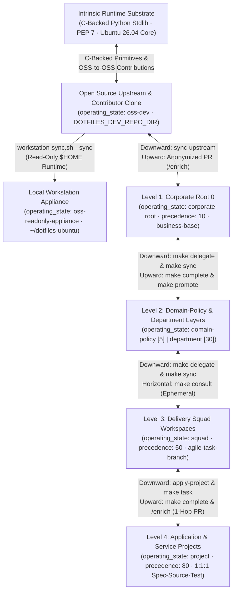
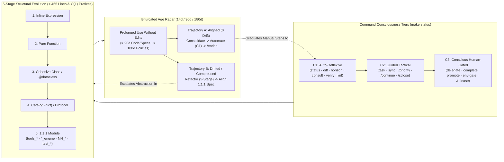

# dotfiles-ubuntu

[](https://github.com/mtwuser/dotfiles-ubuntu/actions/workflows/ci.yml)
[](VERSION)
[-brightgreen.svg)](scripts/verify-repo.sh)
[-3776AB.svg)](pyproject.toml)
[](https://ubuntu.com/)
[](https://antigravity.google/)
[](LICENSE)

Declarative system manager, dotfile engine, and **Distributed Human-AI Governance ("pAIr programming") Platform** for **Ubuntu 26.04 LTS ("Resolute Raccoon")** and **Google Antigravity 2.0 / Gemini** *(directly extrapolable to **VS Code & GitHub Copilot**, **Cursor**, and **Claude Code**)*.

This repository is modular — adopt the full platform or pick only the pieces you need:
1. **Ubuntu System Backup, Audit & Restore ([`backup.sh`](backup.sh), [`audit.sh`](audit.sh), [`bootstrap.sh`](bootstrap.sh))** — snapshot installed APT packages, Snaps, NPM globals, external recipes, and GNOME desktop settings into plain-text manifests, audit system drift, or rebuild a machine from scratch.
2. **Dotfile Symlink Management (`bash/`, `git/`)** — manage `~/.bashrc`, `~/.profile`, and `~/.gitconfig` via [GNU Stow](https://www.gnu.org/software/stow/) while keeping personal identity and secrets in untracked local overrides (`~/.bashrc.local`, `~/.gitconfig.local`).
3. **Google Antigravity 2.0 & Multi-Tier AI Governance (`antigravity/`, `templates/`, `scripts/`, `docs/`)** — composable `AGENTS.md` baselines (`human-core`, `technical-base`, `business-base`), 4 Python 3.14 lifecycle hooks (`PreToolUse`, `PostToolUse`, `PostInvocation`, `Stop`), 13 reusable skills (`/sopen`, `/sclose`, `/continue`, `/release`, `/enrich`, `/priority`, `/review`, `/full-audit`, etc.), polymorphic starter templates, and a zero-dependency **Contextual MCP Server** ([`scripts/dotfiles_mcp_server.py`](scripts/dotfiles_mcp_server.py)) shared across **Antigravity 2.0 Agents** (`/opt/antigravity-agents`), **Antigravity IDE** (`/opt/antigravity-ide`), and **Antigravity CLI (`agy`)**.

---

## Navigation & Progressive Disclosure (`docs/`)

| Tier | Guide / Specification | What You Will Find |
|------|-----------------------|--------------------|
| **Tier 1 (Gateway)** | **[`README.md`](README.md)** *(this file)* · **[`docs/README.md`](docs/README.md)** | Quick-Start paths, repository tree, CLI cheat-sheet, and subsystem lookup map. |
| **Tier 2 (Human Guides)** | **[`docs/guides/01_ubuntu_system_and_multi_machine_guide.md`](docs/guides/01_ubuntu_system_and_multi_machine_guide.md)** | GNU Stow tree unfolding, `system/*` manifests & external recipes, daily usage, all `bootstrap.sh` & `audit.sh` modes, multi-machine setup/migration, portability matrix, and uninstallation. |
| **Tier 2 (Squad Workflows)** | **[`docs/guides/02_hierarchical_layers_and_team_workflows.md`](docs/guides/02_hierarchical_layers_and_team_workflows.md)** | 3-Tier profiles (`human-core`, `technical-base`, `business-base`), `antigravity-ide` (360° viewer) vs. `antigravity-agents` (scoped workspaces), `Root 0 -> Department -> Squad -> Project` setup blueprints & kickoff prompts, Git email authority gates, 1-hop horizon radar, and upward PR promotion. |
| **Tier 3A (Normative Specs)** | **[`01`](docs/architecture/01_system_and_stow_engine.md)** · **[`02`](docs/architecture/02_antigravity_governance_and_hooks.md)** · **[`03`](docs/architecture/03_contextual_mcp_and_federation.md)** · **[`04`](docs/architecture/04_compaction_surface_and_promotion_engines.md)** · **[`05`](docs/architecture/05_ephemeral_forks_and_department_bots.md)** | `1:1:1` source-test-spec contracts (`Specification:`) for the Ubuntu engine, lifecycle hooks, MCP server, `rcap1` compaction, surface weaver, authority/promotion engines, and ephemeral Department Bots. |
| **Tier 3B (Reference)** | **[`Enterprise Governance`](docs/reference/enterprise_pair_programming_governance.md)** · **[`Contextual MCP Mesh`](docs/reference/contextual_mcp_and_multi_service_orchestration.md)** · **[`Maintainer Guide`](docs/reference/developer_and_extension_guide.md)** | Enterprise "pAIr programming" playbook (with or without MCP), VS Code Copilot/Cursor mapping, Docker/SSH MCP orchestration, and maintainer extension workflows. |

---

## Quick Start: 3 Main Ways to Use This Repository

### Path 1: Google Antigravity 2.0 Setup & Usage (Standalone)

Install global rules (`~/.gemini/config/AGENTS.md`), deterministic lifecycle hooks (`hooks.json` + `scripts/`), 13 global skills (`~/.gemini/config/skills/`), and desktop launchers without changing your shell, Git config, or Ubuntu packages:

```bash
git clone https://github.com/mtwuser/dotfiles-ubuntu.git ~/dotfiles-ubuntu
cd ~/dotfiles-ubuntu
./bootstrap.sh --workstation   # Sets up read-only runtime, boot auto-sync & dotfiles-sync command
                               # (or ./bootstrap.sh --antigravity for standalone Antigravity links only)

# Optional: install/upgrade Antigravity IDE & Agents binaries from ~/Downloads/
./scripts/antigravity-install.sh --all      # or --agents / --ide

# Any time in terminal: pull latest release, re-apply global profile & re-stow
dotfiles-sync                               # or ./scripts/workstation-sync.sh --status
```

### Path 2: Fork & Manage YOUR Own Ubuntu 26.04 System

Turn a fork of this repository into your personal Ubuntu 26.04 backup, audit, and recovery engine — `./backup.sh` overwrites `system/*` with **your** machine's packages and GNOME settings:

```bash
# Phase A — Initialize your fork from your current Ubuntu 26.04 workstation
git clone https://github.com/<your-user>/dotfiles-ubuntu.git ~/dotfiles-ubuntu
cd ~/dotfiles-ubuntu
./backup.sh                # Captures YOUR APT, Snap, NPM, external recipes & GNOME settings
./audit.sh                 # Verifies 0 drift between your workstation and system/* manifests
./bootstrap.sh --stow      # Symlinks bash/, git/, and antigravity/ (preserves ~/.gitconfig.local)

# Phase B — Restore or provision a fresh Ubuntu 26.04 PC from your fork
./bootstrap.sh             # Interactive mode (or ./bootstrap.sh --all for unattended restore)
                           # Granular flags: --antigravity, --stow, --packages, --external, --nvm, --gnome
```

📖 Full details on GNU Stow tree unfolding, `.audit-ignore`, multi-machine migration, and uninstallation: **[`docs/guides/01_ubuntu_system_and_multi_machine_guide.md`](docs/guides/01_ubuntu_system_and_multi_machine_guide.md)**.

### Path 3: Enterprise & Multi-Tier Human-AI Governance (With or Without MCP)

Orchestrate Human-AI governance across **Open Source (`oss-dev` / `oss-readonly-appliance`) $\leftrightarrow$ Corporate (`corporate-root`) $\leftrightarrow$ Department (`domain-policy` / `department`) $\leftrightarrow$ Squad (`squad`) $\leftrightarrow$ Project (`project`)** tiers (**Mode A — Without MCP** via pure Git + Stow + `layer-config.sh` static projection, or **Mode B — With MCP** via [`scripts/dotfiles_mcp_server.py`](scripts/dotfiles_mcp_server.py) and `layers/*` `git subtree` mounts):



📖 Step-by-step multi-tier commands, authority gates, and IDE vs. Agents workspace isolation: **[`docs/guides/02_hierarchical_layers_and_team_workflows.md`](docs/guides/02_hierarchical_layers_and_team_workflows.md)** and **[`docs/reference/enterprise_pair_programming_governance.md`](docs/reference/enterprise_pair_programming_governance.md)**.

---

## Natural Code Evolution, Command Consciousness & Reproducible Metrics

### 1. Structural Evolution Ladder, Command Tiers (`C1/C2/C3`) & Bifurcated Age Loop



### 2. Value-Added Efficiency Metrics & Reproducible Human-Agent Validation Map

Both human operators and AI agents use this table as a **verifiable conceptual contract** to measure platform ROI and detect architectural drift across any governed repository:

| Dimension / Lifecycle Point | Reproducible Target Metric / Invariant | Human & Architectural Value Added | Agent Deviation / Drift Signal (Validation Gate) |
| :--- | :--- | :--- | :--- |
| **1. Session Startup & Orientation (`/sopen` / `make status`)** | **`1` CLI call (`< 0.2s`)** returning `operating_state`, `workspace_mode`, `command_tiers`, `horizon`, and `agent_diff` | Eliminates 6–8 slow shell/git/file probes at session start and prevents blind `brain/` scans | Multi-step manual `git`/`ls` probing on startup or attempting edits in `oss-readonly-appliance` |
| **2. Context-Window & Compaction (`AGENTS.md` & `rcap1`)** | **`<= 18,000` bytes** global `AGENTS.md` (`human-core` `~10.2 KB`); **`~85%` token savings** at `L1` Exon Skeleton (`40–65` tokens/section) | Zero rule eviction under Antigravity's `20,000`-token inline budget; workspaces load only rules matching their `workspace_mode` | `TOKEN_BUDGET_EXCEEDED` (`> 18 KB`), `WORKSPACE_RULES_BUDGET_EXCEEDED` (`> 80 KB`), or loading code rules in `business` mode |
| **3. Natural Code Maintainability & Structural Evolution** | **`< 465` lines** hard cap (`<= 400` target), **5-Stage Evolution Ladder**, and **`O(1)` file-prefix taxonomy** (`tools_*`, `*_engine`, `NN_*`, `test_*`) | Prevents God Components and defensive syntactic compression; every file's role and `1:1:1` pair is discoverable in $O(1)$ by filename | File `>= 465` lines (`[max-file-lines]`), cryptic short variable names to save lines, or missing `Specification:` docstring pointer |
| **4. Bidirectional `1:1:1` Test Symbiosis (`Unit -> Imp -> E2E`)** | **`100.00%` isolated unit statement + branch coverage**, **`< 1s` per unit test**, `# Arrange / # Act / # Assert`, `0-byte` `__init__.py` | Self-documenting executable specs (`Top-Down E2E -> Imp -> Unit` reading; `Bottom-Up Unit -> Imp -> E2E` execution without coverage masking) | Coverage `< 100%`, missing AAA markers (`[missing-aaa]`), non-empty `__init__.py` (`[init-purity]`), or legacy aliases / `@deprecated` |
| **5. Inter-Layer Governance & Stage Gates (`dev -> tst -> pre -> pro`)** | **Strict 1-hop horizon**, `4`-role authority (`owner`, `maintainer`, `validator`, `member`), and non-destructive `.agents/proposals/` staging | Unifies Business (`Root 0` / `Department` SSoT ledgers & *Lex Superior* `0..100`) and Technical (`Squad` / `Project`) delivery on `feature/<TICKET-ID>-<slug>` | `CROSS_TIER_PROMOTION_BYPASS`, `INHERITED_UPSTREAM_ASSET_IMMUTABLE`, open `P0` in `tst`, or unchecked `WORKVALI.md` items in `pre` |
| **6. Bifurcated Age & Consolidation Radar (`14d / 90d / 180d`)** | Proposals **`<= 14d`**; Code/Specs reviewed at **`90d`**; Policies/Templates reviewed at **`180d`** | Untouched artifacts **aligned in active use** graduate to `C1` automation or `/enrich`; **drifted** artifacts are refactored before debt compounds | Unresolved `stale_proposals` (`> 14d`), `Source` modified without updating its `1:1:1` `Spec`, or split idioms inside a touched module |
| **7. Bounded MCP Mode, Ephemeral Scope (`inter`/`intra`) & `rcap1` Firewall** | Explicit **`mcp_operating_mode`** per `operating_state` (`oss-dev` bounded to `"self-test-and-dev-only"`); **`inter-layer`** (`strictly-read-only`) vs. **`intra-layer`** (`actor_role`-gated) ephemeral forks; **`rcap1` (`kr: true`)** | Combines **`~85%` `L1` token compaction** with a **Business Confidentiality & SSoT Integrity Firewall** (`flash` / unauthenticated nodes blocked from `L2`/`L3` secrets; tampering triggers `CAPSULE_CHAIN_BROKEN`) | Running a live multi-tenant MCP hub on `oss-dev`, requesting write access on an `inter-layer` fork or `validator` role, or unfolding `L2`/`L3` without `resonance_key` |

---

## Repository Structure

```
~/dotfiles-ubuntu/
├── bash/                              ← stow module: ~/.bashrc, ~/.profile
├── git/                               ← stow module: ~/.gitconfig (includes ~/.gitconfig.local)
├── antigravity/                       ← stow module: ~/.gemini/config/* & ~/.local/share/applications/*
│   ├── .gemini/config/
│   │   ├── AGENTS.md                  ←   Global baseline (< 18 KB token budget cap)
│   │   ├── hooks.json                 ←   Lifecycle hook bindings (PreToolUse, PostToolUse, PostInvocation, Stop)
│   │   ├── scripts/                   ←   pre_tool_guard.py, post_edit_format.py, post_invocation_lint.py, stop_verify_tests.py
│   │   └── skills/                    ←   10 universal global skills (sopen, sclose, continue, release, enrich, priority,
│   │                                      review, full-audit, architecture-review, governance)
│   └── .local/share/applications/     ←   antigravity-agents.desktop, antigravity-ide.desktop
│
├── docs/                              ← NOT stow — 3-tier navigable documentation hub (< 465 lines per file)
│   ├── README.md                      ←   Documentation index, Mermaid subsystem map & quick lookup
│   ├── guides/                        ←   Tier 2: Human operator & squad workflow guides
│   │   ├── 01_ubuntu_system_and_multi_machine_guide.md  ← Stow unfolding, manifests, bootstrap/audit & multi-machine sync
│   │   └── 02_hierarchical_layers_and_team_workflows.md ← 3-tier profiles, multi-layer lifecycle, authority & PR promotion
│   ├── architecture/                  ←   Tier 3A: Normative technical specifications (1:1:1 with code & unit tests)
│   │   ├── 01_system_and_stow_engine.md                    ← Ubuntu 26.04 engine, 3-stage APT filter, Stow
│   │   ├── 02_antigravity_governance_and_hooks.md          ← Token budget, 4 hook 1:1:1 contracts, 10 global + 3 tech skills
│   │   ├── 03_contextual_mcp_and_federation.md             ← Zero-dependency MCP server protocol & schema (v1.2)
│   │   ├── 04_compaction_surface_and_promotion_engines.md  ← rcap1 compaction, 0..N surface weaver, authority & promotion
│   │   └── 05_ephemeral_forks_and_department_bots.md       ← Ephemeral Department Bot forks, project bridges & TTL GC
│   └── reference/                     ←   Tier 3B: Enterprise use cases & maintainer extension guides
│       ├── enterprise_pair_programming_governance.md         ← Enterprise Human-AI governance & Copilot mapping
│       ├── contextual_mcp_and_multi_service_orchestration.md ← Node/Container MCP & multi-service orchestration
│       └── developer_and_extension_guide.md                  ← Maintainer playbook for evolving dotfiles-ubuntu
│
├── templates/                         ← NOT stow — polymorphic template taxonomy (human-core, technical-base, business-base, business-stack/*, squad-stack/agile-task-branch, tech-stack/fastapi-hexagonal)
├── scripts/                           ← NOT stow — CLI orchestrators, Contextual MCP Server & CI verification
│   ├── antigravity-install.sh         ←   Install/update Antigravity IDE & Agents from ~/Downloads/
│   ├── audit-global-config.sh         ←   Verify ~/.gemini/config/ tree-unfolded symlinks & orphans
│   ├── workstation-sync.sh            ←   Workstation appliance setup (--setup), boot auto-sync & dotfiles-sync CLI
│   ├── dotfiles_mcp/                  ←   Modular Contextual MCP & Layer Orchestration package (20 modules, < 465 lines each)
│   │   ├── constants.py, catalogs.py  ←     Declarative constants, regexes & MCP resource/tool/prompt catalogs
│   │   ├── manifest_helpers.py        ←     System manifest, skill frontmatter & telemetry helpers
│   │   ├── fork_configurator.py       ←     Fork parameterization (init-fork), template scaffolding & apply-project
│   │   ├── workspace_bootstrapper.py  ←     Global profile composer (set-global-profile), subtree registrar & bootstrap-workspace
│   │   ├── workflow_engine.py         ←     Squad task-branch onboarding (start-task), upstream reconciliation & consult-layer
│   │   ├── git_governance_engine.py   ←     Git branch policy, dev->tst->pre->pro env gates, non-destructive staging & audit ledger
│   │   ├── authority_engine.py        ←     Layer owner vs. consumer authority gate (set/check-authority) & upward PR planner
│   │   ├── promotion_engine.py        ←     1-hop horizon (inspect-horizon), diff-project & promote-from-project (incl. Root 0 -> OSS)
│   │   ├── ephemeral_fork_engine.py   ←     Zero-copy ephemeral Department Bot forks, project bridges & TTL GC
│   │   ├── surface_weaver.py          ←     Stack-agnostic surface selector inference & Lex Specialis scoring
│   │   ├── capsule_engine.py          ←     Resonant rcap1 Matryoshka L0->L3 encryption & compression engine
│   │   ├── node_base.py, resources.py ←     Base node path-containment, warnings & 9 MCP resource readers
│   │   ├── tools_federation.py        ←     Overview, drift audit, doc reader & federated MCP discovery tools
│   │   ├── tools_compaction.py        ←     Multi-resolution query_governance_rules & capsule minting
│   │   ├── tools_unfold.py            ←     Hop-by-hop unfold_context_capsule & TOCTOU line-drift relocation
│   │   ├── tools_surface.py           ←     0..N resolve_surface_governance weaver & delegation advisories
│   │   └── tools_ephemeral.py, server.py←   orchestrate_ephemeral_fork tool & JSON-RPC 2.0 dispatcher
│   ├── dotfiles_mcp_server.py         ←   Zero-dependency read-only Contextual MCP Server CLI entrypoint (stdio)
│   ├── layer-config.sh                ←   Layer parameterization, workspace bootstrap, authority, horizon & promotion CLI
│   ├── layer-subtree.sh               ←   Upstream fork sync & git subtree context graph manager (layers/*)
│   └── verify-repo.sh                 ←   Deterministic 8-stage CI & pre-commit verification suite
│
├── system/                            ← NOT stow — declarative system manifests (packages-manual.txt, snaps.txt, npm-globals.txt,
│                                        external.txt, gnome-*, nvm-default.txt, mcp-layer.json) & system/external/ recipe catalog
├── tests/                             ← NOT stow — automated test suite (tests/unit/, tests/imp/, tests/e2e/ — 100% branch coverage)
└── bootstrap.sh, backup.sh, audit.sh, Dockerfile, Makefile, pyproject.toml, VERSION, CHANGELOG.md, SECURITY.md, CONTRIBUTING.md
```

---

## Lifecycle Hooks & CLI Orchestrator Cheat-Sheet

### 1. Deterministic Python 3.14 Lifecycle Hooks (`antigravity/.gemini/config/`)

- **`pre_tool_guard.py` (`PreToolUse`)** — Blocks non-empty writes (`> 0 bytes`) to consumer `src/**/__init__.py` or `tests/**/__init__.py`, manual edits to `alembic/versions/*.py`, and direct edits to inherited `.agents/rules/layer-*.md` across both file-write tools and `run_command` shell redirections (`heredoc`, `tee`, `sed -i`, `cp`/`mv`, `dd`, inline `python -c`), plus automatic execution of mutating `git` (`add`, `commit`, `push`, `reset`, `reset --hard`, `rebase`, `checkout`, `merge`, `clean`, `clean -f`, `subtree`) or `alembic` (`revision`, `upgrade`, `downgrade`, `stamp`, `merge`, `edit`) commands.
- **`post_edit_format.py` (`PostToolUse`)** — Runs `ruff format` automatically on modified `.py` files.
- **`post_invocation_lint.py` (`PostInvocation`)** — Enforces `< 465` lines on modified `.py`, root `README.md`, and `docs/**/*.md` files, AAA test markers, `1:1:1` `Specification:` headers, `ruff check`, and `always_on` rule token budgets (`18,000`-byte `AGENTS.md` cap & `80,000`-byte workspace cap) with `force_continue`.
- **`stop_verify_tests.py` (`Stop`)** — Runs affected unit tests before concluding a task.

### 2. Multi-Layer CLI Orchestrator (`./scripts/layer-config.sh` — All 25 Subcommands)

```bash
# Template discovery, fork parameterization & static project projection:
./scripts/layer-config.sh list-templates
./scripts/layer-config.sh init-fork --id acme-dept-design --role department --precedence 30 --prune-default-templates
./scripts/layer-config.sh scaffold-template brand-design-system --kind department-pack --register-binding
./scripts/layer-config.sh apply-project <your-project> --template fastapi-hexagonal --layers all

# Global profile composition, subtree mounting & hierarchical workspace bootstrap/sync/status:
./scripts/layer-config.sh set-global-profile human-core --stow
./scripts/layer-config.sh register-subtree dept-legal https://github.com/acme/dept-legal.git master
./scripts/layer-config.sh bootstrap-workspace /path/to/dept-legal --id dept-legal-ip --role domain-policy --precedence 5 --templates business-base
./scripts/layer-config.sh sync-layer /path/to/dept-legal --parent-dir /path/to/corporate-root
./scripts/layer-config.sh status <your-project>

# Layer owner vs. consumer authority gates, roster, 1-hop horizon, delegation, feature/<TICKET-ID>-slug & completion:
./scripts/layer-config.sh set-authority /path/to/dept-legal --owner-role "CLO" --emails "clo@acme.com"
./scripts/layer-config.sh manage-roster /path/to/dept-legal --add "qa@acme.com" --role validator
./scripts/layer-config.sh check-authority /path/to/dept-legal --op release --email "clo@acme.com"
./scripts/layer-config.sh configure-git-policy /path/to/dept-legal --protected main,master,env/pre,env/pro
./scripts/layer-config.sh check-env-promotion <your-project> --to-env pre --email "qa@acme.com"
./scripts/layer-config.sh record-decision <your-project> --item ".agents/proposals/from-root/policy.md" --decision approve --reason "Reviewed"
./scripts/layer-config.sh inspect-horizon /path/to/corporate-root
./scripts/layer-config.sh compare-upstream /path/to/corporate-root --apply-safe
./scripts/layer-config.sh delegate-to-child /path/to/corporate-root --to-child dept-legal --task "Publish GDPR policy" --ticket LEGAL-2026-004
./scripts/layer-config.sh start-task <your-project> --task "LEGAL-2026-004"
./scripts/layer-config.sh complete-task <your-project> --task "LEGAL-2026-004" --deliverable "corporate/gdpr.md"
./scripts/layer-config.sh diff-project <your-project>
./scripts/layer-config.sh promote-from-project <your-project> --source .agents/rules/rule.md --create-pr

# Ephemeral Department Bot forks (TTL-bounded zero-copy sandboxes & 1-shot consultations):
./scripts/layer-config.sh consult-layer <your-project> --layer dept-legal --query "GDPR retention"
./scripts/layer-config.sh spawn-ephemeral --role dept-qa-bot --templates fastapi-hexagonal --tier flash --ttl 300
./scripts/layer-config.sh inspect-ephemeral
./scripts/layer-config.sh reap-ephemeral --id all
```

---

## Development, Testing, Virtual Environment & CI

`dotfiles-ubuntu` separates **zero-dependency runtime execution** ([`requirements.txt`](requirements.txt) — `0` packages in upstream; 100% Python 3.14 Standard Library for hooks and `scripts/dotfiles_mcp_server.py`) from **development/testing tools** ([`requirements-dev.txt`](requirements-dev.txt) — chains `-r requirements.txt` + `pytest`, `pytest-cov`, `ruff`, `mypy`, `shellcheck-py`):

```bash
cd ~/dotfiles-ubuntu
make install                                  # Create ./venv and install requirements-dev.txt
make test-cov                                 # Run unit + imp + e2e tests with 100.00% branch coverage gate
make lint                                     # Run ruff check + mypy --strict
make verify                                   # Run the full 8-stage deterministic CI verification suite
make docker-build && make docker-self-test    # (Optional) Build & verify Ubuntu 26.04 MCP Docker image
```

### Versioning, Security & Contributing

- **Semantic Versioning**: Tracked in [`VERSION`](VERSION) (`2.5.0`) and [`CHANGELOG.md`](CHANGELOG.md) (ongoing changes accumulate under `## [Unreleased]` and are promoted via `/release`). All CLI scripts support `--version` / `-v`.
- **Security & Secret Isolation**: Personal Git identity (`~/.gitconfig.local`) and shell secrets (`~/.bashrc.local`) are strictly isolated from tracked files; see [`SECURITY.md`](SECURITY.md).
- **Contributing & Extending**: See [`CONTRIBUTING.md`](CONTRIBUTING.md) and [`docs/reference/developer_and_extension_guide.md`](docs/reference/developer_and_extension_guide.md).
