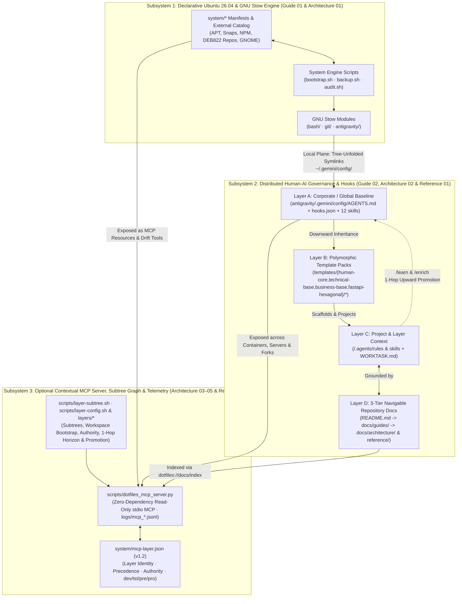

# Documentation Index — `dotfiles-ubuntu`

> **Navigable Knowledge Hub for Humans and AI Agents (3-Tier Progressive Disclosure)**
>
> This `docs/` directory provides a structured, navigable map of `dotfiles-ubuntu` organized across three progressive-disclosure tiers (`< 465` lines per file, target $\le 400$):
> - **Tier 1 (`README.md`)**: Executive gateway, Quick-Start adoption paths, repository structure tree, and CLI cheat-sheet.
> - **Tier 2 (`docs/guides/`)**: Step-by-step human operator & team workflow guides (Ubuntu system operations, GNU Stow, multi-machine sync, multi-tier layer hierarchy, authority gates, and upward PR promotion).
> - **Tier 3 (`docs/architecture/` & `docs/reference/`)**: Normative `1:1:1` technical specifications (`Specification:`) and enterprise reference playbooks.
>
> When an AI agent (Google Antigravity 2.0, Gemini Code Assist, GitHub Copilot, or Google Jules) works on this repository, reading this index first allows it to locate exact subsystem contracts, JSON hook schemas, MCP resources/tools, and script invariants immediately — without brute-force scanning across all shell and Python files.

---

## 1. Document Hierarchy & Navigation Map

```
docs/
├── README.md                                                    ← You are here (Navigable Index & Subsystem Map)
├── guides/                                                      ← Tier 2: Step-by-step human operator & workflow guides (< 465 lines each)
│   ├── 01_ubuntu_system_and_multi_machine_guide.md              ← GNU Stow tree unfolding, system manifests, bootstrap/audit modes & multi-machine sync
│   └── 02_hierarchical_layers_and_team_workflows.md             ← 3-tier profiles, Open Source <-> Root 0 <-> Dept <-> Squad workflows, authority & PR promotion
├── architecture/                                                ← Tier 3A: Normative technical specifications (1:1:1 with code & unit tests, < 465 lines each)
│   ├── 01_system_and_stow_engine.md                             ← Ubuntu 26.04 engine, 3-stage APT filter, Stow tree unfolding
│   ├── 02_antigravity_governance_and_hooks.md                   ← Token budget (<18KB), 4 lifecycle hook 1:1 contracts, 12 skills
│   ├── 03_contextual_mcp_and_federation.md                      ← Zero-dependency MCP server protocol, resources, tools & schema (v1.2)
│   ├── 04_compaction_surface_and_promotion_engines.md           ← rcap1 L0->L3 compaction, 0..N surface weaver, authority & promotion engines
│   └── 05_ephemeral_forks_and_department_bots.md                ← Ephemeral scoped forks, Department Bots, cross-repo bridges & TTL GC
└── reference/                                                   ← Tier 3B: Conceptual guides, enterprise use cases & extension playbooks (< 465 lines each)
    ├── enterprise_pair_programming_governance.md                ← Enterprise "pAIr programming" governance, Google AI docs tools & Copilot mapping
    ├── contextual_mcp_and_multi_service_orchestration.md        ← Standalone Node/Container MCP & Multi-Service Context Mesh setup guide
    └── developer_and_extension_guide.md                         ← Maintainer playbook: adding stow/non-stow dirs, templates, recipes, hooks & MCP
```

| Layer / Category | Document | Scope & Key Contents |
|------------------|----------|----------------------|
| **Human Guide 01 (System & Multi-Machine)** | **[`docs/guides/01_ubuntu_system_and_multi_machine_guide.md`](guides/01_ubuntu_system_and_multi_machine_guide.md)** | GNU Stow modules & `~/.gemini/config/` tree unfolding, path conventions, `system/*` manifests & `system/external/` recipe catalog, daily usage (`backup.sh`, `audit.sh`, `antigravity-install.sh`), all `bootstrap.sh` & `audit.sh` modes, multi-machine provisioning & migration rescue, portability matrix, uninstallation, and local secret isolation. |
| **Human Guide 02 (Layers & Team Workflows)** | **[`docs/guides/02_hierarchical_layers_and_team_workflows.md`](guides/02_hierarchical_layers_and_team_workflows.md)** | 3-Layer Configuration Architecture, 3-Tier profiles (`human-core`, `technical-base`, `business-base`), 12 global skills & slash commands, `antigravity-ide` (360° viewer) vs. `antigravity-agents` (scoped workspaces), full 4-tier workflow (`Open Source <-> Corporate Root 0 <-> Department <-> Squad`), Git email authority gate, 1-hop horizon radar (`inspect-horizon`), and upward PR promotion. |
| **Architecture 01** | **[`docs/architecture/01_system_and_stow_engine.md`](architecture/01_system_and_stow_engine.md)** | Tripartite lifecycle (`backup.sh` $\leftrightarrow$ `audit.sh` $\leftrightarrow$ `bootstrap.sh`), 3-stage APT filtering pipeline, `system/external/{apt-repo,deb-url,script}/` plugin contracts, GNU Stow tree-unfolding invariants, and non-stow root directory exclusions (`system`, `scripts`, `templates`, `docs`, `layers`, `logs`, `tests`, `venv`). |
| **Architecture 02** | **[`docs/architecture/02_antigravity_governance_and_hooks.md`](architecture/02_antigravity_governance_and_hooks.md)** | Three-surface shared `~/.gemini/config/` architecture, Antigravity 2.0 20,000-token `defaultRulesBudget` & 18 KB `AGENTS.md` cap, sequence diagram and `1:1` `Source <-> Unit Test` contracts for all 4 Python 3.14 lifecycle hooks (`PreToolUse`, `PostToolUse`, `PostInvocation`, `Stop`), 12 global skills catalog, and Layer 2 starter templates. |
| **Architecture 03** | **[`docs/architecture/03_contextual_mcp_and_federation.md`](architecture/03_contextual_mcp_and_federation.md)** | **Contextual Layer & System MCP Server (`scripts/dotfiles_mcp_server.py` & `scripts/layer-subtree.sh`)**: Dual-plane model (Stow local vs. MCP distributed), 5 non-negotiable security/zero-dependency invariants, `1:1:1` module/test traceability matrix, JSON-RPC 2.0 contracts for 9 `Resources`, 9 `Tools`, and 3 `Prompts`, `system/mcp-layer.json` (`v1.2`), `layers/*` subtree orchestration, `effective_guardrails` inheritance, and `logs/mcp_*.jsonl` telemetry. |
| **Architecture 04** | **[`docs/architecture/04_compaction_surface_and_promotion_engines.md`](architecture/04_compaction_surface_and_promotion_engines.md)** | **Resonant Compaction (`rcap1`), Surface Projection (`0..N`), Authority & Multi-Layer Promotion Engines**: `1:1:1` module/test traceability matrix for `capsule_engine.py`, `tools_compaction.py`, `tools_unfold.py`, `surface_weaver.py`, `tools_surface.py`, `fork_configurator.py`, `workspace_bootstrapper.py`, `authority_engine.py`, and `promotion_engine.py`, plus `scripts/layer-config.sh` (`init-fork`, `list-templates`, `scaffold-template`, `apply-project`, `diff-project`, `promote-from-project`, `set-global-profile`, `bootstrap-workspace`, `sync-layer`, `set-authority`, `check-authority`, `inspect-horizon`). |
| **Architecture 05** | **[`docs/architecture/05_ephemeral_forks_and_department_bots.md`](architecture/05_ephemeral_forks_and_department_bots.md)** | **Ephemeral Scoped Forks & Department Bots**: `1:1:1` module/test traceability matrix for `ephemeral_fork_engine.py` and `tools_ephemeral.py`, `ephemeral_fork_policy` schema, Tool #9 `orchestrate_ephemeral_fork` (`spawn`, `inspect`, `evaluate`, `reap`), cross-project rule bridging, 4-Channel `subagent_invocation_brief`, and TTL garbage collection. |
| **Reference 01 (Enterprise Use Case)** | **[`docs/reference/enterprise_pair_programming_governance.md`](reference/enterprise_pair_programming_governance.md)** | **Distributed Human-AI Governance ("pAIr programming") at Scale**: 4-tier organizational integration playbook (`Open Source → Corporate → Department & Team → Application`, **with or without MCP**), bidirectional organic knowledge evolution (`/learn` $\rightarrow$ `/enrich`), the 4th Pillar (navigable `docs/` + **Google Jules**, **Gemini Code Assist Enterprise**, **NotebookLM**, **Developer Knowledge MCP**), and 1:1 portability matrix to **VS Code & GitHub Copilot**, **Cursor**, and **Claude Code**. |
| **Reference 02 (Contextual MCP Use Case)** | **[`docs/reference/contextual_mcp_and_multi_service_orchestration.md`](reference/contextual_mcp_and_multi_service_orchestration.md)** | **Contextual MCP Server & Multi-Service Orchestration**: Adopting `dotfiles-ubuntu` as a standalone container/server node MCP or as a federated multi-dimensional Context Mesh (`Corporate → Department/Team → Container/Server` across `dev/tst/pre/pro`), with step-by-step configuration recipes for Antigravity, VS Code Copilot, Cursor, the 3 Docker patterns (`docker run -i --rm`, `COPY --from` + `docker exec -i`, `-v :ro`), `ssh`, and `git subtree` (`layers/*`). |
| **Reference 03 (Maintainer Guide)** | **[`docs/reference/developer_and_extension_guide.md`](reference/developer_and_extension_guide.md)** | Step-by-step extension guide for `dotfiles-ubuntu`: adding new stow vs. non-stow root directories safely, creating new Layer 2 stack templates (`templates/<stack>/`), adding external Ubuntu package recipes, extending the MCP server, and running pre-release verification (`verify-repo.sh`, `audit-global-config.sh`, `audit.sh`). |
| **Root Guides & Policies** | **[`README.md`](../README.md)** · **[`CONTRIBUTING.md`](../CONTRIBUTING.md)** · **[`SECURITY.md`](../SECURITY.md)** · **[`ACCESSIBILITY.md`](../ACCESSIBILITY.md)** · **[`CHANGELOG.md`](../CHANGELOG.md)** | Executive Quick Start, contributor standards, secret/identity isolation policy (`~/.gitconfig.local`, `~/.bashrc.local`), terminal/screen-reader accessibility, and SemVer release history. |

---

## 2. End-to-End Architecture Overview



---

## 3. Quick Lookup for Humans & AI Agents Working on `dotfiles-ubuntu`

| If your task involves... | Read this guide or specification first | Run this verification command after editing |
|--------------------------|----------------------------------------|---------------------------------------------|
| Day-to-day Ubuntu backup/restore, GNU Stow symlinks, or multi-machine setup | [`docs/guides/01_ubuntu_system_and_multi_machine_guide.md`](guides/01_ubuntu_system_and_multi_machine_guide.md) | `./audit.sh && ./scripts/audit-global-config.sh` |
| Setting up Corporate/Department/Squad layers, authority gates, or upward PR promotion | [`docs/guides/02_hierarchical_layers_and_team_workflows.md`](guides/02_hierarchical_layers_and_team_workflows.md) | `./scripts/layer-config.sh inspect-horizon . && ./scripts/verify-repo.sh` |
| Modifying `bootstrap.sh`, `backup.sh`, `audit.sh`, or `system/` internals | [`docs/architecture/01_system_and_stow_engine.md`](architecture/01_system_and_stow_engine.md) | `./scripts/verify-repo.sh && ./audit.sh` |
| Modifying `AGENTS.md`, `hooks.json`, `scripts/*.py`, or `skills/*/SKILL.md` | [`docs/architecture/02_antigravity_governance_and_hooks.md`](architecture/02_antigravity_governance_and_hooks.md) | `stow -t ~ -R antigravity && ./scripts/verify-repo.sh && ./scripts/audit-global-config.sh` |
| Modifying `scripts/dotfiles_mcp_server.py`, `scripts/dotfiles_mcp/*.py`, or `system/mcp-layer.json` | [`docs/architecture/03_contextual_mcp_and_federation.md`](architecture/03_contextual_mcp_and_federation.md) & [`docs/architecture/04_compaction_surface_and_promotion_engines.md`](architecture/04_compaction_surface_and_promotion_engines.md) | `make test-cov && make lint && ./scripts/verify-repo.sh` |
| Configuring `dotfiles-ubuntu` as an MCP server for containers, SSH nodes, or multi-layer forks | [`docs/reference/contextual_mcp_and_multi_service_orchestration.md`](reference/contextual_mcp_and_multi_service_orchestration.md) | `./scripts/dotfiles_mcp_server.py --self-test` |
| Setting up `./venv`, running unit/integration tests (`tests/{unit,imp,e2e}`), or extending `dotfiles-ubuntu` | [`docs/reference/developer_and_extension_guide.md`](reference/developer_and_extension_guide.md) | `make install && make test-cov && make verify` |
| Explaining or adapting the model for enterprise teams or VS Code / Copilot | [`docs/reference/enterprise_pair_programming_governance.md`](reference/enterprise_pair_programming_governance.md) | `./scripts/verify-repo.sh` |
