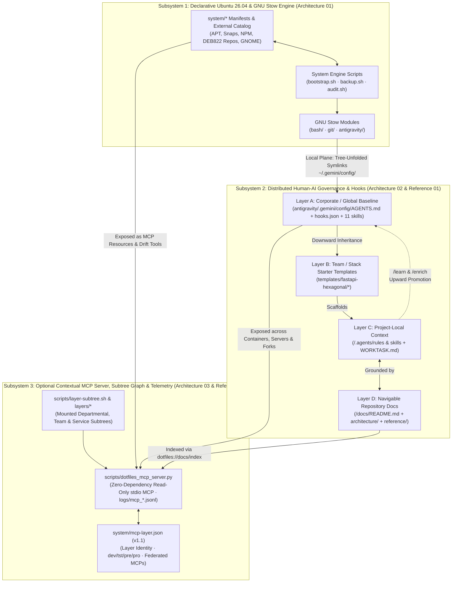

# Documentation Index — `dotfiles-ubuntu`

> **Navigable Knowledge Hub for Humans and AI Agents**
>
> This `docs/` directory provides a structured, navigable map of `dotfiles-ubuntu`'s internal architecture, enterprise Human-AI governance model, contextual MCP server federation, and maintainer extension workflows.
>
> When an AI agent (Google Antigravity 2.0, Gemini Code Assist, GitHub Copilot, or Google Jules) works on this repository, reading this index first allows it to locate exact subsystem contracts, JSON hook schemas, MCP resources/tools, and script invariants immediately — without brute-force scanning across all shell and Python files.

---

## 1. Document Hierarchy & Navigation Map

```
docs/
├── README.md                                                    ← You are here (Navigable Index & Subsystem Map)
├── architecture/                                                ← Normative technical specifications (how it works)
│   ├── 01_system_and_stow_engine.md                             ← Ubuntu 26.04 engine, 3-stage APT filter, Stow tree unfolding
│   ├── 02_antigravity_governance_and_hooks.md                   ← Token budget (<18KB), 4 lifecycle hook JSON contracts, 11 skills
│   └── 03_contextual_mcp_and_federation.md                      ← Zero-dependency MCP server contract (Resources, Tools, Prompts, Schema)
└── reference/                                                   ← Conceptual guides, enterprise use cases & extension playbooks
    ├── enterprise_pair_programming_governance.md                ← Enterprise "pAIr programming" governance, Google AI docs tools & Copilot mapping
    ├── contextual_mcp_and_multi_service_orchestration.md        ← Standalone Node/Container MCP & Multi-Service Context Mesh setup guide
    └── developer_and_extension_guide.md                         ← Maintainer playbook: adding stow/non-stow dirs, templates, recipes, hooks & MCP
```

| Layer / Category | Document | Scope & Key Contents |
|------------------|----------|----------------------|
| **Architecture 01** | **[`docs/architecture/01_system_and_stow_engine.md`](architecture/01_system_and_stow_engine.md)** | Tripartite lifecycle (`backup.sh` $\leftrightarrow$ `audit.sh` $\leftrightarrow$ `bootstrap.sh`), 3-stage APT filtering pipeline, `system/external/{apt-repo,deb-url,script}/` plugin contracts, GNU Stow tree-unfolding invariants, and non-stow root directory exclusions (`system`, `scripts`, `templates`, `docs`, `layers`, `logs`, `tests`, `venv`). |
| **Architecture 02** | **[`docs/architecture/02_antigravity_governance_and_hooks.md`](architecture/02_antigravity_governance_and_hooks.md)** | Three-surface shared `~/.gemini/config/` architecture, Antigravity 2.0 20,000-token `defaultRulesBudget` & 18 KB `AGENTS.md` cap, sequence diagram and `stdin`/`stdout` JSON contracts for all 4 Python 3.14 lifecycle hooks (`PreToolUse`, `PostToolUse`, `PostInvocation`, `Stop`), 11 global skills catalog, and Layer 2 starter templates. |
| **Architecture 03** | **[`docs/architecture/03_contextual_mcp_and_federation.md`](architecture/03_contextual_mcp_and_federation.md)** | **Contextual Layer & System MCP Server (`scripts/dotfiles_mcp_server.py` & `scripts/layer-subtree.sh`)**: Dual-plane model (Stow local vs. MCP distributed), 5 non-negotiable security/zero-dependency invariants, JSON-RPC 2.0 contracts for 9 `Resources`, 6 `Tools`, and 3 `Prompts`, `system/mcp-layer.json` (`v1.1` with `dev/tst/pre/pro`), `layers/*` subtree orchestration, `effective_guardrails` inheritance, and `logs/mcp_*.jsonl` telemetry. |
| **Reference 01 (Enterprise Use Case)** | **[`docs/reference/enterprise_pair_programming_governance.md`](reference/enterprise_pair_programming_governance.md)** | **Distributed Human-AI Governance ("pAIr programming") at Scale**: 4-tier organizational integration playbook (`Open Source → Corporate → Department & Team → Application`, **with or without MCP**), bidirectional organic knowledge evolution (`/learn` $\rightarrow$ `/enrich`), the 4th Pillar (navigable `docs/` + **Google Jules**, **Gemini Code Assist Enterprise**, **NotebookLM**, **Developer Knowledge MCP**), and 1:1 portability matrix to **VS Code & GitHub Copilot**, **Cursor**, and **Claude Code**. |
| **Reference 02 (Contextual MCP Use Case)** | **[`docs/reference/contextual_mcp_and_multi_service_orchestration.md`](reference/contextual_mcp_and_multi_service_orchestration.md)** | **Contextual MCP Server & Multi-Service Orchestration**: Adopting `dotfiles-ubuntu` as a standalone container/server node MCP or as a federated multi-dimensional Context Mesh (`Corporate → Department/Team → Container/Server` across `dev/tst/pre/pro`), with step-by-step configuration recipes for Antigravity, VS Code Copilot, Cursor, `docker exec -i`, `ssh`, and `git subtree` (`layers/*`). |
| **Reference 03 (Maintainer Guide)** | **[`docs/reference/developer_and_extension_guide.md`](reference/developer_and_extension_guide.md)** | Step-by-step extension guide for `dotfiles-ubuntu`: adding new stow vs. non-stow root directories safely, creating new Layer 2 stack templates (`templates/<stack>/`), adding external Ubuntu package recipes, extending the MCP server, and running pre-release verification (`verify-repo.sh`, `audit-global-config.sh`, `audit.sh`). |
| **Root Guides & Policies** | **[`README.md`](../README.md)** · **[`CONTRIBUTING.md`](../CONTRIBUTING.md)** · **[`SECURITY.md`](../SECURITY.md)** · **[`ACCESSIBILITY.md`](../ACCESSIBILITY.md)** · **[`CHANGELOG.md`](../CHANGELOG.md)** | Quick Start (adoption paths), contributor standards, secret/identity isolation policy (`~/.gitconfig.local`, `~/.bashrc.local`), terminal/screen-reader accessibility, and SemVer release history. |

---

## 2. End-to-End Architecture Overview



---

## 3. Quick Lookup for AI Agents Working on `dotfiles-ubuntu`

| If your task involves... | Read this specification first | Run this verification command after editing |
|--------------------------|-------------------------------|---------------------------------------------|
| Modifying `bootstrap.sh`, `backup.sh`, `audit.sh`, or `system/` | [`docs/architecture/01_system_and_stow_engine.md`](architecture/01_system_and_stow_engine.md) | `./scripts/verify-repo.sh && ./audit.sh` |
| Modifying `AGENTS.md`, `hooks.json`, `scripts/*.py`, or `skills/*/SKILL.md` | [`docs/architecture/02_antigravity_governance_and_hooks.md`](architecture/02_antigravity_governance_and_hooks.md) | `stow -t ~ -R antigravity && ./scripts/verify-repo.sh && ./scripts/audit-global-config.sh` |
| Modifying `scripts/dotfiles_mcp_server.py`, `scripts/layer-subtree.sh`, or `system/mcp-layer.json` | [`docs/architecture/03_contextual_mcp_and_federation.md`](architecture/03_contextual_mcp_and_federation.md) | `make test-cov && make lint && ./scripts/verify-repo.sh` |
| Configuring `dotfiles-ubuntu` as an MCP server for containers, SSH nodes, or multi-layer forks | [`docs/reference/contextual_mcp_and_multi_service_orchestration.md`](reference/contextual_mcp_and_multi_service_orchestration.md) | `./scripts/dotfiles_mcp_server.py --self-test` |
| Setting up `./venv`, running unit/integration tests (`tests/{unit,imp}`), or extending `dotfiles-ubuntu` | [`docs/reference/developer_and_extension_guide.md`](reference/developer_and_extension_guide.md) | `make install && make test-cov && make verify` |
| Explaining or adapting the model for enterprise teams or VS Code / Copilot | [`docs/reference/enterprise_pair_programming_governance.md`](reference/enterprise_pair_programming_governance.md) | `./scripts/verify-repo.sh` |
