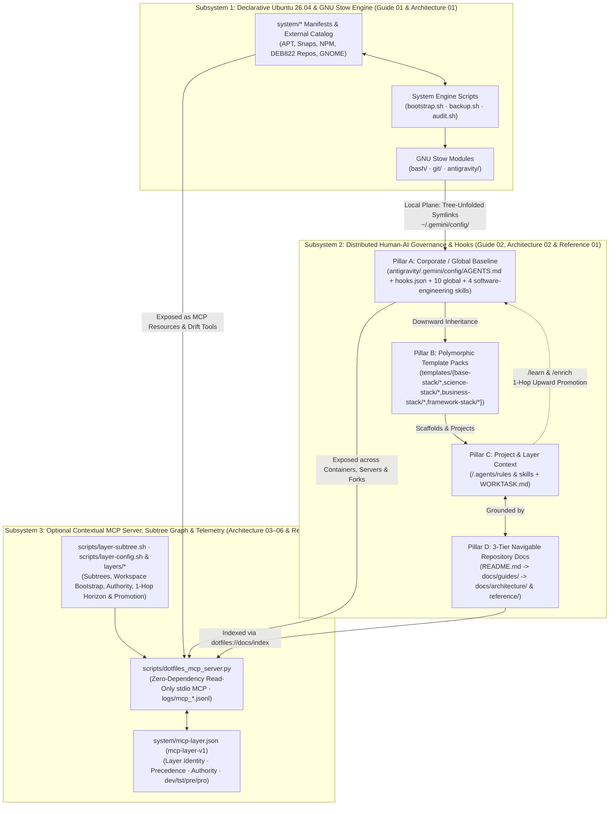

# Documentation Index — `dotfiles-ubuntu`

> **Navigable Knowledge Hub for Humans and AI Agents (3-Tier Progressive Disclosure)**
>
> This `docs/` directory provides a structured, navigable map of `dotfiles-ubuntu` organized across three progressive-disclosure tiers (`< 465` lines per file, target $\le 400$):
> - **Tier 1 (`README.md`)**: Executive gateway, Quick-Start adoption paths, repository structure tree, and CLI cheat-sheet.
> - **Tier 2 (`docs/guides/`)**: Step-by-step human operator & squad workflow guides (Ubuntu system operations, GNU Stow, multi-machine sync, 4-level hierarchy `Root 0 -> Department -> Squad -> Project`, authority gates, and upward PR promotion).
> - **Tier 3 (`docs/architecture/` & `docs/reference/`)**: Normative `1:1:1` technical specifications (`Specification:`) and enterprise reference playbooks.
>
> When an AI agent (Google Antigravity 2.0, Gemini Code Assist, GitHub Copilot, or Google Jules) works on this repository, reading this index first allows it to locate exact subsystem contracts, JSON hook schemas, MCP resources/tools, and script invariants immediately — without brute-force scanning across all shell and Python files.

---

## 1. Document Hierarchy & Navigation Map

The `docs/` tree separates step-by-step operator guides (`guides/`), normative `1:1:1` specifications (`architecture/`), and multi-layer reference playbooks (`reference/`):

```
docs/
├── README.md                                                    ← You are here (Navigable Index & Subsystem Map)
├── guides/                                                      ← Tier 2: Step-by-step human operator & workflow guides (< 465 lines each)
│   ├── 01_ubuntu_system_and_multi_machine_guide.md              ← GNU Stow tree unfolding, system manifests, bootstrap/audit modes & multi-machine sync
│   └── 02_hierarchical_layers_and_team_workflows.md             ← 3-tier profiles, Open Source <-> Root 0 <-> Dept <-> Squad workflows, authority & PR promotion
├── architecture/                                                ← Tier 3A: Normative technical specifications (1:1:1 with code & unit tests, < 465 lines each)
│   ├── 01_system_and_stow_engine.md                             ← Ubuntu 26.04 engine, 3-stage APT filter, Stow tree unfolding
│   ├── 02_antigravity_governance_and_hooks.md                   ← Token budget (<18KB), 4 lifecycle hook 1:1:1 contracts, 23 skills (10 global + 4 software-engineering + 9 stack)
│   ├── 03_contextual_mcp_and_federation.md                      ← Zero-dependency MCP server protocol, resources, tools & schema (mcp-layer-v1)
│   ├── 04_compaction_surface_and_promotion_engines.md           ← rcap1 L0->L3 compaction & 0..N surface weaver (Subpackage 2: capsules/)
│   ├── 05_ephemeral_forks_and_department_bots.md                ← OOP capability rings, symbiotic Department Bots, rcap1 return membrane & TTL GC
│   └── 06_layer_governance_and_promotion_engines.md             ← Fork configurator, bootstrapper, authority, horizon, workflow & git-gov (Subpackage 4: governance/)
└── reference/                                                   ← Tier 3B: Conceptual guides, enterprise use cases & extension playbooks (< 465 lines each)
    ├── enterprise_pair_programming_governance.md                ← Enterprise "pAIr programming" governance, Google AI docs tools & Copilot mapping
    ├── cross_departmental_and_human_stack_matrix.md             ← Cross-Departmental Contextual Algebra (0..80) & Human-Stack Matrix (85..95)
    ├── contextual_mcp_and_multi_service_orchestration.md        ← Standalone Node/Container MCP & Multi-Service Context Mesh setup guide
    └── developer_and_extension_guide.md                         ← Maintainer playbook: adding stow/non-stow dirs, templates, recipes, hooks & MCP
```

| Tier & Architectural Domain | Scope, Normative Contracts & Key Contents | Document |
| :--- | :--- | :--- |
| **Human Guide 01 (Ubuntu System & Multi-Machine Sync)** | **Declarative Ubuntu 26.04 System & GNU Stow Operations (`backup.sh`, `audit.sh`, `bootstrap.sh`)**: GNU Stow modules & `~/.gemini/config/` tree unfolding, path conventions (`~/.config/dotfiles-ubuntu/workstation.conf` $\rightarrow$ `DOTFILES_RUNTIME_DIR`), `system/*` manifests & `system/external/` recipe catalog, daily usage (`backup.sh`, `audit.sh`, `antigravity-install.sh`), all `bootstrap.sh` & `audit.sh` modes, multi-machine provisioning & migration rescue, portability matrix, uninstallation, and local secret isolation. | **[`docs/guides/01_ubuntu_system_and_multi_machine_guide.md`](guides/01_ubuntu_system_and_multi_machine_guide.md)** |
| **Human Guide 02 (Hierarchical Layers, Libraries & Squad Workflows)** | **3 Orthogonal Dimensions (`Stacks × Libraries × Layers Level 1..4`) & Multi-Tier Workflows**: 3 Universal Bases (`base-stack`: `human-base`, `science-base`, `business-base`), Specialization Stacks (`science-stack`, `business-stack`, `framework-stack`), Federated Knowledge Libraries (`gov-*`, `sci-*`, `geo-*`, `org-*`), Dual Viewpoint Model (`Maintainer/Producer` vs. `Consumer M1..M4` + `academic-tutor`), complete 23-skill matrix (`10` global + `4` `software-engineering` + `9` specialization-stack), scoped `antigravity-agents` workspace containment, full 4-level setup blueprints & kickoff prompts (`Root 0 -> Department -> Unit/Squad -> Project`), Git email authority gate, `C1/C2/C3` command tiers, 1-hop horizon radar (`inspect-horizon`), and upward PR promotion. | **[`docs/guides/02_hierarchical_layers_and_team_workflows.md`](guides/02_hierarchical_layers_and_team_workflows.md)** |
| **Architecture 01 (Declarative Ubuntu 26.04 & GNU Stow Engine)** | **Ubuntu 26.04 System Backup, Audit, Restore & Stow Unfolding (`backup.sh`, `audit.sh`, `bootstrap.sh`)**: `1:1:1` traceability matrix (`tests/imp/test_cli_scripts.py`), tripartite lifecycle (`backup.sh` $\leftrightarrow$ `audit.sh` $\leftrightarrow$ `bootstrap.sh`), 3-stage APT filtering pipeline, `system/external/{apt-repo,deb-url,script}/` plugin contracts, GNU Stow tree-unfolding invariants, and non-stow root directory exclusions (`system`, `scripts`, `templates`, `docs`, `layers`, `logs`, `tests`, `venv`). | **[`docs/architecture/01_system_and_stow_engine.md`](architecture/01_system_and_stow_engine.md)** |
| **Architecture 02 (Antigravity 2.0 Governance, Hooks & 23-Skill Matrix)** | **Global Baseline, 4 Deterministic Lifecycle Hooks, 2-Plane Security & Polymorphic Templates (`antigravity/` & `templates/`)**: Shared `~/.gemini/config/` architecture (`antigravity-agents` & `agy`), Antigravity 2.0 20,000-token `defaultRulesBudget` & 18 KB `AGENTS.md` cap, sequence diagram and `1:1:1` `Spec <-> Source <-> Unit Test` contracts for all 4 Python 3.14 lifecycle hooks (`PreToolUse`, `PostToolUse`, `PostInvocation`, `Stop`), complete 23-skill matrix (`10` global + `4` `software-engineering` + `9` specialization-stack), 2-level `templates/{base-stack,science-stack,business-stack,framework-stack}/` hierarchy, and 2-plane security (`OWASP ASVS` + `MCP-Sec` + `NIST-04`). | **[`docs/architecture/02_antigravity_governance_and_hooks.md`](architecture/02_antigravity_governance_and_hooks.md)** |
| **Architecture 03 (Contextual MCP Kernel, Federation & Subtree Mesh)** | **Contextual Layer & System MCP Server (`scripts/dotfiles_mcp_server.py`, `scripts/dotfiles_mcp/{core,mcp_node}/`, & `scripts/layer-subtree.sh`)**: Dual-plane model (Stow local vs. MCP distributed), 5 non-negotiable security/zero-dependency invariants across **4 bounded-domain subpackages (`24` modules: `core/`, `capsules/`, `mcp_node/`, `governance/`)**, `1:1:1` module/test traceability matrix (`manifest_helpers.py`, `layer_topology_helpers.py`, `node_base.py`, `resources.py`, `capability_registry.py`, `tools_federation.py`, `server.py`), JSON-RPC 2.0 contracts for 9 `Resources` (`dotfiles://mcp/topology`), 9 `Tools` (`get_layer_overview` Channel 4 `deep_context_index`, `audit_node_drift` `citation_lifecycle_radar`), and 3 `Prompts`, `system/mcp-layer.json` (`mcp-layer-v1`), 3-tier library endpoint resolution (`local-mcp-clone -> private-mirror-remote -> public-canonical-remote`), `DMCP`/`GRCC`, and `logs/mcp_*.jsonl` telemetry. | **[`docs/architecture/03_contextual_mcp_and_federation.md`](architecture/03_contextual_mcp_and_federation.md)** |
| **Architecture 04 (`rcap1` Compaction, Citations & Surface Weaver)** | **Resonant Chained Compaction (`rcap1`), Citation Receipts & Surface Governance Projection (`0..N` Layers) (`scripts/dotfiles_mcp/capsules/`)**: `1:1:1` module/test traceability matrix for Subpackage 2 (`capsule_engine.py`, `tools_compaction.py`, `tools_unfold.py`, `surface_weaver.py`, `tools_surface.py`), `L0 -> L1 -> L2 -> L3` resonant unfolding, `E3..E0` epistemic credibility scale, adaptive `consumer_viewpoint` (`academic-tutor-m1-m2` vs. `professional-scientific-m3-m4`), canonical `citation_receipt` (`CITATION_DRIFT_DETECTED`), 4-quadrant `Q1..Q4` citation telemetry radar, TOCTOU line-drift auto-relocation, and `0..N` *Lex Superior* (`0..100`) binding weaver. | **[`docs/architecture/04_compaction_surface_and_promotion_engines.md`](architecture/04_compaction_surface_and_promotion_engines.md)** |
| **Architecture 05 (Ephemeral Scoped Forks, Capability Rings & Bots)** | **Ephemeral Scoped Forks, OOP Capability Rings & Symbiotic Bots (`scripts/dotfiles_mcp/mcp_node/`)**: `1:1:1` module/test traceability matrix for `capability_registry.py` (`TestCapabilityRegistry`), `ephemeral_fork_engine.py` (`TestEphemeralForkEngine`), and `tools_ephemeral.py` (`TestEphemeralToolsMixin`), 5 OOP CRUD permission rings (`MCP_PERMISSION_RINGS`), 4-family hierarchical bot catalog (`BOT_ARCHETYPE_CATALOG`), bidirectional Permanent $\leftrightarrow$ Ephemeral symbiosis (`resolve_mcp_capability_profile`), `rcap1` return digest membrane (`seal_ephemeral_digest_capsule` & `unseal_ephemeral_digest_capsule` via `action="catalog" \| "seal-return" \| "verify-return"`), `ephemeral_fork_policy` schema, bounded `operating_state × mcp_operating_mode` matrix, dual `ephemeral_scope` (`inter-layer` vs. `intra-layer`), cross-project rule bridging, 4-Channel `subagent_invocation_brief`, and TTL garbage collection. | **[`docs/architecture/05_ephemeral_forks_and_department_bots.md`](architecture/05_ephemeral_forks_and_department_bots.md)** |
| **Architecture 06 (Inter-Layer Governance, Authority & Promotion Engines)** | **Inter-Layer Governance, 1-Hop Horizon, RBAC Authority & Promotion Engines (`scripts/dotfiles_mcp/governance/` & `scripts/layer-config.sh`)**: `1:1:1` module/test traceability matrix for Subpackage 4 (`fork_configurator.py`, `workspace_bootstrapper.py`, `promotion_engine.py`, `horizon_engine.py`, `authority_engine.py`, `workflow_engine.py`, `git_governance_engine.py`, `cli_dispatcher.py`), recursive `"extends"` template resolution, 6 UNESCO/Frascati science trunks (`CANONICAL_SCIENCE_TRUNKS`), 4-mode section-level template reconciliation (`NEW_UPSTREAM`, `IN_SYNC`, `DIVERGED`, `LOCAL_ONLY`), 5-role contextual & hierarchical authority (`owner`, `maintainer`, `validator`, `member`, `consumer`), 4-state $N$-departmental consensus (`RECONCILED_FLOW` $\rightarrow$ `ESCALATE_TO_ROOT`), `dev -> tst -> pre -> pro` stage gates, 4-gate `publish-oss` release protection, and all 26 CLI subcommands of `scripts/layer-config.sh`. | **[`docs/architecture/06_layer_governance_and_promotion_engines.md`](architecture/06_layer_governance_and_promotion_engines.md)** |
| **Reference 01A (Enterprise Human-AI "pAIr" Governance)** | **Distributed Human-AI Governance ("pAIr programming") at Scale**: 4-level organizational integration playbook (`Upstream OSS → Level 1 Root 0 → Level 2 Department → Level 3 Unit/Squad → Level 4 Project`, **with or without MCP**), bidirectional organic knowledge evolution (`/learn` $\rightarrow$ `/enrich`), the 4th Pillar (navigable `docs/` + **Google Jules**, **Gemini Code Assist Enterprise**, **NotebookLM**, **Developer Knowledge MCP**), and 1:1 portability matrix to **VS Code & GitHub Copilot**, **Cursor**, and **Claude Code**. | **[`docs/reference/enterprise_pair_programming_governance.md`](reference/enterprise_pair_programming_governance.md)** |
| **Reference 01B (Cross-Departmental `0..80` & `Human-Stack` `85..95` Matrix)** | **Cross-Departmental Composition (`0..80`) & `Human-Stack` Matrix (`85..95`)**: 3-Axis Contextual Algebra across Legal, Marketing, Finance, Ops, and Engineering, the 6 Enterprise Archetypes + 3 walkthroughs (*LegalTech MCP*, *Marketing + Social Media Hub*, *Transversal `VoIP` Platform*), the 4 composable `Human-Stack` facets (`domain-<area>:M1..M4`, `bridge-*`, `soft-*`, `hat-*`), Dual Viewpoint Model (`Maintainer` vs. `Consumer M1..M4` across Academic `org-uni-*` $\rightarrow$ Professional `org-*` $\rightarrow$ Scientific `sci-*`), and the 5 `$HOME` vs. `Workspace` personas. | **[`docs/reference/cross_departmental_and_human_stack_matrix.md`](reference/cross_departmental_and_human_stack_matrix.md)** |
| **Reference 02 (Standalone & Federated Contextual MCP Orchestration)** | **Contextual MCP Server & Multi-Service Orchestration**: Adopting `dotfiles-ubuntu` as a standalone container/server node MCP or as a federated multi-dimensional Context Mesh (`Corporate → Department/Squad → Container/Server` across `dev/tst/pre/pro`), with step-by-step configuration recipes for Antigravity, VS Code Copilot, Cursor, the 3 Docker patterns (`docker run -i --rm`, `COPY --from` + `docker exec -i`, `-v :ro`), `ssh`, and `git subtree` (`layers/*`). | **[`docs/reference/contextual_mcp_and_multi_service_orchestration.md`](reference/contextual_mcp_and_multi_service_orchestration.md)** |
| **Reference 03 (Developer, Maintainer & Template Extension Playbook)** | **Maintainer & Extension Engineering Guide for `dotfiles-ubuntu`**: Step-by-step extension workflows for adding new stow vs. non-stow root directories safely, creating new 2-level stack templates (`templates/<stack>-stack/<pack>/`), adding external Ubuntu package recipes, extending the 4-subpackage MCP server, and running pre-release verification (`verify-repo.sh`, `audit-global-config.sh`, `audit.sh`). | **[`docs/reference/developer_and_extension_guide.md`](reference/developer_and_extension_guide.md)** |
| **Root Guides & Policies (Quick Start, Security, Accessibility & SemVer)** | **Repository Gateway, Normative Security & Release History**: Executive Quick Start, contributor standards, secret/identity isolation policy (`~/.gitconfig.local`, `~/.bashrc.local`), terminal/screen-reader accessibility (`2D Progressive Disclosure`), and SemVer release history. | **[`README.md`](../README.md)** · **[`CONTRIBUTING.md`](../CONTRIBUTING.md)** · **[`SECURITY.md`](../SECURITY.md)** · **[`ACCESSIBILITY.md`](../ACCESSIBILITY.md)** · **[`CHANGELOG.md`](../CHANGELOG.md)** |

---

## 2. End-to-End Architecture Overview

The three subsystems (Ubuntu/Stow Engine, Antigravity Governance/Hooks, and Contextual MCP/Subtree Mesh) connect local workstation symlinks with distributed multi-layer governance:



### 2.1. Unified Fractal Mental Model & Deterministic Execution Map

Every feature in `dotfiles-ubuntu` is a concrete application of **one recursive rule** (*a governed node holds a manifest, Markdown rules/skills, and task ledgers across `Root 0 -> Department (1..N) -> Project`, combining **3 Universal Bases (`base-stack`)** $\times$ **3 Specialization Stacks***) implemented through **4 independent, zero-dependency capabilities**:

| Independent Capability | Physical Execution on Disk (Zero External Infrastructure) | Canonical Entry Points |
| :--- | :--- | :--- |
| **1. Ubuntu 26.04 & GNU Stow Engine** | Reads/writes plain-text package and GNOME manifests in `system/*` and unfolds dotfile symlinks into `$HOME`. | [`backup.sh`](../backup.sh), [`audit.sh`](../audit.sh), [`bootstrap.sh`](../bootstrap.sh) |
| **2. Local Antigravity Governance** | Projects `AGENTS.md` and `23` skills into `~/.gemini/config/` or `<repo>/.agents/`; `4` Python hooks intercept tool calls (`pre_tool_guard.py`, `post_invocation_lint.py`). | [`AGENTS.md`](../antigravity/.gemini/config/AGENTS.md), [`hooks.json`](../antigravity/.gemini/config/hooks.json) |
| **3. Layer & Task-Branch Orchestrator** | Scaffolds `mcp-layer.json` + `Makefile` (`bootstrap-workspace`), projects templates with `SHA-256` reconciliation (`apply-project`, `make sync`), and tracks `[ ] -> [/] -> [x]` tasks across `layers/<child>/` (`make delegate`, `make task`, `make complete`). | [`scripts/layer-config.sh`](../scripts/layer-config.sh), [`scripts/layer-subtree.sh`](../scripts/layer-subtree.sh) |
| **4. Contextual MCP & `rcap1` Capsules** | Stdlib Python 3.14 JSON-RPC `stdio` server that indexes layer `.md` files into `L1/L2/L3` excerpts, seals `zlib + HMAC-SHA256` (`rcap1`) capsules (`make consult`), and enforces `R0..W` capability rings on `.agents/ephemeral/` leases. | [`scripts/dotfiles_mcp_server.py`](../scripts/dotfiles_mcp_server.py) |

| Stack Family & Conceptual Role | Target Domain & Governance Structure | Included Skills | Canonical Template Path (`templates/`) |
| :--- | :--- | :--- | :--- |
| **Universal Base 1 — Human Baseline (`base-stack`)** | Universal 13-mandate cognitive, organizational, and `dotfiles-ubuntu` orchestration baseline (`AGENTS.md` + `10` universal global skills). | `sopen`, `sclose`, `continue`, `release`, `enrich`, `priority`, `review`, `full-audit`, `architecture-review`, `governance` | **[`base-stack/human-base`](../templates/base-stack/human-base/template.json)** |
| **Universal Base 2 — Scientific & Epistemic Rigor (`base-stack`)** | Universal scientific method, `1:1:1` traceability (`Spec <-> Test <-> Corpus`), `E3..E0` credibility scale, `citation_receipt` verification, and SI/ISO `N ± 1` precision. | *(Inherited global skills)* | **[`base-stack/science-base`](../templates/base-stack/science-base/template.json)** |
| **Universal Base 3 — Enterprise & Statutory SSoT (`base-stack`)** | Universal corporate, public-administration, SSoT ledger (`corporate/ledgers/`), Business `AAA`, and *Lex Superior* (`0..100`) governance baseline. | *(Inherited global skills)* | **[`base-stack/business-base`](../templates/base-stack/business-base/template.json)** |
| **Science Stack — Software Engineering (`science-stack`)** | Computer Science & Software Engineering branch (`extends: science-base`) — strict typing, `1:1:1` test symbiosis, 6-stage refactoring, OWASP ASVS + MCP capability security, and C-backed stdlib rigor. | `testing`, `refactoring`, `validation`, `oss-contribute` | **[`science-stack/software-engineering`](../templates/science-stack/software-engineering/README.md)** |
| **Science Stack — Scientific & Academic Corpus (`science-stack`)** | Scientific research (`sci-*`), academic curricula (`org-uni-*` / `docs/guides/`), regulatory/statutory bodies (`gov-*`), & territorial registries (`geo-*`; `extends: science-base`; `< 465`-line `docs/` queried via `make consult` with `M1..M4` consumer personalization). | `academic-tutor` | **[`science-stack/scientific-knowledge-branch`](../templates/science-stack/scientific-knowledge-branch/README.md)** |
| **Business Stack — Corporate Operations & Ledgers (`business-stack`)** | Enterprise operations, SOPs & compliance (`extends: business-base`; `corporate/ledgers/` $\rightarrow$ `corporate/{policies,sops}/` Business `AAA` $\rightarrow$ `surfaces/{web,forms,print}/`). | `ledger-surface-audit` | **[`business-stack/corporate-ops-ledger`](../templates/business-stack/corporate-ops-ledger/README.md)** |
| **Framework Stack — FastAPI Hexagonal DDD (`framework-stack`)** | Python FastAPI + Hexagonal DDD (`extends: software-engineering`; `domain/` zero-I/O `Protocol` ports $\rightarrow$ `application/` $\rightarrow$ `infrastructure/` + `1:1:1` tests). | `start`, `fastapi-testing`, `database`, `frontend` | **[`framework-stack/fastapi-hexagonal`](../templates/framework-stack/fastapi-hexagonal/README.md)** |
| **Framework Stack — Angular 19+ Web (`framework-stack`)** | Standalone Angular 19+ Signals, OnPush & reactive forms (`extends: software-engineering`). | `angular-testing` | **[`framework-stack/angular-web`](../templates/framework-stack/angular-web/README.md)** |
| **Framework Stack — Django 5.2+ Backend (`framework-stack`)** | Modular Django 5.2+ service-layer & query optimization (`extends: software-engineering`). | `django-testing` | **[`framework-stack/django-backend`](../templates/framework-stack/django-backend/README.md)** |
| **Framework Stack — NIST CSF 2.0 & ISO 27001 (`framework-stack`)** | NIST CSF 2.0 (`GV/ID/PR/DE/RS/RC`), ISO/IEC 27001 controls, and `NIST-04` AppSec/MCP-Sec surface bindings (`extends: business-base`). | `nist-csf-audit` | **[`framework-stack/nist-csf-security`](../templates/framework-stack/nist-csf-security/README.md)** |

---

## 3. Quick Lookup for Humans & AI Agents Working on `dotfiles-ubuntu`

Use this decision table to identify the exact verification command and primary specification for any task in `dotfiles-ubuntu`:

| If your task involves... | Run this verification command after editing | Read this guide or specification first |
|--------------------------|---------------------------------------------|----------------------------------------|
| Day-to-day Ubuntu backup/restore, GNU Stow symlinks, or multi-machine setup | `./audit.sh && ./scripts/audit-global-config.sh` | [`docs/guides/01_ubuntu_system_and_multi_machine_guide.md`](guides/01_ubuntu_system_and_multi_machine_guide.md) |
| Setting up Corporate/Department/Squad layers, authority gates, or upward PR promotion | `./scripts/layer-config.sh inspect-horizon . && ./scripts/verify-repo.sh` | [`docs/guides/02_hierarchical_layers_and_team_workflows.md`](guides/02_hierarchical_layers_and_team_workflows.md) |
| Modifying `bootstrap.sh`, `backup.sh`, `audit.sh`, or `system/` internals | `./scripts/verify-repo.sh && ./audit.sh` | [`docs/architecture/01_system_and_stow_engine.md`](architecture/01_system_and_stow_engine.md) |
| Modifying `AGENTS.md`, `hooks.json`, `scripts/*.py`, or `skills/*/SKILL.md` | `stow -t ~ -R antigravity && ./scripts/verify-repo.sh && ./scripts/audit-global-config.sh` | [`docs/architecture/02_antigravity_governance_and_hooks.md`](architecture/02_antigravity_governance_and_hooks.md) |
| Modifying `scripts/dotfiles_mcp_server.py`, `scripts/dotfiles_mcp/*/*.py`, or `system/mcp-layer.json` | `make test-cov && make lint && ./scripts/verify-repo.sh` | [`docs/architecture/03_contextual_mcp_and_federation.md`](architecture/03_contextual_mcp_and_federation.md), [`docs/architecture/04_compaction_surface_and_promotion_engines.md`](architecture/04_compaction_surface_and_promotion_engines.md), [`docs/architecture/05_ephemeral_forks_and_department_bots.md`](architecture/05_ephemeral_forks_and_department_bots.md), & [`docs/architecture/06_layer_governance_and_promotion_engines.md`](architecture/06_layer_governance_and_promotion_engines.md) |
| Configuring `dotfiles-ubuntu` as an MCP server for containers, SSH nodes, or multi-layer forks | `./scripts/dotfiles_mcp_server.py --self-test` | [`docs/reference/contextual_mcp_and_multi_service_orchestration.md`](reference/contextual_mcp_and_multi_service_orchestration.md) |
| Setting up `./venv`, running unit/implementation tests (`tests/{unit,imp,e2e}`), or extending `dotfiles-ubuntu` | `make install && make test-cov && make verify` | [`docs/reference/developer_and_extension_guide.md`](reference/developer_and_extension_guide.md) |
| Explaining or adapting the model for enterprise teams, Cross-Departmental composition, `Human-Stack`, or VS Code / Copilot | `./scripts/verify-repo.sh` | [`docs/reference/enterprise_pair_programming_governance.md`](reference/enterprise_pair_programming_governance.md) & [`docs/reference/cross_departmental_and_human_stack_matrix.md`](reference/cross_departmental_and_human_stack_matrix.md) |
