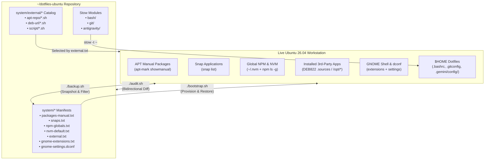

# Architecture 01: Declarative System & GNU Stow Engine

> **Normative Specification — Subsystem 1 (`bootstrap.sh`, `backup.sh`, `audit.sh`, `system/`, `bash/`, `git/`, `antigravity/`)**
>
> This document defines the internal architecture, data flows, filtering algorithms, and safety invariants of the Ubuntu 26.04 LTS ("Resolute Raccoon") declarative system engine and GNU Stow symlink manager.

---

## 1. Architectural Principles

1. **Idempotent Fork-First Portability**:
   - Any user can fork the repository, run `./backup.sh` to overwrite `system/*` manifests with their own workstation state, and push to their fork without inheriting the original author's personal applications.
2. **Bidirectional Drift Detection (`audit.sh`)**:
   - System state (`dpkg`, `apt-mark`, `snap`, `npm`, `dconf`, `readlink`) and repository manifests (`system/*`, stow modules) are compared in both directions: *installed but untracked* vs. *tracked but missing*.
3. **Zero-Secret & Zero-Identity Leakage**:
   - Personal Git identity (`user.name`, `user.email`) and shell secrets (`export *_API_KEY=...`) are structurally isolated in untracked local include files (`~/.gitconfig.local`, `~/.bashrc.local`).
4. **GNU Stow Tree Unfolding (`~/.gemini/config/`)**:
   - Directories that mix tracked global assets with machine-local state (`~/.gemini/config/`, `~/.gemini/config/skills/`, `~/.local/share/applications/`) are pre-created as real directories before invoking `stow -t "$HOME"`, forcing GNU Stow to create granular file/subfolder symlinks instead of folding the parent directory.

### 1.1. `1:1:1` Source $\leftrightarrow$ Implementation Test $\leftrightarrow$ Specification Traceability Matrix

Every shell orchestrator and system manifest in Subsystem 1 is verified by a `1:1` implementation test suite (`Specification: docs/architecture/01_system_and_stow_engine.md`):

| Subsystem & Functional Responsibility | Source Script / Engine | `1:1` Implementation Test Suite (`Specification: docs/architecture/01_system_and_stow_engine.md`) |
|---|---|---|
| **Declarative System Lifecycle, Stow & Workstation Sync**: Verifies `--help`/`--version` flags (including `antigravity-install.sh [--agents \| --cli \| --ide \| --all]`), unknown-option rejection, `bash -n` syntax across all 19 shell scripts, `workstation-sync.sh` (`--setup`, `--auto`, `--status`, `dev-*` pushurl guard healing & unified 3-step `origin -> upstream -> clean committed dev` sync cascade), `STOW_BASE_DIR` runtime resolution in `audit.sh`, and `Dockerfile` / `Makefile` contracts. | [`bootstrap.sh`](../../bootstrap.sh), [`backup.sh`](../../backup.sh), [`audit.sh`](../../audit.sh), [`scripts/workstation-sync.sh`](../../scripts/workstation-sync.sh), [`scripts/audit-global-config.sh`](../../scripts/audit-global-config.sh), [`scripts/antigravity-install.sh`](../../scripts/antigravity-install.sh) | [`tests/imp/test_cli_scripts.py`](../../tests/imp/test_cli_scripts.py) (`TestCLIScripts`) |
| **8-Stage Repository Verification & Parity Gates**: Enforces 8-stage repository verification, `0-byte` `__init__.py` markers, `< 465`-line modularity cap, `1:1:1` spec pointers, English language purity, and AST anti-deception gates. | [`scripts/verify-repo.sh`](../../scripts/verify-repo.sh), `system/*` manifests | [`tests/imp/test_repo_parity_gates.py`](../../tests/imp/test_repo_parity_gates.py) (`TestRepoParityGates`) |

---

## 2. Tripartite Lifecycle (`backup.sh` $\leftrightarrow$ `audit.sh` $\leftrightarrow$ `bootstrap.sh`)

The declarative workstation engine operates as a closed three-script loop between the live Ubuntu 26.04 machine and the `~/dotfiles-ubuntu` repository:
- **`./backup.sh` (Snapshot & Filter)**: Captures manual APT packages, Snap applications, NPM globals, external recipes, and GNOME `dconf` state into `system/*`.
- **`./audit.sh` (Bidirectional Diff)**: Compares live machine state against `system/*` manifests and GNU Stow symlinks in `$HOME` without mutating the system.
- **`./bootstrap.sh` (Provision & Restore)**: Installs missing packages/snaps/external recipes, applies GNOME settings, and links GNU Stow modules into `$HOME`.



---

## 3. Subsystem Specifications

Subsystem 1 filters Ubuntu APT packages, Snap runtimes, and third-party recipes through three deterministic pipelines:

### 3.1. APT 3-Stage Filtering Pipeline (`backup.sh` & `audit.sh`)

When `./backup.sh` generates `system/packages-manual.txt` (and when `./audit.sh` computes APT drift), raw output from `apt-mark showmanual` passes through a deterministic **3-stage exclusion pipeline**:

| Stage | Filter | Purpose |
|:-----:|--------|---------|
| **Stage 1** | **Official Ubuntu APT Origin Check** (`/var/lib/apt/lists/*ubuntu.com*Packages`) | Excludes kernel HWE meta-packages (`linux-generic-hwe-*`) and locally installed/obsolete `.deb` packages that do not exist in official Ubuntu 26.04 APT repositories. |
| **Stage 2** | **External Recipe Catalog Exclusion** (`system/external/{apt-repo,deb-url,script}/*.sh`) | Dynamically parses `CHECK=`, `PACKAGES=`, and `*-release` helper packages from every recipe in `system/external/` and removes them via `comm -23` so third-party packages are tracked exclusively via `system/external.txt`. |
| **Stage 3** | **Hardware / Machine-Local Ignore** (`.audit-ignore`) | Removes hardware-specific packages listed in the gitignored `.audit-ignore` file (e.g., `nvidia-driver-*`). |

### 3.2. Snap Runtime Filtering (`backup.sh` & `audit.sh`)

Snap packages (`snap list`) are filtered via `awk` to exclude system/runtime snaps that are auto-managed by `snapd`:
- Excluded types (`$6`): `base`, `snapd`
- Excluded runtime prefixes (`$1`): `gnome-[0-9]*`, `gtk-common-themes`, `mesa-[0-9]*`
- Only user-facing application snaps are written to `system/snaps.txt`.

### 3.3. External Package Recipe Plugin Contract (`system/external/`)

Third-party software is decoupled into two parts:
1. **The Recipe Catalog (`system/external/<category>/<name>.sh`)**: Declarative shell scripts defining *how* to check and install a package.
2. **The Active Selection Manifest (`system/external.txt`)**: Plain-text list of relative recipe paths (e.g., `apt-repo/docker.sh`, `script/antigravity-ide.sh`) enabled on the current machine.

Each recipe category implements a strict variable/function contract:

| Category | Directory | Required Contract | Execution Order in `bootstrap.sh --external` |
|----------|-----------|-------------------|----------------------------------------------|
| **APT Repository** | `system/external/apt-repo/*.sh` | `NAME`, `DESCRIPTION`, `CHECK` (package name for `dpkg -s`), `PACKAGES` (space-separated install list), and `setup_repo()` (writes GPG key to `/etc/apt/keyrings/` and DEB822 `.sources` file to `/etc/apt/sources.list.d/`) | **8a**: Runs `setup_repo()` for all missing repos first $\rightarrow$ executes a **single** `sudo apt update -qq` $\rightarrow$ installs all `PACKAGES`. |
| **Direct `.deb` URL** | `system/external/deb-url/*.sh` | `NAME`, `DESCRIPTION`, `CHECK` (`dpkg -s`), and `URL` (direct `.deb` or `.zip` containing a `.deb`) | **8b**: Downloads to `mktemp -d`, extracts if `.zip`, installs via `sudo dpkg -i` + `sudo apt install -f -y`, and cleans up temp dir. |
| **Custom Script** | `system/external/script/*.sh` | `NAME`, `DESCRIPTION`, `CHECK_CMD` (shell expression returning `0` when installed), and `INSTALL_CMD` | **8c**: Evaluates `CHECK_CMD`; if non-zero, runs `INSTALL_CMD`. |

---

## 4. GNU Stow Modules & Non-Stow Directory Invariant

GNU Stow links tracked dotfile modules (`bash/`, `git/`, `antigravity/`) into `$HOME` while isolating non-stow repository directories and preserving local machine identity:

### 4.1. Stow vs. Non-Stow Root Directories

Both `bootstrap.sh` (Step 3) and `audit.sh` (Section 1) iterate over top-level directories (`for module in */; do`). Directories that are **not** GNU Stow modules **MUST** be explicitly skipped in both scripts:

```bash
# Non-stow root directories (MUST be skipped in bootstrap.sh and audit.sh):
[ "$module" = "system" ] && continue
[ "$module" = "scripts" ] && continue
[ "$module" = "templates" ] && continue
[ "$module" = "docs" ] && continue
[ "$module" = "layers" ] && continue
[ "$module" = "logs" ] && continue
[ "$module" = "tests" ] && continue
[ "$module" = "venv" ] && continue
[ "$module" = ".venv" ] && continue
[ "$module" = "htmlcov" ] && continue
```

| Root Directory | Classification | Target in `$HOME` | Notes |
|----------------|:--------------:|-------------------|-------|
| `bash/` | **Stow Module** | `~/.bashrc`, `~/.profile` | Sources untracked `~/.bashrc.local` at end of file |
| `git/` | **Stow Module** | `~/.gitconfig` | Includes untracked `~/.gitconfig.local` via `[include]` |
| `antigravity/` | **Stow Module** | `~/.gemini/config/*`, `~/.local/share/applications/*` | Uses `prepare_antigravity_dirs()` to enforce tree unfolding |
| `system/` | Non-Stow | — | Declarative package & GNOME manifests + `external/` catalog |
| `scripts/` | Non-Stow | — | `antigravity-install.sh`, `audit-global-config.sh`, `workstation-sync.sh`, `dotfiles_mcp_server.py`, `layer-config.sh`, `layer-subtree.sh`, `verify-repo.sh` |
| `templates/` | Non-Stow | — | 2-level polymorphic template packs (`base-stack/*`, `science-stack/*`, `business-stack/*`, `framework-stack/*`) |
| `docs/` | Non-Stow | — | Navigable architecture & reference documentation |
| `layers/` | Non-Stow (Optional) | — | Mounted `git subtree` context forks (`layers/<name>/` managed via `scripts/layer-subtree.sh` & queried via MCP) |
| `logs/` | Non-Stow (Ignored) | — | Structured JSONL audit & alert logs generated in MCP mode (`logs/mcp_events.jsonl`, `logs/mcp_alerts.jsonl`) |
| `tests/` | Non-Stow | — | Automated unit (`tests/unit/`), implementation (`tests/imp/`), & end-to-end (`tests/e2e/`) test suite (100% branch coverage) |
| `venv/` | Non-Stow (Ignored) | — | Optional local Python virtual environment created via `make install` (`requirements-dev.txt` $\rightarrow$ `-r requirements.txt`) |

### 4.2. Collision Safety & Identity Migration (`bootstrap.sh`)

Before invoking `stow -t "$HOME" "$module"`, `bootstrap.sh` enforces three safety steps:
1. **Git Identity Preservation**: If `~/.gitconfig` is a real file containing `user.name` or `user.email` and `~/.gitconfig.local` does not exist yet, `bootstrap.sh` extracts those values into `~/.gitconfig.local` before backing up `~/.gitconfig`.
2. **Tree-Unfolding Directory Preparation (`prepare_antigravity_dirs`)**: Creates `~/.gemini/config/skills` and `~/.local/share/applications` as real directories, and backs up any real (non-symlink) `scripts/` or colliding `skills/<name>/` directories to `*.backup.YYYYMMDD`.
3. **File Collision Backup**: Any real file at `$HOME/$relpath` is moved to `$HOME/${relpath}.backup.YYYYMMDD` before `stow` runs, ensuring `stow` never fails with a conflict error and zero user data is lost.

### 4.3. Contributor `dev-*` Workspace Stow Resolution, Sovereign `$HOME` Workstation Forks, Unified 3-Step `workstation-sync` Cascade & Open-Source Publication (`audit.sh`, `bootstrap.sh`, `layer-subtree.sh` & `workstation-sync.sh`)

- When `audit.sh` (`make audit`) or `scripts/workstation-sync.sh` runs inside a dedicated contributor clone (`$DOTFILES_DEV_REPO_DIR` / `~/Projects/dev-<repo>`) or when the `$HOME` runtime clone is named `~/<user-pc>` instead of `~/dotfiles-ubuntu`, `STOW_BASE_DIR` / `RUNTIME_DIR` automatically resolves via `DOTFILES_RUNTIME_DIR` or `readlink -f "$HOME/.bashrc"` (and `bootstrap.sh` / `workstation-sync.sh` maintain a `~/dotfiles-ubuntu -> ~/<user-pc>` symlink when `basename != "dotfiles-ubuntu"`).
- Running `dotfiles-sync` (`make workstation-sync` / `./scripts/workstation-sync.sh --sync`) executes a single automatic **3-step cascade**: **(1) `origin` sync** (pulls the user's personal workstation fork in `private`/`mutable` mode or resets to `origin` in `readonly` mode), **(2) `upstream` Open-Source release sync** (when `upstream` is configured, runs `layer-subtree.sh sync-upstream` to merge the latest Open-Source release while preserving the fork's `system/mcp-layer.json`), and **(3) clean committed `dev` engine overlay** (when `~/Projects/dev-<repo>` exists locally and its Git working tree is 100% committed and clean, copies tracker-free engine files into `RUNTIME_DIR`; if `dev` has uncommitted changes, skips Step 3 with a warning).
- Finally, `publish-oss` (`make publish-oss`) exports tracker-free Open-Source releases (`excluding WORKTASK.md, WORKROAD.md, ROADMAP.md, BACKLOG.md, WORKVALI.md, roadmaps/, .agents/, corporate/, layers/`) to `upstream`.

### 4.4. Automated Antigravity 2.0 (`antigravity-agents`), `agy` CLI & Optional IDE Installer (`scripts/antigravity-install.sh`)

- Supports `--agents` (recommended: queries the official release feed `resolve_latest_agents_url`, downloads the latest `linux-x64/Antigravity.tar.gz` into `~/Downloads/` with manual `https://antigravity.google/download` fallback, installs `/opt/antigravity-agents`, and refreshes `~/.local/bin/agy`), `--cli` (standalone `install_or_update_cli` backing up/replacing `~/.local/bin/agy` via `https://antigravity.google/cli/install.sh`), `--ide` (optional `/opt/antigravity-ide`), and `--all`.
