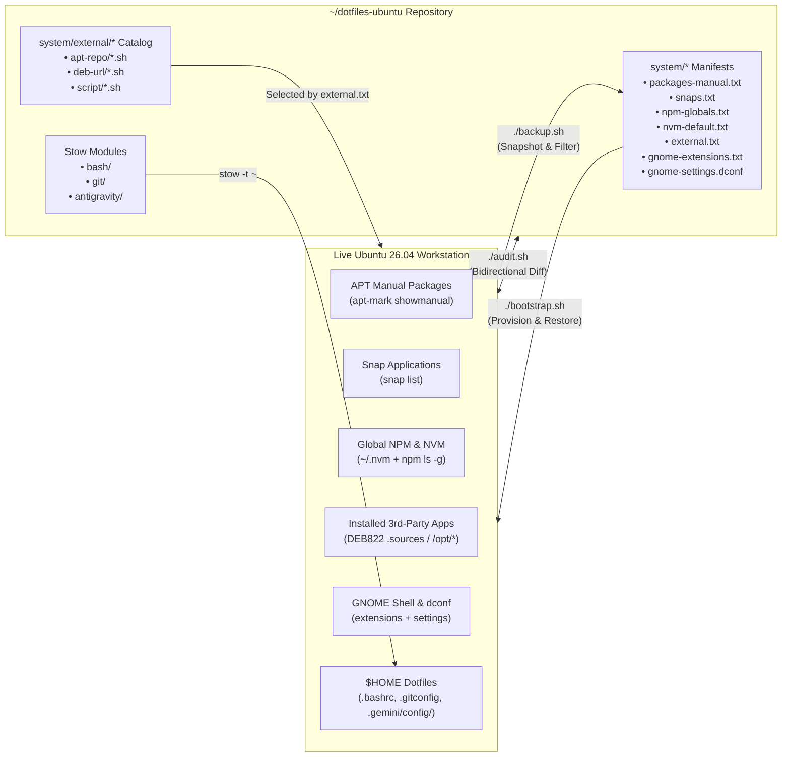

# Architecture 01: Declarative System & GNU Stow Engine

> **Normative Specification — Subsystem 1 (`bootstrap.sh`, `backup.sh`, `audit.sh`, `system/`, `bash/`, `git/`, `antigravity/`)**
>
> This document defines the internal architecture, data flows, filtering algorithms, and safety invariants of the Ubuntu 26.04 LTS ("Resolute Raccoon") declarative system engine and GNU Stow symlink manager.

---

## 1. Architectural Principles

1. **Idempotent Fork-First Portability**:
   - Any user can fork the repository, run `./backup.sh` to overwrite `system/*` manifests with their own workstation state, and push to their fork without inheriting the original author's personal applications.
2. **Bidirectional Drift Detection (`audit.sh`)**:
   - System state (`dpkg`, `apt-mark`, `snap`, `npm`, `dconf`, `readlink`) and repository manifests (`system/*`, stow modules) are compared in both directions: *installed but untracked* vs. *tracked but missing*.
3. **Zero-Secret & Zero-Identity Leakage**:
   - Personal Git identity (`user.name`, `user.email`) and shell secrets (`export *_API_KEY=...`) are structurally isolated in untracked local include files (`~/.gitconfig.local`, `~/.bashrc.local`).
4. **GNU Stow Tree Unfolding (`~/.gemini/config/`)**:
   - Directories that mix tracked global assets with machine-local state (`~/.gemini/config/`, `~/.gemini/config/skills/`, `~/.local/share/applications/`) are pre-created as real directories before invoking `stow -t "$HOME"`, forcing GNU Stow to create granular file/subfolder symlinks instead of folding the parent directory.

---

## 2. Tripartite Lifecycle (`backup.sh` $\leftrightarrow$ `audit.sh` $\leftrightarrow$ `bootstrap.sh`)



---

## 3. Subsystem Specifications

### 3.1. APT 3-Stage Filtering Pipeline (`backup.sh` & `audit.sh`)

When `./backup.sh` generates `system/packages-manual.txt` (and when `./audit.sh` computes APT drift), raw output from `apt-mark showmanual` passes through a deterministic **3-stage exclusion pipeline**:

| Stage | Filter | Purpose |
|:-----:|--------|---------|
| **Stage 1** | **Official Ubuntu APT Origin Check** (`/var/lib/apt/lists/*ubuntu.com*Packages`) | Excludes kernel HWE meta-packages (`linux-generic-hwe-*`) and locally installed/obsolete `.deb` packages that do not exist in official Ubuntu 26.04 APT repositories. |
| **Stage 2** | **External Recipe Catalog Exclusion** (`system/external/{apt-repo,deb-url,script}/*.sh`) | Dynamically parses `CHECK=`, `PACKAGES=`, and `*-release` helper packages from every recipe in `system/external/` and removes them via `comm -23` so third-party packages are tracked exclusively via `system/external.txt`. |
| **Stage 3** | **Hardware / Machine-Local Ignore** (`.audit-ignore`) | Removes hardware-specific packages listed in the gitignored `.audit-ignore` file (e.g., `nvidia-driver-*`). |

### 3.2. Snap Runtime Filtering (`backup.sh` & `audit.sh`)

Snap packages (`snap list`) are filtered via `awk` to exclude system/runtime snaps that are auto-managed by `snapd`:
- Excluded types (`$6`): `base`, `snapd`
- Excluded runtime prefixes (`$1`): `gnome-[0-9]*`, `gtk-common-themes`, `mesa-[0-9]*`
- Only user-facing application snaps are written to `system/snaps.txt`.

### 3.3. External Package Recipe Plugin Contract (`system/external/`)

Third-party software is decoupled into two parts:
1. **The Recipe Catalog (`system/external/<category>/<name>.sh`)**: Declarative shell scripts defining *how* to check and install a package.
2. **The Active Selection Manifest (`system/external.txt`)**: Plain-text list of relative recipe paths (e.g., `apt-repo/docker.sh`, `script/antigravity-ide.sh`) enabled on the current machine.

Each recipe category implements a strict variable/function contract:

| Category | Directory | Required Contract | Execution Order in `bootstrap.sh --external` |
|----------|-----------|-------------------|----------------------------------------------|
| **APT Repository** | `system/external/apt-repo/*.sh` | `NAME`, `DESCRIPTION`, `CHECK` (package name for `dpkg -s`), `PACKAGES` (space-separated install list), and `setup_repo()` (writes GPG key to `/etc/apt/keyrings/` and DEB822 `.sources` file to `/etc/apt/sources.list.d/`) | **8a**: Runs `setup_repo()` for all missing repos first $\rightarrow$ executes a **single** `sudo apt update -qq` $\rightarrow$ installs all `PACKAGES`. |
| **Direct `.deb` URL** | `system/external/deb-url/*.sh` | `NAME`, `DESCRIPTION`, `CHECK` (`dpkg -s`), and `URL` (direct `.deb` or `.zip` containing a `.deb`) | **8b**: Downloads to `mktemp -d`, extracts if `.zip`, installs via `sudo dpkg -i` + `sudo apt install -f -y`, and cleans up temp dir. |
| **Custom Script** | `system/external/script/*.sh` | `NAME`, `DESCRIPTION`, `CHECK_CMD` (shell expression returning `0` when installed), and `INSTALL_CMD` | **8c**: Evaluates `CHECK_CMD`; if non-zero, runs `INSTALL_CMD`. |

---

## 4. GNU Stow Modules & Non-Stow Directory Invariant

### 4.1. Stow vs. Non-Stow Root Directories

Both `bootstrap.sh` (Step 3) and `audit.sh` (Section 1) iterate over top-level directories (`for module in */; do`). Directories that are **not** GNU Stow modules **MUST** be explicitly skipped in both scripts:

```bash
# Non-stow root directories (MUST be skipped in bootstrap.sh and audit.sh):
[ "$module" = "system" ] && continue
[ "$module" = "scripts" ] && continue
[ "$module" = "templates" ] && continue
[ "$module" = "docs" ] && continue
```

| Root Directory | Classification | Target in `$HOME` | Notes |
|----------------|:--------------:|-------------------|-------|
| `bash/` | **Stow Module** | `~/.bashrc`, `~/.profile` | Sources untracked `~/.bashrc.local` at end of file |
| `git/` | **Stow Module** | `~/.gitconfig` | Includes untracked `~/.gitconfig.local` via `[include]` |
| `antigravity/` | **Stow Module** | `~/.gemini/config/*`, `~/.local/share/applications/*` | Uses `prepare_antigravity_dirs()` to enforce tree unfolding |
| `system/` | Non-Stow | — | Declarative package & GNOME manifests + `external/` catalog |
| `scripts/` | Non-Stow | — | `antigravity-install.sh`, `audit-global-config.sh`, `dotfiles_mcp_server.py`, `verify-repo.sh` |
| `templates/` | Non-Stow | — | Layer 2 project starter templates (`fastapi-hexagonal/`) |
| `docs/` | Non-Stow | — | Navigable architecture & reference documentation |

### 4.2. Collision Safety & Identity Migration (`bootstrap.sh`)

Before invoking `stow -t "$HOME" "$module"`, `bootstrap.sh` enforces three safety steps:
1. **Git Identity Preservation**: If `~/.gitconfig` is a real file containing `user.name` or `user.email` and `~/.gitconfig.local` does not exist yet, `bootstrap.sh` extracts those values into `~/.gitconfig.local` before backing up `~/.gitconfig`.
2. **Tree-Unfolding Directory Preparation (`prepare_antigravity_dirs`)**: Creates `~/.gemini/config/skills` and `~/.local/share/applications` as real directories, and backs up any real (non-symlink) `scripts/` or colliding `skills/<name>/` directories to `*.backup.YYYYMMDD`.
3. **File Collision Backup**: Any real file at `$HOME/$relpath` is moved to `$HOME/${relpath}.backup.YYYYMMDD` before `stow` runs, ensuring `stow` never fails with a conflict error and zero user data is lost.
