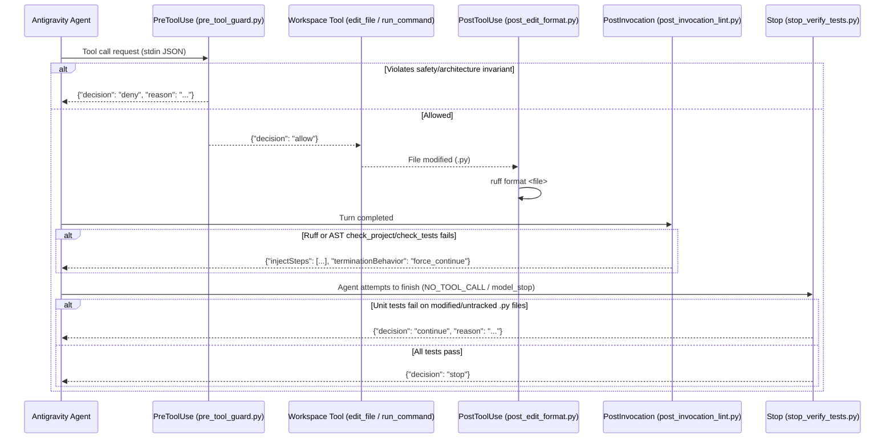

# Architecture 02: Google Antigravity 2.0 Governance, Lifecycle Hooks & Skills

> **Normative Specification — Subsystem 2 (`antigravity/.gemini/config/` & `templates/`)**
>
> This document specifies the runtime architecture, token-budget constraints, lifecycle hook JSON contracts (`PreToolUse`, `PostToolUse`, `PostInvocation`, `Stop`), skill discovery mechanics, and Layer 2 starter templates for Google Antigravity 2.0.

---

## 1. Three-Surface Shared Configuration (`~/.gemini/config/`)

Google Antigravity 2.0 operates across three local developer surfaces that share a single global configuration root at `~/.gemini/config/`:

| Surface | Binary / Install Location | Surface-Specific State | Shared Global Config (Stowed) |
|---------|---------------------------|------------------------|-------------------------------|
| **Antigravity 2.0 (Agents Desktop)** | `/opt/antigravity-agents/antigravity` | `~/.gemini/antigravity/` (`brain/`, MCP schemas) | `~/.gemini/config/{AGENTS.md,hooks.json,scripts/,skills/}` |
| **Antigravity IDE** | `/opt/antigravity-ide/antigravity-ide` | `~/.gemini/antigravity-ide/` | `~/.gemini/config/{AGENTS.md,hooks.json,scripts/,skills/}` |
| **Antigravity CLI (`agy`)** | `~/.local/bin/agy` | `~/.gemini/antigravity-cli/` | `~/.gemini/config/{AGENTS.md,hooks.json,scripts/,skills/}` |

> **Cross-Container & Multi-Layer Extension**: While GNU Stow links `~/.gemini/config/` on the local host with zero latency, these same governance assets (`AGENTS.md`, `hooks.json`, `skills/`, `templates/`) can also be exposed across isolated Docker containers, remote SSH servers, and multi-team forks via the optional Contextual MCP Server ([`03_contextual_mcp_and_federation.md`](03_contextual_mcp_and_federation.md)).

---

## 2. Token Budget Engineering & Progressive Disclosure

Antigravity 2.0 enforces two strict runtime limits when loading rules into the LLM context window:
1. **Per-File Cap**: Individual rule files exceeding **24 KB** are truncated or rejected.
2. **Global Inline Budget (`defaultRulesBudget`)**: The combined size of all `always_on` rules (`~/.gemini/config/AGENTS.md` + all active workspace `.agents/rules/*.md` with `trigger: always_on`) is capped at **20,000 tokens** (~70–75 KB across a multi-repo workspace). If the combined `always_on` payload exceeds this budget, Antigravity evicts global rules from inline injection.

### Architectural Invariants for Rules & Skills

```
┌─────────────────────────────────────────────────────────────────────────┐
│ Tier 1: Always-On Inline Rules (Strict Budget <= 20,000 tokens total)   │
│  • ~/.gemini/config/AGENTS.md (MUST stay <= 18,000 bytes; target ~16KB) │
│  • <project>/.agents/rules/{project,coding,environment}.md (always_on)  │
├─────────────────────────────────────────────────────────────────────────┤
│ Tier 2: Conditional Rules (Loaded on demand via trigger: model_decision)│
│  • <project>/.agents/rules/{governance,testing,documentation}.md        │
├─────────────────────────────────────────────────────────────────────────┤
│ Tier 3: Procedural & Workflow Skills (Loaded only when activated)       │
│  • ~/.gemini/config/skills/<name>/SKILL.md (< 500 lines, kebab-case)    │
│  • <project>/.agents/skills/<name>/SKILL.md                             │
└─────────────────────────────────────────────────────────────────────────┘
```

- **Hard Gate**: `scripts/verify-repo.sh` (Check `[5/8]`) fails CI if `antigravity/.gemini/config/AGENTS.md` exceeds **18,000 bytes**, and `post_invocation_lint.py` (`check_rules_token_budget`) warns at runtime if `AGENTS.md` exceeds `18,000 bytes` (`[TOKEN_BUDGET_EXCEEDED]`) or if combined `always_on` rules across `AGENTS.md` + workspace `.agents/rules/*.md` exceed `80,000 bytes` (~20,000 tokens, `[WORKSPACE_RULES_BUDGET_EXCEEDED]`).
- **Rule vs. Skill Separation**: *Rules* govern **what** invariants must hold (concise mandates); *Skills* teach **how** to execute multi-step workflows (loaded on demand).

---

## 3. Lifecycle Hooks Architecture (`hooks.json` + `scripts/*.py`)

Antigravity 2.0 executes deterministic Python 3.14 hook scripts at four points in the agent execution lifecycle. All hooks receive a JSON payload on `stdin` and write a JSON response to `stdout`.



### Hook Contract & `1:1:1` Test Traceability Reference

| Hook Event | Source Script | `1:1` Unit Test | Matcher | Input (`stdin` JSON keys) | Output (`stdout` JSON contract) | Enforcement Behavior |
|------------|---------------|-----------------|---------|---------------------------|---------------------------------|----------------------|
| **`PreToolUse`** | [`pre_tool_guard.py`](../../antigravity/.gemini/config/scripts/pre_tool_guard.py) | [`test_pre_tool_guard.py`](../../tests/unit/test_pre_tool_guard.py) | `write_file\|edit_file\|replace_file_content\|multi_replace_file_content\|write_to_file\|run_command` | `toolCall.name`, `toolCall.args` (`Path`, `TargetFile`, `Content`, `Replacement`, `CodeContent`, `ReplacementChunks`, `CommandLine`) | `{"decision": "allow"}` or `{"decision": "deny", "reason": "..."}` | **Hard-blocks** (via POSIX `shlex` segment tokenizer + subshell unwrapping + regex fallback):<br>1. Non-empty writes to consumer `src/**/__init__.py` or `tests/**/__init__.py` (across both `_FILE_WRITE_TOOLS` and `run_command` shell output redirections `>`/`>>`/`>\|`/`&>`, heredocs `<<EOF`, `tee`, `cp`/`mv`/`install`, `sed -i`/`perl -i`, `touch`/`truncate`, `dd of=`, and inline `python -c`).<br>2. Manual edits or shell writes to `alembic/versions/*.py`.<br>3. Automatic execution of mutating `git` (`add`, `commit`, `push`, `reset --hard`, `clean -f`, `subtree add\|pull\|push\|merge`) or `alembic` (`revision`, `upgrade`, `downgrade`) commands across compound commands, global flags (`-C`, `-c`, `--no-pager`), env/sudo wrappers, `sh -c` / `bash -c` subshells, and `python -c` `subprocess`/`os.system` calls without false positives on quoted strings or input redirections (`<`). |
| **`PostToolUse`** | [`post_edit_format.py`](../../antigravity/.gemini/config/scripts/post_edit_format.py) | [`test_post_edit_format.py`](../../tests/unit/test_post_edit_format.py) | `edit_file\|write_file\|...` | `toolCall.args.Path` / `TargetFile`, `workspacePaths` | `{}` or `< 465`-line pre-growth advisory | Resolves relative `Path` / `TargetFile` entries against `workspacePaths` and runs `ruff format` on any edited `.py` file immediately after the write completes. |
| **`PostInvocation`** | [`post_invocation_lint.py`](../../antigravity/.gemini/config/scripts/post_invocation_lint.py) | [`test_post_invocation_lint.py`](../../tests/unit/test_post_invocation_lint.py) | *(All turns)* | `workspacePaths`, `invocationNum` | `{}` or `{"injectSteps": [{"ephemeralMessage": "..."}], "terminationBehavior": "force_continue"}` | Checks `always_on` rule token budgets (`check_rules_token_budget`: `AGENTS.md <= 18 KB` and combined workspace `always_on` rules `<= 80 KB`), detects modified **and untracked** `.py` and `docs/**/*.md` files, and runs `ruff check` + `< 465`-line modularity gate (`[max-file-lines]`, `[max-doc-lines]`) + defense-in-depth `[init-purity]` and `[zero-touch-migration]` checks + `1:1:1` `Specification:` pointer check (`[missing-spec-pointer]`) + AAA test comment check (`[missing-aaa]`) + AST `check_project`/`check_tests`. Forces the agent to fix violations in the same turn (up to `_MAX_FORCE_CONTINUE_INVOCATIONS = 5`). |
| **`Stop`** | [`stop_verify_tests.py`](../../antigravity/.gemini/config/scripts/stop_verify_tests.py) | [`test_stop_verify_tests.py`](../../tests/unit/test_stop_verify_tests.py) | *(Normal stop: `NO_TOOL_CALL` / `model_stop`)* | `workspacePaths`, `terminationReason` | `{"decision": "stop"}` or `{"decision": "continue", "reason": "..."}` | Runs `pytest --tb=line -q --no-header -x` across workspaces with modified/untracked `.py` files before allowing the agent to conclude its turn (`decision="continue"` blocks the stop and forces remediation if tests fail). |

### 3.1. Deterministic Hook-to-Documentation Contract Parity (`scripts/verify-repo.sh` Check `[4/8]`)

To prevent silent drift between what the lifecycle hooks enforce in Python and what is documented in `AGENTS.md`, `SECURITY.md`, `README.md`, and `docs/architecture/`, `scripts/verify-repo.sh` (Check `[4/8]`) and `tests/imp/test_repo_parity_gates.py` import the hook modules directly and enforce four automated parity checks on every CI run:
1. **Matcher Set Parity**: `hooks.json` `PreToolUse` and `PostToolUse` `matcher` sets must equal `pre_tool_guard._FILE_WRITE_TOOLS` (`| {"run_command"}` for `PreToolUse`).
2. **Enforced Guard Token Parity**: Every git subcommand in `pre_tool_guard._DOCUMENTED_GIT_SUBCOMMANDS` (`add`, `commit`, `push`, `reset --hard`, `clean -f`, `subtree`), every alembic subcommand in `_DOCUMENTED_ALEMBIC_SUBCOMMANDS` (`revision`, `upgrade`, `downgrade`), and every file guard (`alembic/versions/`, `0 bytes` `__init__.py`) must match `_MUTATING_GIT_RE` / `_ALEMBIC_MUTATE_RE` and appear across `AGENTS.md`, `02_antigravity_governance_and_hooks.md`, `SECURITY.md`, and `README.md`.
3. **Token-Budget Threshold Parity**: `post_invocation_lint._AGENTS_MD_MAX_BYTES` (`18,000` bytes) and `_TOTAL_RULES_BUDGET_MAX_BYTES` (`80,000` bytes) plus warning codes (`TOKEN_BUDGET_EXCEEDED`, `WORKSPACE_RULES_BUDGET_EXCEEDED`) must match `dotfiles_mcp_server.AGENTS_MD_MAX_BYTES` and `docs/architecture/02..04`.
4. **Bidirectional `1:1:1` Source $\leftrightarrow$ Unit Test $\leftrightarrow$ Specification Traceability**: Every Python module in `antigravity/.gemini/config/scripts/` and `scripts/dotfiles_mcp/` must declare a `Specification: docs/architecture/<file>.md` header in its docstring, and that specification file must cross-reference the module and its `1:1` unit test.

---

## 4. Global Skills Catalog (`antigravity/.gemini/config/skills/`)

Every skill resides in `antigravity/.gemini/config/skills/<name>/SKILL.md` and must declare YAML frontmatter with a `kebab-case` `name:` and `description:` (verified by `scripts/verify-repo.sh` Check `[6/8]`).

### 4.1. Interactive Slash-Command Skills (`/<name>`)

| Skill / Command | Primary Responsibility | Key Artifacts Read / Updated |
|-----------------|------------------------|------------------------------|
| **[`sopen`](../../antigravity/.gemini/config/skills/sopen/SKILL.md)** (`/sopen`) | Pulls latest `~/dotfiles-ubuntu` (`--ff-only`), inspects mounted `layers/*` & `logs/mcp_alerts.jsonl`, restores session context across 3 tiers (`brain/` $\rightarrow$ `.agents/SESSION.md` $\rightarrow$ `git status`), and triggers project `/start` | `.agents/SESSION.md`, `WORKTASK.md`, `WORKROAD.md` |
| **[`continue`](../../antigravity/.gemini/config/skills/continue/SKILL.md)** (`/continue`) | Mid-session checkpoint: snapshots active task progress, promotes completed task blocks (`WORKTASK.md` $\rightarrow$ `CHANGELOG.md`), and delivers commit blocks | `.agents/SESSION.md`, `WORKTASK.md`, `WORKROAD.md`, `CHANGELOG.md` |
| **[`sclose`](../../antigravity/.gemini/config/skills/sclose/SKILL.md)** (`/sclose`) | End-of-session closure: runs governance promotion (Zero-Clutter Invariant), closes `.agents/SESSION.md`, runs `make verify` if `dotfiles-ubuntu` changed, emits knowledge signals, and delivers per-repo commits | `.agents/SESSION.md`, `WORKTASK.md`, `WORKROAD.md`, `BACKLOG.md`, `CHANGELOG.md` |
| **[`priority`](../../antigravity/.gemini/config/skills/priority/SKILL.md)** (`/priority`) | Enforces the deterministic priority chain (`WORKTASK.md` $\rightarrow$ `WORKROAD.md` / `BACKLOG.md` $\rightarrow$ `roadmaps/`) and Phase 0.5 deep-analysis | `WORKTASK.md`, `WORKROAD.md`, `BACKLOG.md`, `roadmaps/*.md` |
| **[`review`](../../antigravity/.gemini/config/skills/review/SKILL.md)** (`/review`) | Audits module architecture, service boundaries, `1:1:1` test/spec mapping (`< 465` lines), AAA comment separation, and 100% coverage | `src/**`, `tests/unit/**`, `tests/imp/**`, `docs/architecture/**` |
| **[`enrich`](../../antigravity/.gemini/config/skills/enrich/SKILL.md)** (`/enrich`) | Scans active workspace `.agents/` against `~/dotfiles-ubuntu` (`Layer A`), `templates/*` (`Layer B`), and mounted `layers/*` subtrees (`Layer D`), proposes upward promotions (`layer-subtree.sh push`) and downward syncs, and runs `stow -t ~ -R antigravity` | `.agents/rules/*.md`, `.agents/skills/**`, `~/dotfiles-ubuntu/antigravity/`, `~/dotfiles-ubuntu/layers/*` |

### 4.2. Procedural Engineering Skills (Auto-Activated by Task Context)

| Skill Name | Activation Trigger | Core Methodology |
|------------|--------------------|------------------|
| **[`architecture-review`](../../antigravity/.gemini/config/skills/architecture-review/SKILL.md)** | Designing framework architecture, unifying classifications, or auditing documentation coherence | **5-Step Intersection Audit** + **5-Dimension Pre-Development Gate** (*Normative Specs $\rightarrow$ Reference Docs $\rightarrow$ Diagrams $\rightarrow$ Root Guides $\rightarrow$ Roadmaps*) + **4 Deterministic Verification Gates** |
| **[`governance`](../../antigravity/.gemini/config/skills/governance/SKILL.md)** | Promoting work across tiers or extracting knowledge from raw AI conversations | **One-Way Work Lifecycle** (`roadmaps/ → WORKROAD → WORKTASK → CHANGELOG`) + **3-Stage Conversation Extraction Pipeline** (*Reference Corpus $\rightarrow$ Normative Specs $\rightarrow$ Raw Source Decommissioning*) |
| **[`refactoring`](../../antigravity/.gemini/config/skills/refactoring/SKILL.md)** | Breaking down God Components (`< 465` lines cap, `<= 400` target), moving modules, or decommissioning features | **Zero-Residue Cutover** (no shims/aliases) + **`1:1:1` Test/Spec Alignment** + **3-Step Obsolete Test Pruning Audit** (`orphan-test-file`, dead symbol sweep, default-parameter sensitivity verification) |
| **[`testing`](../../antigravity/.gemini/config/skills/testing/SKILL.md)** | Writing unit/integration tests, fixing coverage gaps, or consolidating test suites | **Explicit 3-Comment AAA**, **Service Constructor Mock Injection**, **Anti-Characterization Trap**, and **5-Phase Test Consolidation** |
| **[`validation`](../../antigravity/.gemini/config/skills/validation/SKILL.md)** | Executing collaborative human-agent manual QA sessions | **5-Layer Validation Protocol** (Render, Interaction, Persistence, Observation, Edge Cases) tracked in `WORKVALI.md` |

---

## 5. Layer 2 Starter Templates (`templates/fastapi-hexagonal/`)

`templates/fastapi-hexagonal/` provides a ready-to-copy Layer 2/3 configuration for Python FastAPI + Hexagonal DDD + HTMX projects:
- **`rules/`**: `coding.md` (always-on), `environment.md` (always-on), `governance.md` (`trigger: model_decision`), `testing.md` (`trigger: model_decision`, including `orphan-test-file` decommissioning).
- **`skills/`**: `start/SKILL.md` (`/start`), `testing/SKILL.md` (`fastapi-testing`), `frontend/SKILL.md` (`fastapi-frontend`), `database/SKILL.md` (`fastapi-database`).
- **`governance/`**: Clean starter files for `WORKTASK.md`, `WORKROAD.md`, `WORKVALI.md`, `BACKLOG.md`, `CHANGELOG.md`, and `SESSION.md`.
