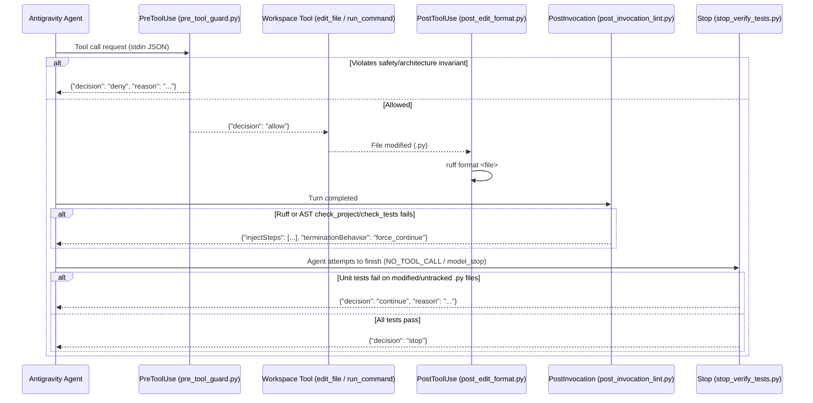

# Architecture 02: Google Antigravity 2.0 Governance, Lifecycle Hooks & Skills

> **Normative Specification — Subsystem 2 (`antigravity/.gemini/config/` & `templates/`)**
>
> This document specifies the runtime architecture, token-budget constraints, lifecycle hook JSON contracts (`PreToolUse`, `PostToolUse`, `PostInvocation`, `Stop`), skill discovery mechanics, and Layer 2 starter templates for Google Antigravity 2.0.

---

## 1. Shared Global Configuration (`~/.gemini/config/`) Across `antigravity-agents` & `agy`

Google Antigravity 2.0 operates across two local developer surfaces (`antigravity-agents` desktop and `agy` CLI) that share a single global configuration root at `~/.gemini/config/`:

| Surface | Binary / Install Location | Surface-Specific State | Shared Global Config (Stowed) |
|---------|---------------------------|------------------------|-------------------------------|
| **Antigravity 2.0 (`antigravity-agents`)** | `/opt/antigravity-agents/antigravity` | `~/.gemini/antigravity/` (`brain/`, MCP schemas) | `~/.gemini/config/{AGENTS.md,hooks.json,scripts/,skills/}` |
| **Antigravity CLI (`agy`)** | `~/.local/bin/agy` | `~/.gemini/antigravity-cli/` | `~/.gemini/config/{AGENTS.md,hooks.json,scripts/,skills/}` |

> **Cross-Container & Multi-Layer Extension**: While GNU Stow links `~/.gemini/config/` on the local host with zero latency, these same governance assets (`AGENTS.md`, `hooks.json`, `skills/`, `templates/`) can also be exposed across isolated Docker containers, remote SSH servers, and multi-squad forks via the optional Contextual MCP Server ([`03_contextual_mcp_and_federation.md`](03_contextual_mcp_and_federation.md)).

---

## 2. Token Budget Engineering & Progressive Disclosure

Antigravity 2.0 enforces two strict runtime limits when loading rules into the LLM context window:
1. **Per-File Cap**: Individual rule files exceeding **24 KB** are truncated or rejected.
2. **Global Inline Budget (`defaultRulesBudget`)**: The combined size of all `always_on` rules (`~/.gemini/config/AGENTS.md` + all active workspace `.agents/rules/*.md` with `trigger: always_on`) is capped at **20,000 tokens** (~70–75 KB across a multi-repo workspace). If the combined `always_on` payload exceeds this budget, Antigravity evicts global rules from inline injection.

### Architectural Invariants for Rules & Skills

```
┌─────────────────────────────────────────────────────────────────────────┐
│ Tier 1: Always-On Inline Rules (Strict Budget <= 20,000 tokens total)   │
│  • ~/.gemini/config/AGENTS.md (MUST stay <= 18,000 bytes; target ~16KB) │
│  • <project>/.agents/rules/{project,coding,environment}.md (always_on)  │
├─────────────────────────────────────────────────────────────────────────┤
│ Tier 2: Conditional Rules (Loaded on demand via trigger: model_decision)│
│  • <project>/.agents/rules/{governance,testing,documentation}.md        │
├─────────────────────────────────────────────────────────────────────────┤
│ Tier 3: Procedural & Workflow Skills (Loaded only when activated)       │
│  • ~/.gemini/config/skills/<name>/SKILL.md (< 500 lines, kebab-case)    │
│  • <project>/.agents/skills/<name>/SKILL.md                             │
└─────────────────────────────────────────────────────────────────────────┘
```

- **Hard Gate**: `scripts/verify-repo.sh` (Check `[5/8]`) fails CI if `antigravity/.gemini/config/AGENTS.md` exceeds **18,000 bytes**, and `post_invocation_lint.py` (`check_rules_token_budget`) warns at runtime if `AGENTS.md` exceeds `18,000 bytes` (`[TOKEN_BUDGET_EXCEEDED]`) or if combined `always_on` rules across `AGENTS.md` + workspace `.agents/rules/*.md` exceed `80,000 bytes` (~20,000 tokens, `[WORKSPACE_RULES_BUDGET_EXCEEDED]`).
- **Rule vs. Skill Separation**: *Rules* govern **what** invariants must hold (concise mandates); *Skills* teach **how** to execute multi-step workflows (loaded on demand).

---

## 3. Lifecycle Hooks Architecture (`hooks.json` + `scripts/*.py`)

Antigravity 2.0 executes deterministic Python 3.14 hook scripts at four points in the agent execution lifecycle. All hooks receive a JSON payload on `stdin` and write a JSON response to `stdout`.



### Hook Contract & `1:1:1` Test Traceability Reference

| Hook Event | Source Script | `1:1` Unit Test | Matcher | Input (`stdin` JSON keys) | Output (`stdout` JSON contract) | Enforcement Behavior |
|------------|---------------|-----------------|---------|---------------------------|---------------------------------|----------------------|
| **`PreToolUse`** | [`pre_tool_guard.py`](../../antigravity/.gemini/config/scripts/pre_tool_guard.py) | [`test_pre_tool_guard.py`](../../tests/unit/test_pre_tool_guard.py) (`TestPreToolGuard`) | `write_file\|edit_file\|replace_file_content\|multi_replace_file_content\|write_to_file\|run_command` | `toolCall.name`, `toolCall.args` (`Path`, `TargetFile`, `Content`, `Replacement`, `CodeContent`, `ReplacementChunks`, `Target`, `Append`, `CommandLine`) | `{"decision": "allow"}` or `{"decision": "deny", "reason": "..."}` | **Hard-blocks** (via POSIX `shlex` segment tokenizer + subshell unwrapping + regex fallback):<br>1. Non-empty writes or partial edits (`_init_write_leaves_non_empty`: blocks non-empty `Content`/`Replacement`/`ReplacementChunks`, `Append=True` on existing non-empty files, and partial `Target`/`ReplacementChunks` removals that leave residual bytes on disk) to consumer `src/**/__init__.py` or `tests/**/__init__.py` (across both `_FILE_WRITE_TOOLS` and `run_command` shell output redirections `>`/`>>`/`>\|`/`&>`, heredocs `<<EOF`, `tee`, `cp`/`mv`/`install`, `sed -i`/`perl -i`, `touch`/`truncate`, `dd of=`, and inline `python -c`).<br>2. Manual edits or shell writes to `alembic/versions/*.py`.<br>3. Direct edits or shell writes to materialized upstream layer rules (`.agents/rules/layer-<NN>-*.md`).<br>4. Automatic execution of mutating `git` (`add`, `commit`, `push`, `reset --hard`, `clean -f`, `subtree add\|pull\|push\|merge`) or `alembic` (`revision`, `upgrade`, `downgrade`) commands across compound commands, global flags (`-C`, `-c`, `--no-pager`), env/sudo/nice/timeout/ionice/stdbuf/chrt/taskset wrappers (with option arguments via `_WRAPPER_FLAGS_WITH_ARG` and `timeout` positional duration), `sh -c` / `bash -c` subshells, and `python -c` `subprocess`/`os.system` calls without false positives on quoted strings or input redirections (`<`). |
| **`PostToolUse`** | [`post_edit_format.py`](../../antigravity/.gemini/config/scripts/post_edit_format.py) | [`test_post_edit_format.py`](../../tests/unit/test_post_edit_format.py) (`TestPostEditFormat`) | `edit_file\|write_file\|...` | `toolCall.args.Path` / `TargetFile`, `workspacePaths` | `{}` or `< 465`-line pre-growth advisory | Resolves relative `Path` / `TargetFile` entries against `workspacePaths` and runs `ruff format` on any edited `.py` file immediately after the write completes. |
| **`PostInvocation`** | [`post_invocation_lint.py`](../../antigravity/.gemini/config/scripts/post_invocation_lint.py) | [`test_post_invocation_lint.py`](../../tests/unit/test_post_invocation_lint.py) (`TestPostInvocationLint`) | *(All turns)* | `workspacePaths`, `invocationNum` | `{}` or `{"injectSteps": [{"ephemeralMessage": "..."}], "terminationBehavior": "force_continue"}` | Exposes `inspect_checker_availability(workspace_paths)` for adapter introspection (`ruff_available`, `venv_python_available`, `structural_checks_available`), checks `always_on` rule token budgets (`check_rules_token_budget`: `AGENTS.md <= 18 KB` and combined workspace `always_on` rules `<= 80 KB`), detects modified **and untracked** `.py` and `docs/**/*.md` files, and runs `ruff check` + `< 465`-line modularity gate (`[max-file-lines]`, `[max-doc-lines]`) + defense-in-depth `[init-purity]` and `[zero-touch-migration]` checks + `1:1:1` `Specification:` pointer check (`[missing-spec-pointer]`) + AST-aware AAA test comment check (`[missing-aaa]`) + AST `check_project`/`check_tests`. Forces the agent to fix violations in the same turn up to `_MAX_FORCE_CONTINUE_INVOCATIONS = 5`, emitting an explicit circuit-breaker halt footer once `invocationNum >= 5`. |
| **`Stop`** | [`stop_verify_tests.py`](../../antigravity/.gemini/config/scripts/stop_verify_tests.py) | [`test_stop_verify_tests.py`](../../tests/unit/test_stop_verify_tests.py) (`TestStopVerifyTests`) | *(Normal stop: `NO_TOOL_CALL` / `model_stop`)* | `workspacePaths`, `terminationReason` | `{"decision": "stop"}` or `{"decision": "continue", "reason": "..."}` | Runs `pytest --tb=line -q --no-header -x` across workspaces with modified/untracked `.py` files before allowing the agent to conclude its turn (`decision="continue"` blocks the stop and forces remediation if tests fail). |

### 3.1. Deterministic Hook-to-Documentation Contract Parity (`scripts/verify-repo.sh` Check `[4/8]`)

To prevent silent drift between what the lifecycle hooks enforce in Python and what is documented in `AGENTS.md`, `SECURITY.md`, `README.md`, and `docs/architecture/`, `scripts/verify-repo.sh` (Check `[4/8]`) and `tests/imp/test_repo_parity_gates.py` import the hook modules directly and enforce four automated parity checks on every CI run:
1. **Matcher Set Parity**: `hooks.json` `PreToolUse` and `PostToolUse` `matcher` sets must equal `pre_tool_guard._FILE_WRITE_TOOLS` (`| {"run_command"}` for `PreToolUse`).
2. **Enforced Guard Token Parity**: Every git subcommand in `pre_tool_guard._DOCUMENTED_GIT_SUBCOMMANDS` (`add`, `commit`, `push`, `reset --hard`, `clean -f`, `subtree`), every alembic subcommand in `_DOCUMENTED_ALEMBIC_SUBCOMMANDS` (`revision`, `upgrade`, `downgrade`), and every file guard (`alembic/versions/`, `0 bytes` `__init__.py`) must match `_MUTATING_GIT_RE` / `_ALEMBIC_MUTATE_RE` and appear across `AGENTS.md`, `02_antigravity_governance_and_hooks.md`, `SECURITY.md`, and `README.md`.
3. **Token-Budget Threshold Parity**: `post_invocation_lint._AGENTS_MD_MAX_BYTES` (`18,000` bytes) and `_TOTAL_RULES_BUDGET_MAX_BYTES` (`80,000` bytes) plus warning codes (`TOKEN_BUDGET_EXCEEDED`, `WORKSPACE_RULES_BUDGET_EXCEEDED`) must match `dotfiles_mcp_server.AGENTS_MD_MAX_BYTES` and `docs/architecture/02..04`.
4. **Bidirectional `1:1:1` Source $\leftrightarrow$ Unit Test $\leftrightarrow$ Specification Traceability**: Every Python module in `antigravity/.gemini/config/scripts/` and `scripts/dotfiles_mcp/` must declare a `Specification: docs/architecture/<file>.md` header in its docstring, and that specification file must cross-reference the module and its `1:1` unit test.

---

## 4. Complete 19-Skill Matrix (`antigravity/.gemini/config/skills/` & `templates/**/skills/`)

Every skill resides in `antigravity/.gemini/config/skills/<name>/SKILL.md` (10 universal lifecycle, governance, and dual-mode audit skills), `templates/technical-base/skills/<name>/SKILL.md` (4 software-engineering and substrate skills), or `templates/{business-stack,tech-stack}/*/skills/<name>/SKILL.md` (5 domain specialization-stack skills) and must declare YAML frontmatter with a `kebab-case` `name:` and `description:` (verified by `scripts/verify-repo.sh` Check `[6/8]`).

### 4.1. Interactive Slash-Command Skills (`/<name>` — 8 Global Skills)

| Skill / Command | Primary Responsibility | Key Artifacts Read / Updated |
|-----------------|------------------------|------------------------------|
| **[`sopen`](../../antigravity/.gemini/config/skills/sopen/SKILL.md)** (`/sopen`) | Pulls latest `~/dotfiles-ubuntu` (`--ff-only`), inspects mounted `layers/*` & `logs/mcp_alerts.jsonl`, restores session context across 3 tiers (`brain/` $\rightarrow$ `.agents/SESSION.md` $\rightarrow$ `git status`), and triggers project `/start` | `.agents/SESSION.md`, `WORKTASK.md`, `WORKROAD.md` |
| **[`continue`](../../antigravity/.gemini/config/skills/continue/SKILL.md)** (`/continue`) | Mid-session checkpoint: snapshots active task progress, promotes completed task blocks (`WORKTASK.md` $\rightarrow$ `CHANGELOG.md`), and delivers commit blocks | `.agents/SESSION.md`, `WORKTASK.md`, `WORKROAD.md`, `CHANGELOG.md` |
| **[`sclose`](../../antigravity/.gemini/config/skills/sclose/SKILL.md)** (`/sclose`) | End-of-session closure: runs governance promotion (Zero-Clutter Invariant), closes `.agents/SESSION.md`, runs `make verify` if `dotfiles-ubuntu` changed, emits knowledge signals, and delivers local per-repo commits (`[Unreleased]`) | `.agents/SESSION.md`, `WORKTASK.md`, `WORKROAD.md`, `BACKLOG.md`, `CHANGELOG.md` |
| **[`release`](../../antigravity/.gemini/config/skills/release/SKILL.md)** (`/release`) | Explicit SemVer release cut: runs zero-leak/agnosticism scans and `make verify`, promotes `## [Unreleased]` $\rightarrow$ `## [X.Y.Z] - YYYY-MM-DD`, syncs `VERSION`/`pyproject.toml`/`README.md`, and delivers the release commit + tag + push block | `VERSION`, `pyproject.toml`, `README.md`, `CHANGELOG.md` |
| **[`priority`](../../antigravity/.gemini/config/skills/priority/SKILL.md)** (`/priority`) | Enforces the deterministic priority chain (`WORKTASK.md` $\rightarrow$ `WORKROAD.md` / `BACKLOG.md` $\rightarrow$ `roadmaps/`) and Phase 0.5 deep-analysis | `WORKTASK.md`, `WORKROAD.md`, `BACKLOG.md`, `roadmaps/*.md` |
| **[`review`](../../antigravity/.gemini/config/skills/review/SKILL.md)** (`/review`) | Tactical `C1` read-only review across the active session delta (default) or a targeted path/dimension (`/review [path\|docs\|arch\|1:1:1\|layer]`): evaluates `1. docs` (3-tier, 5-link ripple & Conceptual/Semantic Isomorphism), `2. arch` (code or SSoT ledgers), `3. 1:1:1` (tests or sign-off gates), and `4. layer` (manifests & horizon) | `src/**`, `tests/unit/**`, `tests/imp/**`, `docs/**`, `system/mcp-layer.json`, `corporate/**` |
| **[`full-audit`](../../antigravity/.gemini/config/skills/full-audit/SKILL.md)** (`/full-audit`) | Convergent `C2` closed-world repository gate: executes all 4 deterministic probes (`Probe A..D`) and all 4 canonical passes (including Conceptual & Semantic Documentation Isomorphism) across 100% of the repository toward `Regime 0 (0 findings)` | `docs/**`, `.agents/**`, `src/**`, `tests/**`, `WORKTASK.md`, `WORKROAD.md`, `BACKLOG.md` |
| **[`enrich`](../../antigravity/.gemini/config/skills/enrich/SKILL.md)** (`/enrich`) | Scans active workspace `.agents/` against `~/dotfiles-ubuntu` (`Layer A`), `templates/*` (`Layer B`), and mounted `layers/*` subtrees, proposes 1-hop upward promotions (`promote-from-project` / `layer-subtree.sh push`) and downward syncs (`sync-layer`), and runs `stow -t ~ -R antigravity` | `.agents/rules/*.md`, `.agents/skills/**`, `~/dotfiles-ubuntu/antigravity/`, `~/dotfiles-ubuntu/layers/*` |

### 4.2. Core Procedural Skills (2 Global + 4 `technical-base` Skills)

| Skill Name | Source Pack (`kind`) | Activation Trigger & Core Methodology |
|------------|----------------------|---------------------------------------|
| **[`architecture-review`](../../antigravity/.gemini/config/skills/architecture-review/SKILL.md)** | Global (`human-core`) | **5-Step Intersection Audit** + **5-Dimension Pre-Development Gate** (*Normative Specs $\rightarrow$ Reference Docs $\rightarrow$ Diagrams $\rightarrow$ Root Guides $\rightarrow$ Roadmaps*) + **4 Deterministic Verification Gates** |
| **[`governance`](../../antigravity/.gemini/config/skills/governance/SKILL.md)** | Global (`human-core`) | **One-Way Work Lifecycle** (`roadmaps/ → WORKROAD → WORKTASK → CHANGELOG`), 1-hop downward directive delegation (`make delegate`), and **3-Stage Conversation Extraction Pipeline** |
| **[`refactoring`](../../templates/technical-base/skills/refactoring/SKILL.md)** | `technical-base` (`core-base`) | **Zero-Residue Cutover** (no shims/aliases) + **`1:1:1` Test/Spec Alignment** + **3-Step Obsolete Test Pruning Audit** (`orphan-test-file`, dead symbol sweep, default-parameter sensitivity verification) |
| **[`testing`](../../templates/technical-base/skills/testing/SKILL.md)** | `technical-base` (`core-base`) | **Bidirectional 3-Tier Flow (`E2E <-> Imp <-> Unit`)**, **Explicit 3-Comment AAA**, **Service Constructor Mock Injection**, **Anti-Characterization Trap**, and **5-Phase Test Consolidation** |
| **[`validation`](../../templates/technical-base/skills/validation/SKILL.md)** | `technical-base` (`core-base`) | **5-Layer Validation Protocol** (Render, Interaction, Persistence, Observation, Edge Cases) tracked in `WORKVALI.md` |
| **[`oss-contribute`](../../templates/technical-base/skills/oss-contribute/SKILL.md)** | `technical-base` (`core-base`) | **Empirical Hot-Path Profiling** (`timeit`/`cProfile`) $\rightarrow$ **3-Tier Substrate Escalation** (`Stdlib C-Primitive` $\rightarrow$ `Optional PEP 7 C-Accelerator` $\rightarrow$ `Isolated ~/Projects/oss-contrib-<repo> Upstream PR`) |

### 4.3. Specialization-Stack Skills (5 Skills: `business-stack` & `tech-stack`)

| Skill Name | Specialization Pack (`kind`) | Target Domain & Core Methodology |
|------------|------------------------------|----------------------------------|
| **[`ledger-surface-audit`](../../templates/business-stack/corporate-ops-ledger/skills/ledger-surface-audit/SKILL.md)** | `corporate-ops-ledger` (`business-stack`) | Audits 3-ring Hexagonal Business traceability (`corporate/ledgers/` $\rightarrow$ `corporate/{policies,sops}/` $\rightarrow$ `surfaces/{web,forms,print}/`) and `[DEPT]-[TYPE]-[YYYY]-[NNN]` citation parity |
| **[`start`](../../templates/tech-stack/fastapi-hexagonal/skills/start/SKILL.md)** | `fastapi-hexagonal` (`tech-stack`) | Bootstraps or resumes a Python FastAPI + Hexagonal DDD service workspace (`./venv`, `uvicorn`, environment readiness) |
| **[`fastapi-testing`](../../templates/tech-stack/fastapi-hexagonal/skills/fastapi-testing/SKILL.md)** | `fastapi-hexagonal` (`tech-stack`) | Enforces 4-layer hexagonal test isolation (`domain`, `application`, `adapters`, `entrypoints`) with `httpx.AsyncClient` and async DB fixtures alongside `technical-base`'s `testing` |
| **[`database-migrations`](../../templates/tech-stack/fastapi-hexagonal/skills/database/SKILL.md)** | `fastapi-hexagonal` (`tech-stack`) | Governs user-gated Alembic async schema migrations, zero-touch `alembic/versions/*.py` invariants, and downgrade safety |
| **[`frontend-patterns`](../../templates/tech-stack/fastapi-hexagonal/skills/frontend/SKILL.md)** | `fastapi-hexagonal` (`tech-stack`) | Guides FastAPI web frontend integration, typed API client boundaries, and accessible UI state patterns |

---

## 5. Layer 2 Polymorphic Template Packs (`templates/`)

`templates/` provides 3 composable foundational governance pillars (`kind: "core-base"`) and 3 orthogonal specialization stack families (`templates/business-stack/*`, `templates/science-stack/*`, and `templates/tech-stack/*`):
1. **3-Tier Base Governance Pillars (`human-core`, `technical-base`, `business-base`)**:
   - **`templates/human-core/`**: Universal cognitive rigor (`§1–10`), `5-Surface Change Propagation`, forensic `[WIRE] / [CONSOLIDATE] / [PRUNE]` intent verification, `dotfiles-ubuntu` native self-guidance (`§11`), universal task-branch & inter-layer lifecycle (`make status`, `make sync`, `make task` $\rightarrow$ `feature/<TICKET-ID>-<slug>`, `make complete`, `make consult`, `make delegate` strictly inside `layers/<child>/`, `make promote`), `$HOME` vs. `Workspace` separation, scoped `antigravity-agents` workspace containment, model delegation (`§12`), single-language purity (`§13`), and `[Unreleased]` commit discipline. Default machine-global `AGENTS.md` baseline (with the 10 universal global skills in `antigravity/.gemini/config/skills/`).
   - **`templates/technical-base/`**: Software engineering rigor (`ruff`/`mypy --strict`, C-backed floor-version stdlib primitives, Rule 6 constants & data symmetry), `1:1:1` Source-Test-Spec traceability (`Specification:`), `0-byte` `__init__.py` purity, Refactoring & Decommissioning (5-Stage Evolution Ladder, `O(1)` file prefixes, Bifurcated Age Review, 3-Step Test Pruning Audit), Testing Universal (AAA, `100%` branch coverage, `N vs N ± 1` boundary cut-points), and the 4 software engineering skills (`skills/testing/`, `skills/refactoring/`, `skills/validation/`, `skills/oss-contribute/`).
   - **`templates/business-base/`**: Enterprise & normative governance, Single Source of Truth Ledger (`corporate/`), Cross-Departmental Precedence Matrix (`1..80` from Territorial/Public Administration to Corporate/Department/Squad), *Lex Superior* IP/confidentiality firewall & Crisis Escalation SLAs (`P0/P1/P2`), Traceable Ledger IDs (`[DEPT]-[TYPE]-[YYYY]-[NNN]`), Three-Part Functional Verification Structure, and AI Agent Capability Matrix by Organizational Role.
2. **3 Orthogonal Specialization Stack Families (`templates/business-stack/`, `templates/science-stack/`, & `templates/tech-stack/`)**:
   - **`templates/business-stack/corporate-ops-ledger/`**: Reference Hexagonal Business Architecture pack (`kind: "business-stack"`, `extends: "business-base"`) with `rules/ops-ledger-architecture.md` (`corporate/ledgers/` $\rightarrow$ `corporate/{policies,sops}/` $\rightarrow$ `surfaces/{web,forms,print}/`, `[DEPT]-[TYPE]-[YYYY]-[NNN]` citations, Business `AAA` templates) and `skills/ledger-surface-audit/SKILL.md`.
   - **`templates/science-stack/scientific-knowledge-branch/`**: Scientific, legal, public-administration, and territorial knowledge specialization pack (`kind: "science-stack"`, `extends: "business-base"`, `rules/scientific-methodology.md`) enforcing the `Trunk -> Branch -> Specialty` epistemic taxonomy, primary-evidence & citation hierarchy, lightweight routing rules in `.agents/rules/` + 3-tier modular reference libraries (`< 465` lines per file in `docs/` queried on demand via `make consult`), and contextual `Human-Stack` (`L1..L4`) didactic adaptation.
   - **`templates/tech-stack/fastapi-hexagonal/`**: Pure Layer 2/3 configuration for Python FastAPI + Hexagonal DDD (Ports & Adapters, Bounded Contexts, SQLAlchemy Async, Pydantic v2, `httpx.AsyncClient`) projects (`kind: "tech-stack"`, `extends: "technical-base"`):
     - **`rules/`**: `coding.md` (Hexagonal rings, `Protocol` ports, `Depends`, no `from __future__ import annotations` in routers), `testing.md` (4-layer hexagonal test matrix), `environment.md` (`./venv`, `uvicorn`, `pytest`, `mypy --strict`, `ruff`, user-gated `alembic`), `governance.md` (Bounded Context `1:1:1` spec mapping).
     - **`skills/`**: `start/SKILL.md` (`start`), `fastapi-testing/SKILL.md` (`fastapi-testing`, coexisting alongside `technical-base`'s `testing/SKILL.md`), `frontend/SKILL.md` (`frontend-patterns`), `database/SKILL.md` (`database-migrations`).
     - **`governance/`**: Clean starter files for `WORKTASK.md`, `WORKROAD.md`, `WORKVALI.md`, `BACKLOG.md`, `CHANGELOG.md`, and `SESSION.md`.
