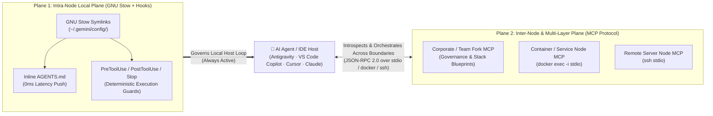

# Architecture 03: Contextual Layer & System MCP Server (`dotfiles-mcp`)

> **Normative Specification — Subsystem 3 ([`scripts/dotfiles_mcp_server.py`](../../scripts/dotfiles_mcp_server.py) & [`system/mcp-layer.json`](../../system/mcp-layer.json))**
>
> This document defines the technical specification, protocol contracts (`Resources`, `Tools`, `Prompts`), security invariants, and federation schema for operating any `dotfiles-ubuntu` instance or fork as a **Model Context Protocol (MCP) Server** representing a specific governance layer, container, server, or application node.

---

## 1. Architectural Purpose: Bridging the Physical Boundary of GNU Stow

In `dotfiles-ubuntu`, Subsystem 1 ([`01_system_and_stow_engine.md`](01_system_and_stow_engine.md)) and Subsystem 2 ([`02_antigravity_governance_and_hooks.md`](02_antigravity_governance_and_hooks.md)) solve configuration and AI governance within a **single local filesystem (`$HOME`)** via GNU Stow symlinks and lifecycle hooks.

However, modern software systems frequently span boundaries that POSIX filesystem symlinks cannot cross:
- **Containerized Runtime Topologies**: Docker containers, Devcontainers, Kubernetes pods, or sidecar services where each container has its own isolated packages and runtime state.
- **Distributed Server & Node Architectures**: Multi-server staging/production nodes, data processing workers, or specialized GPU/ML hosts.
- **Multi-Tier Organizational Forks**: Separate Git forks for Corporate Governance (`Layer A`), Team/Domain Architecture (`Layer B`), and Service Nodes (`Layer C`) that are not simultaneously symlinked to `$HOME`.

By embedding an **optional, zero-dependency, read-only MCP server** (`scripts/dotfiles_mcp_server.py`) inside `dotfiles-ubuntu`, every fork, container, or server hosting the repository can expose its **system manifests, drift status, active governance rules, navigable `docs/`, and downstream MCP topology** over standard JSON-RPC 2.0.

### The Dual-Plane Architecture (Stow Local Plane vs. MCP Distributed Plane)



| Architectural Dimension | Plane 1: Local Host (GNU Stow + Lifecycle Hooks) | Plane 2: Distributed / Multi-Layer (`dotfiles-mcp`) |
|-------------------------|--------------------------------------------------|-----------------------------------------------------|
| **Transport Mechanism** | Local POSIX symlinks (`stow -t ~`) + `stdin`/`stdout` hooks | Model Context Protocol (JSON-RPC 2.0 over `stdio`, `docker exec -i`, or `ssh`) |
| **Control Flow** | **Deterministic Push / Intercept** (mandatory on every turn/tool call) | **Contextual Pull / Introspection** (queried on demand by the agent) |
| **Primary Responsibility** | Enforce coding rules, block dangerous commands (`pre_tool_guard.py`), auto-format, and run unit tests locally | Expose container/server drift, resolve cross-layer rules & `docs/`, and federate downstream MCP servers across services |
| **Dependency Footprint** | GNU Stow + Bash + Python 3.14 stdlib | Python >= 3.10 stdlib only (**zero external pip packages**, compatible with Python 3.10–3.14+ across containers, CI, and Ubuntu 26.04) |

---

## 2. Non-Negotiable Design Boundaries & Security Invariants

To preserve the simplicity, security, and reliability of `dotfiles-ubuntu`, the MCP server implementation MUST obey five strict architectural constraints:

1. **100% Optional & Zero-Impact on Traditional Dotfiles Usage**:
   - Users who only use `bootstrap.sh`, `backup.sh`, and `audit.sh` never need to configure or run the MCP server. Nothing runs as a background daemon unless explicitly invoked by an MCP client over `stdio`.
2. **Zero External Dependencies (Pure Python Standard Library, Python >= 3.10)**:
   - `scripts/dotfiles_mcp_server.py` MUST use only the Python 3 standard library (`json`, `sys`, `os`, `pathlib`, `subprocess`, `re`, `platform`, `argparse`) with `from __future__ import annotations`. It must never require `pip install mcp`, `fastapi`, or a virtual environment, ensuring it runs out of the box on any Ubuntu container, CI runner, or remote server where `python3` (3.10 through 3.14+) is present.
3. **Strictly Read-Only & Deterministic Execution (No Arbitrary Shell)**:
   - In accordance with [`SECURITY.md`](../../SECURITY.md), the MCP server MUST NEVER expose a generic `run_command` or `exec_shell` tool, nor any tool that modifies files, installs packages, or alters Git state.
   - The only subprocesses it may spawn are deterministic, read-only repository scripts (`./audit.sh` without `--clean`, and `./scripts/verify-repo.sh`) with fixed argument lists (`shell=False`) and strict timeouts.
4. **Strict Path Containment & Secret Exclusion**:
   - File-reading tools and resources MUST resolve paths via `Path.resolve()` and verify they reside strictly inside the `dotfiles-ubuntu` repository root (`REPO_DIR`).
   - Machine-local secret overrides (`~/.bashrc.local`, `~/.gitconfig.local`, `.env`, `~/.gemini/*.json`) and directories outside `REPO_DIR` are structurally unreachable.
5. **Complementary to Local `AGENTS.md` (Never a Replacement)**:
   - On the developer's local workstation, `AGENTS.md` and `hooks.json` remain symlinked via GNU Stow so `PreToolUse` guards cannot be bypassed. The MCP server is used for programmatic introspection, multi-fork layer resolution, and cross-container / cross-server diagnostics.

---

## 3. MCP Protocol Contract (`scripts/dotfiles_mcp_server.py`)

The server implements the Model Context Protocol (`protocolVersion: "2024-11-05"` / backward-compatible JSON-RPC 2.0 over newline-delimited `stdio` or `Content-Length` framed streams) and declares three capability groups: `resources`, `tools`, and `prompts`.

### 3.1. MCP Resources (`resources/list` & `resources/read`)

Each `dotfiles-ubuntu` instance exposes seven canonical URI resources representing its identity, system manifests, governance rules, documentation graph, and federated MCP topology:

| Resource URI | MIME Type | Source Files in Repository | Returned Payload Description |
|--------------|-----------|----------------------------|------------------------------|
| `dotfiles://layer/identity` | `application/json` | `VERSION`, `system/mcp-layer.json`, `/etc/os-release`, `git rev-parse` | Node & layer identity: SemVer `version`, `layer_id`, `layer_role` (`corporate`, `team`, `service-node`, `workstation`), `hostname`, `os_pretty_name`, `git_commit`, and `upstream_layer`. |
| `dotfiles://system/manifests` | `application/json` | `system/*.txt` (`packages-manual`, `snaps`, `npm-globals`, `nvm-default`, `external`, `gnome-extensions`) | Structured JSON dictionary containing counts and package lists for every declarative manifest tracked by this node/container. |
| `dotfiles://governance/rules` | `text/markdown` | `antigravity/.gemini/config/AGENTS.md` | The complete `Layer A` universal behavioral and engineering rules active in this repository fork. |
| `dotfiles://governance/hooks` | `application/json` | `antigravity/.gemini/config/hooks.json` | Lifecycle hook configuration (`PreToolUse`, `PostToolUse`, `PostInvocation`, `Stop`) active in this layer. |
| `dotfiles://governance/skills` | `application/json` | `antigravity/.gemini/config/skills/*/SKILL.md` | Catalog of all global skills in this layer, extracted from YAML frontmatter (`name`, `description`, `path`, `line_count`). |
| `dotfiles://governance/templates` | `application/json` | `templates/*/` | Inventory of `Layer B` stack starter templates available in this fork, including their `rules/`, `skills/`, and `governance/` files. |
| `dotfiles://docs/index` | `text/markdown` | `docs/README.md` | The navigable documentation index and subsystem map for this repository or layer. |
| `dotfiles://mcp/topology` | `application/json` | `system/mcp-layer.json` | Declarative federation manifest listing downstream or sibling MCP servers associated with this layer, container, or service node, along with the governance rules that apply when calling them. |

### 3.2. MCP Tools (`tools/list` & `tools/call`)

The server exposes six read-only, deterministic tools for live node auditing, targeted rule/documentation retrieval, and multi-MCP orchestration:

| Tool Name | Input Arguments (`inputSchema`) | Execution Logic & Security Gate | Output Summary |
|-----------|---------------------------------|---------------------------------|----------------|
| **`get_layer_overview`** | *(none)* | Aggregates `VERSION`, `system/mcp-layer.json`, manifest counts, skill/template counts, and doc index into a **4-Channel Executive Digest** (`1. Node & System State`, `2. Governance & Stack Contracts`, `3. Active Invariants & Hooks`, `4. Navigable Docs & Federated MCPs`). | Structured JSON digest for instant agent orientation (< 2 KB). |
| **`audit_node_drift`** | `mode`: `"verify-repo"` \| `"system-audit"` \| `"both"` (default `"verify-repo"`) | Executes `./scripts/verify-repo.sh` and/or `./audit.sh` in read-only mode via `subprocess.run(..., shell=False, timeout=30)` with `NO_COLOR=1`. Never runs `--clean`. | JSON report with `healthy` (boolean), `exit_code`, and clean text output showing any symlink, package, or metadata drift on that container/server. |
| **`read_layer_document`** | `relative_path`: string (e.g., `"docs/architecture/01_system_and_stow_engine.md"` or `"templates/fastapi-hexagonal/rules/coding.md"`) | Resolves `(REPO_DIR / relative_path).resolve()`, verifies `target.is_relative_to(REPO_DIR)`, and enforces an allowlist of readable directories (`docs/`, `templates/`, `antigravity/`, `system/`, root `.md` files). | Full Markdown or text content of the requested specification. |
| **`query_governance_rules`** | `query`: string (keyword or topic, e.g., `"testing"`, `"migrations"`, `"refactoring"`), `scope`: `"all"` \| `"global"` \| `"templates"` \| `"docs"` | Case-insensitive section-aware search across `AGENTS.md`, `templates/*/rules/*.md`, and `docs/**/*.md`. Extracts matching Markdown sections rather than dumping entire files. | Matching rule sections with file paths and line numbers. |
| **`discover_federated_mcps`** | `filter_role`: optional string (e.g., `"database"`, `"service-node"`, `"team"`) | Reads `system/mcp-layer.json` and returns the registered downstream/sibling MCP servers for this layer/node, including their transport hint, purpose, and **mandatory pre-call guardrails** (e.g., `"Before calling postgres-mcp on this node, enforce accidental-data-loss-prevention"`). | JSON list of federated MCP descriptors and required safety rules. |
| **`compare_layer_patterns`** | `project_rules`: array of strings, `project_skills`: array of strings | Compares a consumer project's rule/skill inventory against this layer's `antigravity/.gemini/config/skills/` and `templates/*/` to identify candidates for upward `/enrich` promotion or missing downward templates. | JSON classification (`already_in_layer_a`, `already_in_layer_b`, `candidates_for_promotion`, `available_in_layer_but_missing_in_project`). |

### 3.3. MCP Prompts (`prompts/list` & `prompts/get`)

| Prompt Name | Arguments | Purpose |
|-------------|-----------|---------|
| **`orient-on-layer`** | `task_description` (optional) | Instructs the agent to call `get_layer_overview` and `dotfiles://docs/index` first, returning a 4-Channel Executive Digest of the target node/layer before proposing changes. |
| **`audit-container-or-node`** | `target_service` (optional) | Guides the agent through executing `audit_node_drift(mode="both")` and cross-checking `dotfiles://system/manifests` to diagnose environment discrepancies across containers or servers. |
| **`orchestrate-federated-mcps`** | `workflow_goal` (required) | Instructs the agent to call `discover_federated_mcps` and `query_governance_rules` on the layer MCP **before** invoking any downstream infrastructure/database MCP server. |

---

## 4. Declarative Layer & MCP Federation Schema (`system/mcp-layer.json`)

To enable multi-layer and multi-service orchestration without hardcoding machine-specific topologies into scripts, `dotfiles-ubuntu` supports an optional, declarative manifest at **`system/mcp-layer.json`**.

When a team or engineer forks `dotfiles-ubuntu` for a specific corporate layer, team archetype, or service container, they customize `system/mcp-layer.json` to describe **what this node is** and **which MCP servers belong to its context**:

```json
{
  "schema_version": "1.0",
  "layer_id": "dotfiles-ubuntu-default",
  "layer_role": "workstation",
  "description": "Declarative Ubuntu 26.04 LTS & Google Antigravity 2.0 Reference Layer (Corporate / Workstation Baseline)",
  "upstream_layer": {
    "layer_id": "mtwuser/dotfiles-ubuntu",
    "repository": "https://github.com/mtwuser/dotfiles-ubuntu.git"
  },
  "default_stack_templates": [
    "fastapi-hexagonal"
  ],
  "federated_mcps": [
    {
      "mcp_id": "google-developer-knowledge",
      "role": "documentation-grounding",
      "layer": "corporate",
      "description": "Official Google Cloud, Gemini, Android, Firebase, and Web documentation retrieval.",
      "required_guardrails": [
        "AGENTS.md §5 (Documentation Hierarchy & Discrepancy Scans)",
        "AGENTS.md §12 (Generated Output Verification)"
      ]
    }
  ]
}
```

### Valid `layer_role` Values

| `layer_role` | Typical Deployment Target | Primary Purpose in the Context Mesh |
|--------------|---------------------------|-------------------------------------|
| **`corporate`** | Organization-wide fork (`acme-corp/dotfiles-ubuntu`) | Exposes transverse `Layer A` security, typing, and testing mandates (`AGENTS.md`) plus enterprise-approved MCP catalog. |
| **`team`** | Team or platform fork (`acme-backend/dotfiles-ubuntu`) | Exposes `Layer B` stack starter templates (`templates/<stack>/`), team coding conventions, and shared staging/platform MCP servers. |
| **`service-node`** | Application container, Devcontainer, or remote VM (`/opt/dotfiles-ubuntu`) | Exposes the live container/server package manifest (`system/*`), drift status (`audit_node_drift`), service `docs/`, and service-local MCPs (e.g., database, cache, queue). |
| **`workstation`** | Developer PC (`~/dotfiles-ubuntu`) | Default role combining local GNU Stow management with local MCP introspection. |

---

## 5. Verification & Self-Test Contract

To guarantee that `scripts/dotfiles_mcp_server.py` remains deterministic and passes CI on every commit:
1. **CLI Flags (`--help`, `--version`, `--self-test`)**:
   - Running `./scripts/dotfiles_mcp_server.py --self-test` executes an in-process JSON-RPC 2.0 round-trip test verifying `initialize`, `resources/list`, `resources/read`, `tools/list`, `tools/call` (`get_layer_overview`, `discover_federated_mcps`, `query_governance_rules`), and `prompts/list` without requiring an external MCP client.
2. **CI Gate Integration (`scripts/verify-repo.sh`)**:
   - `scripts/verify-repo.sh` compiles `scripts/dotfiles_mcp_server.py` (`py_compile`), lints it with `ruff check`, validates `system/mcp-layer.json` schema, and runs `./scripts/dotfiles_mcp_server.py --self-test`.
