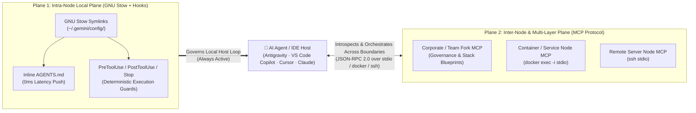
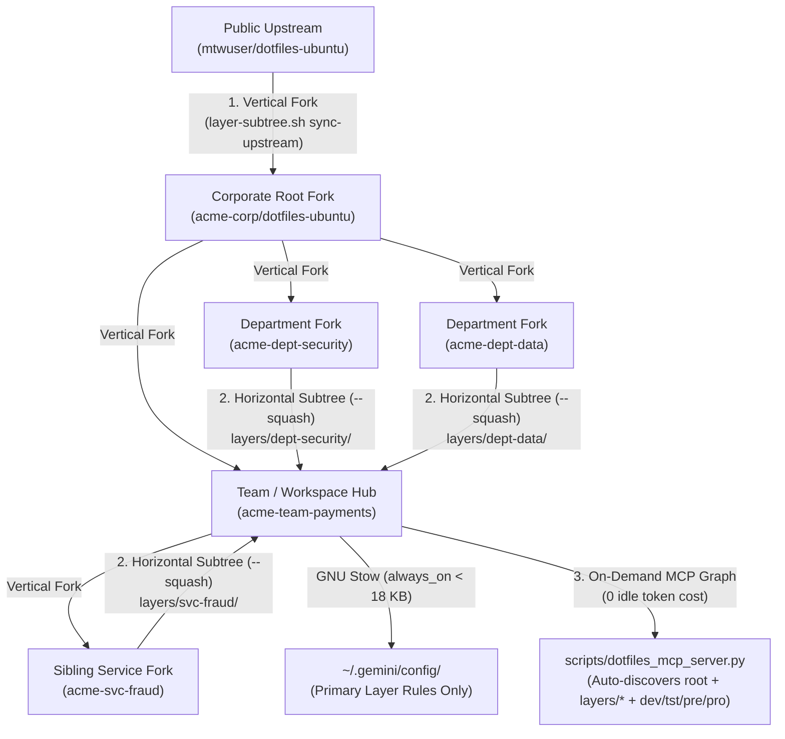

# Architecture 03: Contextual Layer & System MCP Server (`dotfiles-mcp`)

> **Normative Specification — Subsystem 3 ([`scripts/dotfiles_mcp_server.py`](../../scripts/dotfiles_mcp_server.py), `scripts/dotfiles_mcp/`, & [`system/mcp-layer.json`](../../system/mcp-layer.json))**
>
> This document defines the technical specification, protocol contracts (`Resources`, `Tools`, `Prompts`), security invariants, and federation schema for operating any `dotfiles-ubuntu` instance or fork as a **Model Context Protocol (MCP) Server** representing a specific governance layer, container, server, or application node.

---

## 1. Architectural Purpose: Bridging the Physical Boundary of GNU Stow

In `dotfiles-ubuntu`, Subsystem 1 ([`01_system_and_stow_engine.md`](01_system_and_stow_engine.md)) and Subsystem 2 ([`02_antigravity_governance_and_hooks.md`](02_antigravity_governance_and_hooks.md)) solve configuration and AI governance within a **single local filesystem (`$HOME`)** via GNU Stow symlinks and lifecycle hooks.

However, modern software systems frequently span boundaries that POSIX filesystem symlinks cannot cross:
- **Containerized Runtime Topologies**: Docker containers, Devcontainers, Kubernetes pods, or sidecar services where each container has its own isolated packages and runtime state.
- **Distributed Server & Node Architectures**: Multi-server staging/production nodes, data processing workers, or specialized GPU/ML hosts.
- **Multi-Tier Organizational Forks**: Separate Git forks for Corporate Governance (`Layer A`), Team/Domain Architecture (`Layer B`), and Service Nodes (`Layer C`) that are not simultaneously symlinked to `$HOME`.

By embedding an **optional, zero-dependency, read-only MCP server** (`scripts/dotfiles_mcp_server.py`) inside `dotfiles-ubuntu`, every fork, container, or server hosting the repository can expose its **system manifests, drift status, active governance rules, navigable `docs/`, and downstream MCP topology** over standard JSON-RPC 2.0.

### The Dual-Plane Architecture (Stow Local Plane vs. MCP Distributed Plane)



| Architectural Dimension | Plane 1: Local Host (GNU Stow + Lifecycle Hooks) | Plane 2: Distributed / Multi-Layer (`dotfiles-mcp`) |
|-------------------------|--------------------------------------------------|-----------------------------------------------------|
| **Transport Mechanism** | Local POSIX symlinks (`stow -t ~`) + `stdin`/`stdout` hooks | Model Context Protocol (JSON-RPC 2.0 over `stdio`, `docker run -i --rm`, `docker exec -i`, or `ssh`) |
| **Control Flow** | **Deterministic Push / Intercept** (mandatory on every turn/tool call) | **Contextual Pull / Introspection** (queried on demand by the agent) |
| **Primary Responsibility** | Enforce coding rules, block dangerous commands (`pre_tool_guard.py`), auto-format, and run unit tests locally | Expose container/server drift, resolve cross-layer rules & `docs/`, and federate downstream MCP servers across services |
| **Dependency Footprint** | GNU Stow + Bash + Python 3.14 stdlib | Python >= 3.10 stdlib only (**zero external pip packages**, compatible with Python 3.10–3.14+ across containers, CI, and Ubuntu 26.04) |

---

## 2. Non-Negotiable Design Boundaries & Security Invariants

To preserve the simplicity, security, and reliability of `dotfiles-ubuntu`, the MCP server implementation MUST obey five strict architectural constraints:

1. **100% Optional & Zero-Impact on Traditional Dotfiles Usage**:
   - Users who only use `bootstrap.sh`, `backup.sh`, and `audit.sh` never need to configure or run the MCP server. Nothing runs as a background daemon unless explicitly invoked by an MCP client over `stdio`.
2. **Zero External Dependencies & Modular Package Architecture (Pure Python Standard Library, Python >= 3.10)**:
   - `scripts/dotfiles_mcp_server.py` (thin CLI entrypoint) and the 12-module package `scripts/dotfiles_mcp/` (`constants.py`, `catalogs.py`, `manifest_helpers.py`, `surface_weaver.py`, `capsule_engine.py`, `fork_configurator.py`, `promotion_engine.py`, `node_base.py`, `resources.py`, `tools_federation.py`, `tools_compaction.py`, `tools_unfold.py`, `tools_surface.py`, `server.py` — every file `< 465` lines with a `0-byte` `__init__.py`) MUST use only the Python 3 standard library (`json`, `sys`, `os`, `pathlib`, `subprocess`, `re`, `platform`, `argparse`, `zlib`, `hashlib`, `hmac`, `base64`, `shutil`) with `from __future__ import annotations`. It must never require `pip install mcp`, `fastapi`, or a virtual environment, ensuring it runs out of the box on any Ubuntu container, CI runner, or remote server where `python3` (3.10 through 3.14+) is present.

### 2.1. `1:1:1` Source $\leftrightarrow$ Unit Test $\leftrightarrow$ Specification Traceability Matrix (Core Protocol & Federation)

| Core Subsystem | Source Module | `1:1` Unit Test | Normative Spec & Primary Responsibility |
|---|---|---|---|
| **CLI Entrypoint & Self-Test** | [`scripts/dotfiles_mcp_server.py`](../../scripts/dotfiles_mcp_server.py) | [`tests/unit/test_dotfiles_mcp_server.py`](../../tests/unit/test_dotfiles_mcp_server.py) (`TestDotfilesMCPServerCLI`) | **Arch 03 §7**: CLI flags (`--self-test`, `--layer-id`, `--layer-role`, `--log-dir`, `--no-log`), `run_self_test`, `main` |
| **Declarative Constants & Catalogs** | [`constants.py`](../../scripts/dotfiles_mcp/constants.py), [`catalogs.py`](../../scripts/dotfiles_mcp/catalogs.py) | *(Declarative constants verified via `1:1` consumer tests & `verify-repo.sh`)* | **Arch 03 §3–§4**: `PROTOCOL_VERSION`, `VALID_LAYER_ROLES`, `MCP_RESOURCES_CATALOG`, `MCP_TOOLS_CATALOG`, `MCP_PROMPTS_CATALOG` |
| **Manifest & System Helpers** | [`manifest_helpers.py`](../../scripts/dotfiles_mcp/manifest_helpers.py) | [`test_manifest_helpers.py`](../../tests/unit/dotfiles_mcp/test_manifest_helpers.py) (`TestManifestHelpers`) | **Arch 03 §3.1**: `_read_version`, `_read_os_pretty_name`, `_is_running_in_container`, `_parse_skill_frontmatter` |
| **Node Security, Manifests & Warnings** | [`node_base.py`](../../scripts/dotfiles_mcp/node_base.py) | [`test_node_base.py`](../../tests/unit/dotfiles_mcp/test_node_base.py) (`TestMCPNodeBase`) | **Arch 03 §2, §4, §6**: `MCPNodeBase`, `_load_layer_manifest`, `_discover_mounted_layers`, `_resolve_safe_path`, `_emit_warning` |
| **MCP Resources & Telemetry** | [`resources.py`](../../scripts/dotfiles_mcp/resources.py) | [`test_resources.py`](../../tests/unit/dotfiles_mcp/test_resources.py) (`TestResourcesMixin`) | **Arch 03 §3.1, §6.3**: `ResourcesMixin`, `list_resources`, `read_resource` (`9` URIs), `_read_diagnostics_resource` |
| **Node Audit & Federation Tools** | [`tools_federation.py`](../../scripts/dotfiles_mcp/tools_federation.py) | [`test_tools_federation.py`](../../tests/unit/dotfiles_mcp/test_tools_federation.py) (`TestFederationToolsMixin`) | **Arch 03 §3.2, §5, §6.1**: `FederationToolsMixin` (`get_layer_overview`, `audit_node_drift`, `read_layer_document`, `discover_federated_mcps`, `compare_layer_patterns`) |
| **JSON-RPC 2.0 Dispatcher & `stdio` Loop** | [`server.py`](../../scripts/dotfiles_mcp/server.py) | [`test_server.py`](../../tests/unit/dotfiles_mcp/test_server.py) (`TestDotfilesMCPServerDispatcher`) | **Arch 03 §3, §6.3**: `DotfilesMCPServer`, `handle_request`, `run_stdio_loop` (`Content-Length` & newline framing) |
| **Compaction (`rcap1`), Surface (`0..N`) & Promotion Engines** | `capsule_engine.py`, `tools_compaction.py`, `tools_unfold.py`, `surface_weaver.py`, `tools_surface.py`, `fork_configurator.py`, `promotion_engine.py` | `test_capsule_engine.py`, `test_tools_compaction.py`, `test_tools_unfold.py`, `test_surface_weaver.py`, `test_tools_surface.py`, `test_fork_configurator.py`, `test_promotion_engine.py` | **See [`04_compaction_surface_and_promotion_engines.md`](04_compaction_surface_and_promotion_engines.md) §§1–4** |
3. **Strictly Read-Only & Deterministic Execution (No Arbitrary Shell)**:
   - In accordance with [`SECURITY.md`](../../SECURITY.md), the MCP server MUST NEVER expose a generic `run_command` or `exec_shell` tool, nor any tool that modifies files, installs packages, or alters Git state.
   - The only subprocesses it may spawn are deterministic, read-only repository scripts (`./audit.sh` without `--clean`, and `./scripts/verify-repo.sh`) with fixed argument lists (`shell=False`) and strict timeouts.
4. **Strict Path Containment & Secret Exclusion**:
   - File-reading tools and resources MUST resolve paths via `Path.resolve()` and verify they reside strictly inside the `dotfiles-ubuntu` repository root (`REPO_DIR`).
   - Machine-local secret overrides (`~/.bashrc.local`, `~/.gitconfig.local`, `.env`, `~/.gemini/*.json`) and directories outside `REPO_DIR` are structurally unreachable.
5. **Complementary to Local `AGENTS.md` (Never a Replacement)**:
   - On the developer's local workstation, `AGENTS.md` and `hooks.json` remain symlinked via GNU Stow so `PreToolUse` guards cannot be bypassed. The MCP server is used for programmatic introspection, multi-fork layer resolution, and cross-container / cross-server diagnostics.

---

## 3. MCP Protocol Contract (`scripts/dotfiles_mcp_server.py`)

The server implements the Model Context Protocol (`protocolVersion: "2024-11-05"` / backward-compatible JSON-RPC 2.0 over newline-delimited `stdio` or `Content-Length` framed streams) and declares three capability groups: `resources`, `tools`, and `prompts`.

### 3.1. MCP Resources (`resources/list` & `resources/read`)

Each `dotfiles-ubuntu` instance exposes nine canonical URI resources representing its identity, system manifests, governance rules, documentation graph, federated MCP topology, and live runtime diagnostics:

| Resource URI | MIME Type | Source Files in Repository | Returned Payload Description |
|--------------|-----------|----------------------------|------------------------------|
| `dotfiles://layer/identity` | `application/json` | `VERSION`, `system/mcp-layer.json`, `/etc/os-release`, `/.dockerenv`, `git rev-parse` / `DOTFILES_GIT_COMMIT` | Node & layer identity: SemVer `version`, `layer_id`, `layer_role` (`corporate`, `department`, `team`, `service-node`, `environment-cluster`, `workstation`), `hostname`, `in_container` (boolean), `os_pretty_name`, `git_commit`, and `upstream_layer`. |
| `dotfiles://system/manifests` | `application/json` | `system/*.txt` (`packages-manual`, `snaps`, `npm-globals`, `nvm-default`, `external`, `gnome-extensions`) | Structured JSON dictionary containing counts and package lists for every declarative manifest tracked by this node/container. |
| `dotfiles://governance/rules` | `text/markdown` | `antigravity/.gemini/config/AGENTS.md` | The complete `Layer A` universal behavioral and engineering rules active in this repository fork. |
| `dotfiles://governance/hooks` | `application/json` | `antigravity/.gemini/config/hooks.json` | Lifecycle hook configuration (`PreToolUse`, `PostToolUse`, `PostInvocation`, `Stop`) active in this layer. |
| `dotfiles://governance/skills` | `application/json` | `antigravity/.gemini/config/skills/*/SKILL.md` | Catalog of all global skills in this layer, extracted from YAML frontmatter (`name`, `description`, `path`, `line_count`). |
| `dotfiles://governance/templates` | `application/json` | `templates/*/` | Inventory of `Layer B` stack starter templates available in this fork, including their `rules/`, `skills/`, and `governance/` files. |
| `dotfiles://docs/index` | `text/markdown` | `docs/README.md` | The navigable documentation index and subsystem map for this repository or layer. |
| `dotfiles://mcp/topology` | `application/json` | `system/mcp-layer.json` | Declarative federation manifest listing downstream or sibling MCP servers associated with this layer, container, or service node, along with the governance rules that apply when calling them. |
| `dotfiles://mcp/diagnostics` | `application/json` | `logs/mcp_events.jsonl`, `logs/mcp_alerts.jsonl` | Live telemetry summary of recent MCP JSON-RPC calls (`total_events`, `error_events`, `max_response_bytes`, `recent_events`) and structured runtime warnings/alerts (`total_alerts`, `by_code`, `recent_alerts`). |

### 3.2. MCP Tools (`tools/list` & `tools/call`)

The server exposes eight read-only, deterministic tools for live node auditing, multi-resolution resonant rule compaction/unfolding, stack-agnostic multi-layer surface projection (`0..N` layers), targeted documentation retrieval, and multi-MCP orchestration:

| Tool Name | Input Arguments (`inputSchema`) | Execution Logic & Security Gate | Output Summary |
|-----------|---------------------------------|---------------------------------|----------------|
| **`get_layer_overview`** | `layer`: optional string (`"root"` or a mounted subtree name/`layer_id` in `layers/*`) | Returns a compact **4-Channel Executive Digest** of the target layer: (1) Node & System State, (2) Governance & Stack Contracts, (3) Active Invariants, Token-Budget Utilization, Context Compaction Protocol (`rcap1`), & Warnings, and (4) Navigable Docs, Mounted `layers/*` Subtrees, Supported Environments (`dev`, `tst`, `pre`, `pro`), & Federated MCPs. | JSON digest (`< 2 KB`) giving an agent immediate situational awareness. |
| **`audit_node_drift`** | `mode`: `"verify-repo"` \| `"system-audit"` \| `"both"` (default `"verify-repo"`) | Executes `./scripts/verify-repo.sh` and/or `./audit.sh` in read-only mode via `subprocess.run(..., shell=False, timeout=30)` with `NO_COLOR=1`. Never runs `--clean`. | JSON report with `healthy` (boolean), `exit_code`, and clean text output showing any symlink, package, or metadata drift on that container/server. |
| **`read_layer_document`** | `relative_path`: string, `layer`: optional string (`"root"` or a mounted subtree in `layers/*`) | Resolves `(target_layer_dir / relative_path).resolve()`, verifies `target.is_relative_to(target_layer_dir)`, and enforces an allowlist of readable directories (`docs/`, `templates/`, `antigravity/`, `system/`, root `.md` files). | Full Markdown or text content of the requested specification. |
| **`query_governance_rules`** | `query`: string, `scope`: `"all"` \| `"global"` \| `"templates"` \| `"docs"`, `layer`: `"all"` \| `"root"` \| `<subtree>` (default `"all"`), `resolution`: `"L0"` \| `"L1"` \| `"L2"` (default `"L2"`), `environment`: optional `"dev"` \| `"tst"` \| `"pre"` \| `"pro"`, `resonance_key`: optional string, `include_capsules`: optional boolean | Case-insensitive section-aware search across `AGENTS.md`, `templates/*/rules/*.md`, and `docs/**/*.md` across the root layer and/or all mounted `git subtree` layers (`layers/*/`). Supports multi-resolution compaction (`L0` Promoter Codons, `L1` Axiom Skeletons, `L2` Full Sections) and seals chained `rcap1` context capsules. | Matching rule sections with `promoter_codon`, `capsule_token` (`rcap1...`), and `token_compaction_metrics`. |
| **`unfold_context_capsule`** | `capsule_token`: string (`"rcap1.<header>.<payload>.<sig>"`), `target_level`: optional `"L0"` \| `"L1"` \| `"L2"` \| `"L3"`, `agent_tier`: `"flash"` \| `"inherit"` \| `"pro"` (default `"inherit"`), `environment`: optional `"dev"` \| `"tst"` \| `"pre"` \| `"pro"`, `resonance_key`: optional string | Verifies the surface Promoter Codon header & HMAC-SHA256 chain link, enforces agent capability (`flash` capped at `L1`) and environment clearance, and progressively decrypts (`SHA-256 CTR`) and decompresses (`zlib`) the capsule interior (`L0 → L1 → L2 → L3`). | Unfolded level content (`L1` skeleton, `L2` full section, or `L3` linked skills/specs + guardrails) and `next_capsule_token`. |
| **`discover_federated_mcps`** | `filter_role`: optional string, `environment`: optional `"dev"` \| `"tst"` \| `"pre"` \| `"pro"`, `layer`: `"all"` \| `"root"` \| `<subtree>` (default `"all"`) | Aggregates registered downstream/sibling MCP servers from `system/mcp-layer.json` across the root layer and mounted `layers/*/` subtrees, filtered by `role`, `layer`, and target `environment`, attaching the active environment's `access_mode`, `requirements_file`, and `default_guardrails`. | JSON list of federated MCP descriptors, mounted subtrees, and environment safety rules. |
| **`compare_layer_patterns`** | `project_rules`: array of strings, `project_skills`: array of strings, `layer`: optional string (`"all"` \| `"root"` \| `<subtree>`, default `"all"`) | Compares a consumer project's rule/skill inventory across `1..N` layers (`Root` + mounted `layers/*` + `templates/*`), filters out materialized `layer-<NN>-<name>.md` files into `materialized_layer_rules`, and generates deterministic `promotion_routing` recommendations (`target_layer`, `target_role`, `target_destination`, `subtree_push_command`, `root_agents_md_headroom_bytes`). | JSON classification (`compared_against_layer`, `layers_scanned`, `materialized_layer_rules`, `already_in_layer_a_skills`, `already_in_layer_b_templates`, `candidates_for_upward_promotion`, `promotion_routing`). |
| **`resolve_surface_governance`** | `target_path`: optional string, `architectural_plane`: optional `"schema"` \| `"domain"` \| `"application"` \| `"presentation"` \| `"infrastructure"` \| `"testing"`, `scope`: optional string, `traits`: optional array of strings, `environment`: optional `"dev"` \| `"tst"` \| `"pre"` \| `"pro"`, `resolution_override`: optional `"L0"` \| `"L1"` \| `"L2"`, `resonance_key`: optional string, `include_capsules`: optional boolean | Projects and weaves effective governance bindings (`manifest["surface_bindings"]` merged and deduplicated by `binding_id` with `recommended_surface_bindings` from active `templates/<name>/template.json` packs via `collect_layer_effective_bindings`) across `0..N` layers (`Root` + arbitrary mounted `layers/*` subtrees) for a target application surface. Automatically infers `effective_plane` and `effective_scope` from `target_path`, prunes non-intersecting layers (`0` token cost), orders matching bindings by numeric `precedence` (`0..100`, *Lex Superior*), and applies adaptive `rcap1` compaction (`L2` for `authoritative` bindings, `L1` for `transversal` bindings). | Ordered `participating_layers`, `pruned_layers`, `resolved_bindings` (with `rcap1` capsules), merged `effective_invariants`, `canonical_templates`, and `token_compaction_metrics`. |

### 3.3. MCP Prompts (`prompts/list` & `prompts/get`)

| Prompt Name | Arguments | Purpose |
|-------------|-----------|---------|
| **`orient-on-layer`** | `task_description` (optional) | Instructs the agent to call `get_layer_overview` and `dotfiles://docs/index` first, returning a 4-Channel Executive Digest of the target node/layer before proposing changes. |
| **`audit-container-or-node`** | `target_service` (optional) | Guides the agent through executing `audit_node_drift(mode="both")` and cross-checking `dotfiles://system/manifests` to diagnose environment discrepancies across containers or servers. |
| **`orchestrate-federated-mcps`** | `workflow_goal` (required), `environment` (optional), `layer` (optional) | Instructs the agent to call `discover_federated_mcps` (scoped by `environment` and `layer`) and `query_governance_rules` on the layer MCP **before** invoking any downstream infrastructure/database MCP server, enforcing `effective_guardrails` and `activation_policy`. |

---

## 4. Declarative Layer & MCP Federation Schema (`system/mcp-layer.json`)

To enable multi-layer and multi-service orchestration without hardcoding machine-specific topologies or organizational department names into scripts, `dotfiles-ubuntu` supports an optional, declarative manifest at **`system/mcp-layer.json`** (`schema_version: "1.2"`).

When a team, department, or engineer forks `dotfiles-ubuntu` for a specific corporate layer, domain-policy module, team archetype, or service container, they customize `system/mcp-layer.json` to describe **what this node is**, **its numeric deontic `precedence` (`0..100`)**, **its stack-agnostic `surface_bindings`**, **its environment safety profiles (`dev/tst/pre/pro`)**, and **which MCP servers belong to its context**:

```json
{
  "schema_version": "1.2",
  "layer_id": "dotfiles-ubuntu-default",
  "layer_role": "workstation",
  "precedence": 10,
  "description": "Declarative Ubuntu 26.04 LTS & Google Antigravity 2.0 Reference Layer (Corporate / Workstation Baseline)",
  "upstream_layer": {
    "layer_id": "mtwuser/dotfiles-ubuntu",
    "repository": "https://github.com/mtwuser/dotfiles-ubuntu.git",
    "branch": "master"
  },
  "mounted_layers_dir": "layers",
  "mounted_layers": [],
  "default_stack_templates": [
    "fastapi-hexagonal"
  ],
  "baseline_guardrails": [
    "AGENTS.md §1 (Reusability First — scan workspace before creating duplicates)",
    "AGENTS.md §4 (Absolute Test Inclusion — 100% branch coverage & AAA pattern)",
    "AGENTS.md §7 (Zero-Backward Law — no legacy shims or aliases)"
  ],
  "surface_bindings": [
    {
      "binding_id": "universal-engineering-baseline",
      "target_globs": ["**"],
      "architectural_planes": ["*"],
      "scopes": ["*"],
      "traits": [],
      "mode": "transversal",
      "rule_files": ["antigravity/.gemini/config/AGENTS.md"],
      "canonical_templates": [],
      "invariants": [
        "AGENTS.md §1 (Reusability First — scan workspace before creating duplicates)",
        "AGENTS.md §2 (Professional Robustness — strongly typed, scalable implementations)",
        "AGENTS.md §7 (Zero-Backward Law — no legacy shims, aliases, or @deprecated branches)"
      ]
    }
  ],
  "environments": {
    "dev": {
      "description": "Local workstation or devcontainer development environment",
      "access_mode": "read-write-local",
      "requirements_file": "requirements-dev.txt",
      "default_guardrails": [
        "AGENTS.md §4 (Absolute Test Inclusion — 100% branch coverage)",
        "AGENTS.md §8 (Mandatory Pre-Commit Hygiene Scan)"
      ]
    },
    "pre": {
      "description": "Pre-production staging and release validation environment",
      "access_mode": "strictly-read-only",
      "requirements_file": "requirements-pre.txt",
      "default_guardrails": [
        "Strictly read-only observability, schema drift, and contract inspection",
        "No manual schema mutations; all migrations must flow through CI/CD"
      ]
    }
  },
  "federated_mcps": [
    {
      "mcp_id": "google-developer-knowledge",
      "role": "documentation-grounding",
      "layer": "corporate",
      "activation_policy": "on-demand",
      "environments": ["dev", "tst", "pre", "pro"],
      "description": "Official Google Cloud, Gemini, Android, Firebase, and Web documentation retrieval.",
      "when_to_invoke": "Invoke on demand when verifying official Google Cloud, Gemini, Android, Firebase, or Web API specifications.",
      "avoid_when": "Do not invoke when inspecting local repository code, internal domain models, or offline unit tests.",
      "required_guardrails": [
        "AGENTS.md §5 (Documentation Hierarchy & Discrepancy Scans)",
        "AGENTS.md §12 (Generated Output Verification)"
      ]
    }
  ]
}
```

### Valid `layer_role` Values

| `layer_role` | Typical Deployment Target | Primary Purpose in the Context Mesh |
|--------------|---------------------------|-------------------------------------|
| **`corporate`** | Organization-wide fork (`acme-corp/dotfiles-ubuntu`) | Exposes transverse `Layer A` security, typing, and testing mandates (`AGENTS.md`) plus enterprise-approved MCP catalog. |
| **`department`** | Cross-cutting departmental fork (`acme-dept-security`, `acme-dept-data`, `acme-dept-legal`) | Exposes department-specific compliance rules, data/cloud governance docs, `surface_bindings`, and departmental MCP servers; mounted into team/project repos via `git subtree` (`layers/<slug>`). |
| **`domain-policy`** | Arbitrary regulatory, brand, or business-domain policy module (`layers/eu-gdpr`, `layers/brand-system`) | Exposes stack-agnostic `surface_bindings`, canonical templates, and domain invariants projected onto matching application surfaces via `resolve_surface_governance`. |
| **`team`** | Team or domain fork (`acme-team-payments`) | Exposes `Layer B` stack starter templates (`templates/<stack>/`), domain conventions, and shared team MCP servers. |
| **`service-node`** | Application container, Devcontainer, or sibling service fork (`layers/svc-*` or `/opt/dotfiles-ubuntu`) | Exposes the service's package manifest (`system/*`), drift status (`audit_node_drift`), service `docs/`, and service-local MCPs (database, cache, queue) across `dev`, `tst`, `pre`, `pro`. |
| **`environment-cluster`** | Shared environment topology fork (`layers/env-pre-cluster`) | Exposes cluster-wide observability and deployment guardrails for a specific environment tier (`tst`, `pre`, `pro`). |
| **`workstation`** | Developer PC (`~/dotfiles-ubuntu`) | Default role combining local GNU Stow management with local MCP introspection and mounted `layers/*` subtrees. |

---

## 5. Multi-Dimensional Context Graph: `git fork` + `git subtree` (`layers/`) + Environment Profiles (`dev/tst/pre/pro`)

A single linear chain of Git forks (`Public → Corporate → Team`) can only represent **vertical inheritance** from a single parent. Real enterprise architectures, however, are **multi-dimensional Directed Acyclic Graphs (DAGs)** where a project simultaneously intersects:
1. **Corporate governance** (vertical parent fork),
2. **Multiple cross-cutting Departments** (e.g., Security, Data Platform, Cloud/SRE),
3. **Sibling Microservices** with coupled APIs/events, and
4. **Multiple Deployment Environments** (`dev`, `tst`, `pre`, `pro`).

`dotfiles-ubuntu` resolves this multi-dimensional orchestration without blowing past the IDE's 20,000-token `defaultRulesBudget` by combining **three orthogonal mechanisms**:



1. **Vertical Inheritance via `git fork` (`./scripts/layer-subtree.sh sync-upstream`)**:
   - Keeps the repository's primary root synchronized with its upstream parent (`Public → Corporate → Team`).
2. **Horizontal / Cross-Departmental Composition via `git subtree` (`./scripts/layer-subtree.sh add | pull | push`)**:
   - Secondary forks (Departmental governance repos, sibling service MCP repos, or cluster topologies) are mounted under the non-stow **`layers/<layer-name>/`** directory using `git subtree --squash`.
   - Because `bootstrap.sh` and `audit.sh` skip `layers/`, mounted subtrees add **0 bytes** to the `always_on` `~/.gemini/config/AGENTS.md` token budget.
   - Instead, `scripts/dotfiles_mcp_server.py` automatically discovers every subtree under `layers/*/` and exposes its `docs/`, `AGENTS.md`, `templates/`, and `federated_mcps` on demand (`layer="all"` or `layer="<layer-name>"`).
3. **Transversal Environment Profiles (`environments: {dev, tst, pre, pro}` + `requirements-<env>.txt`)**:
   - Rather than duplicating Git repositories for every environment of the same service, `system/mcp-layer.json` defines environment-specific access modes (`read-write-local` in `dev`, `read-and-test-trigger` in `tst`, `strictly-read-only` in `pre`, `strictly-read-only-audited` in `pro`), default guardrails, and `requirements-<env>.txt` pointers.

---

## 6. Controlled On-Demand MCP Orchestration, Runtime Warnings & Structured Logging (`logs/`)

To prevent **two opposite failure modes** in multi-dimensional context graphs — **(1) silent context/token truncation** and **(2) uncontrolled MCP fan-out or missing corporate guardrails** — `dotfiles-ubuntu` enforces deterministic runtime controls across both planes:

### 6.1. Hierarchical Guardrail Inheritance (`effective_guardrails`) & On-Demand Activation Policy

When `discover_federated_mcps` resolves MCP servers across the root repository, mounted `layers/*` subtrees, and target `dev/tst/pre/pro` environments, a downstream subtree can **never** strip or bypass parent corporate or environment safety rules. For every discovered MCP entry, `scripts/dotfiles_mcp_server.py` computes **`effective_guardrails`** as the deduplicated union of four hierarchical levels:

$$\text{effective\_guardrails} = \text{Root } \texttt{baseline\_guardrails} \cup \text{Subtree } \texttt{baseline\_guardrails} \cup \text{Environment } \texttt{default\_guardrails} \cup \text{MCP } \texttt{required\_guardrails}$$

Additionally, every federated MCP entry carries explicit **on-demand routing metadata** so the AI agent neither under-uses nor over-uses underlying MCP servers:
- `activation_policy`: `"on-demand"` (never poll or invoke speculatively).
- `when_to_invoke`: Explicit task trigger condition for invoking the MCP.
- `avoid_when`: Explicit condition under which the agent must skip the MCP and use local context instead.

### 6.2. Runtime Warning & Alert Catalog (In-Band + Out-of-Band)

Both `post_invocation_lint.py` (local `PostInvocation` hook) and `scripts/dotfiles_mcp_server.py` actively monitor token budgets, truncation boundaries, subtree lineage, and MCP fan-out:

| Warning Code | Severity | Trigger Condition | Purpose |
|--------------|:--------:|-------------------|---------|
| `TOKEN_BUDGET_NEAR_LIMIT` | `WARN` | `AGENTS.md` $\ge 16,000$ bytes ($88\%$ of 18 KB cap) | Early warning before `AGENTS.md` reaches the 18,000-byte ceiling (`channel_3_active_invariants_and_hooks.agents_md_budget_utilization_pct`). |
| `TOKEN_BUDGET_EXCEEDED` | `CRITICAL` | `AGENTS.md` $> 18,000$ bytes | Alerts that `AGENTS.md` exceeds the hard cap and risks silent rule truncation in the IDE. |
| `WORKSPACE_RULES_BUDGET_EXCEEDED` | `WARN` | Combined `always_on` rules (`AGENTS.md` + workspace `.agents/rules/*.md`) $> 80,000$ bytes (~20k tokens) | Emitted by `post_invocation_lint.py` (`check_rules_token_budget`) when combined active rules exceed the 20,000-token budget. |
| `RESPONSE_TRUNCATED` | `WARN` | `query_governance_rules` matches $> 15$ sections / $> 1,500$ chars, or `unfold_context_capsule` (`L2`/`L3`) exceeds $8,000$-char section / $5 \times 4,000$-char `L3` link caps | Alerts the AI agent in-band (`truncated: true`) that results were capped and recommends narrowing `query`/`scope`/`layer` or calling `read_layer_document`. |
| `LARGE_MCP_PAYLOAD_WARNING` | `WARN` | Any MCP JSON-RPC response exceeds $16,000$ bytes (~4,000 tokens) | Alerts when a single MCP call consumes significant context window capacity. |
| `MCP_FANOUT_WARNING` | `WARN` | Unfiltered `discover_federated_mcps` returns $> 3$ MCPs without `environment` or `filter_role` | Prevents indiscriminate multi-MCP fan-out across layers and environments. |
| `SUBTREE_LINEAGE_WARNING` | `WARN` | A mounted `layers/<name>/` subtree is missing `upstream_layer.repository` | Detects orphan subtrees lacking upstream Git lineage. |
| `TEMPLATE_PACK_MISSING` | `WARN` | An entry in `default_stack_templates` does not exist under `templates/<name>/` | Detects stale or unmounted template pack references in `system/mcp-layer.json` (`init-fork --prune-default-templates` or `scaffold-template`). |
| `NODE_DRIFT_DETECTED` | `WARN` | `audit_node_drift` detects non-zero exit from `verify-repo.sh` or `audit.sh` | Records repository or OS/Stow drift in `logs/mcp_alerts.jsonl`. |
| `CAPSULE_CAPABILITY_INSUFFICIENT` | `WARN` | `unfold_context_capsule` called with insufficient `agent_tier` (e.g., `"flash"` requesting `L2`/`L3` or `"inherit"` requesting `L3` in `pro`) | Enforces `AGENTS.md §13` model delegation discipline at the cryptographic MCP boundary. |
| `CAPSULE_RESONANCE_DENIED` | `WARN` | Missing `resonance_key` when `header.kr=true`, invalid `resonance_key`, tampered HMAC signature, or mismatched `environment` on `rcap1` capsule | Detects unauthorized, unauthenticated, or cross-environment capsule unfolding attempts. |
| `CAPSULE_CHAIN_BROKEN` | `WARN` | Malformed `rcap1` envelope, corrupted `zlib` stream, or level-scoped `parent_hash`/section/`L3` SHA-256 content drift mismatch | Guarantees cryptographic chain integrity and level-scoped live drift detection across multi-hop Matryoshka unfolding (`L0->L1`, `L1->L2`, `L2->L3`). |
| `SURFACE_PRECEDENCE_COLLISION` | `WARN` | Two or more distinct layers match a surface with identical `(precedence, mode)` during `resolve_surface_governance` | Alerts that equal-precedence layers collided on the same surface and were tie-broken via *Lex Specialis* (`specificity_score`), recommending distinct `precedence` (`0..100`) values in `system/mcp-layer.json`. |
| `SURFACE_ASSET_MISSING` | `WARN` | A matched `surface_binding` references a `rule_file` or `canonical_template` that does not exist on disk in its layer | Detects governance metadata drift (`rule_files` or `canonical_templates` pointing to missing files) while preventing ghost templates from entering the response. |
| `SECURITY_OR_VALIDATION_ERROR` | `ERROR` | Path traversal attempt (`../`), invalid `layer`/`environment`/`precedence`/`mode`, unsupported `schema_version`, or missing file | Records security containment or parameter validation rejections in `logs/mcp_alerts.jsonl`. |

### 6.3. Structured JSONL Audit & Alert Logs (`logs/mcp_events.jsonl` & `logs/mcp_alerts.jsonl`)

When running in MCP mode, `scripts/dotfiles_mcp_server.py` automatically writes structured JSON Lines to `<repo>/logs/` (configurable via `--log-dir <path>`, `DOTFILES_MCP_LOG_DIR`, or disabled via `--no-log`):
- **`logs/mcp_events.jsonl`**: Records every JSON-RPC request (`ts`, `method`, `target`, `layer`, `environment`, `duration_ms`, `response_bytes`, `estimated_tokens`, `warning_count`, `status`, plus compaction telemetry `resolution`, `tokens_saved`, `savings_pct`, `unfolded_level`, `agent_tier`, `decrypted_hops`).
- **`logs/mcp_alerts.jsonl`**: Dedicated stream of `WARN`, `ERROR`, and `CRITICAL` alerts for instant operator inspection (`tail -f ~/dotfiles-ubuntu/logs/mcp_alerts.jsonl`).
- **`dotfiles://mcp/diagnostics` (`resonance_compaction_summary`)**: Aggregates live behavioral compaction metrics (`queries_by_resolution`, `unfolds_by_target_level`, `unfolds_by_agent_tier`, `total_decrypted_hops`, `cumulative_tokens_saved`, and `capsule_alerts_by_code`).
- **Automatic Size Rotation & Container Safety**: Each log file automatically rotates to `.jsonl.1` at `512 KB`, is ignored by Git and GNU Stow (`[ "$module" = "logs" ] && continue`), and gracefully suppresses `OSError` when mounted on a read-only container filesystem (`:ro`).

### 6.4. Specialized Engines (`rcap1` Compaction, `0..N` Surface Projection, & Multi-Layer Promotion)

To keep each architecture specification modular (`< 465` lines) and aligned `1:1` with its implementation and test modules, the normative specifications for the three specialized engines are maintained in **[`docs/architecture/04_compaction_surface_and_promotion_engines.md`](04_compaction_surface_and_promotion_engines.md)**:
- **§2 — Resonant Chained Context Compaction & Unfolding (`rcap1`: `L0 → L1 → L2 → L3`)**: `Promoter Codon → Exon Axiom Skeleton → Full Section → Deep L3 Links`, Matryoshka HMAC-SHA256 + `zlib` + SHA-256 CTR onion encryption (`capsule_engine.py`, `tools_compaction.py`, `tools_unfold.py`), `agent_tier` capability gating (`CAPSULE_CAPABILITY_INSUFFICIENT`, `CAPSULE_RESONANCE_DENIED`, `CAPSULE_CHAIN_BROKEN`), and TOCTOU line-drift relocation.
- **§3 — Stack-Agnostic Multi-Layer Surface Projection & Governance Weaver (`0..N` Layers via `resolve_surface_governance`)**: 4 universal selectors (`target_globs`, `architectural_planes`, `scopes`, `traits`), numeric deontic `precedence` (`0..100`, *Lex Superior*), *Lex Specialis* specificity tie-breaking (`SURFACE_PRECEDENCE_COLLISION`), `SURFACE_ASSET_MISSING`, and automatic `template.json` binding merging (`collect_layer_effective_bindings` in `surface_weaver.py` & `tools_surface.py`).
- **§4 — Polymorphic Fork Configurator (`template.json`), Static Materialization & Multi-Layer Promotion Engine**: `init-fork`, `list-templates`, `scaffold-template`, `apply-project`, `compare_layer_patterns(layer="all")` (`promotion_routing`), `diff-project`, and `promote-from-project` (`fork_configurator.py` & `promotion_engine.py`).

---

## 7. Verification & Self-Test Contract

To guarantee that `scripts/dotfiles_mcp_server.py` and `scripts/layer-subtree.sh` remain deterministic and pass CI on every commit:
1. **CLI Flags (`--help`, `--version`, `--self-test`, `--log-dir`, `--no-log`, `list`)**:
   - Running `./scripts/dotfiles_mcp_server.py --self-test` executes an in-process JSON-RPC 2.0 round-trip test verifying `initialize`, `resources/list`, `resources/read`, `tools/list`, `tools/call` (`get_layer_overview`, `discover_federated_mcps`, `query_governance_rules`, `unfold_context_capsule`, `resolve_surface_governance`), `prompts/list`, and JSONL event/alert log generation without requiring an external MCP client.
   - Running `./scripts/layer-subtree.sh list` inspects `layers/*/` and reports all mounted context subtrees.
2. **CI & Container Gate Integration (`scripts/verify-repo.sh` & `Dockerfile`)**:
   - `scripts/verify-repo.sh` compiles `scripts/dotfiles_mcp_server.py` (`py_compile`), lints it with `ruff check` and `mypy --strict`, validates `system/mcp-layer.json` schema (`v1.2`) and `Dockerfile` contract (`FROM ubuntu:26.04`, non-root `USER ubuntu`, `/opt/dotfiles-ubuntu`), runs `./scripts/layer-subtree.sh list` and `./scripts/dotfiles_mcp_server.py --self-test`, and enforces **100.00% statement and branch coverage** via `pytest`.
   - `Dockerfile` executes `python3 /opt/dotfiles-ubuntu/scripts/dotfiles_mcp_server.py --self-test --no-log` and `/opt/dotfiles-ubuntu/scripts/layer-subtree.sh list` during `docker build` (`make docker-build` / `make docker-self-test`), guaranteeing that every built image is self-verified and ready for both standalone `docker run -i --rm` execution and multi-stage `COPY --from` sidecar injection.
