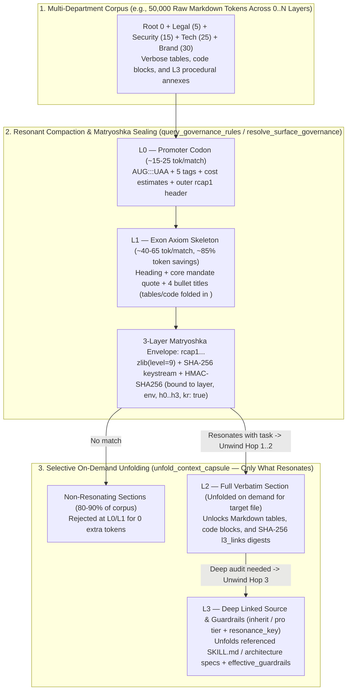

# Architecture 04: Resonant Compaction (`rcap1`) & Surface Projection (`0..N`) Engines (`capsules/`)

> **Normative Specification — Subsystem 3B (`scripts/dotfiles_mcp/capsules/{capsule_engine,surface_weaver,tools_compaction,tools_unfold,tools_surface}.py`)**
>
> This document specifies the **`capsules/`** bounded-domain subpackage (Subpackage 2 of `scripts/dotfiles_mcp/`):
> 1. **Resonant Chained Context Compaction & Unfolding (`rcap1`: `L0 → L1 → L2 → L3`)**
> 2. **Stack-Agnostic Multi-Layer Surface Projection & Governance Weaver (`0..N` Layers)**
>
> For the core JSON-RPC 2.0 protocol contract (`core/` & `mcp_node/`), see **[`03_contextual_mcp_and_federation.md`](03_contextual_mcp_and_federation.md)**; for OOP capability rings and ephemeral bots (`mcp_node/`), see **[`05_ephemeral_forks_and_department_bots.md`](05_ephemeral_forks_and_department_bots.md)**; for fork parameterization, 1-hop horizon, RBAC authority, task-branch workflows, and upward promotion (`governance/` & `scripts/layer-config.sh`), see **[`06_layer_governance_and_promotion_engines.md`](06_layer_governance_and_promotion_engines.md)**.

---

## 1. `1:1:1` Source $\leftrightarrow$ Unit Test $\leftrightarrow$ Specification Traceability Matrix (`capsules/`)

Every engine module in `scripts/dotfiles_mcp/capsules/` maintains a strict `1:1:1` alignment between its subpackage-mirrored `1:1` unit test suite (`100.00%` isolated single-file branch coverage, `< 465` lines) and its bidirectional docstring pointer (`Specification: docs/architecture/04_compaction_surface_and_promotion_engines.md`):

| Subpackage & Domain | Normative Section & Primary Symbols | Source Module (`scripts/dotfiles_mcp/capsules/`) | `1:1` Unit Test (`tests/unit/dotfiles_mcp/capsules/`) |
|---|---|---|---|
| **`capsules/` — Resonant Capsule Crypto & Compression** | **§2 & Arch 05 §5.3**: `CapsuleError`, `_seal_single_capsule`, `_parse_capsule_envelope`, `_derive_chain_key`, `_xor_keystream`, `_extract_axiom_skeleton`, `_resolve_section_hierarchy`, `_extract_l3_links`, `seal_ephemeral_digest_capsule`, `unseal_ephemeral_digest_capsule`, `seal_dmcp_context_frame`, `verify_dmcp_context_frame` | [`capsules/capsule_engine.py`](../../scripts/dotfiles_mcp/capsules/capsule_engine.py) | [`capsules/test_capsule_engine.py`](../../tests/unit/dotfiles_mcp/capsules/test_capsule_engine.py) (`TestCapsuleEngine`) |
| **`capsules/` — Multi-Resolution Rule Search, Epistemic Grading & Contextual Claim Proofs** | **§2, §2.7 & §2.8**: `CompactionToolsMixin`, `infer_epistemic_grade`, `verify_epistemic_context_claims` (including `CITATION_DRIFT_DETECTED`), `_build_section_capsule` (with `epistemic_grade`, `heading_depth`, `section_path`, `citation_receipt` & `l3_targets` beacons), `_tool_query_governance_rules` (with `min_epistemic_grade`, `E3->E0` + vertical `heading_depth`/`start_line` sorting & zero-checkout `branch_ref` `dmcp_projection`) | [`capsules/tools_compaction.py`](../../scripts/dotfiles_mcp/capsules/tools_compaction.py) | [`capsules/test_tools_compaction.py`](../../tests/unit/dotfiles_mcp/capsules/test_tools_compaction.py) (`TestCompactionToolsMixin`) |
| **`capsules/` — Hop-by-Hop Capsule Unfolding (`L0->L3`)** | **§2**: `UnfoldToolsMixin`, `_resolve_ephemeral_issuer_meta`, `_tool_unfold_context_capsule` | [`capsules/tools_unfold.py`](../../scripts/dotfiles_mcp/capsules/tools_unfold.py) | [`capsules/test_tools_unfold.py`](../../tests/unit/dotfiles_mcp/capsules/test_tools_unfold.py) (`TestUnfoldToolsMixin`) |
| **`capsules/` — Surface Selector Inference, Co-Ownership, $N$-Layer Consensus & Citation Telemetry Radar** | **§2.8, §3 & Arch 06 §4**: `collect_layer_effective_bindings`, `match_authoritative_surface_bindings`, `evaluate_multilayer_surface_consensus`, `build_citation_receipt`, `evaluate_citation_telemetry_lifecycle`, `record_citation_telemetry_event`, `load_citation_telemetry_radar`, `_verify_citation_receipt_claim`, `_resolve_co_owner_ledger_decision`, `_infer_plane_from_path`, `_infer_scope_from_path`, `_binding_matches_surface`, `_compute_binding_specificity` | [`capsules/surface_weaver.py`](../../scripts/dotfiles_mcp/capsules/surface_weaver.py) | [`capsules/test_surface_weaver.py`](../../tests/unit/dotfiles_mcp/capsules/test_surface_weaver.py) (`TestSurfaceWeaver`) |
| **`capsules/` — `0..N` Layer Surface Governance Weaver** | **§3**: `SurfaceToolsMixin`, `_resolve_binding_asset`, `_tool_resolve_surface_governance` | [`capsules/tools_surface.py`](../../scripts/dotfiles_mcp/capsules/tools_surface.py) | [`capsules/test_tools_surface.py`](../../tests/unit/dotfiles_mcp/capsules/test_tools_surface.py) (`TestSurfaceToolsMixin`) |

---

## 2. Resonant Chained Context Compaction & Unfolding (`rcap1`: `L0 → L1 → L2 → L3`)

When an AI agent searches across a multi-dimensional context graph (`Root` + mounted `layers/*` subtrees + `dev/tst/pre/pro` environments), returning full Markdown sections (`L2`) for every match wastes context tokens on non-resonating sections. At the same time, passing raw encrypted/Base64 blobs directly into an LLM prompt would *increase* BPE token usage due to high Shannon entropy.

To solve both problems using **100% Python Standard Library (`zlib`, `hashlib`, `hmac`, `base64`)**, `scripts/dotfiles_mcp/capsules/` implements **Resonant Chained Context Compaction (`rcap1`)**, inspired by biological DNA/RNA chromatin transcription (`Promoter Codon → Exon Skeleton → Full Transcript → Epigenetic L3 Complex`):

- **How a Human Operator & AI Pair Experience `rcap1` Compaction & Unfolding**:
  - **Without `rcap1`**: Loading 5 departmental rule sets (`50,000` tokens) into every chat turn saturates the context window, slows inference, and causes *lost-in-the-middle* hallucination.
  - **With `rcap1` (`Compaction -> Resonance -> Selective Unfolding`)**: The agent scans 15 matching sections across all mounted layers at `L0`/`L1` for `< 600` tokens total (`~85–90%` savings), discards irrelevant sections at zero cost, and calls `unfold_context_capsule` **only** on the `1–2` sections that directly govern the file being edited (`L2`/`L3`), verifying cryptographic integrity (`h0 -> h1 -> h2 -> h3`) and `session_resonance_key` (`kr: true`) at each hop.

### 2.1. Four Progressive Resolution Levels (`L0 → L1 → L2 → L3`) & Unified `sections` / `promoter_codon` Contract

- Every Markdown rule or specification file is parsed via `_iter_markdown_sections` into discrete **`sections`** (`section`, `start_line`, `end_line`, `promoter_codon`, `capsule_token`): `query_governance_rules` (which indexes `AGENTS.md`, `templates/*/rules/*.md`, `templates/*/skills/**/*.md`, `README.md`, `docs/**/*.md`, `corporate/**/*.md`, `surfaces/**/*.md`, and any prioritized `target_path`, matching exact substrings, 2-keyword conjunctions, or multi-keyword overlap) returns `matches[].{section, promoter_codon, capsule_token}`, `resolve_surface_governance` returns `resolved_bindings[].sections[].{section, promoter_codon, capsule_token}`, and `unfold_context_capsule` returns `promoter_codon` alongside `content.section`.
- **`L0` — Promoter Codon (`resolution="L0"`, ~15–25 tokens/match)**: Exposes a readable start/stop codon (`AUG:<scope>:<slug>:UAA`), 5 semantic tags, token cost estimates (`L0`, `L1`, `L2`, `L3`), and a sealed `rcap1` Matryoshka capsule token. Allows an agent to scan 15 matches across layers for `< 300` tokens, reject non-resonating sections at `0` extra cost, or resonate and unfold `L1`.
- **`L1` — Exon Axiom Skeleton (`resolution="L1"`, ~40–65 tokens/match)**: Extracts the section heading, core mandate quote (`> *"..."*`), and up to 4 bullet titles while folding tables and fenced code blocks inside the `rcap1` capsule (`[+N detail/table/code lines folded in rcap1:L1]`). Sufficient for ~80% of coding turns (~85% token savings).
- **`L2` — Full Section Specification (`resolution="L2"`, default)**: Returns the verbatim Markdown section (tables, code blocks, invariants) plus `l3_links` metadata (including `sha256` content digests) and an `rcap1` capsule pointing to `L3`.
- **`L3` — Deep Linked Procedural Source (`target_level="L3"`)**: Unfolds the full content of referenced `SKILL.md` or architecture specs (`linked_l3_documents`), merged `effective_guardrails`, and `federated_mcps` for the target layer and environment.

### 2.2. Single-Envelope Chained-Digest Cryptographic Capsule (`rcap1.<header_b64>.<cipher_b64>.<hmac_sig_hex24>`)

- **Shallow Prefix Inspection (`target_level="L0"`)**: The compact `<header_b64>` (`lvl`, `next`, `iss`, `lyr`, `sec`, `eg`, `cap`, `env`, `kr`, `ph`) is decodable via `_parse_capsule_envelope` and HMAC-verified in $O(1)$ time (`decrypted_hops: 0`) without decompressing `<cipher_b64>`, while `promoter_codon` (`codon`, `tags`, `has_l3_substrate`, `l3_links_count`, `token_estimates`) is returned once alongside `capsule_token` without duplicating fields inside the Base64 header.
- **Single-Envelope `zlib`-First Compression & Hop-by-Hop Key Derivation ($K_0 \rightarrow K_1 \rightarrow K_2$)**: Because `zlib` cannot compress high-entropy ciphertext and nested Base64 encoding inflates payloads by $(4/3)^3 \approx 2.37\times$, `_build_section_capsule` seals **one** compressed envelope for the requested `resolution` (`L0`, `L1`, or `L2`, `~518–577` chars total — `-76.3%` smaller than nested Base64 wrapping) containing the 4-level SHA-256 Merkle digest ladder (`hd: {"L0": h0, "L1": h1, "L2": h2, "L3": h3}`). Each level's key is derived via $K_k = \text{HMAC-SHA256}(M_{\text{secret}}, \texttt{"rcap1-key:"} \parallel \texttt{layer} \parallel \texttt{":"} \parallel L_k \parallel \texttt{":"} \parallel H_k \parallel \texttt{":"} \parallel \texttt{env})$, where the interior JSON is compressed with `zlib.compress(level=9)` *before* encrypting with `_xor_keystream`. Unfolding (`_tool_unfold_context_capsule`) walks `L0->L1`, `L1->L2`, and `L2->L3`, verifying level-scoped digests (`h0->h1` at `L1`, `h1->h2` over the 8,000-char section at `L2`, and `h2->h3` over linked `L3` file paths + SHA-256 content digests at `L3`) and minting `next_capsule_token` on demand for `L1`/`L2`. Thus, drift in a linked `L3` document is caught at `L2->L3` (`CAPSULE_CHAIN_BROKEN`) while preserving valid `L1`/`L2` unfolding.

### 2.3. Capability, Key Requirement, Ephemeral Issuer Verification & Environment Depth Gating (`AGENTS.md §12`)

- `agent_tier="flash"` is restricted to `L0` and `L1` Axiom Skeletons; attempting to unfold `L2` or `L3` is deterministically blocked (`CAPSULE_CAPABILITY_INSUFFICIENT`).
- `agent_tier="inherit"` can unfold `L1`, `L2`, and standard `L3`; unfolding `L3` in a `"pro"` environment requires `agent_tier="pro"`.
- Capsules sealed with an explicit `resonance_key` (or `DOTFILES_RESONANCE_KEY`) set `"kr": true` in the capsule envelope (`promoter_codon`) and reject unauthenticated, wrong-key, cross-node (`"iss"` mismatch), or cross-environment unfolding attempts (`CAPSULE_RESONANCE_DENIED`). Capsules minted by an active ephemeral fork (`iss="eph-..."`) are resolved by the parent server via `_resolve_ephemeral_issuer_meta` while unexpired, and automatically rejected once the fork is reaped or expires.

### 2.4. Dual Virtue of `rcap1` Compaction (`Token Economy` + `Business Confidentiality & Context Firewall`)

- **Virtue 1 — Token Economy & Context Window Limiting (`technical` & `business` modes)**: `L0` Promoter Codons (`15–25` tokens) and `L1` Exon Skeletons (`40–65` tokens, `~85%` compaction) prevent context-window saturation when weaving rules across `0..N` layers, folding verbose Markdown tables and code blocks inside `<cipher_b64>` until explicitly unfolded.
- **Virtue 2 — Cryptographic Business Confidentiality, *Lex Superior* & SSoT Integrity Firewall (`business` mode)**: When crossing organizational tiers (`Root 0 -> Department -> Squad -> Project`) or running `make consult` (`consult_layer_ephemeral`), every capsule is sealed with `session_resonance_key` (`kr: true`) and bound to its issuer (`iss`), environment (`env`), and level-scoped SHA-256 digests (`h0..h3`). Downstream `flash` bots or unauthenticated nodes can read `L0`/`L1` normative boundaries without exposing proprietary `L2`/`L3` annexes (`CAPSULE_CAPABILITY_INSUFFICIENT` / `CAPSULE_RESONANCE_DENIED`), while any out-of-band tampering with a `corporate/*.md` SSoT policy immediately breaks the HMAC/digest chain (`CAPSULE_CHAIN_BROKEN`).

### 2.5. Cross-Architecture Safeguards (`include_capsules=false`, TOCTOU Line-Drift Relocation & Alert Deduplication)

- **Content-Negotiation Opt-Out (`include_capsules=false`)**: Callers querying `L2` or `L1` without needing subsequent capsule unfolding can pass `include_capsules=false` on `query_governance_rules` or `resolve_surface_governance` to omit `capsule_token` (`capsule_overhead_tokens: 0`).
- **TOCTOU Line-Drift Relocation (`line_drift_relocated`)**: If lines are inserted or deleted earlier in a Markdown file after a capsule is minted, `_tool_unfold_context_capsule` automatically relocates the section by its heading (`_iter_markdown_sections`) and verifies `live_h1..h3`, succeeding without false-positive failures when the section itself is intact.
- **Actionable Recovery Hints & Non-Duplicate Alerts (`CapsuleError`)**: Capsule failures append an explicit `[Recovery: ...]` hint for AI agents and suppress duplicate `SECURITY_OR_VALIDATION_ERROR` alerts in `logs/mcp_alerts.jsonl`.

### 2.6. `Git-Ref Capsule Chaining` (`GRCC` — `CAPSULE_REF_NAMESPACE = "refs/capsules/"`) & `Dynamic Multi-Branch Context Projection` (`DMCP`)

When an MCP server or ephemeral consultation fork resolves multi-branch context across a layer's `specialty/*`, `hat/*`, or `env/*` branches, `GRCC` stores pre-sealed `.agents/capsule.rcap1` bundles inside the isolated custom Git reference namespace **`refs/capsules/<scope-fingerprint>`** (`CAPSULE_REF_NAMESPACE` in [`constants.py`](../../scripts/dotfiles_mcp/core/constants.py)), delivering **4 High-Value Architectural Guarantees** (see **[`cross_departmental_and_human_stack_matrix.md`](../reference/cross_departmental_and_human_stack_matrix.md)** `§3.1` & `§3.4`):
1. **$O(1)$ Existence-Match Discovery Without Cloning or Checkout (`git show-ref` / `git ls-remote`)**: Probes `git show-ref --verify refs/capsules/<scope-fingerprint>` locally (`< 2 ms`) or `git ls-remote <origin> refs/capsules/<scope-fingerprint>` remotely (1 lightweight packet) before spending compute or LLM tokens.
2. **Pre-Sealed Encrypted Payloads (*Zero Cold-Start* + *Remote Cryptographic Opacity*)**: Extracts `.agents/capsule.rcap1` (`zlib(level=9) + SHA-256 keystream + HMAC-SHA256`) in `< 1 ms` via `git show <ref>:.agents/capsule.rcap1` without re-parsing Markdown; if pushed to a remote Git server to resume across machines, only an opaque encrypted `rcap1` blob resides on the remote.
3. **Native Git Commit Graph as an Immutable Context & Decision Chain (`Commit Parentage = Decision Tree`)**: Each decision hop appends a child commit (`parent_tree_sha -> child_sha`) onto `refs/capsules/<scope-fingerprint>`, forming a tamper-evident Merkle chain of custody (`Root 0 -> Dept -> Squad -> Task`) without an external database.
4. **Total Repository Hygiene (*Ephemeral What Is Ephemeral, Permanent What Is Normative*)**: Because `refs/capsules/*` lives outside `refs/heads/*`, standard `git branch` listings, branch protection rules, and CI branch triggers remain `100%` clean, and completed capsule refs are pruned via `git update-ref -d refs/capsules/<scope-fingerprint>` once the 4-Channel Digest is recorded in `WORKTASK.md`.

### 2.7. Universal Epistemic Credibility Scale (`E3..E0`), Inverse Context-to-Density Gradient (`L0/L1 -> L3` Deep-Wiki Beacons) & Objective Contextual Claim Verification (`verify_epistemic_context_claims`)

- **Why Epistemic Credibility (`E3..E0`) Is Orthogonal to Organizational Precedence (`0..100`)**: Organizational `precedence` (`0..100`) governs *who has authority* (*Lex Superior*), whereas **`epistemic_grade`** (`VALID_EPISTEMIC_GRADES = ("E3", "E2", "E1", "E0")` in [`constants.py`](../../scripts/dotfiles_mcp/core/constants.py)) governs *the epistemological nature and falsifiability of a statement within any repository*:
  - **`E3` (`inviolable-axiom-or-law`, rank `3`)**: Physical/mathematical laws, statutory mandates, cryptographic invariants, or non-negotiable `AGENTS.md` / `corporate/` axioms.
  - **`E2` (`canonical-contract-or-standard`, rank `2`)**: Normative `1:1:1` architecture specifications (`docs/architecture/*.md`), schema contracts, and verified template rules.
  - **`E1` (`contextual-guideline-or-theory`, rank `1`)**: Operational guides (`docs/guides/*.md`), empirical heuristics, and theoretical models.
  - **`E0` (`provisional-hypothesis-or-draft`, rank `0`)**: Exploratory roadmaps (`roadmaps/*.md`), unverified hypotheses, and backlog proposals.
- **Continuous Intra-Repo & Inter-Repo Priority (`infer_epistemic_grade`, `_resolve_section_hierarchy` & `min_epistemic_grade`)**: `_build_section_capsule` infers `epistemic_grade` automatically from explicit `[E3]..[E0]` markers, document path, and deontic/normative keywords (`must`, `invariant`, `statute`, `specification`), resolves the vertical heading breadcrumb (`section_path`: `"H1 > H2 > H3 > H4"`) and `heading_depth` (`1..4` via `_resolve_section_hierarchy`), embeds `"eg"` in the outer `rcap1` header and `promoter_codon`, filters by `min_epistemic_grade`, and sorts `query_governance_rules` matches by `(-EPISTEMIC_GRADE_RANK[grade], heading_depth if L0/L1 else 0, start_line)` so inviolable laws (`E3`) and canonical contracts (`E2`) surface first, and within each grade, `L0/L1` orientation queries prioritize top-of-file foundational sections (`H1/H2` before `H3/H4`).
- **Inverse Context-to-Density Gradient (`CAPSULE_ABSTRACTION_LAYERS`) & `L0/L1` Deep-Wiki Substrate Beacons (`l3_targets`)**: While `L0` (`discovery-codon`) and `L1` (`contextual-overview`) maximize **contextual orientation** (`why / where / who`), `L2` (`operational-contract`) and `L3` (`first-principles-substrate`) maximize **mathematical, physical, statutory, or algorithmic density** (`exact formula / statute article / bit-level specification`). To prevent agents from unfolding `L2` blindly just to discover whether a deep `L3` substrate exists, `_build_section_capsule` surfaces `has_l3_substrate` and `l3_targets` (`[{"path": ..., "sha256_prefix": ...}]`) directly inside the `L0/L1` `promoter_codon`.
- **Objective Contextual & Epistemic Proof Engine (`verify_epistemic_context_claims`)**: For scientific, statutory, or architectural claims that cannot be tested solely by executing application code, [`verify_epistemic_context_claims`](../../scripts/dotfiles_mcp/capsules/tools_compaction.py) enforces three deterministic invariants:
  1. **Primary-Source SHA-256 Hash Grounding (`PRIMARY_SOURCE_HASH_MISMATCH`)**: Verifies that every cited `source_path` exists inside the layer and matches its `expected_sha256_prefix`.
  2. **Epistemic Monotonicity (`EPISTEMIC_PRECEDENCE_VIOLATION`)**: Rejects any lower-credibility claim (`E0/E1` theory or draft) attempting to override a higher-credibility axiom or statute (`E2/E3`, `EPISTEMIC_GRADE_RANK[claim] < EPISTEMIC_GRADE_RANK[overrides]`).
  3. **First-Principles Boundary Cut-Point Verification (`CUT_POINT_BOUNDARY_VIOLATION`)**: Evaluates `cut_point` thresholds (`N` vs. `N ± 1` across `<=`, `<`, `>=`, `>`, `==`) to prove quantitative boundary compliance.
  4. **Citation Receipt Version Drift Detection (`CITATION_DRIFT_DETECTED`)**: Compares the section digest in a cited `citation_receipt` (`<layer>::<file>#<slug>@<digest>:<grade>`) against the official `official_digest` via `_verify_citation_receipt_claim`, immediately flagging interactions built on superseded laws or clinical guidelines.

### 2.8. Federated Knowledge Libraries (`gov-*`, `sci-*`, `geo-*`, `org-*`), Canonical Citation Receipts (`citation_receipt`) & 4-Quadrant `Age × Empirical Usage` Lifecycle Radar

To keep the base `dotfiles-ubuntu` engine lean while enabling infinite domain scalability across public administration, science, geography, and enterprise organizations, specialized knowledge corpora are federated as sovereign `Root 0` forks (`VALID_LIBRARY_PREFIXES = ("gov-", "sci-", "geo-", "org-")` in [`constants.py`](../../scripts/dotfiles_mcp/core/constants.py)) with deterministic citation provenance and usage-adaptive lifecycle telemetry:

- **Domain-First Library Prefix Taxonomy, 6 Canonical Science Trunks (`CANONICAL_SCIENCE_TRUNKS`) & Fractal `Trunk <-> Branch` Granularity (`_resolve_science_trunk`, `classify_library_domain` & `resolve_library_mount_endpoints` in [`manifest_helpers.py`](../../scripts/dotfiles_mcp/core/manifest_helpers.py))**:
  - **`gov-<jurisdiction>`** (e.g., `gov-es`): Statutory and regulatory jurisdiction (`library_kind: "jurisdictional-normative"`, `default_epistemic_grade: "E3"`, `default_entity_kind: "public-government"`, `default_stack_templates: ["business-base", "corporate-ops-ledger", "science-base"]`).
  - **`sci-<trunk-or-branch>`** (e.g., umbrella trunks `sci-formal`, `sci-nature`, `sci-health`, `sci-engineering`, `sci-social`, `sci-humanities`, or standalone high-volume branches `sci-medicine`, `sci-physics`): Universal scientific, clinical, and engineering corpus (`library_kind: "scientific-epistemic"`, `default_epistemic_grade: "E2"`, `default_entity_kind: "enterprise"`, `default_stack_templates: ["science-base", "scientific-knowledge-branch"]`). `_resolve_science_trunk` maps every `sci-*` repository to its `canonical_trunk` in `CANONICAL_SCIENCE_TRUNKS` (`formal`, `nature`, `health`, `engineering`, `social`, `humanities`, or `custom-science` for emerging disciplines) and reports `granularity: "trunk-repository"` (e.g., `sci-health`, `sci-engineering`) vs. `"branch-repository"` (e.g., `sci-medicine` $\rightarrow$ `canonical_trunk: "health"`, `sci-physics` $\rightarrow$ `canonical_trunk: "nature"`).
  - **`geo-<region>`** (e.g., `geo-es`): Territorial, cartographic, climatic, and demographic empirical substrate (`library_kind: "territorial-empirical"`, `default_epistemic_grade: "E3"`, `default_entity_kind: "public-government"`, `default_stack_templates: ["science-base", "scientific-knowledge-branch"]`), decoupled from `gov-*` because physical/climatic reality is empirical and consumed by both `gov-*` and `sci-*`.
  - **`org-<entity>`** (e.g., `org-acme`, `org-uni`): Organizational, institutional, or academic holding corpus (`library_kind: "organizational-operational"`, `default_epistemic_grade: "E2"`, `default_entity_kind: "enterprise"`, `default_stack_templates: ["business-base", "corporate-ops-ledger"]`).
  - **Dual-Ring Intra-Library Architecture & Dual Viewpoint Model (`Maintainer/Producer` vs. `Consumer M1..M4` Adaptive Guardrails via `consumer_viewpoint`)**:
    - **Maintainer Viewpoint (`sci-*`, `org-uni-*`, `org-*`)**: Inside any `sci-*` library, `docs/reference/` and `docs/architecture/` store pure scientific/engineering truth graded by `E3..E0` and `L0..L3`; universities (`org-uni-*` or `docs/guides/`) curate structured `M1..M4` academic curricula via `citation_receipt` pointers into `docs/reference/` (flagging `CITATION_DRIFT_DETECTED` whenever upstream science advances); and enterprises (`org-*`) maintain post-academic professional practice (`M3/M4`).
    - **Consumer Viewpoint (`consumer_viewpoint` in `_tool_query_governance_rules`)**: `_tool_query_governance_rules` inspects `_resolve_effective_human_stack(self.repo_dir)["facets"]`. When the consumer carries `domain-*:M1`, `domain-*:M2`, or `soft-socratic-coach`, `consumer_viewpoint` is set to `"academic-tutor-m1-m2"` and sorting prioritizes `docs/guides/` (`0` vs. `1`) before raw `E3/E2` research papers so foundational learners receive structured academic lessons (`academic-tutor` skill) instead of uncontextualized `L3` articles; for `M3/M4` professionals, researchers, or default workspaces, `consumer_viewpoint` is `"professional-scientific-m3-m4"`, sorting strictly by `-EPISTEMIC_GRADE_RANK[epistemic_grade]` (`E3 -> E2 -> E1`).
  - **3-Tier Endpoint Resolution Cascade**: Each mounted library resolves automatically across (1) **`local-mcp-clone`** (`layers/<id>/system/mcp-layer.json` present on disk for `< 1 ms` offline MCP and `rcap1` execution), (2) **`private-mirror-remote`** (`private_mirror_url` for internal ministry/enterprise Git mirrors), and (3) **`public-canonical-remote`** (`repository` / `public_url` open-source upstream).
- **Canonical Citation Receipts (`build_citation_receipt` in [`surface_weaver.py`](../../scripts/dotfiles_mcp/capsules/surface_weaver.py))**: Every section capsule minted by `_build_section_capsule` and returned by `query_governance_rules` includes a self-contained **`citation_receipt`** (`"<layer_id>::<rel_file>#<section_slug>@<h2_digest16>:<epistemic_grade>"`, e.g., `"gov-es::docs/sns.md#1-2-coverage@8f3a91c2:E3"`), allowing any receiving node or human auditor to identify the exact source section and verify whether the sender's cited digest matches the current official `HEAD` (`CITATION_DRIFT_DETECTED`).
- **2-Layer Persistence (`.agents/telemetry/citation_stats.json`) & 4-Quadrant `Age × Empirical Usage` Lifecycle Radar (`record_citation_telemetry_event`, `load_citation_telemetry_radar` & `evaluate_citation_telemetry_lifecycle` in [`surface_weaver.py`](../../scripts/dotfiles_mcp/capsules/surface_weaver.py))**: Real-time citation hits, drift events (`stale_citation_hits`), and proposal friction counts are persisted locally in `CITATION_TELEMETRY_REL_PATH = ".agents/telemetry/citation_stats.json"` (gitignored so telemetry never pollutes commit history) and surfaced automatically in `verify_epistemic_context_claims` and `audit_node_drift`. Crossing document age (`age_days` vs. `STALE_POLICY_REVIEW_DAYS = 180`) with empirical network citation frequency classifies every statutory article, scientific protocol, or engineering rule into 4 actionable quadrants (`CITATION_LIFECYCLE_QUADRANTS`) while strictly preserving **`E3 > E2 > E1 > E0` Epistemic Precedence (`epistemic_override_allowed: False`)**:

| Lifecycle Quadrant (`Age × Empirical Usage`) | Classification Condition | Automated Governance & Indexing Action (`recommended_action`) |
| :--- | :--- | :--- |
| **`Q1_HOT_CORE`** | `citation_count >= 3` (`HOT_CITATION_THRESHOLD`) and `0` stale/friction hits | **`pre_seal_grcc_hot_index`**: Pre-seal into `refs/capsules/*` (`GRCC`) and prioritize within its `E3..E0` tier in `dynamic_hot_index` (`< 1 ms` unfolding). |
| **`Q2_HIGH_FRICTION`** | `stale_citation_hits > 0` or `proposal_friction_count > 0` | **`prioritize_normative_clarification_or_sync`**: Flag in `high_friction_targets` for urgent regulator/maintainer review or consumer sync notification. |
| **`Q3_EMERGING_NICHE`** | `citation_count < 3` and `age_days <= 180` | **`retain_standard_l1_l2_index`**: Keep in standard on-demand `L1/L2` index without inflating hot cache. |
| **`Q4_NORMATIVE_OBSOLESCENCE`** | `citation_count == 0` and `age_days > 180` (`STALE_POLICY_REVIEW_DAYS`) | **`review_for_deregulation_consolidation_or_prune`**: Flag in `obsolescence_candidates` so governments (`gov-*`), scientific boards (`sci-*`), or engineering teams can simplify, consolidate, or repeal unused deadwood rules. |

### 2.9. Information-Theoretic Foundations & Live Empirical Benchmarks (`130k`-Token Corpus)

While `rcap1` uses biological nomenclature (*Promoter Codon*, *Exon Skeleton*) as an intuitive mental model, its performance rests on **four strictly deterministic computer-science mechanisms** (`0` LLM summarization calls, `0` vector databases, `100%` Python 3.14 stdlib):
1. **Compile-Time 2D Document Geometry (`AGENTS.md §10.1`)**: Enforcing `< 465` lines/file, `H1..H4` hierarchy, 1-line executive lead sentences, and `> *"...*"` mandate quotes turns every Markdown file into a pre-indexed AST, allowing `_extract_axiom_skeleton` to extract `L0`/`L1` in $O(N)$ linear time (`~16 ms` across 14 files / `521 KB` / `~130,465` tokens).
2. **`zlib`-Before-Stream-Cipher Single-Envelope Sealing**: Compressing the JSON interior (`ph`, `f`, `s`, `e`, `h1`, `hd`) with `zlib(level=9)` *before* applying `_xor_keystream` and Base64 encoding shrinks each `capsule_token` from `2,183` chars to **`518–577` chars (`-76.3%`)** and reduces `capsule_overhead_tokens` by **`-78.5%`**.
3. **Content-Addressable Merkle Grounding (`citation_receipt`)**: Every section is pinned by `<layer>::<file>#<slug>@<h2_digest16>:<E3..E0>`, converting epistemological authority and version drift (`CITATION_DRIFT_DETECTED`) into an $O(1)$ cryptographic hash check.
4. **C-Backed Git Plumbing (`DMCP` & `GRCC`)**: Reading branch trees via `git ls-tree` / `git cat-file` (`zero_checkout: true`) and storing decision chains under `refs/capsules/*` delegates concurrency and storage to Git's C object store.

| Resolution & Mode (`query="Resonance"`, `13` Matches Across `130k`-Token Corpus) | Section Content Tokens (`returned_estimated_tokens`) | Capsule Overhead Tokens (`capsule_overhead_tokens`) | Net Tokens (`content + capsules` vs. `4,622` `L2` Baseline) | Content Compaction (`savings_pct`) | End-to-End Latency (`stdio` Engine) |
| :--- | :---: | :---: | :---: | :---: | :---: |
| **`L0` (`include_capsules=false` — Pure Discovery Scan)** | **`522` tok** | `0` tok | **`522` tok (`-88.7%` net)** | **`88.7%`** | `17.7 ms` |
| **`L0` (`include_capsules=true` — Sealed Hop-Ready)** | **`522` tok** | `1,858` tok (`577` chars/cap) | **`2,380` tok (`-48.5%` net)** | **`88.7%`** | `16.7 ms` |
| **`L1` (`include_capsules=false` — Exon Skeleton)** | **`1,523` tok** | `0` tok | **`1,523` tok (`-67.0%` net)** | **`67.0%`** | `17.1 ms` |
| **`L1` (`include_capsules=true` — Sealed Hop-Ready)** | **`1,523` tok** | `1,865` tok (`578` chars/cap) | **`3,388` tok (`-26.7%` net)** | **`67.0%`** | `16.2 ms` |
| **`L2` (`include_capsules=false` — Full Verbatim Section)** | `4,622` tok | `0` tok | `4,622` tok *(baseline)* | `0.0%` | `15.5 ms` |

---

## 3. Stack-Agnostic Multi-Layer Surface Projection & Governance Weaver (`0..N` Layers via `resolve_surface_governance`)

When an organization scales from a single repository (`0` mounted subtrees) to `1` or `N` arbitrary governance layers (`layers/<any-slug>/` — such as statutory compliance, financial controls, design systems, or growth/SEO), `resolve_surface_governance` determines **which exact rules, invariants, and canonical templates from which layers govern the target file or module**, and **which layer wins when multiple layers intersect**:

### 3.1. Zero Hardcoded Departments (`0 → 1 → N` Arbitrary Layers)

- The **Root repository** (`self.repo_dir`, default `precedence: 10`) provides the universal engineering baseline (`AGENTS.md` + `templates/*`) via GNU Stow and MCP without requiring a separate `"dept-it"` subtree.
- Any `0`, `1`, or `N` additional governance layers can be mounted under `layers/<any-slug>/` with any `layer_id`, `layer_role` (`department`, `domain-policy`, `squad`, `corporate`, `service-node`), and numeric `precedence` (`0..100`).

### 3.2. Four Universal Surface Selectors (`surface_bindings`)

- **`target_globs`**: Relative file glob patterns (`["templates/**", "static/css/**", "*.html"]`, `["*"]`, or `["**"]`).
- **`architectural_planes`**: Universal software engineering planes (`"schema"`, `"domain"`, `"application"`, `"presentation"`, `"infrastructure"`, `"testing"`, or `"*"`). Automatically inferred from `target_path` via `_infer_plane_from_path` when omitted.
- **`scopes`**: Feature module, bounded context, or domain service names (`["checkout", "legal", "catalog"]` or `["*"]`). Automatically inferred from `target_path` via `_infer_scope_from_path` when omitted (skipping both software and multi-layer structural container segments in `STRUCTURAL_PATH_SEGMENTS`: `src`, `app`, `templates`, `docs`, `guides`, `corporate`, `surfaces`, `layers`), and satisfied in `_binding_matches_surface` whenever `target_path` matches a specific (non-wildcard) glob in `target_globs` whose literal path segments cover the inferred scope.
- **`traits`**: Semantic cross-cutting tags (`["pii", "financial", "public-facing"]` or wildcard `["*"]`).

### 3.3. Numeric Deontic Precedence (`0..100`, *Lex Superior*), Selector Specificity (*Lex Specialis*) & Adaptive `rcap1` Resolution

- Non-intersecting layers are pruned at `0` token cost (`pruned_layers`).
- Intersecting bindings are sorted deterministically by `(precedence ASC, mode=="transversal" ASC, -specificity_score ASC, layer_id ASC, binding_id ASC)`:
  1. ***Lex Superior* (`precedence` `0..100` ascending)**: Lower numeric value holds higher deontic authority (`5` statutory/legal compliance > `10` root engineering baseline > `20` domain/financial > `30` design system > `60` growth/marketing).
  2. **Binding Mode (`"authoritative"` before `"transversal"`)**: Authoritative domain owners precede cross-cutting advisors at the same priority level.
  3. ***Lex Specialis* (`specificity_score` descending)**: Computed from explicit non-wildcard `traits` (`+4` each), non-wildcard `scopes` (`+3`), non-wildcard `architectural_planes` (`+2`), and non-wildcard `target_globs` (`+1`). Equal `(precedence, mode)` ties across distinct layers emit a **`SURFACE_PRECEDENCE_COLLISION`** warning.
- **Verified Governance Assets (`SURFACE_ASSET_MISSING`), Template Binding Sync (`collect_layer_effective_bindings`) & Adaptive Resolution**: Active template packs declared in `default_stack_templates` (`templates/<name>/template.json`) automatically contribute their `recommended_surface_bindings` (deduplicated by `binding_id`). Every declared `rule_file` and `canonical_template` is verified via `_resolve_safe_path`. Each binding honors its explicit `default_resolution` (`"L0"`, `"L1"`, or `"L2"` in `VALID_RESOLUTIONS`) when set, falling back to `resolution="L2"` for `mode: "authoritative"` and `resolution="L1"` (*Exon Axiom Skeleton*, ~85% token compaction) for `mode: "transversal"`.

---

## 4. Subpackage 4 (`governance/`): Polymorphic Fork Configurator, Authority, Horizon & Promotion Engines

To maintain strict `1:1:1` subpackage-to-specification symmetry across the 4 bounded-domain subpackages of `scripts/dotfiles_mcp/`, the normative specification for Subpackage 4 (`governance/` — `fork_configurator.py`, `workspace_bootstrapper.py`, `promotion_engine.py`, `horizon_engine.py`, `authority_engine.py`, `workflow_engine.py`, `git_governance_engine.py`, `cli_dispatcher.py`, and all 26 CLI subcommands of `scripts/layer-config.sh`) lives in **[`docs/architecture/06_layer_governance_and_promotion_engines.md`](06_layer_governance_and_promotion_engines.md)**.
