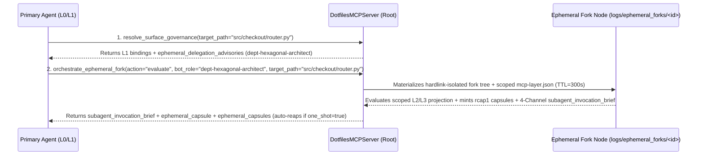
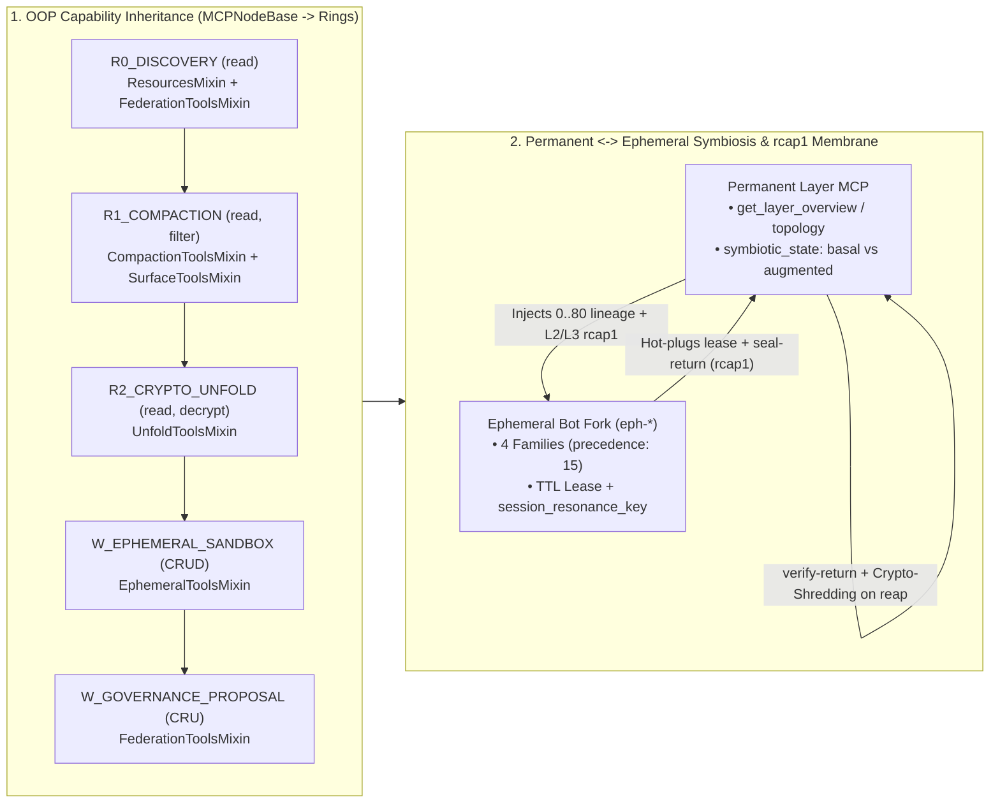

# 05 — Ephemeral Scoped Forks, OOP Capability Rings & Symbiotic Bots (`capability_registry.py`, `ephemeral_fork_engine.py`, `tools_ephemeral.py`)

> **Navigation**: [`docs/README.md`](../README.md) · [`03_contextual_mcp_and_federation.md`](03_contextual_mcp_and_federation.md) · [`04_compaction_surface_and_promotion_engines.md`](04_compaction_surface_and_promotion_engines.md) · [`06_layer_governance_and_promotion_engines.md`](06_layer_governance_and_promotion_engines.md) · [`contextual_mcp_and_multi_service_orchestration.md`](../reference/contextual_mcp_and_multi_service_orchestration.md)

This document specifies the **Ephemeral Sandbox & Department Bot Dimension** (`Axis 2: ephemeral-sandbox` & `Axis 6: Channel 5 Ephemeral Consultation` in the 7-Axis Multidimensional Taxonomy — see [`cross_departmental_and_human_stack_matrix.md`](../reference/cross_departmental_and_human_stack_matrix.md#0-canonical-7-axis-multidimensional-taxonomy--perspective-matrix-root-0-rightarrow-child-departments-rightarrow-units--nodes)) of `dotfiles-ubuntu`: **Ephemeral Scoped Forks, OOP Capability Inheritance & Symbiotic Department Bots** — a deterministic, rule-governed mechanism allowing an MCP node or CLI workflow to compose capability extensions by CRUD permission ring, materialize temporary TTL-bounded contextual forks (`layer_role: "ephemeral-bot"`), dynamically augment permanent MCP nodes while ephemeral leases are active, and seal/verify 4-Channel Executive Digests through the `rcap1` cryptographic membrane.

---

## 1. `1:1:1` Source $\leftrightarrow$ Unit Test $\leftrightarrow$ Specification Traceability Matrix

| Source Module (`< 465` lines) | `1:1` Unit Test (`< 465` lines) | Primary Responsibility |
|-------------------------------|---------------------------------|------------------------|
| [`scripts/dotfiles_mcp/mcp_node/capability_registry.py`](../../scripts/dotfiles_mcp/mcp_node/capability_registry.py) | [`tests/unit/dotfiles_mcp/mcp_node/test_capability_registry.py`](../../tests/unit/dotfiles_mcp/mcp_node/test_capability_registry.py) (`TestCapabilityRegistry`) | OOP MCP permission rings (`MCP_PERMISSION_RINGS`), 4-family hierarchical bot catalog (`BOT_ARCHETYPE_CATALOG`), Permanent $\leftrightarrow$ Ephemeral symbiosis resolver (`resolve_mcp_capability_profile`), and `rcap1` return digest orchestration (`orchestrate_ephemeral_return_capsule`) |
| [`scripts/dotfiles_mcp/mcp_node/ephemeral_fork_engine.py`](../../scripts/dotfiles_mcp/mcp_node/ephemeral_fork_engine.py) | [`tests/unit/dotfiles_mcp/mcp_node/test_ephemeral_fork_engine.py`](../../tests/unit/dotfiles_mcp/mcp_node/test_ephemeral_fork_engine.py) (`TestEphemeralForkEngine`) | Zero-copy ephemeral fork materialization (`spawn_ephemeral_fork`), cross-project rule bridging (`mount_project_rules_from`), advisory extraction (`extract_ephemeral_advisories`), 4-Channel subagent brief generation (`build_subagent_invocation_brief`), and TTL garbage collection (`reap_expired_ephemeral_forks`, `reap_ephemeral_fork`) |
| [`scripts/dotfiles_mcp/mcp_node/tools_ephemeral.py`](../../scripts/dotfiles_mcp/mcp_node/tools_ephemeral.py) | [`tests/unit/dotfiles_mcp/mcp_node/test_tools_ephemeral.py`](../../tests/unit/dotfiles_mcp/mcp_node/test_tools_ephemeral.py) (`TestEphemeralToolsMixin`) | MCP Tool #9 (`orchestrate_ephemeral_fork`: actions `"spawn"`, `"inspect"`, `"evaluate"`, `"reap"`, `"catalog"`, `"seal-return"`, `"verify-return"`), live scoped evaluation with `rcap1` capsule minting, and structured alert emission (`EPHEMERAL_FORK_LIMIT_REACHED`, `EPHEMERAL_FORK_EXPIRED`) |

---

## 2. Why Ephemeral Scoped Forks Exist (The 4 High-Value Operational Cases)

When a primary AI agent works across a complex enterprise or multi-service workspace (such as a shared core platform + multiple consumer microservices or client applications), loading full `L2`/`L3` specifications for every department (Security, DBA/Migrations, UX/Accessibility, Hexagonal Domain) simultaneously causes **context window dilution** (*lost-in-the-middle* drift). Conversely, keeping everything at `L0` risks subtle domain violations when editing specialized surfaces.

Ephemeral Scoped Forks solve this paradox by keeping the primary orchestrator lightweight (`L0`/`L1`) while delegating surface-specific work to short-lived, rule-bounded **"Department Bots"**:

1. **Case 1 — Parallel Department Specialist Bot (`"on_surface_match"`)**:
   - When `resolve_surface_governance` matches a surface binding containing an `ephemeral_fork_policy` (e.g., `dept-dba-guardian` on `alembic/**` or `dept-hexagonal-architect` on `src/**`), it emits an **`ephemeral_delegation_advisories`** entry.
   - The agent (or orchestrator) calls `orchestrate_ephemeral_fork(action="spawn")` or `action="evaluate"`, creating an isolated fork mounting **only** that department's template pack and rules promoted to `authoritative` at `L2`/`L3`.
2. **Case 2 — Cross-Repository / Consumer-Service Context Bridge (`mount_project_rules_from`)**:
   - When validating contract compatibility between a shared core platform (`acme-core-platform`) and a consumer service (`checkout-service`), `spawn` can mount the consumer's `.agents/rules/*.md` into `layers/ephemeral-project-bridge/` inside the ephemeral fork—enabling cross-repo rule weaving and `rcap1` capsule exchange without polluting the permanent `dotfiles-ubuntu` tree.
3. **Case 3 — Privilege & Scope Sandboxing (`access_mode`, `model_tier`, `target_globs`)**:
   - Each ephemeral fork locks its `system/mcp-layer.json` to an explicit `model_tier` (`"flash"`, `"inherit"`, `"pro"`), `access_mode` (`"strictly-read-only"`, `"read-and-test-trigger"`, `"read-write-scoped"`), and `target_globs` boundary, preventing a support subagent from drifting outside its assigned surface (`AGENTS.md §12` & `§13.3`).
4. **Case 4 — Canary Governance Dry-Run (`"on_demand"`)**:
   - Before promoting a candidate rule to a Squad or Department layer (`promote-from-project`), an engineer or agent can spawn an ephemeral fork with custom `target_globs`/`mount_templates`, run `action="evaluate"` against real `target_path`s to verify precedence weaving (`Lex Superior` / `Lex Specialis`) and token budgets, and immediately `reap` it.

---

## 3. Declarative Policy Contract (`ephemeral_fork_policy` in `system/mcp-layer.json`)

Any `surface_binding` in `system/mcp-layer.json` (or `template.json` `recommended_surface_bindings`) may declare an optional `ephemeral_fork_policy`:

```json
{
  "binding_id": "hexagonal-and-presentation-architecture",
  "ephemeral_fork_policy": {
    "bot_role": "dept-hexagonal-architect",
    "trigger": "on_surface_match",
    "model_tier": "inherit",
    "access_mode": "strictly-read-only",
    "mount_templates": ["fastapi-hexagonal"],
    "resolution": "L2",
    "ttl_seconds": 300,
    "handback_contract": "4-channel-digest+rcap1"
  }
}
```

| Field | Allowed Values / Constraint | Purpose |
|-------|-----------------------------|---------|
| `bot_role` | `kebab-case` identifier (`KEBAB_ID_RE`) | Specialized role identity for the ephemeral fork (`fork_id` / `layer_id`: `"eph-<bot_role>-<hash>"`) |
| `trigger` | `"on_surface_match"` \| `"on_high_complexity"` \| `"on_demand"` | Advisory trigger condition reported in `ephemeral_delegation_advisories` |
| `model_tier` | `"flash"` \| `"inherit"` \| `"pro"` | Target subagent model tier per `AGENTS.md §12` |
| `access_mode` | `"strictly-read-only"` \| `"read-and-test-trigger"` \| `"read-write-scoped"` | Operational capability boundary enforced in the subagent brief |
| `ephemeral_scope` | `"inter-layer"` \| `"intra-layer"` (default `"intra-layer"`) | Distinguishes cross-layer read-only consultations (`"inter-layer"`) from within-layer participant/bot execution (`"intra-layer"`) |
| `actor_role` | `"owner"` \| `"maintainer"` \| `"validator"` \| `"member"` \| `"consumer"` (default `"member"`) | Layer roster role of the participant spawning the ephemeral fork (`"consumer"` is locked to `strictly-read-only`) |
| `mount_templates` | `list[str]` | Subset of template packs activated in the ephemeral fork's `default_stack_templates` |
| `resolution` | `"L0"` \| `"L1"` \| `"L2"` | Default context resolution for the bot's authoritative surface |
| `ttl_seconds` | Integer `10..3600` (default `300`) | Time-to-live before automatic garbage collection (`reap_expired_ephemeral_forks`) |
| `handback_contract` | `"4-channel-digest+rcap1"` | Enforces `AGENTS.md §12` 4-Channel Executive Digest + sealed `rcap1` capsule |

---

## 3B. Bounded `operating_state × mcp_operating_mode` Matrix & Dual Ephemeral Scope (`inter-layer` vs. `intra-layer`)

To prevent operational ambiguity between the **Non-MCP Static Plane** (`layer-config.sh` / `make`) and the **Contextual MCP Plane** (`dotfiles_mcp_server.py`), every repository `operating_state` maps to a bounded **`mcp_operating_mode`** (`MCP_OPERATING_MODES` in `constants.py`), surfaced identically by `inspect_workspace_status` (`make status`) and `get_layer_overview`:

| `operating_state` | `mcp_operating_mode` | Non-MCP Plane (`layer-config.sh` / `make`) | Contextual MCP Plane (`dotfiles_mcp_server.py`) | Allowed `ephemeral_scope` & `access_mode` Boundary |
|---|---|---|---|---|
| **`oss-dev`** (`DOTFILES_DEV_REPO_DIR`) | `"self-test-and-dev-only"` | Human-agent collaborative OSS authoring (`make verify`, `make setup-dev`, `make promote`) | Bounded to `--self-test` and CI verification (`make mcp-test`); **not** a live multi-tenant governance hub | Self-test / CI verification sandboxes only |
| **`oss-readonly-appliance`** (`~/dotfiles-ubuntu`) | `"workstation-baseline-provider"` | Read-only `$HOME` Stow runtime (`dotfiles-sync`) | Local workstation baseline provider (`AGENTS.md` + `system/*`) | Strictly locked to `access_mode="strictly-read-only"` |
| **`corporate-root`** (`Root 0`) | `"enterprise-governance-hub"` | C-level SSoT ledgers (`make delegate`, `make promote`, `make env-gate`) | Enterprise `0..N` surface weaver & `rcap1` (`kr: true`) authority hub | `inter-layer` (`strictly-read-only`) + `intra-layer` (`owner`/`maintainer`/`validator`/`member`) |
| **`domain-policy` / `department`** | `"departmental-policy-hub"` | Departmental policy & specialization packs (`make sync`, `make delegate`, `make consult`) | Departmental MCP hub & specialist bot provider | `inter-layer` (`strictly-read-only`) + `intra-layer` role-gated bots |
| **`squad`** | `"squad-execution-hub"` | Agile task-branch delivery (`make task`, `make complete`, `make consult`) | Squad execution & cross-project bridge hub (`mount_project_rules_from`) | `inter-layer` (`strictly-read-only`) + `intra-layer` (`read-write-scoped` for `owner`/`maintainer`/`member`) |
| **`project`** | `"project-consumer-only"` | Static `.agents/` consumer (`apply-project`, `diff-project`, `make task`) | Consumer of parent Squad/Department MCP or `make consult`; does not host multi-layer `layers/*` | Calls parent `consult-layer` (`inter-layer`, `strictly-read-only`) |

Furthermore, `spawn_ephemeral_fork` and `orchestrate_ephemeral_fork` enforce two orthogonal **Ephemeral Collaboration Scopes (`VALID_EPHEMERAL_SCOPES`)**:
1. **`ephemeral_scope="inter-layer"` (Cross-Layer Consultation Bridge — e.g., `make consult` / `consult_layer_ephemeral`)**:
   - Enables a downstream `Project`, `Squad`, or sibling `Department` to query an upstream/sibling layer's rules and surface bindings with `session_resonance_key`-sealed `rcap1` capsules (`kr: true`).
   - **Hard Immutability Invariant**: `inter-layer` forks **MUST** use `access_mode="strictly-read-only"` (any other `access_mode` raises `ValueError`).
2. **`ephemeral_scope="intra-layer"` (Within-Layer Participant & Specialist Bot Collaboration)**:
   - Enables participants within the same layer (`actor_role` in `owner`, `maintainer`, `validator`, `member`) to spawn specialist bots for parallel domain analysis, QA verification (`WORKVALI.md`), or scoped refactoring.
   - **Participant Role Guardrail**: `actor_role="validator"` is restricted to `"strictly-read-only"` or `"read-and-test-trigger"` (raising `ValueError` on `"read-write-scoped"`), and `oss-readonly-appliance` only permits `"strictly-read-only"`.

---

## 4. MCP Tool #9 (`orchestrate_ephemeral_fork`) & Zero-Residue Invariants



1. **Hardlink-Isolated Materialization, Read-Only Container Fallback & Path Containment (`default_ephemeral_root`)**:
   - Ephemeral forks reside under `logs/ephemeral_forks/<fork_id>/` by default (git-ignored and wiped by `make clean`), or automatically fall back to `/tmp/dotfiles_ephemeral_forks/<fork_id>/` (and in-memory `_ephemeral_memory_store` if `/tmp` is non-writable) when the repository is mounted read-only (`:ro` in Docker/Kubernetes).
   - Instead of OS directory symlinks (which would cause `Path.resolve().is_relative_to(fork_dir)` to escape back to the parent repository), `_copy_zero_copy` constructs real directory trees and hardlinks files via `os.link` (falling back to `shutil.copy2` across filesystem boundaries). In `_prepare_project_bridge`, every candidate `.agents/rules/*.md` is verified via `rf.resolve().is_relative_to(proj)` to block outbound symlink escapes.
   - `action="evaluate"` returns both the primary `ephemeral_capsule` and the complete `ephemeral_capsules` catalog (including bridged project rules). While an ephemeral fork is active (or preserved in `_ephemeral_memory_store` for `one_shot=True` bridged rules), the parent `DotfilesMCPServer` can unfold (`L0 → L3`) any `rcap1` capsule minted by that fork (`iss="eph-..."` via `_resolve_ephemeral_issuer_meta`), automatically revoking unfolding once the fork is reaped or its TTL expires.
2. **Deterministic Garbage Collection & Capacity Cap**:
   - Every invocation of `orchestrate_ephemeral_fork` first executes `reap_expired_ephemeral_forks`, deleting any fork whose `expires_at_epoch <= time.time()` and emitting `EPHEMERAL_FORK_EXPIRED` when a targeted `fork_id` has expired.
   - Active ephemeral forks are capped at `MAX_ACTIVE_EPHEMERAL_FORKS = 16` (emitting `EPHEMERAL_FORK_LIMIT_REACHED` if exceeded).
3. **CLI Parity (`scripts/layer-config.sh`)**:
   - `consult-layer [<target-dir>] --layer <layer-or-template> --query <text> [--path <rel-path>] [--tier <flash|inherit|pro>]` (`make consult LAYER=<id> QUERY="..."` — one-shot `strictly-read-only` inter-layer consultation returning a 4-Channel Digest + `rcap1` capsules and auto-reaping immediately)
   - `spawn-ephemeral --role <bot-role> [--templates <csv>] [--layers <csv>] [--globs <csv>] [--project-bridge <dir>] [--tier <flash|inherit|pro>] [--ttl <sec>]`
   - `inspect-ephemeral [--id <fork-id>] [--catalog] [--family <fam>]`
   - `reap-ephemeral --id <fork-id|all>`

---

## 5. OOP Capability Inheritance (`MCP_PERMISSION_RINGS`), Bot Taxonomy, Permanent $\leftrightarrow$ Ephemeral Symbiosis & `rcap1` Return Membrane

[`capability_registry.py`](../../scripts/dotfiles_mcp/mcp_node/capability_registry.py) models MCP servers using object-oriented capability inheritance on top of [`MCPNodeBase`](../../scripts/dotfiles_mcp/mcp_node/node_base.py):



### 5.1 Standard CRUD Capability Rings (`MCP_PERMISSION_RINGS`)

| Ring ID | CRUD Permissions | Persistence Mode | Extension Mixin(s) | Tools Exposed |
|---------|------------------|------------------|--------------------|---------------|
| `R0_DISCOVERY` | `["read"]` | `"permanent"` | `ResourcesMixin + FederationToolsMixin` | `get_layer_overview`, `read_layer_document`, `discover_federated_mcps`, `audit_node_drift` |
| `R1_COMPACTION` | `["read", "filter"]` | `"permanent"` | `CompactionToolsMixin + SurfaceToolsMixin` | `query_governance_rules`, `resolve_surface_governance` |
| `R2_CRYPTO_UNFOLD` | `["read", "decrypt"]` | `"hybrid-symbiotic"` | `UnfoldToolsMixin` | `unfold_context_capsule` |
| `W_EPHEMERAL_SANDBOX` | `["create", "read", "update", "delete"]` | `"ephemeral"` | `EphemeralToolsMixin` | `orchestrate_ephemeral_fork` |
| `W_GOVERNANCE_PROPOSAL` | `["create", "read", "update"]` | `"permanent"` | `FederationToolsMixin` | `compare_layer_patterns` |

- **Environment & Layer Gating (`resolve_mcp_capability_profile`)**: In `pro` (or any environment declaring `access_mode: "strictly-read-only"`), granted rings are restricted to `["R0_DISCOVERY", "R1_COMPACTION", "R2_CRYPTO_UNFOLD"]`. In `dev`/`pre`, all 5 rings are active.

### 5.2 Hierarchical Bot Archetype Catalog (`BOT_ARCHETYPE_CATALOG`)

Bots (`precedence: 15`) are categorized into **4 Functional Families** queryable via `orchestrate_ephemeral_fork(action="catalog", family="<family>")`:
1. **`"audit-and-compliance"`**: `security-auditor-bot` (`inherit`, `L2`, `R0..R2`), `doc-coherence-bot` (`flash`, `L1`, `R0..R1`).
2. **`"architecture-and-code"`**: `architecture-reviewer-bot` (`pro`, `L2`, `R0..R2`), `refactoring-surgeon-bot` (`inherit`, `L2`, `R0..W_EPHEMERAL_SANDBOX`).
3. **`"data-and-operations"`**: `ops-ledger-bot` (`flash`, `L1`, `R0..R1`).
4. **`"scientific-and-normative"`**: `normative-analyst-bot` (`pro`, `L2`, `R0..R2`).

### 5.3 Bidirectional Permanent $\leftrightarrow$ Ephemeral Symbiosis & `rcap1` Return Membrane

1. **Permanent $\rightarrow$ Ephemeral Augmentation**: The Permanent Layer MCP injects inherited `0..80` lineage, baseline guardrails, and surface-filtered `rcap1` capsules into each spawned Ephemeral Bot without cold-start re-indexing.
2. **Ephemeral $\rightarrow$ Permanent Hot-Plug Lease (`symbiotic_state`)**: While an ephemeral fork (`eph-*`) is alive (`now < expires_at_epoch`), `resolve_mcp_capability_profile` transitions from `"basal-permanent-only"` to `"ephemeral-augmented"`, mounting the ephemeral lease's bridged project rules and `session_resonance_key` into the Permanent MCP. When the lease expires or is reaped, all hot-plugged capabilities and keys vanish automatically (*Zero Standing Privileges*).
3. **Cryptographic Return Digest Membrane (`action="seal-return"` & `action="verify-return"`)**:
   - [`seal_ephemeral_digest_capsule`](../../scripts/dotfiles_mcp/capsules/capsule_engine.py) seals an Ephemeral Bot's 4-Channel Executive Digest (`channel_1_domain_state`..`channel_4_actionable_delta`) into an HMAC-SHA256 signed, keystream-encrypted `rcap1` token (`kind: "ephemeral-digest"`) bound to `(fork_id, bot_role, parent_layer_id, surface_globs)`.
   - [`unseal_ephemeral_digest_capsule`](../../scripts/dotfiles_mcp/capsules/capsule_engine.py) verifies the return capsule in the Permanent MCP, rejecting expired/reaped leases (`EPHEMERAL_LEASE_EXPIRED_OR_SHREDDED` — *Crypto-Shredding*), invalid signatures (`CAPSULE_SIGNATURE_INVALID`), or reported file modifications in `channel_2_affected_surface` that escape the bot's leased `surface_globs` (`SURFACE_BOUNDARY_VIOLATION`).
