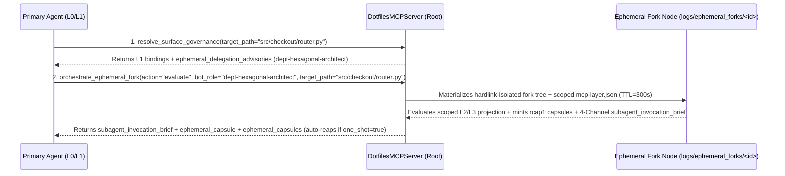

# 05 — Ephemeral Scoped Forks & Department Bots (`ephemeral_fork_engine.py`, `tools_ephemeral.py`)

> **Navigation**: [`docs/README.md`](../README.md) · [`03_contextual_mcp_and_federation.md`](03_contextual_mcp_and_federation.md) · [`04_compaction_surface_and_promotion_engines.md`](04_compaction_surface_and_promotion_engines.md) · [`contextual_mcp_and_multi_service_orchestration.md`](../reference/contextual_mcp_and_multi_service_orchestration.md)

This document specifies the **3rd Orthogonal Governance Dimension** of `dotfiles-ubuntu`: **Ephemeral Scoped Forks & Department Bots** — a deterministic, rule-governed mechanism allowing an MCP node or CLI workflow to materialize temporary, TTL-bounded, privilege-scoped contextual forks (`layer_role: "ephemeral-bot"`) for parallel specialist support, cross-repository context bridging, and canary governance dry-runs.

---

## 1. `1:1:1` Source $\leftrightarrow$ Unit Test $\leftrightarrow$ Specification Traceability Matrix

| Source Module (`< 465` lines) | `1:1` Unit Test (`< 465` lines) | Primary Responsibility |
|-------------------------------|---------------------------------|------------------------|
| [`scripts/dotfiles_mcp/ephemeral_fork_engine.py`](../../scripts/dotfiles_mcp/ephemeral_fork_engine.py) | [`tests/unit/dotfiles_mcp/test_ephemeral_fork_engine.py`](../../tests/unit/dotfiles_mcp/test_ephemeral_fork_engine.py) | Zero-copy ephemeral fork materialization (`spawn_ephemeral_fork`), cross-project rule bridging (`mount_project_rules_from`), advisory extraction (`extract_ephemeral_advisories`), 4-Channel subagent brief generation (`build_subagent_invocation_brief`), and TTL garbage collection (`reap_expired_ephemeral_forks`, `reap_ephemeral_fork`) |
| [`scripts/dotfiles_mcp/tools_ephemeral.py`](../../scripts/dotfiles_mcp/tools_ephemeral.py) | [`tests/unit/dotfiles_mcp/test_tools_ephemeral.py`](../../tests/unit/dotfiles_mcp/test_tools_ephemeral.py) | MCP Tool #9 (`orchestrate_ephemeral_fork`: actions `"spawn"`, `"inspect"`, `"evaluate"`, `"reap"`), live scoped evaluation with `rcap1` capsule minting, and structured alert emission (`EPHEMERAL_FORK_LIMIT_REACHED`, `EPHEMERAL_FORK_EXPIRED`) |

---

## 2. Why Ephemeral Scoped Forks Exist (The 4 High-Value Operational Cases)

When a primary AI agent works across a complex enterprise or multi-service workspace (such as a shared core platform + multiple consumer microservices or client applications), loading full `L2`/`L3` specifications for every department (Security, DBA/Migrations, UX/Accessibility, Hexagonal Domain) simultaneously causes **context window dilution** (*lost-in-the-middle* drift). Conversely, keeping everything at `L0` risks subtle domain violations when editing specialized surfaces.

Ephemeral Scoped Forks solve this paradox by keeping the primary orchestrator lightweight (`L0`/`L1`) while delegating surface-specific work to short-lived, rule-bounded **"Department Bots"**:

1. **Case 1 — Parallel Department Specialist Bot (`"on_surface_match"`)**:
   - When `resolve_surface_governance` matches a surface binding containing an `ephemeral_fork_policy` (e.g., `dept-dba-guardian` on `alembic/**` or `dept-hexagonal-architect` on `src/**`), it emits an **`ephemeral_delegation_advisories`** entry.
   - The agent (or orchestrator) calls `orchestrate_ephemeral_fork(action="spawn")` or `action="evaluate"`, creating an isolated fork mounting **only** that department's template pack and rules promoted to `authoritative` at `L2`/`L3`.
2. **Case 2 — Cross-Repository / Consumer-Service Context Bridge (`mount_project_rules_from`)**:
   - When validating contract compatibility between a shared core platform (`acme-core-platform`) and a consumer service (`checkout-service`), `spawn` can mount the consumer's `.agents/rules/*.md` into `layers/ephemeral-project-bridge/` inside the ephemeral fork—enabling cross-repo rule weaving and `rcap1` capsule exchange without polluting the permanent `dotfiles-ubuntu` tree.
3. **Case 3 — Privilege & Scope Sandboxing (`access_mode`, `model_tier`, `target_globs`)**:
   - Each ephemeral fork locks its `system/mcp-layer.json` to an explicit `model_tier` (`"flash"`, `"inherit"`, `"pro"`), `access_mode` (`"strictly-read-only"`, `"read-and-test-trigger"`, `"read-write-scoped"`), and `target_globs` boundary, preventing a support subagent from drifting outside its assigned surface (`AGENTS.md §13` & `§14.3`).
4. **Case 4 — Canary Governance Dry-Run (`"on_demand"`)**:
   - Before promoting a candidate rule to a Team or Department layer (`promote-from-project`), an engineer or agent can spawn an ephemeral fork with custom `target_globs`/`mount_templates`, run `action="evaluate"` against real `target_path`s to verify precedence weaving (`Lex Superior` / `Lex Specialis`) and token budgets, and immediately `reap` it.

---

## 3. Declarative Policy Contract (`ephemeral_fork_policy` in `system/mcp-layer.json`)

Any `surface_binding` in `system/mcp-layer.json` (or `template.json` `recommended_surface_bindings`) may declare an optional `ephemeral_fork_policy`:

```json
{
  "binding_id": "hexagonal-and-presentation-architecture",
  "ephemeral_fork_policy": {
    "bot_role": "dept-hexagonal-architect",
    "trigger": "on_surface_match",
    "model_tier": "inherit",
    "access_mode": "strictly-read-only",
    "mount_templates": ["fastapi-hexagonal"],
    "resolution": "L2",
    "ttl_seconds": 300,
    "handback_contract": "4-channel-digest+rcap1"
  }
}
```

| Field | Allowed Values / Constraint | Purpose |
|-------|-----------------------------|---------|
| `bot_role` | `kebab-case` identifier (`KEBAB_ID_RE`) | Specialized role identity for the ephemeral fork (`layer_id: "ephemeral-<bot_role>-<hash>"`) |
| `trigger` | `"on_surface_match"` \| `"on_high_complexity"` \| `"on_demand"` | Advisory trigger condition reported in `ephemeral_delegation_advisories` |
| `model_tier` | `"flash"` \| `"inherit"` \| `"pro"` | Target subagent model tier per `AGENTS.md §13` |
| `access_mode` | `"strictly-read-only"` \| `"read-and-test-trigger"` \| `"read-write-scoped"` | Operational capability boundary enforced in the subagent brief |
| `mount_templates` | `list[str]` | Subset of template packs activated in the ephemeral fork's `default_stack_templates` |
| `resolution` | `"L1"` \| `"L2"` \| `"L3"` | Default context resolution for the bot's authoritative surface |
| `ttl_seconds` | Integer `10..3600` (default `300`) | Time-to-live before automatic garbage collection (`reap_expired_ephemeral_forks`) |
| `handback_contract` | `"4-channel-digest+rcap1"` | Enforces `AGENTS.md §13` 4-Channel Executive Digest + sealed `rcap1` capsule |

---

## 4. MCP Tool #9 (`orchestrate_ephemeral_fork`) & Zero-Residue Invariants



1. **Hardlink-Isolated Materialization, Read-Only Container Fallback & Path Containment (`default_ephemeral_root`)**:
   - Ephemeral forks reside under `logs/ephemeral_forks/<fork_id>/` by default (git-ignored and wiped by `make clean`), or automatically fall back to `/tmp/dotfiles_ephemeral_forks/<fork_id>/` (and in-memory `_ephemeral_memory_store` if `/tmp` is non-writable) when the repository is mounted read-only (`:ro` in Docker/Kubernetes).
   - Instead of OS directory symlinks (which would cause `Path.resolve().is_relative_to(fork_dir)` to escape back to the parent repository), `_copy_zero_copy` constructs real directory trees and hardlinks files via `os.link` (falling back to `shutil.copy2` across filesystem boundaries). In `_prepare_project_bridge`, every candidate `.agents/rules/*.md` is verified via `rf.resolve().is_relative_to(proj)` to block outbound symlink escapes.
   - `action="evaluate"` returns both the primary `ephemeral_capsule` and the complete `ephemeral_capsules` catalog (including bridged project rules). While an ephemeral fork is active (or preserved in `_ephemeral_memory_store` for `one_shot=True` bridged rules), the parent `DotfilesMCPServer` can unfold (`L0 → L3`) any `rcap1` capsule minted by that fork (`iss="eph-..."` via `_resolve_ephemeral_issuer_meta`), automatically revoking unfolding once the fork is reaped or its TTL expires.
2. **Deterministic Garbage Collection & Capacity Cap**:
   - Every invocation of `orchestrate_ephemeral_fork` first executes `reap_expired_ephemeral_forks`, deleting any fork whose `expires_at_epoch <= time.time()` and emitting `EPHEMERAL_FORK_EXPIRED` when a targeted `fork_id` has expired.
   - Active ephemeral forks are capped at `MAX_ACTIVE_EPHEMERAL_FORKS = 16` (emitting `EPHEMERAL_FORK_LIMIT_REACHED` if exceeded).
3. **CLI Parity (`scripts/layer-config.sh`)**:
   - `spawn-ephemeral --role <bot-role> [--templates <csv>] [--layers <csv>] [--globs <csv>] [--project-bridge <dir>] [--tier <flash|inherit|pro>] [--ttl <sec>]`
   - `inspect-ephemeral [--id <fork-id>]`
   - `reap-ephemeral --id <fork-id|all>`
