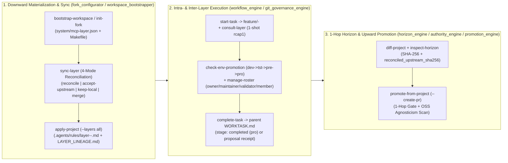

# Architecture 06: Multi-Layer Governance, 1-Hop Horizon, Authority & Promotion Engines (`governance/`)

> **Normative Specification — Subsystem 3D (`scripts/dotfiles_mcp/governance/{fork_configurator,workspace_bootstrapper,promotion_engine,horizon_engine,authority_engine,workflow_engine,git_governance_engine}.py` & [`scripts/layer-config.sh`](../../scripts/layer-config.sh))**
>
> This document specifies the **`governance/`** bounded-domain subpackage (Subpackage 4 of `scripts/dotfiles_mcp/`) and its 26 CLI subcommands in [`scripts/layer-config.sh`](../../scripts/layer-config.sh):
> 1. **Polymorphic Fork Configurator (`template-pack-v1`), Global Profile Composition & Workspace Bootstrapper (`fork_configurator.py`, `workspace_bootstrapper.py`)**
> 2. **Layer Authority (`4`-Role Roster), 1-Hop Horizon Radar, 4-Mode Reconciliation & Upward Promotion (`authority_engine.py`, `horizon_engine.py`, `promotion_engine.py`)**
> 3. **Task-Branch Workflow (`feature/<TICKET-ID>-<slug>`), 1-Hop Downward Delegation, Inter-Layer Consultation & `dev -> tst -> pre -> pro` Env Gates (`workflow_engine.py`, `git_governance_engine.py`)**
>
> For core JSON-RPC 2.0 protocol contracts (`core/` & `mcp_node/`), see **[`03_contextual_mcp_and_federation.md`](03_contextual_mcp_and_federation.md)**; for `rcap1` compaction and `0..N` surface weaving (`capsules/`), see **[`04_compaction_surface_and_promotion_engines.md`](04_compaction_surface_and_promotion_engines.md)**; for OOP capability rings and ephemeral bots (`mcp_node/`), see **[`05_ephemeral_forks_and_department_bots.md`](05_ephemeral_forks_and_department_bots.md)**.

---

## 1. `1:1:1` Source $\leftrightarrow$ Unit Test $\leftrightarrow$ Specification Traceability Matrix (`governance/`)

Every module in `scripts/dotfiles_mcp/governance/` maintains a strict `1:1:1` alignment with its subpackage-mirrored unit test suite in `tests/unit/dotfiles_mcp/governance/` (`100.00%` single-file isolated branch coverage, `< 465` lines) and its bidirectional docstring pointer (`Specification: docs/architecture/06_layer_governance_and_promotion_engines.md`):

| Subpackage & Engine Domain | Source Module (`scripts/dotfiles_mcp/governance/`) | `1:1` Unit Test (`tests/unit/dotfiles_mcp/governance/`) | Normative Section & Primary Symbols |
|---|---|---|---|
| **`governance/` — Fork Configurator & Template Scaffolding** | [`governance/fork_configurator.py`](../../scripts/dotfiles_mcp/governance/fork_configurator.py) | [`governance/test_fork_configurator.py`](../../tests/unit/dotfiles_mcp/governance/test_fork_configurator.py) (`TestForkConfigurator`) | **§2 & §5**: `configure_fork_manifest`, `scaffold_template_pack`, `apply_fork_to_project` |
| **`governance/` — Global Profile, Subtree & Workspace Bootstrapper** | [`governance/workspace_bootstrapper.py`](../../scripts/dotfiles_mcp/governance/workspace_bootstrapper.py) | [`governance/test_workspace_bootstrapper.py`](../../tests/unit/dotfiles_mcp/governance/test_workspace_bootstrapper.py) (`TestWorkspaceBootstrapper`) | **§2 & §5**: `set_global_agents_profile`, `register_mounted_subtree`, `bootstrap_layer_workspace`, `sync_layer_workspace`, `inspect_workspace_status` |
| **`governance/` — Multi-Layer Diff & Upward Promotion** | [`governance/promotion_engine.py`](../../scripts/dotfiles_mcp/governance/promotion_engine.py) | [`governance/test_promotion_engine.py`](../../tests/unit/dotfiles_mcp/governance/test_promotion_engine.py) (`TestPromotionEngine`) | **§3 & §5**: `compare_project_patterns_multilayer`, `diff_project_against_layers`, `promote_project_asset_to_layer` |
| **`governance/` — 1-Hop Horizon Radar & Upstream Reconciliation** | [`governance/horizon_engine.py`](../../scripts/dotfiles_mcp/governance/horizon_engine.py) | [`governance/test_horizon_engine.py`](../../tests/unit/dotfiles_mcp/governance/test_horizon_engine.py) (`TestHorizonEngine`) | **§3 & §5**: `inspect_layer_horizon`, `reconcile_template_pack_sync`, `compare_upstream_templates`, `_parse_markdown_sections_map`, `_clear_upstream_proposal_residue` |
| **`governance/` — Layer Authority & Upward PR Planner** | [`governance/authority_engine.py`](../../scripts/dotfiles_mcp/governance/authority_engine.py) | [`governance/test_authority_engine.py`](../../tests/unit/dotfiles_mcp/governance/test_authority_engine.py) (`TestAuthorityEngine`) | **§3 & §5**: `resolve_git_user_email`, `configure_layer_authority`, `verify_layer_operation_authority`, `build_upward_promotion_pr_plan`, `scan_open_source_agnosticism` |
| **`governance/` — Task-Branch Workflow, 1-Hop Delegation & Consultation** | [`governance/workflow_engine.py`](../../scripts/dotfiles_mcp/governance/workflow_engine.py) | [`governance/test_workflow_engine.py`](../../tests/unit/dotfiles_mcp/governance/test_workflow_engine.py) (`TestWorkflowEngine`) | **§4 & §5**: `start_task_workflow`, `complete_task_workflow`, `_derive_branch_slug`, `delegate_directive_to_child`, `consult_layer_ephemeral` |
| **`governance/` — Git Branch Policy, Roster, Env Gates & Staging** | [`governance/git_governance_engine.py`](../../scripts/dotfiles_mcp/governance/git_governance_engine.py) | [`governance/test_git_governance_engine.py`](../../tests/unit/dotfiles_mcp/governance/test_git_governance_engine.py) (`TestGitGovernanceEngine`) | **§4 & §5**: `record_governance_event`, `stage_non_destructive_proposal`, `configure_git_governance_policy`, `manage_layer_roster`, `inspect_git_governance_state`, `evaluate_environment_promotion`, `record_governance_decision` |

---

## 2. Polymorphic Fork Configurator (`template-pack-v1`), Global Profile Composition & Workspace Bootstrapper (`fork_configurator.py`, `workspace_bootstrapper.py`)

1. **4 Canonical Template Kinds (`VALID_TEMPLATE_KINDS`) & Automatic Base Inclusion**:
   - Every template pack under `templates/<name>/template.json` or `templates/<stack-group>/<name>/template.json` (`schema_version: "template-pack-v1"`) belongs to one of the **4 Canonical Template Kinds**: `"core-base"` (`human-core`, `technical-base`, `business-base`), `"business-stack"` (`corporate-ops-ledger`), `"science-stack"` (`scientific-knowledge-branch`), or `"tech-stack"` (`fastapi-hexagonal`).
   - During `apply_fork_to_project` (`apply-project`), applying a `"tech-stack"` pack automatically includes `technical-base`, and applying a `"business-stack"` or `"science-stack"` pack automatically includes `business-base`. When `include_layer_defaults=True` (`make setup-dev` or `--parent-dir`), the governing layer's `default_stack_templates` are merged automatically, falling back to `REPO_DIR` (`~/dotfiles-ubuntu/templates/`) for foundational templates.
2. **4-Mode Non-Destructive Template Upgrade Reconciliation (`reconcile_template_pack_sync` & `_is_git_historical_blob`)**:
   - When `sync_layer_workspace` (`make sync`) pulls updates from a parent layer, `reconcile_template_pack_sync` compares each rule's SHA-256 against `reconciled_upstream_sha256` in `template.json` (and verifies historical git blob existence via `_is_git_historical_blob` so `workstation-sync.sh --sync` `mtime` updates never overwrite locally customized downstream rules):
     - `"reconcile"` (default): Stages diverged upstream rules non-destructively at `.agents/proposals/from-upstream/<tpl>-<rule>.md` and logs a `P0` review task.
     - `"accept-upstream"`: Adopts upstream and clears `.agents/proposals/from-upstream/` residue.
     - `"merge"`: Adopts upstream while preserving local-only `#`/`##`/`###` Markdown sections.
     - `"keep-local"`: Preserves the local rule file and stamps `reconciled_upstream_sha256` to the current upstream digest so subsequent `make status` / `inspect-horizon` calls report `in_sync`.

---

## 3. Layer Authority (`4`-Role Roster), 1-Hop Horizon Radar & Upward Promotion (`authority_engine.py`, `horizon_engine.py`, `promotion_engine.py`)

1. **4-Role Layer Roster (`owner`, `maintainer`, `validator`, `member`) & `.github/CODEOWNERS` Sync**:
   - `manage_layer_roster` (`manage-roster`) maintains `layer_authority.roster` in `system/mcp-layer.json`, synchronizes `authorized_emails`, `maintainer_emails`, and `validator_emails`, and generates `.github/CODEOWNERS` (mapping `/templates/`, `/WORKROAD.md`, `/ROADMAP.md` to `owners + maintainers`, and `/WORKVALI.md` to `owners + maintainers + validators`).
   - `verify_layer_operation_authority` (`check-authority`) blocks direct mutation of inherited `.agents/rules/layer-<NN>-*.md` (`INHERITED_UPSTREAM_ASSET_IMMUTABLE`) and unauthorized owner/maintainer/validator operations (`UNAUTHORIZED_ACTOR_EMAIL`) with constructive PR remediation guidance.
2. **Strict 1-Hop Horizon (`inspect_layer_horizon`) & Open-Source Agnosticism Gate (`promote_project_asset_to_layer`)**:
   - Every node only inspects its immediate `1-hop upstream` parent and immediate `1-hop downstream` `mounted_layers`. Skipping intermediate tiers (`Squad -> Corporate Root` or `Department -> Open Source`) is blocked (`CROSS_TIER_PROMOTION_BYPASS`).
   - Promotions from Corporate `Root 0` to Open Source (`--upstream-dir`) enforce `scan_open_source_agnosticism` (`OSS_AGNOSTICISM_VIOLATION` zero-leak gate) and anonymize corporate/email metadata (`oss_anonymized: true`).

---

## 4. Task-Branch Workflow (`feature/<TICKET-ID>-<slug>`), 1-Hop Delegation & `dev -> tst -> pre -> pro` Env Gates (`workflow_engine.py`, `git_governance_engine.py`)

1. **Intra-Workspace Subtree Containment (`layers/<child>/`) & Dual Delegation Authority (`delegate_directive_to_child`)**:
   - `delegate-to-child` (`make delegate`) verifies both parent authority and child authority on `layers/<child>/system/mcp-layer.json` (`record_blocked=False`), records `- [/] **[<TICKET-ID> -> <child> (stage: delegated)]**` under `## Outbound Delegations` in the parent's `WORKTASK.md`, and delivers strictly inside `layers/<child>/` (`delivery_mode="direct_subtree"` when authorized on child vs. `delivery_mode="proposal_pr"` / `CROSS_OWNER_CHILD_DELEGATION` staging in `layers/<child>/.agents/proposals/from-<parent>/` when cross-owner or `--create-pr`).
2. **Reciprocal Task Lifecycle (`start_task_workflow` $\rightarrow$ `evaluate_environment_promotion` $\rightarrow$ `complete_task_workflow`)**:
   - `start-task` (`make task`) marks the task `[/]`, records `Ticket ID` and `Origin Layer` in `.agents/SESSION.md`, and emits `git checkout -b feature/<TICKET-ID>-<slug>`.
   - `check-env-promotion` (`make env-gate`) enforces isomorphic Business & Technical `dev -> tst -> pre -> pro` gates (`0` open `P0` in `WORKTASK.md` for `tst`, `0` unchecked items in `WORKVALI.md` + `validator_emails` for `pre`, and `CHANGELOG.md` + `authorized_emails` for `pro`).
   - `complete-task` (`make complete`) marks the task `[x]` and reciprocally updates the parent layer's `WORKTASK.md` (`stage: completed (pro)`) or stages a completion receipt (`.agents/proposals/to-<parent>/completion-<ticket>.md`).

---

## 5. Complete `scripts/layer-config.sh` CLI Subcommand Matrix (`26` Subcommands via `./scripts/layer-config.sh`)

To ensure every fork (`corporate`, `domain-policy`, `department`, `squad`, `service-node` — `schema_version: "mcp-layer-v1"`) is proactively configurable and supports bidirectional knowledge flow in both **MCP Mode** and **Static / Non-MCP Mode**, `fork_configurator.py` and `promotion_engine.py` (exposed via `./scripts/layer-config.sh`) implement:

| Capability | CLI Subcommand (`layer-config.sh`) | Python Function | Key Invariants & Guarantees |
|---|---|---|---|
| **Fork Identity & Default Pruning** | `init-fork --id <id> --role <role> [--precedence N] [--prune-default-templates]` | `configure_fork_manifest` | Assigns role-based default `precedence` (`domain-policy: 5`, `corporate: 10`, `department: 30`, `squad: 50`) and optionally prunes upstream starter templates (`fastapi-hexagonal`, `human-core`, `technical-base`) and `fastapi-hexagonal` bindings when a fork targets another stack or policy domain. |
| **Polymorphic Template Discovery** | `list-templates` | `discover_templates_catalog` | Scans `templates/*/template.json` and `templates/<stack-group>/*/template.json` across `Root` and all mounted `layers/*` subtrees across the 4 canonical `VALID_TEMPLATE_KINDS` (`core-base`, `business-stack`, `science-stack`, `tech-stack`). |
| **Template Pack Scaffolding** | `scaffold-template <name> --kind <kind> [--rule-file <fname>] [--register-binding]` | `scaffold_template_pack` | Generates `templates/<name>/template.json` (`template-pack-v1`), `rules/<fname\|policy.md>`, `skills/<name>-guide/SKILL.md`, `governance/WORKTASK.md` or `assets/canonical_snippet.md`, and registers `<name>` in `default_stack_templates`. |
| **Downward Static Materialization & Hybrid Dev Overlay** | `apply-project <dir> [--parent-dir <dir>] [--template <ref>] [--layers all] [--include-defaults]` | `apply_fork_to_project` | Copies template `rules/`, `skills/`, `governance/`, and `assets/` into `<dir>/.agents/`, automatically merges the governing layer's `default_stack_templates` when `include_layer_defaults=True` (`make setup-dev` or `--parent-dir`), auto-includes `technical-base` for `tech-stack` packs and `business-base` for `business-stack` / `science-stack` packs, falls back to `REPO_DIR` (`~/dotfiles-ubuntu/templates/`) for foundational templates (`technical-base`, `fastapi-hexagonal`, `scientific-knowledge-branch`), and writes `.agents/LAYER_LINEAGE.md`. |
| **Multi-Layer Pattern Routing (MCP)** | *(MCP Tool: `compare_layer_patterns(layer="all")`)* | `compare_project_patterns_multilayer` | Scans `1..N` layers, filters `layer-<NN>-<name>.md` into `materialized_layer_rules` (preventing false-positive novel candidates), and outputs `promotion_routing` (`target_layer`, `target_destination`, `subtree_push_command`, `root_agents_md_headroom_bytes`). |
| **Upward SHA-256 Project Diff** | `diff-project <dir> [--parent-dir <dir>]` | `diff_project_against_layers` | Compares SHA-256 digests across `<dir>/.agents/{rules,skills,assets}/` against `Root` (or `--parent-dir` for project consumers), `templates/*`, `layers/*`, and the `REPO_DIR` (`engine:<template>`) fallback, classifying every file into `in_sync`, `modified_in_project`, or `novel_in_project`. |
| **Upward Asset Promotion & PR Plan** | `promote-from-project <dir> --source <rel-path> [--to-layer <target>] [--to-template <pack>] [--upstream-dir <dir>] [--create-pr] [--org <name>] [--contributors <list>] [--context <text>]` | `promote_project_asset_to_layer` | Promotes rules, skills, `templates/<pack>/**`, or `.agents/assets/<tpl>/*` into `Root`, `layers/<name>`, `templates/<pack>`, or `--upstream-dir`, enforcing the 1-hop boundary (`CROSS_TIER_PROMOTION_BYPASS`), Open-Source Agnosticism (`OSS_AGNOSTICISM_VIOLATION` & `oss_anonymized` PR plans with optional community attribution metadata), `AGENTS.md` ($\le 18{,}000$ bytes), and `SKILL.md` frontmatter gates. |
| **Layer Authority & Identity Gate** | `set-authority [<dir>] --owner-role <role> [--emails <csv>]` `check-authority [<dir>] --op <op> [--email <email>] [--file <path>]` | `configure_layer_authority` `verify_layer_operation_authority` | Distinguishes **Layer Owner** (`authorized_emails` via `git config user.email`) from **Downstream Consumer**, blocking direct mutation of inherited upstream assets (`INHERITED_UPSTREAM_ASSET_IMMUTABLE`) or unauthorized owner ops (`UNAUTHORIZED_ACTOR_EMAIL`) with constructive promotion guidance. |
| **1-Hop Horizon Radar** | `inspect-horizon [<dir>] [--parent-dir <dir>] [--email <email>]` | `inspect_layer_horizon` | Evaluates the immediate 1-hop horizon both upward (`workspace` $\leftrightarrow$ `upstream_layer`, using `reconciled_upstream_sha256` in `template.json` when present to detect 3-way divergence deterministically) and downward across `mounted_layers` (`downstream_layer_drifts` / `child_sync_needed`), automatically resolving `oss_contrib_dir` (`DOTFILES_DEV_REPO_DIR` or `~/Projects/dev-<repo>`) for `Root 0` $\rightarrow$ Open Source promotions while keeping the workstation runtime clone as `immediate_upstream_dir`. |
| **Modular Global Profile Composition** | `set-global-profile <human-core\|technical\|business\|full> [--stow]` | `set_global_agents_profile` | Composes `antigravity/.gemini/config/AGENTS.md` from `templates/human-core/`, `templates/technical-base/`, and `templates/business-base/` within the $18{,}000$-byte cap and optionally re-stows into `~/.gemini/config/`. |
| **One-Shot Layer Workspace Bootstrap** | `bootstrap-workspace <dir> --id <id> [--role <role>] [--parent-dir <dir>] [--templates <csv>]` | `bootstrap_layer_workspace` | Inherits parent templates/lineage (when `--parent-dir` is supplied or repo is a non-workstation layer), copies base templates, configures `system/mcp-layer.json`, scaffolds `templates/<id>/` with collision-free `rules/<id>.md`, writes baseline governance files, and executes `apply-project` in one atomic step. |
| **Bidirectional Layer Sync & 4-Mode Upgrade Reconciliation (`Upstream` + `Mounted Children`)** | `sync-layer [<dir>] [--parent-dir <dir>] [--templates <csv>] [--strategy reconcile\|accept-upstream\|keep-local\|merge]` | `sync_layer_workspace` `reconcile_template_pack_sync` | Auto-normalizes legacy manifest contracts (`"mcp-layer-v1"`, `"squad"`), auto-upgrades generated `# Role-Specialized Layer Makefile` targets in place (preserving any `# --- Custom Targets ---` tail), reconciles inherited upstream template packs using `--strategy` (verifying `reconciled_upstream_sha256` or historical git blob existence via `_is_git_historical_blob` so `workstation-sync.sh --sync` `mtime` updates never overwrite locally customized downstream rules; `reconcile` stages upstream conflicts non-destructively at `.agents/proposals/from-upstream/<tpl>-<rule>.md`; `accept-upstream` adopts upstream; `merge` adopts upstream while preserving local-only `#/##/###` sections; `keep-local` preserves local rule files), synchronizes mounted child layers (`layers/*`, including outdated child `Makefile`s), and re-executes `apply-project --layers all` so `.agents/` is immediately `100% in_sync`. |
| **Subtree Manifest Registration** | `register-subtree <name> <url> [branch]` | `register_mounted_subtree` | Reads `layers/<name>/system/mcp-layer.json` and upserts the layer descriptor into root `mounted_layers` sorted by `precedence`. |
| **Consolidated Workspace Status (`/sopen`)** | `status [<dir>] [--parent-dir <dir>]` | `inspect_workspace_status` | Returns a single-call JSON digest (`operating_state`, `workspace_mode`, `command_tiers` across `auto_reflexive` / `guided_tactical` / `conscious_human_gated`, `session_state` with `last_conversation_id`, `priority_state`, `git_state`, `horizon`, and `agent_diff`) in `< 0.2s` so `/sopen` avoids multi-step file/directory probes. |
| **1-Hop Downward Directive Delegation** | `delegate-to-child [<dir>] --to-child <layer> [--task <text>] [--source <rel-path>] [--ticket <id>] [--priority P0\|P1\|P2] [--surface <surface>] [--create-pr] [--force]` | `delegate_directive_to_child` | Verifies parent authority (`delegate-to-child`) and child authority on `layers/<child>/system/mcp-layer.json` (`record_blocked=False`), assigns a traceable `ticket_id`, records `- [/] **[<TICKET-ID> -> <child> (stage: delegated)]**` under `## Outbound Delegations` in the parent layer's `WORKTASK.md`, delivers strictly inside `layers/<child>/` (`delivery_mode="direct_subtree"` when authorized on child vs. `delivery_mode="proposal_pr"` / `CROSS_OWNER_CHILD_DELEGATION` staging in `layers/<child>/.agents/proposals/from-<parent>/` when cross-owner or `--create-pr`), and returns `subtree_push_command` (`./scripts/layer-subtree.sh push`). |
| **Squad Task-Branch Onboarding (`make task`)** | `start-task [<dir>] --task <id-or-text> [--tracker WORKTASK.md] [--ticket <id>] [--prefix feature]` | `start_task_workflow` | Claims a task item in `<tracker>`, marks it `[/]`, updates `.agents/SESSION.md` (`## Active Task` with `Ticket ID` and `Origin Layer`), and emits the ticket-linked feature branch command (`git checkout -b feature/<TICKET-ID>-<slug>`). |
| **Reciprocal Task Completion (`make complete`)** | `complete-task [<dir>] --task <id-or-text> [--deliverable <path>] [--parent-dir <dir>] [--create-pr]` | `complete_task_workflow` | Marks the task `[x]` in `<tracker>`, updates the parent layer's `WORKTASK.md` (`## Outbound Delegations` $\rightarrow$ `stage: completed (pro)`) when authorized or stages a non-destructive completion receipt (`.agents/proposals/to-<parent>/completion-<ticket>.md`), and emits `completion_pr_plan` (`feature/<TICKET-ID>-completed`). |
| **Section-Level Upstream Template Reconciliation (`make upstream-diff`)** | `compare-upstream [<dir>] [--parent-dir <dir>] [--template <name>] [--apply-safe]` | `compare_upstream_templates` | Compares Markdown rule sections (`#`/`##`/`###`) between upstream (`dotfiles-ubuntu` or `--parent-dir`) and the local workspace, classifying sections into `in_sync_sections`, `upstream_only_sections`, `local_only_sections`, and `diverged_sections` (with `diff_preview`), and optionally adopting `upstream_only_sections` via `--apply-safe` without overwriting local customizations. |
| **Inter-Layer Ephemeral Consultation (`make consult`)** | `consult-layer [<dir>] --layer <id> --query <text> [--path <rel-path>] [--tier <flash\|inherit\|pro>]` | `consult_layer_ephemeral` | Spawns a zero-residue, one-shot `strictly-read-only` ephemeral consultation fork against a target layer or template pack, evaluates `query_governance_rules` + `resolve_surface_governance`, immediately reaps the fork, and returns a 4-Channel Executive Digest + `rcap1` capsules. |
| **Ephemeral Bot Lifecycle & Capability Catalog** | `spawn-ephemeral --role <role> [--templates <csv>] [--layers <csv>] [--globs <csv>] [--project-bridge <dir>] [--tier <flash\|inherit\|pro>] [--ttl <sec>]` `inspect-ephemeral [--id <fork-id>] [--catalog] [--family <fam>]` `reap-ephemeral --id <fork-id\|all>` | `spawn_ephemeral_fork` `inspect_ephemeral_forks` `resolve_mcp_capability_profile` `reap_ephemeral_fork` | Materializes, inspects (including `--catalog` for OOP capability rings & 4-family bot archetypes), and reaps TTL-bounded ephemeral Department Bot forks (`layer_role: "ephemeral-bot"`, see **[`05_ephemeral_forks_and_department_bots.md`](05_ephemeral_forks_and_department_bots.md)** §§4–5). |
| **Git Branch Policy, Layer Roster & `.github/CODEOWNERS` Sync** | `configure-git-policy [<dir>] [--protected <csv>] [--no-codeowners] [--no-require-pr]` `manage-roster [<dir>] [--add <email>] [--remove <email>] [--role <owner\|maintainer\|validator\|member>]` | `configure_git_governance_policy` `manage_layer_roster` | Persists `git_governance` and `layer_authority.roster` (`owners`, `maintainers`, `validators`, `members`) in `system/mcp-layer.json`, synchronizes `authorized_emails`, `maintainer_emails`, and `validator_emails`, and writes `.github/CODEOWNERS` (mapping `/templates/`, `/WORKROAD.md`, `/ROADMAP.md` to owners + maintainers, and `/WORKVALI.md` to owners + maintainers + validators). |
| **Intrinsic Environment Promotion Gate (`make env-gate`)** | `check-env-promotion [<dir>] --to-env <dev\|tst\|pre\|pro> [--branch <branch>] [--email <email>]` | `evaluate_environment_promotion` | Enforces isomorphic Business & Technical `dev -> tst -> pre -> pro` promotion invariants (`0` open `P0` in `WORKTASK.md` for `tst`, `0` unchecked items in `WORKVALI.md` + `validator_emails` gate for `pre`, and `CHANGELOG.md` + `authorized_emails` check for `pro`). |
| **Non-Destructive Staging & Human Governance Decisions** | `record-decision [<dir>] --item <ref> --decision <approve\|reject\|defer\|blocked> --reason <text>` | `stage_non_destructive_proposal` `record_governance_event` `record_governance_decision` | Stages existing/protected files non-destructively at `.agents/proposals/{from-<parent>,to-<layer>}/<file>` (unless `--force` is passed) and records every blocked/rejected/deferred/staged event in `logs/governance_audit.jsonl`, `.agents/SESSION.md`, and `WORKTASK.md`. |
