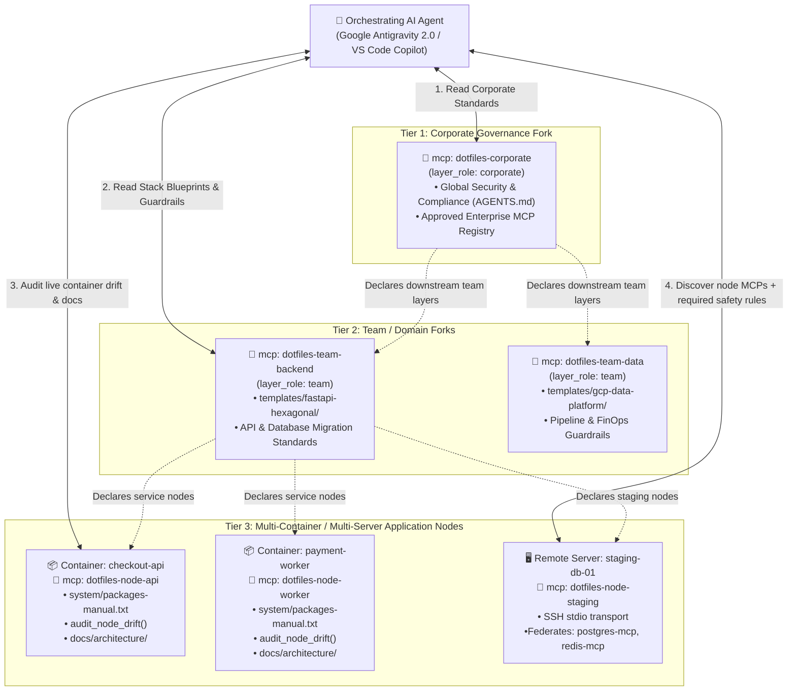
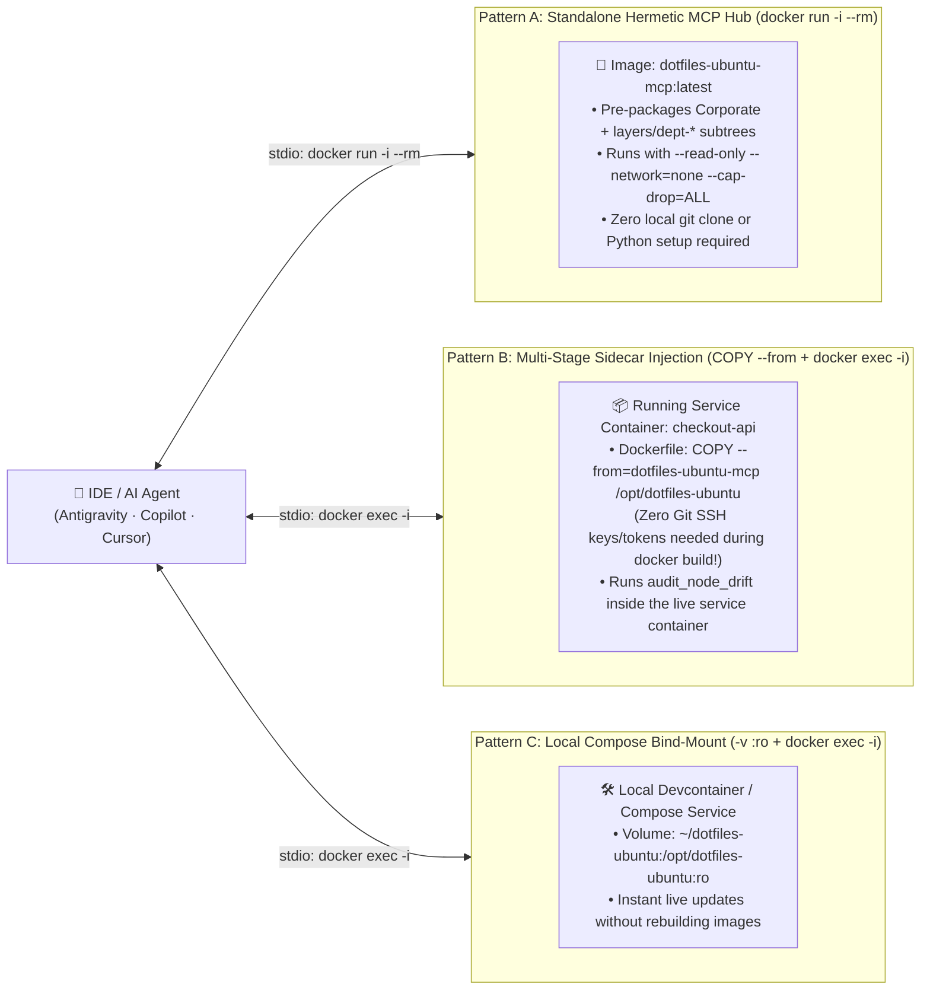

# Contextual MCP Server & Multi-Service Orchestration Guide

> **Reference & Configuration Guide — Operating `dotfiles-ubuntu` as a Node/Layer MCP Server**
>
> Just as `dotfiles-ubuntu` contextualizes engineering patterns across organizational layers (`Corporate → Team → Project`) via GNU Stow on a local workstation, any instance or fork of `dotfiles-ubuntu` hosted on a **system, container, remote server, or team repository** can also run as a **lightweight Model Context Protocol (MCP) Server** (`scripts/dotfiles_mcp_server.py`).
>
> This capability is **100% optional, read-only, and zero-dependency** (pure Python 3 standard library). You can adopt it in **two ways**:
> 1. **As a Standalone Node / Container MCP Use Case**: Turn any Ubuntu workstation, Docker container, Devcontainer, or remote server into a self-describing, auditable node that AI agents can inspect for package drift, configuration health, and navigable documentation (`docs/`).
> 2. **As an Extension of the [Enterprise "pAIr programming" Governance Model](enterprise_pair_programming_governance.md)**: Orchestrate multiple customized `dotfiles-ubuntu` forks across **Corporate, Team, and Multi-Service / Multi-Container architectures**, creating a **Federated Context Mesh** where AI agents discover both the specialized MCPs of each service and the exact governance rules that apply to them.

---

## 1. Why Turn `dotfiles-ubuntu` into a Contextual MCP Server?

### 1.1. The Boundary Problem in Complex Architectures

On a single developer laptop, **GNU Stow** (`./bootstrap.sh --stow`) is unbeatable: it links [`AGENTS.md`](../../antigravity/.gemini/config/AGENTS.md) and [`hooks.json`](../../antigravity/.gemini/config/hooks.json) directly into `~/.gemini/config/`, giving the AI agent zero-latency rules and deterministic `PreToolUse` safety guards.

However, as soon as an engineering workflow involves **multiple containers, microservices, remote servers, or multiple team forks**, filesystem symlinks hit a physical wall:
- A symlink in `~/.gemini/config/` on your host laptop **cannot** inspect whether a worker container is missing an APT library declared in its [`system/packages-manual.txt`](../../system/packages-manual.txt).
- A local symlink **cannot** read the `Layer B` templates of another team's fork or the `docs/` of a remote service node.
- A flat `mcp_config.json` with 20 raw infrastructure MCP servers (databases, queues, cloud APIs) tells the AI agent *how to call* those tools, but gives **zero context** about *which architectural rules, migration restrictions, or safety guardrails govern each environment*.

### 1.2. The Solution: Every Node & Layer as a Self-Describing MCP Context Provider

When `dotfiles-ubuntu` (or a customized fork of it) is present in a layer, container, or server, running `scripts/dotfiles_mcp_server.py` exposes that environment's **declarative truth** and **live health** over MCP:

```
┌──────────────────────────────────────────────────────────────────────────────┐
│                 dotfiles-ubuntu Contextual MCP Server (stdio)                │
├───────────────────────────┬──────────────────────────┬───────────────────────┤
│ 1. System & Drift Context │ 2. Governance & Docs     │ 3. MCP Federation     │
│ • system/*.txt manifests  │ • Layer AGENTS.md rules  │ • system/mcp-layer    │
│ • audit_node_drift tool   │ • templates/<stack>/     │ • Downstream MCP list │
│ • OS / Git / Version info │ • Navigable docs/ graph  │ • Mandatory guardrails│
└───────────────────────────┴──────────────────────────┴───────────────────────┘
```

---

## 2. Two Adoption Modes: Standalone vs. Multi-Layer Enterprise Federation

### Mode A: Standalone System or Container Introspection (Independent Use Case)

Even for a single developer or a single project using Docker Compose, attaching the `dotfiles-ubuntu` MCP server to your environment allows your AI assistant (Antigravity 2.0, VS Code Copilot, Cursor, or Claude Code) to:
- **Audit Environment Drift On Demand**: Ask the agent *"Check if my workstation or container has drifted from `dotfiles-ubuntu`"* $\rightarrow$ the agent calls `audit_node_drift` (`verify-repo.sh` / `audit.sh`) and reports missing packages, broken symlinks, or uncommitted manifest changes.
- **Query Rules & Templates Programmatically**: Ask the agent *"Which FastAPI testing rules apply to module decommissioning?"* $\rightarrow$ the agent calls `query_governance_rules(query="decommissioning")` and retrieves the exact rule section without scanning the filesystem manually.
- **Navigate `docs/` via MCP Resources**: Any MCP-compatible client can browse `dotfiles://docs/index` and call `read_layer_document` to read architecture specs on demand.

### Mode B: Multi-Layer & Multi-Service Orchestration (Enterprise Extension)

In complex enterprise architectures where multiple services, containers, servers, and teams interact, organizations customize forks of `dotfiles-ubuntu` for each layer and service node.

Instead of managing an unstructured list of disconnected MCP servers, the customized `dotfiles-ubuntu` instances form a **Hierarchical Context Mesh**:



#### How Contextual MCP Orchestration Works in Practice

1. **Context Before Action (Guardrailed MCP Execution)**:
   - Suppose an agent needs to inspect or troubleshoot `staging-db-01`, which has a `postgres-mcp` server attached.
   - Before touching the database MCP, the agent queries `dotfiles-node-staging` via `discover_federated_mcps()`.
   - The node's [`system/mcp-layer.json`](../../system/mcp-layer.json) returns not only the `postgres-mcp` descriptor, but also its **`required_guardrails`** (e.g., *"Strictly read-only queries; never run `DROP`/`TRUNCATE` without explicit human approval per `accidental-data-loss-prevention`; schema changes must go through declarative Alembic migrations in `checkout-api`"*).
2. **Cross-Service Drift Diagnosis**:
   - A feature works in `checkout-api` but fails in `payment-worker` due to a native library mismatch (`libpq` / `cairo` / Node version).
   - The agent calls `audit_node_drift` and reads `dotfiles://system/manifests` on both `dotfiles-node-api` and `dotfiles-node-worker`, immediately pinpointing the exact package discrepancy between the two containers.
3. **Cross-Layer `/enrich` Discovery**:
   - Using `compare_layer_patterns`, the agent compares a microservice's `.agents/rules/` and `.agents/skills/` against both `dotfiles-team-backend` (`Layer B`) and `dotfiles-corporate` (`Layer A`), identifying which local rules should be promoted to the team fork versus the corporate fork.

---

## 3. Step-by-Step Configuration Guide

Because `scripts/dotfiles_mcp_server.py` communicates over standard `stdio` using only the Python 3 standard library, it requires **zero background daemons, zero open network ports, and zero `pip install` steps**.

Below are the exact configuration recipes for local workstations, Docker containers, remote SSH servers, and multi-IDE setups.

---

### 3.1. Verify the MCP Server Locally first

Before adding the server to your IDE, you can verify that it responds cleanly on your machine:

```bash
cd ~/dotfiles-ubuntu
./scripts/dotfiles_mcp_server.py --self-test
```

---

### 3.2. Configure in Google Antigravity 2.0 (`~/.gemini/config/mcp_config.json`)

In Google Antigravity 2.0 (Agents Desktop, IDE, and CLI), MCP servers are configured in `~/.gemini/config/mcp_config.json` (which is intentionally untracked by GNU Stow so each machine can define its own local and remote topology).

Add `dotfiles-ubuntu` under `"mcpServers"`:

```json
{
  "mcpServers": {
    "dotfiles-local": {
      "command": "python3",
      "args": [
        "/home/<your-user>/dotfiles-ubuntu/scripts/dotfiles_mcp_server.py"
      ]
    }
  }
}
```

> **Tip**: Replace `/home/<your-user>/dotfiles-ubuntu` with your absolute home path (e.g., `/home/alice/dotfiles-ubuntu`), as JSON configuration files do not expand `~`. In the upstream base repository, `dotfiles_mcp_server.py` uses only the Python standard library (`requirements.txt` has 0 external packages), so `"command": "python3"` invokes the operating system's native interpreter (`/usr/bin/python3` — Python 3.14 on Ubuntu 26.04 LTS, or Python >= 3.10 on older containers/nodes) directly without needing a `venv`. If a custom service-node fork adds runtime packages to `requirements.txt` (or an environment profile such as `requirements-tst.txt`, `requirements-pre.txt`, `requirements-pro.txt`), run `make install-runtime` (or `venv/bin/pip install -r requirements-<env>.txt`) on that node and point `"command"` to `"/path/to/dotfiles-ubuntu/venv/bin/python"`.

---

### 3.3. Three Docker MCP Deployment Patterns (`Dockerfile`: `docker run -i --rm`, `COPY --from` + `docker exec -i`, & Bind-Mount `-v :ro`)

`dotfiles-ubuntu` ships with an official, hardened Ubuntu 26.04 [`Dockerfile`](../../Dockerfile) (`make docker-build`, `make docker-self-test`, `make docker-mcp`) and [`.dockerignore`](../../.dockerignore) that enable **three complementary Docker architectures** depending on whether you need a **portable Governance Hub** or **live inside-container drift inspection**:



#### Pattern A — Standalone Hermetic MCP Hub Container (`docker run -i --rm`)
Build the repository (including any mounted `layers/*` subtrees) into a self-contained image:

```bash
cd ~/dotfiles-ubuntu
make docker-build        # Builds dotfiles-ubuntu-mcp:<version> and :latest
make docker-self-test    # Verifies MCP self-test inside --read-only --network=none container
```

Now any developer (even on macOS, Windows/WSL, or non-Ubuntu hosts) or CI agent can run the Corporate/Team/Departmental MCP Hub in a **kernel-isolated sandbox** (`--read-only --network=none --cap-drop=ALL`) without cloning the repositories locally:

```json
{
  "mcpServers": {
    "dotfiles-hermetic-hub": {
      "command": "docker",
      "args": [
        "run",
        "-i",
        "--rm",
        "--read-only",
        "--network=none",
        "--cap-drop=ALL",
        "dotfiles-ubuntu-mcp:latest",
        "--no-log"
      ]
    }
  }
}
```

> **Optional Persistent Logs in Pattern A**: If you want the hermetic container to write `mcp_events.jsonl` and `mcp_alerts.jsonl` to your host, mount a host log directory (`"-v", "/home/<your-user>/dotfiles-ubuntu/logs:/opt/dotfiles-ubuntu/logs"`) and omit `"--no-log"`.

#### Pattern B — Multi-Stage Sidecar Injection into Microservice Containers (`COPY --from` + `docker exec -i`)
When you want `audit_node_drift` (`audit.sh`) and `dotfiles://system/manifests` to inspect the **actual runtime environment inside a microservice container** (`checkout-api`, `payment-worker`), you don't need to run `git clone` (or pass private Git SSH keys/tokens) inside the microservice's `Dockerfile`. Instead, copy `/opt/dotfiles-ubuntu` from your `dotfiles-ubuntu-mcp` image in a single line:

```dockerfile
# Inside checkout-api/Dockerfile:
FROM ghcr.io/acme-corp/dotfiles-ubuntu-mcp:1.6.0 AS governance-layer

FROM ubuntu:26.04
# ... install checkout-api runtime packages ...
COPY --from=governance-layer /opt/dotfiles-ubuntu /opt/dotfiles-ubuntu
```

#### Pattern C — Local Docker Compose / Devcontainer Bind-Mount (`-v :ro` + `docker exec -i`)
During local `dev` with Docker Compose, you can mount your local `~/dotfiles-ubuntu` directly into any running service container without modifying its `Dockerfile`:

```yaml
# Inside docker-compose.yml:
services:
  checkout-api:
    volumes:
      - ~/dotfiles-ubuntu:/opt/dotfiles-ubuntu:ro
```

For both **Pattern B** and **Pattern C**, your host IDE connects to each running service container over `docker exec -i` (zero open network ports):

```json
{
  "mcpServers": {
    "dotfiles-container-api": {
      "command": "docker",
      "args": ["exec", "-i", "checkout-api-container", "python3", "/opt/dotfiles-ubuntu/scripts/dotfiles_mcp_server.py", "--no-log"]
    },
    "dotfiles-container-worker": {
      "command": "docker",
      "args": ["exec", "-i", "payment-worker-container", "python3", "/opt/dotfiles-ubuntu/scripts/dotfiles_mcp_server.py", "--no-log"]
    }
  }
}
```

| Docker Pattern | Primary Goal | Can Inspect Host/Service APT Drift? | Requires Local Clone on Host? |
|----------------|--------------|:-----------------------------------:|:-----------------------------:|
| **Pattern A (`docker run -i --rm`)** | Zero-install distribution & hermetic sandbox for Corporate/Departmental/Team rules, `docs/`, `layers/*`, & federated MCP discovery | Inspects the Hub image itself (`in_container: true`) | **No** (runs directly from registry image) |
| **Pattern B (`COPY --from` + `docker exec -i`)** | Bake layer context into `tst`/`pre`/`pro` microservice images without Git credentials during `docker build` | **Yes** — audits the live microservice container (`in_container: true`) | **No** |
| **Pattern C (`-v :ro` + `docker exec -i`)** | Zero-rebuild live introspection of local `dev` containers | **Yes** — audits the live `dev` container using host's latest `~/dotfiles-ubuntu` | **Yes** (`~/dotfiles-ubuntu` mounted `:ro`) |

---

### 3.4. Configure Across Remote Servers or VMs (`ssh` over `stdio`)

To give your local AI agent read-only visibility into the configuration, package manifests, and layer rules of a remote Ubuntu server (e.g., a staging node, build server, or data node) where `dotfiles-ubuntu` is cloned at `~/dotfiles-ubuntu`, use standard `ssh` as the MCP transport:

```json
{
  "mcpServers": {
    "dotfiles-staging-node": {
      "command": "ssh",
      "args": ["-T", "-o", "BatchMode=yes", "deploy@staging-node-01.internal", "python3", "/home/deploy/dotfiles-ubuntu/scripts/dotfiles_mcp_server.py"]
    }
  }
}
```

**Security & Operational Advantages**:
- Uses your existing SSH keys, bastion hosts (`~/.ssh/config`), and OS-level user permissions (`BatchMode=yes` ensures non-interactive fail-fast if the key is not loaded).
- No web server or open port needs to be exposed on `staging-node-01.internal`.
- Because `dotfiles_mcp_server.py` is strictly read-only, the agent can inspect drift (`audit_node_drift`), manifests (`dotfiles://system/manifests`), and node documentation (`dotfiles://docs/index`) without being able to mutate the remote server.

---

### 3.5. Configure Multi-Layer Forks Simultaneously (`Corporate + Team + Node`)

In an enterprise setting where a tech lead or architect works across organizational layers, multiple forks of `dotfiles-ubuntu` can be mounted simultaneously:

```json
{
  "mcpServers": {
    "dotfiles-layer-corporate": {
      "command": "python3",
      "args": ["/home/<your-user>/dotfiles-corporate/scripts/dotfiles_mcp_server.py", "--layer-role", "corporate", "--layer-id", "acme-corp/dotfiles-enterprise"]
    },
    "dotfiles-layer-team-backend": {
      "command": "python3",
      "args": ["/home/<your-user>/dotfiles-team-backend/scripts/dotfiles_mcp_server.py", "--layer-role", "team", "--layer-id", "acme-corp/dotfiles-backend-hexagonal"]
    }
  }
}
```

> Notice that `--layer-role` and `--layer-id` can be passed as CLI flags (overriding `system/mcp-layer.json` on the fly) or committed declaratively inside each fork's `system/mcp-layer.json`.

---

### 3.6. Configure in VS Code (GitHub Copilot), Cursor, and Claude Code

Because `scripts/dotfiles_mcp_server.py` implements the standard Model Context Protocol over `stdio`, the exact same command works in every MCP-capable editor:
- **VS Code & GitHub Copilot (`.vscode/mcp.json` or User `settings.json`)**: `{"servers": {"dotfiles-ubuntu": {"type": "stdio", "command": "python3", "args": ["/home/<your-user>/dotfiles-ubuntu/scripts/dotfiles_mcp_server.py"]}}}`
- **Cursor (`~/.cursor/mcp.json`) & Claude Code (`~/.claude.json` or `.mcp.json`)**: `{"mcpServers": {"dotfiles-ubuntu": {"command": "python3", "args": ["/home/<your-user>/dotfiles-ubuntu/scripts/dotfiles_mcp_server.py"]}}}`

---

## 4. Customizing `system/mcp-layer.json` for Your Fork or Service Node

When you fork `dotfiles-ubuntu` for a team or attach it to a microservice container, edit [`system/mcp-layer.json`](../../system/mcp-layer.json) to declare the layer's role, upstream parent, and any specialized MCP servers that operate in that environment:

```json
{
  "schema_version": "1.2",
  "layer_id": "acme-checkout-service-node",
  "layer_role": "service-node",
  "precedence": 20,
  "description": "Checkout Service Ubuntu 26.04 Container Node (FastAPI Hexagonal + PostgreSQL)",
  "upstream_layer": {
    "layer_id": "acme-corp/dotfiles-backend-hexagonal",
    "repository": "git@github.com:acme-corp/dotfiles-backend-hexagonal.git",
    "branch": "main"
  },
  "default_stack_templates": ["fastapi-hexagonal"],
  "baseline_guardrails": ["AGENTS.md §4 (Absolute Test Inclusion — 100% branch coverage)"],
  "surface_bindings": [
    {
      "binding_id": "checkout-domain-invariants",
      "target_globs": ["src/checkout/**", "templates/checkout/**"],
      "architectural_planes": ["domain", "application", "presentation"],
      "scopes": ["checkout"],
      "traits": ["financial"],
      "mode": "authoritative",
      "rule_files": ["antigravity/.gemini/config/AGENTS.md"],
      "canonical_templates": [],
      "invariants": ["All checkout monetary calculations must use integer minor units (cents) and idempotency keys"]
    }
  ],
  "environments": {
    "dev": {
      "access_mode": "read-write-local",
      "requirements_file": "requirements-dev.txt",
      "default_guardrails": ["Run local unit & integration tests before committing"]
    },
    "pre": {
      "access_mode": "strictly-read-only",
      "requirements_file": "requirements-pre.txt",
      "default_guardrails": ["Strictly read-only schema & query introspection in pre-production"]
    }
  },
  "federated_mcps": [
    {
      "mcp_id": "checkout-postgres-mcp",
      "role": "database",
      "layer": "service-node",
      "activation_policy": "on-demand",
      "environments": ["dev", "tst", "pre"],
      "description": "Read-only schema & query introspection for the Checkout PostgreSQL database.",
      "when_to_invoke": "Invoke on demand when inspecting live Checkout table schemas, indexes, or query plans.",
      "avoid_when": "Avoid when reading static SQLAlchemy models or unit test fixtures.",
      "required_guardrails": [
        "accidental-data-loss-prevention: NEVER execute DROP, TRUNCATE, or unguarded DELETE.",
        "fastapi-database: Schema changes must exclusively use Zero-Touch Alembic migrations, never manual DDL."
      ]
    }
  ]
}
```

When an AI agent connects to this node and runs `discover_federated_mcps`, it immediately learns:
1. Which specialized MCP servers (`checkout-postgres-mcp`, `checkout-observability-mcp`) belong to this service.
2. Which **mandatory safety and architectural guardrails** (`required_guardrails`) must be respected before invoking them.
3. Which **environment profile** (`dev`, `tst`, `pre`, `pro`) applies when filtering via `discover_federated_mcps(environment="pre")`.

---

## 5. Multi-Dimensional Context Networks with `git subtree` (`scripts/layer-subtree.sh`)

In complex organizations, a single project often needs context from **multiple horizontal directions at once**: Corporate standards, cross-cutting Departments (Cybersecurity, Data Platform, Cloud/SRE), sibling Microservices (`svc-fraud`, `svc-ledger`), and target deployment Environments (`dev`, `tst`, `pre`, `pro`).

Instead of configuring 10 separate MCP server processes on every developer machine, you can compose a **Multi-Dimensional Context Graph** inside your team or workstation fork by mounting secondary `dotfiles-ubuntu` forks into **`layers/<layer-name>/`** via [`scripts/layer-subtree.sh`](../../scripts/layer-subtree.sh):

### 5.1. End-to-End Workflow: Vertical Upstream Sync + Horizontal Subtree Mounting

```bash
cd ~/dotfiles-ubuntu

# 1. Vertical Sync: Pull latest baseline improvements from parent fork (Public or Corporate upstream)
./scripts/layer-subtree.sh sync-upstream

# 2. Horizontal Mount: Attach Departmental & Sibling-Service forks under layers/<name>/ (--squash)
./scripts/layer-subtree.sh add dept-security git@github.com:acme-corp/dotfiles-dept-security.git main
./scripts/layer-subtree.sh add dept-data     git@github.com:acme-corp/dotfiles-dept-data.git main
./scripts/layer-subtree.sh add svc-fraud     git@github.com:acme-corp/dotfiles-svc-fraud.git main

# 3. Inspect all mounted context layers (auto-discovered by dotfiles_mcp_server.py)
./scripts/layer-subtree.sh list
# Or via Makefile:
make layer-list

# 4. Update a single mounted layer (auto-resolves repo URL & branch from layers/<name>/system/mcp-layer.json)
./scripts/layer-subtree.sh pull dept-security

# 5. Update ALL mounted layers in layers/* in a single command
./scripts/layer-subtree.sh pull-all
# Or via Makefile:
make layer-pull-all

# 6. Promote a reusable departmental rule or MCP guardrail upstream (/enrich -> subtree push)
./scripts/layer-subtree.sh push dept-data feat/enrich-bq-guardrail
```

### 5.2. How the AI Agent Queries the Mounted Subtree Graph & Environments (`dev/tst/pre/pro`)

Once subtrees are mounted under `layers/*/`, your **single local `dotfiles_mcp_server.py` instance** automatically discovers and indexes all of them with **zero idle token cost** (`layers/` is excluded from GNU Stow so `~/.gemini/config/AGENTS.md` stays `< 18 KB`):

- **Cross-Layer Rule & Doc Search (`layer="all"` or `layer="dept-security"`)**:
  - Calling `query_governance_rules(query="webhook", layer="all")` searches the root layer **plus every mounted subtree in `layers/*/`** in a single call.
  - Calling `read_layer_document(relative_path="docs/README.md", layer="svc-fraud")` reads the architecture index of a sibling service directly.
- **Stack-Agnostic Multi-Layer Surface Projection (`resolve_surface_governance` across `0..N` Layers)**:
  - Calling `resolve_surface_governance(target_path="templates/checkout/summary.html", traits=["financial", "pii"])` automatically infers `effective_plane="presentation"` and `effective_scope="checkout"`, prunes non-intersecting layers (`0` token cost), and weaves matching `surface_bindings` from the Root layer (`precedence: 10`) and any `0..N` arbitrary mounted subtrees (`layers/<any-slug>/`) ordered by numeric deontic `precedence` (`0..100`, *Lex Superior*).
  - Authoritative bindings (`mode="authoritative"`) resolve at `L2` with `canonical_templates`, while cross-cutting bindings (`mode="transversal"`) automatically compact to `L1` Axiom Skeletons with sealed `rcap1` capsules.
- **Resonant Chained Context Compaction & Unfolding (`L0 → L1 → L2 → L3` via `rcap1` Capsules)**:
  - To prevent context window saturation when scanning across multiple layers, agents can pass `resolution="L0"` to `query_governance_rules(query="webhook", layer="all", resolution="L0")`. This returns compact **Promoter Codons (`AUG:<scope>:<slug>:UAA`, ~18 tokens/match)** plus sealed **`rcap1` context capsules** (~85–90% token savings).
  - When a Promoter Codon resonates with the task, the agent calls **`unfold_context_capsule(capsule_token="rcap1...", target_level="L1", agent_tier="flash")`** to decrypt and `zlib`-decompress the **Level 1 Axiom Skeleton** (~45 tokens), or continues unfolding sequentially to **`L2`** (Full Section) and **`L3`** (linked `SKILL.md` / architecture specs + environment guardrails) with `agent_tier="inherit"` or `"pro"`.
- **Environment-Aware Federated MCP Discovery (`environment="dev" | "tst" | "pre" | "pro"`)**:
  - Calling `discover_federated_mcps(layer="all", environment="pre")` returns only the MCP servers enabled for pre-production across the root layer and all mounted subtrees, together with the `pre` environment profile (`access_mode: "strictly-read-only"`, `requirements_file: "requirements-pre.txt"`, and `default_guardrails`).
  - Every discovered MCP entry automatically includes **`effective_guardrails`** (merging Root `baseline_guardrails` + Subtree `baseline_guardrails` + Environment `default_guardrails` + MCP `required_guardrails`) as well as `activation_policy` (`"on-demand"`), `when_to_invoke`, and `avoid_when` so child layers cannot drop corporate guardrails and agents only invoke underlying MCPs when strictly needed.
- **Structured Runtime Audit & Alert Logs (`logs/mcp_events.jsonl` & `logs/mcp_alerts.jsonl`)**:
  - Every MCP tool call, resource read, token-budget warning (`TOKEN_BUDGET_NEAR_LIMIT`, `TOKEN_BUDGET_EXCEEDED`), truncation warning (`RESPONSE_TRUNCATED`), or fan-out alert (`MCP_FANOUT_WARNING`) is automatically logged to `logs/mcp_events.jsonl` and `logs/mcp_alerts.jsonl` (with 512 KB rotation and `--log-dir` / `--no-log` flags).

---

## 6. Summary of Precautions & Design Boundaries

| Principle | How `dotfiles-ubuntu` Enforces It |
|-----------|-----------------------------------|
| **Never replace local Stow hooks with MCP** | Local `AGENTS.md` and `PreToolUse` (`pre_tool_guard.py`) remain symlinked in `~/.gemini/config/` for zero-latency, non-bypassable local enforcement. MCP is used for cross-node, cross-container, and cross-layer introspection. |
| **Zero idle token bloat from `layers/*` subtrees** | `bootstrap.sh` and `audit.sh` skip `layers/`. Mounted departmental and sibling-service subtrees are queried on demand via MCP rather than injected into `always_on` prompt context. |
| **Zero external dependencies at base runtime** | `scripts/dotfiles_mcp_server.py` uses 100% Python 3 standard library (`requirements.txt` has 0 external packages in upstream). Environment-specific extensions can use `requirements-{tst,pre,pro}.txt` chaining `-r requirements.txt`. |
| **Strictly read-only by default** | Zero tools for arbitrary shell commands, file editing, or package installation. Only deterministic read/audit operations (`verify-repo.sh`, `audit.sh`, doc/rule readers) are exposed. |
| **Zero secret exposure** | Path containment locks all file reads strictly inside the repository root (`REPO_DIR`). Machine-local files (`~/.bashrc.local`, `~/.gitconfig.local`, `.env`, `~/.gemini/*.json`) cannot be read via MCP. |

📖 **Normative Protocol, Schema & Engine References**: See **[`docs/architecture/03_contextual_mcp_and_federation.md`](../architecture/03_contextual_mcp_and_federation.md)** and **[`docs/architecture/04_compaction_surface_and_promotion_engines.md`](../architecture/04_compaction_surface_and_promotion_engines.md)**.
