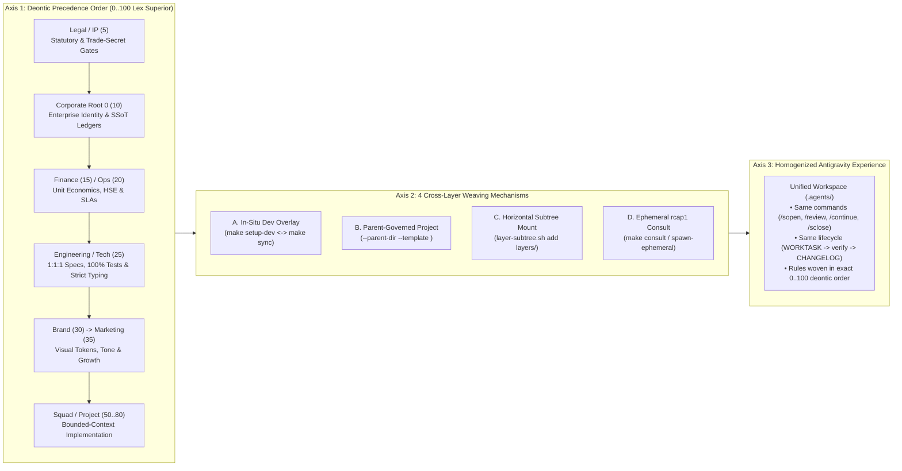
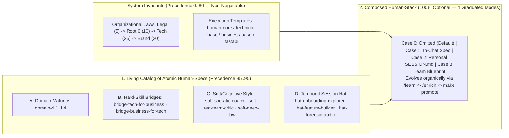

# Cross-Departmental Composition & `Human-Stack` Matrix (`0..95`)

> **Parent Reference**: [`docs/reference/enterprise_pair_programming_governance.md`](enterprise_pair_programming_governance.md) | **Normative Architecture**: [`docs/architecture/02_antigravity_governance_and_hooks.md`](../architecture/02_antigravity_governance_and_hooks.md) & [`docs/architecture/06_layer_governance_and_promotion_engines.md`](../architecture/06_layer_governance_and_promotion_engines.md)

This reference defines the **Cross-Departmental Contextual Algebra (`0..80`)** across Legal, Marketing, Finance, Operations, and Engineering, together with the **`Human-Spec` / `Human-Stack` Matrix (`85..95`)** for multidisciplinary operator pairing across Public Administration, Enterprise, Science, and Individual contexts.

---

## 1. Cross-Departmental & Multi-Specialty Composition Matrix: LegalTech, Governed Marketing & Transversal Platforms (`VoIP`)

In traditional enterprises, whenever a business or functional department (Legal, Marketing, Finance, Operations) needs to build software, automate workflows, or integrate with another specialty, two structural failures emerge:
1. **The IT Bottleneck (Context Loss)**: Business writes static handoff specs for IT; engineers build technically sound code that inadvertently misses legal, brand, or financial nuances because those domain rules live in separate silos.
2. **Shadow IT (Engineering Drift)**: The business department builds its own scripts, bots, or connectors outside IT; it solves the immediate domain need, but without `1:1:1` architecture, `100%` test coverage, type safety, or corporate security guards.

`dotfiles-ubuntu` eliminates both failure modes by turning organizational departments and technical stacks into a **3-Axis Compositional Matrix ("Contextual Algebra")** where **Google Antigravity** acts as the universal execution surface:



1. **Order Defines Authority (*Lex Superior* `0..100`)**:
   - Combining **Legal (`5`) + Tech (`25`)** is not an unordered bag of prompts: because `5 < 25`, `.agents/rules/layer-05-dept-legal.md` takes deontic precedence over `layer-25-dept-tech.md`. The AI agent enforces `100%` unit test coverage and hexagonal architecture (`25`) *in service of* statutory IP and confidentiality invariants (`5`), never allowing a technical shortcut to bypass a legal gate.
2. **Infinite Specialized Profiles, Zero Cognitive Overhead**:
   - Whether the resulting workspace is a *LegalTech MCP Engineer*, a *Governed Growth & Social Automation Specialist*, or a *Transversal VoIP Platform Architect*, the human operator interacts with the exact same Antigravity commands (`/sopen`, `make status`, `make verify`, `/review`, `/sclose`) while `inspect_workspace_status` (`C1 / C2 / C3` command tiers) filters out irrelevant commands.

### 1.1. The 6 Cross-Specialty Enterprise Archetypes

| Enterprise Scenario | Workspace Owner | Woven Rule Chain (`0..100` *Lex Superior*) | 1-Command Activation | Effective Antigravity Profile |
| :--- | :--- | :--- | :--- | :--- |
| **1. Pure Business Governance** *(Policies, Patents, Financial Ledgers)* | `Root 0` (`10`) or `Department` (`5..20`) | `human-core` + `business-base` (`10`) + `templates/<dept>/` (`5..20`) | `bootstrap-workspace` / `make sync` | **Normative & SSoT Ledger Auditor** (`workspace_mode: business`) |
| **2. In-Department Tooling** *(Scripts/validators inside a business repo)* | `Department` (`Legal`, `Finance`, `Ops`) | `<dept>` (`5..20`) + `business-base` (`10`) + **`technical-base` (`25`, temporary)** | `make setup-dev` *(reverts to `business` via `make sync`)* | **In-Situ Domain Automation Engineer** (`workspace_mode: hybrid`) |
| **3. Department-Owned Tech Product** *(e.g., **LegalTech Patent/Contract MCP**)* | `Legal` (`5`) or Embedded Legal Squad | **`Legal` (`5`)** $\rightarrow$ `Root 0` (`10`) $\rightarrow$ **`Tech` + `FastAPI` (`25..50`)** | `apply-project <app> --parent-dir <dept> --template <stack>` | **Software Architect Subordinated to Department Law** (`hybrid`) |
| **4. Multi-Departmental Intersection** *(e.g., **Marketing + Social Media Hub**)* | `Marketing` / `Growth` Squad (`35`) | **`Legal/GDPR` (`5`)** $\rightarrow$ `Root 0` (`10`) $\rightarrow$ **`Tech` (`25`)** $\rightarrow$ **`Brand` (`30`)** $\rightarrow$ **`Marketing` (`35`)** | `--parent-dir dept-marketing` + `layer-subtree.sh add` (`legal`, `brand`) | **Full-Stack Growth Engineer Governed by Legal, Brand & Security** |
| **5. Transversal Enterprise Platform** *(e.g., **Company-Wide `VoIP` Service**)* | Platform `service-node` / `squad` (`25`) | **Inward**: `Legal` (`5`) $\rightarrow$ `Root 0` (`10`) $\rightarrow$ `Ops` (`20`) $\rightarrow$ `Tech/VoIP` (`25`)<br/>**Outward**: Exports `templates/voip-pack` + `federated_mcps` | Consumers mount `layers/voip-platform` or apply `--template voip-pack` | **Critical Infrastructure Builder (inward) / Governed Service Provider (outward)** |
| **6. Punctual Cross-Departmental Audit** *(e.g., Design checks Patent Gate with Legal)* | Any consumer workspace | Active workspace + **Ephemeral `rcap1` Capsule (`L0..L2`, `kr: true`)** | `make consult LAYER=dept-legal QUERY="..."` | **Zero-Residue Read-Only Inter-Departmental Advisor** (`inter-layer`) |

---

### 1.2. Concrete Walkthroughs of the 3 Cross-Specialty Cases

#### Case A — When the Legal Department Builds Technology (e.g., a LegalTech Patent & Contract Auditor MCP)

Suppose the **Legal & IP Department (`dept-legal-ip`, `precedence: 5`)** needs a custom Model Context Protocol (MCP) server or microservice to audit supplier contracts and patent claims against `corporate/` ledgers. The enterprise can execute this in two ways depending on team structure:

- **Option A1 — Embedded Technical Development Under Legal (`--parent-dir` or `make setup-dev`)**:
  - A technical specialist working directly for Legal scaffolds `legal-contract-mcp/` governed by `dept-legal-ip`:
    ```bash
    ./scripts/layer-config.sh apply-project ~/Projects/legal-contract-mcp \
      --parent-dir ~/Projects/dept-legal-ip \
      --template technical-base,fastapi-hexagonal
    ```
  - *(Or, if authoring automation scripts directly inside `~/Projects/dept-legal-ip`, runs `make setup-dev` to overlay `technical-base` onto `business-base` + `dept-legal-ip`, and `make sync` when finished).*
  - **Resulting Agent Behavior**: Antigravity enforces `mypy --strict`, `ruff`, hexagonal ports/adapters, and `100.00%` isolated unit branch coverage from `technical-base` (`25`), while `dept-legal-ip` (`5`) acts as supreme law — blocking any tool output or test fixture from exposing unpatented inventions (*World Novelty Gate*) or trade secrets (`<TS-ID>`) outside sealed `rcap1` (`kr: true`) capsules.
- **Option A2 — Delegated to the Engineering Department (`dept-tech`) with Legal Mounted**:
  - Legal delegates the build to Engineering via `./scripts/layer-config.sh delegate-to-child ~/Projects/corporate-root --to-child dept-tech --task "Build Patent Audit MCP" --ticket LEG-2026-009`.
  - The engineering squad mounts `layers/dept-legal-ip/` (`./scripts/layer-subtree.sh add dept-legal-ip <url>`). Because `dept-legal-ip` carries `precedence: 5` and `dept-tech` carries `precedence: 25`, `resolve_surface_governance` enforces the exact same `Legal (5) > Corporate (10) > Tech (25)` hierarchy.

#### Case B — When Marketing Connects to Social Media (Multi-Departmental Intersection)

Suppose **Marketing (`dept-marketing`, `precedence: 35`)** wants to build an automated omnichannel campaign engine connected to LinkedIn, X, and Instagram APIs (`marketing-social-hub/`). In a governed enterprise, a social media automation tool touches **four distinct specialties simultaneously**:
1. **Legal & Compliance (`precedence: 5`)**: Enforces GDPR privacy, embargo dates (*World Novelty Gate*), and **Zero-Greenwashing** (every sustainability or unit-economics claim in a post must cite an audited `Batch #NNN` ledger in `corporate/`).
2. **Corporate Root 0 (`precedence: 10`)**: Enforces secret isolation and executive crisis SLAs (`P0 < 1h`).
3. **Engineering / Tech (`precedence: 25`)**: Enforces OAuth token security, idempotent retry queues, rate-limiting, and `100%` `AAA` unit test coverage.
4. **Brand & Design (`precedence: 30`)**: Locks corporate casing, phonetic standards, color contrast (`WCAG >= 4.5:1`), and visual tokens so Marketing (`35`) cannot alter brand identity.
5. **Marketing (`precedence: 35`)**: Defines campaign hooks, audience segmentation, UTM attribution, and posting cadences.

- **How It Is Configured**:
  ```bash
  # Inside dept-marketing (or the marketing-social-hub squad fork):
  ./scripts/layer-subtree.sh add dept-legal ~/Projects/dept-legal-ip master
  ./scripts/layer-subtree.sh add dept-brand ~/Projects/dept-brand-design master
  ./scripts/layer-config.sh apply-project ~/Projects/marketing-social-hub \
    --parent-dir ~/Projects/dept-marketing \
    --template technical-base,fastapi-hexagonal \
    --layers all
  ```
- **Resulting Agent Behavior**: A single developer or technical marketer in Antigravity operates with all five layers woven in `.agents/rules/` (`layer-05-dept-legal.md`, `layer-10-root.md`, `layer-30-dept-brand.md`, `layer-35-dept-marketing.md`, `technical-base.md`, `fastapi-hexagonal.md`). Any code or campaign template generated by the AI automatically satisfies Legal, Brand, Security, and Growth constraints in a single pass.

#### Case C — When a Service Is Transversal to the Entire Company (e.g., Enterprise `VoIP` / Unified Communications)

Suppose the organization operates a transversal **`VoIP` & Unified Communications Platform (`voip-platform`)** used across Customer Support, Sales/Marketing, Legal counsel lines, and Executive communications. A transversal platform has a **dual inward/outward architecture**:

1. **Inward Perspective (Building & Operating the `VoIP` Core)**:
   - `voip-platform` is bootstrapped as a `service-node` (or platform `squad`) at `precedence: 25` with `technical-base` + `fastapi-hexagonal`, mounting **`dept-legal` (`5`)** (telephony recording consent laws, wiretap compliance, audio retention TTLs) and **`dept-ops` (`20`)** (`< 1h` P0 incident SLA, emergency failover routing).
   - It declares its runtime MCP server (`voip-sip-controller`) under `federated_mcps` in `system/mcp-layer.json` with explicit `required_guardrails` (e.g., *"Never initiate call recording or transcript export without a verified consent token; `pro` environment restricted to read-only telemetry"*), and packages a reusable client template at `templates/voip-client-pack/`.
2. **Outward Perspective (Consuming `VoIP` Across Any Department or Squad)**:
   - Whenever **Customer Support**, **Sales/Marketing**, or **Legal** builds a workspace that integrates voice calls or AI voice agents, they mount `layers/voip-platform/` (or run `apply-project --template voip-client-pack`).
   - Their Antigravity agents immediately discover the `voip-sip-controller` MCP via `discover_federated_mcps(layer="all")` **pre-loaded with the combined `effective_guardrails` of Legal (`5`) + Corporate (`10`) + Ops (`20`) + VoIP (`25`)**, guaranteeing uniform compliance across every department that touches telephony.

---

## 2. The `Human-Spec` & `Human-Stack` Matrix: Fluid Multidisciplinary Profiles & Maturity Adaptation

While **Axis 1 (Deontic Precedence `0..80`)** defines *which organizational laws govern the repository* and **Axis 2 (Stack Templates)** defines *which technical or operational architecture applies*, modern professionals are rarely single-track specialists. To guide each human operator with zero overengineering, `dotfiles-ubuntu` distinguishes strictly between an atomic **`Human-Spec`** and a composed **`Human-Stack`** at **`precedence: 85..95`**:

$$\text{Human-Stack (Composed Person/Role Profile)} = \text{Human-Spec}_1 + \text{Human-Spec}_2 + \dots + \text{Human-Spec}_n$$

| Concept | Exact Definition & Granularity | Software Analogy | Concrete Examples | Where It Lives & Evolves |
| :--- | :--- | :--- | :--- | :--- |
| **`science-stack` / `business-stack` / `tech-stack`** *(Objective Discipline & Methodology)* | **Defines the objective methodology, verification rules, and knowledge taxonomy (`Trunk -> Branch -> Specialty`) of the field** (`precedence: 25..80`). Independent of who the user is. | A domain framework & reference library (`scientific-knowledge-branch`, `corporate-ops-ledger`, `fastapi-hexagonal`). | • `science-stack/scientific-knowledge-branch` *(Epistemic rigor, modular `< 465`-line `docs/` statutory/scientific corpus, `make consult`)*<br/>• `tech-stack/fastapi-hexagonal` | Lives in `templates/{science-stack,business-stack,tech-stack}/`. Applied to workspaces via `apply-project` or `bootstrap-workspace`. |
| **`Human-Spec`** *(Atomic Capability Facet)* | **A single modular building block** describing one domain maturity level, one cross-discipline bridge, one cognitive/soft skill, or one temporal session role (`precedence: 85..95`). | A single library or tool facet (`domain-legal:L3`, `domain-python:L1`). | • `domain-legal:L3` *(Legal Expert)*<br/>• `domain-python:L1` *(Python Explorer)*<br/>• `bridge-tech-for-business`<br/>• `soft-socratic-coach` | Lives in the **Living Catalog** (`docs/reference/` or `templates/`). Refined and shared across companies via `/enrich` + `make promote`. |
| **`Human-Stack`** *(Contextual Seniority & Pairing Profile)* | **The personalized combination of $N$ `Human-Specs`** representing a real person's contextual maturity in the active workspace (`precedence: 85..95`). Shifts when the same person changes workspace context. | A personalized IDE/pairing profile for the current workspace context. | **Same Lawyer in two workspaces**:<br/>• Civil Law Case: `domain-civil-law:L4` *(Direct peer)*<br/>• Tax/Python Tool: `domain-tax:L1 + domain-python:L1 + soft-socratic-coach` *(Didactic guide)* | Declared **optionally** in `.agents/SESSION.md` (personal), `.agents/LAYER_LINEAGE.md` / `README.md` (team), or in chat. Shifts fluidly by context and as mastery grows (`L1 -> L2`). |

- **Invariance of Quality (`0..80` *Lex Superior*)**: A `Human-Stack` (`85..95`) **never lowers statutory, security, architectural, or `100%` test-coverage gates (`0..80`)**. Whether paired with an `L1` newcomer or an `L4` Principal, the deliverable must pass the exact same verification suite (`make verify`).
- **Fluid Cognitive Adaptation (`85..95`)**: What changes is **how the AI pairs with the human** — adjusting explanation depth, cross-discipline vocabulary bridges, Socratic coaching, and review pacing to match the operator's active `Human-Stack`.



### 2.1. The 4 Categories of Atomic `Human-Specs` (The Building Blocks)

| `Human-Spec` Category | Atomic Catalog Identifiers (`precedence: 85..95`) | How Each `Human-Spec` Modulates Agent Pairing Behavior |
| :--- | :--- | :--- |
| **A. Asymmetric Domain Maturity (`domain-<area>:L1..L4`)** | • `domain-<area>:L1` *(Guided Explorer / Onboarding)*<br/>• `domain-<area>:L2` *(Autonomous Practitioner)*<br/>• `domain-<area>:L3` *(Systems Architect / Domain Expert)*<br/>• `domain-<area>:L4` *(Principal / Cross-Domain Strategist)* | In domains tagged **`L1`**, the agent explains the architectural *why* before edits, links to `docs/guides/`, and walks through the 5-link ripple chain step by step. In domains tagged **`L3/L4`**, it uses terse 4-channel digests, boundary trade-offs (`N vs N±1`), and zero condescension. |
| **B. Cross-Discipline Bridges (`bridge-*`)** | • `bridge-tech-for-business`<br/>• `bridge-business-for-tech`<br/>• `bridge-legal-engineering`<br/>• `bridge-growth-engineering` | Translates concepts across guilds: explains hexagonal ports, `AAA` tests, and Git gates to business specialists as *enforceable contract clauses and audit ledgers*, or translates EBITDA, CAPEX/OPEX, and IP novelty rules to engineers as *state-machine invariants*. |
| **C. Cognitive & Soft-Skill Style (`soft-*`)** | • `soft-socratic-coach` *(Active learning)*<br/>• `soft-red-team-critic` *(Assumption challenger)*<br/>• `soft-executive-storyteller` *(Board/ROI framing)*<br/>• `soft-deep-flow` *(Maximum velocity, minimal prose)* | Modulates collaboration dynamics: prompts the user to spot edge cases (`socratic-coach`), stress-tests architectural or commercial premises (`red-team-critic`), or packages technical diffs into executive impact summaries (`executive-storyteller`). |
| **D. Temporal Session Hat (`hat-*`)** | • `hat-onboarding-explorer` · `hat-feature-builder`<br/>• `hat-forensic-auditor` · `hat-cross-dept-integrator` | Allows the same person to shift modes fluidly within a single day (e.g., *Explorer* when entering an unfamiliar module in the morning, *Feature Builder* at midday, and *Forensic Auditor* during pre-release review). |

### 2.2. How & Where to Apply `Human-Specs` and `Human-Stacks` (`4` Optional Graduated Use Cases)

Adoption is **100% optional** and follows a clean specificity hierarchy (**`In-Chat Override -> Personal .agents/SESSION.md -> Team Blueprint -> Default`**):

| Use Case & Adoption Level | Mandatory? | Where It Is Declared | Who Defines It & How It Works in Practice |
| :--- | :---: | :--- | :--- |
| **Case 0 — Default Standard Operation *(Nothing Declared)*** | **No (`100% Optional`)** | Left blank (`[Optional: leave blank for default...]`). | **Nobody**: When omitted, the agent operates with standard `human-core` + active layer/stack rules (`0..80`) with zero extra prompts or ceremony. |
| **Case 1 — Punctual In-Chat Activation *(Single `Human-Spec` on the Fly)*** | Optional | **Directly in the chat prompt** for a single task. | **Any user on demand**: A Senior Engineer (`L3`) reviewing a supplier contract says in chat: *"Apply `bridge-business-for-tech` and `soft-red-team-critic` to audit this clause."* Active only for that turn/task. |
| **Case 2 — Personal Evolving `Human-Stack` *(Individual Fluidity)*** | Optional | **`.agents/SESSION.md`** *(local to the user's machine, read by `/sopen`, **zero `make diff` drift** on shared team files)*. | **Each individual practitioner**: A Marketing Director (`domain-marketing:L3`) learning Python automation (`domain-python:L1 + bridge-tech-for-business + soft-socratic-coach`) records their stack in `SESSION.md` and upgrades `domain-python:L1 -> L2` months later as mastery grows. |
| **Case 3 — Corporate / Squad Onboarding Directive *(Role Archetype)*** | Optional | **`README.md`** *(Department / Squad layer)* or **`.agents/LAYER_LINEAGE.md`** *(Project workspace)*. | **Layer Owner or Squad Lead**: Pre-fills a recommended `Human-Stack` for a role (e.g., *Squad Onboarding Engineer*: `domain-stack:L1 \| bridge-business-for-tech \| soft-socratic-coach \| hat-onboarding-explorer`) so new hires receive guided architectural mentorship automatically on `/sopen`. |

### 2.3. The Full Deontic Spectrum (`1..95`) & `$HOME` vs. `Workspace` Across Public Administration, Enterprise, Science & Individual Work

By separating **`$HOME` (`~/dotfiles-ubuntu` — Organizational Membership)** from **`Workspace` (`<repo>/.agents/` — Active Case + Crossed `layers/*` + Specialization Stack + Contextual `Human-Stack`)**, the exact same governance engine scales from a national public administration down to a single freelancer:

| Persona & Context | `$HOME` (`~/dotfiles-ubuntu`) | Active `Workspace` & Mounted `layers/*` (`1..80`) | Specialization Stack & Contextual `Human-Stack` (`85..95`) | Functional Outcome in Antigravity |
| :--- | :--- | :--- | :--- | :--- |
| **1. Public Administration Chain** *(State `Root 0` $\rightarrow$ Public Dept $\rightarrow$ Civil Servant)* | • State Maintainer: `human-core`<br/>• Dept Maintainer: `gov-country` (`2`)<br/>• Civil Servant: `dept-justice` (`3`) | • State `Root 0`: `gov-country` (`2`) + `layers/geo-region` (`1`)<br/>• Public Dept: `dept-justice` (`3`, statutes in `docs/` `< 465` lines)<br/>• Civil Servant: `expediente-2026-042/` | `business-base` + `science-stack/scientific-knowledge-branch` (`domain-admin-law:L3`) | Territorial (`1`), constitutional (`2`), and departmental statutes (`3`) govern every administrative resolution; laws in `docs/` are queried on demand (`make consult`) with `0` idle token bloat. |
| **2. Law Firm / Enterprise Member Crossing Public Admin** | `empresa-dept-legal` (`15`, inheriting `empresa-root` at `10`) | Client filing `recurso-fiscal-cliente-x/` crossing `layers/dept-justice` (`3`) + `layers/dept-tax` (`4`) | `science-stack/scientific-knowledge-branch` + `business-stack/corporate-ops-ledger` (`domain-civil-law:L4 + domain-tax-law:L2`) | Public statutes (`3..4`) automatically override internal company policies (`10..15`) via *Lex Superior*; agent operates as a peer in civil law (`L4`) and explains recent tax changes step-by-step (`L2`). |
| **3. Enterprise Tech Lead (`L4`) vs. Junior Developer (`L1`)** | Both stow `empresa-dept-tech` (`25`, inheriting `empresa-root` at `10`) | Both open `checkout-service/` (`50..80`) | `tech-stack/fastapi-hexagonal`; Lead sets `domain-python:L4`, Junior sets `domain-python:L1 + soft-socratic-coach` in `.agents/SESSION.md` | Identical `100%` branch coverage and hexagonal gates (`0..80`); Lead gets rapid 4-channel execution (`L4`), Junior gets Socratic architectural mentorship (`L1`). |
| **4. Specialist Shifting Contexts** *(Same Person, Different Workspace)* | `dept-bio-lab` (`20`) or `dept-legal` (`15`) | • **Workspace A**: Primary clinical/legal research repo<br/>• **Workspace B**: Cross-cutting tax grant or Python automation (`make setup-dev`) | • **Workspace A**: `science-stack` (`domain-biotech:L4`)<br/>• **Workspace B**: `tech-stack` (`domain-python:L1 + bridge-tech-for-business`) | Demonstrates why `science-stack` (objective field) and `Human-Stack` (contextual seniority) are orthogonal: the same specialist is `L4` in their core science and `L1` when crossing into Python or tax law. |
| **5. Individual Professional** | Default `human-core` (`workstation-sync.sh --setup`) | Personal or client project (`apply-project`) | Any `science-stack`, `business-stack`, or `tech-stack` + optional `Human-Stack` in `.agents/SESSION.md` | Enjoys the full `human-core` task-branch lifecycle (`make status`, `make task`, `/review`, `/sclose`) with zero corporate setup ceremony. |
