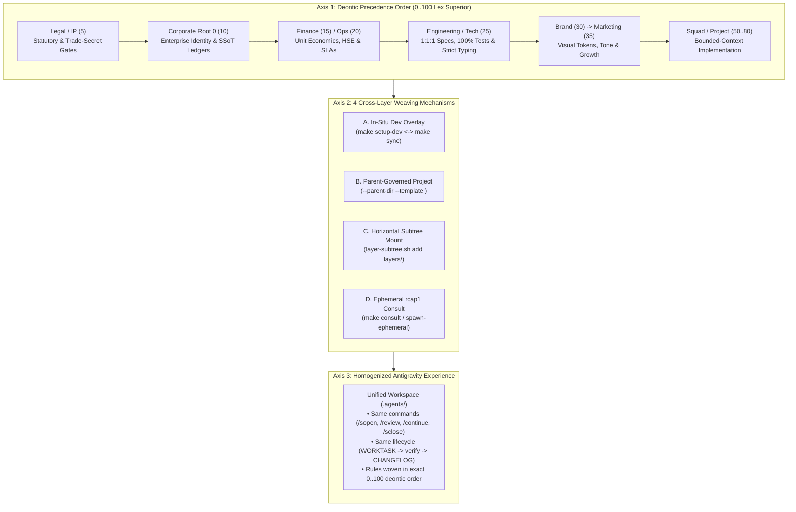
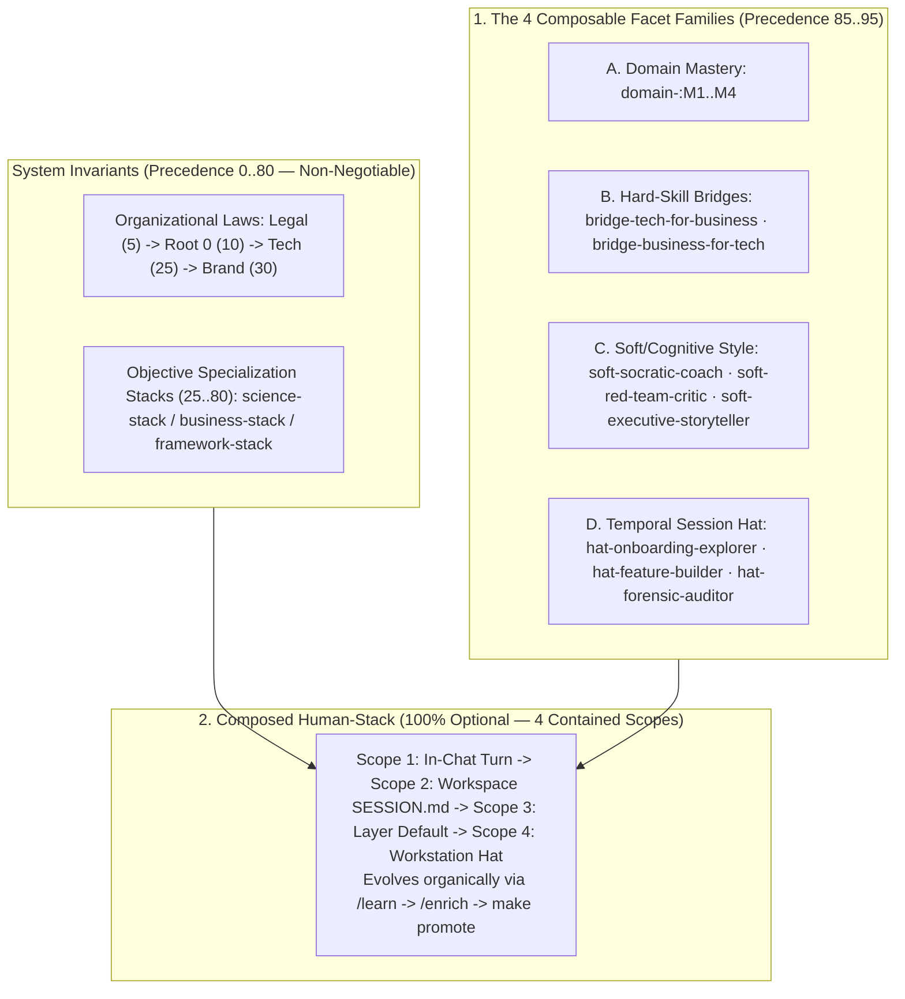
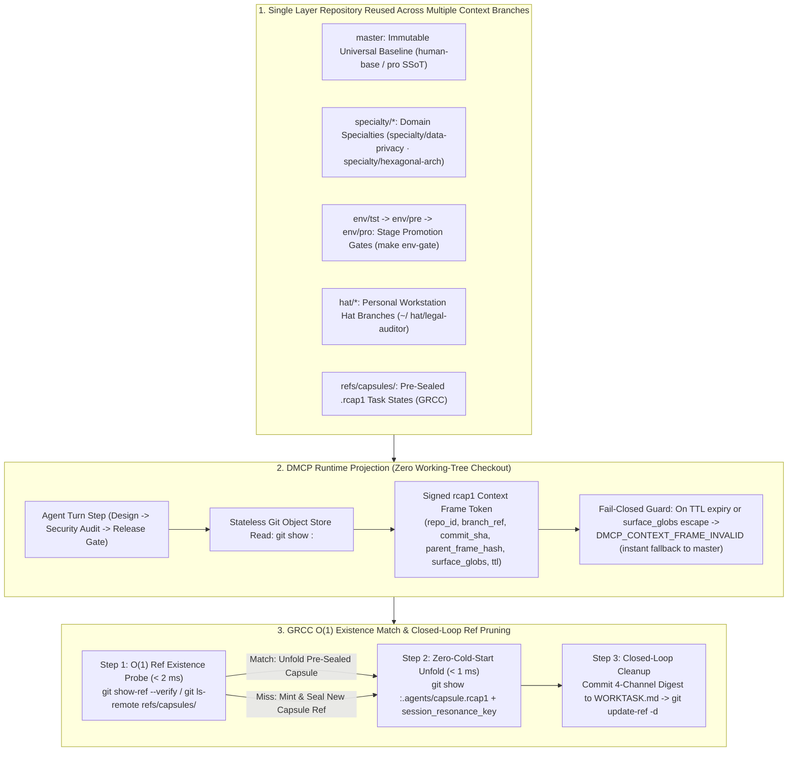

# Cross-Departmental Composition & `Human-Stack` Matrix (`0..95`)

> **Parent Reference**: [`docs/reference/enterprise_pair_programming_governance.md`](enterprise_pair_programming_governance.md) | **Normative Architecture**: [`docs/architecture/02_antigravity_governance_and_hooks.md`](../architecture/02_antigravity_governance_and_hooks.md) & [`docs/architecture/06_layer_governance_and_promotion_engines.md`](../architecture/06_layer_governance_and_promotion_engines.md)

This reference defines the **7-Axis Multidimensional Taxonomy (`Entity Lineage × Topological Class × Deontic Precedence × Actor RBAC × Physical Pillars × Communication Channels × Progression Scales`)**, the **Perspective Matrix across `Root 0` (Government vs. Enterprise vs. Individual vs. OSS) and Child Departments (`D1..D4`)**, the **Cross-Departmental Contextual Algebra (`0..80`)**, and the **`Human-Stack` Matrix (`85..95`: `4` Composable Facets & `M1..M4` Mastery)**.

---

## 0. Canonical 7-Axis Multidimensional Taxonomy & Perspective Matrix (`Root 0` $\rightarrow$ `Child Departments` $\rightarrow$ `Units & Nodes`)

Because `dotfiles-ubuntu` orchestrates organizations, codebases, containers, and human-agent pairing simultaneously, every concept belongs to one of **7 orthogonal dimensions** (with zero overloaded terms):

| Axis # | Orthogonal Dimension (Canonical Name) | Question It Answers | Canonical Values / Enums (`constants.py`) | Disambiguation Rule (What Never to Mix) |
| :--- | :--- | :--- | :--- | :--- |
| **Axis 1** | **Entity & Sovereignty Lineage (`entity_kind` $\times$ `collective_scope` $\times$ `governing_root_id`)** | *What kind of legal/organizational entity is this, who is its sovereign `Root 0`, and is another layer `internal` or `external`?* | `VALID_ENTITY_KINDS`: `public-government` (`collective`, `prec: 1..4`), `enterprise` (`collective`, `prec: 5..84`), `individual` (`individual`, `workstation` / `85..95`), `open-source` (`collective`, upstream appliance).<br/>**Relationship**: `internal` (same `governing_root_id` + `entity_kind`) vs. `external:<entity_kind>` | Never confuse **`entity_kind`** (*nature of the sovereign entity: Government vs. Enterprise vs. Individual vs. OSS*) with **`layer_role`** (*hierarchical rank inside that entity*). Both a Government and an Enterprise have a `Root 0` and child `Departments`. |
| **Axis 2** | **Topological Class & Organizational Level: `Layer` (`Level 1..3`) vs. `Node` vs. `Bot` vs. `Project` (`Level 4`)** | *What is this repository or runtime instance functionally within the graph?* | `TOPOLOGICAL_ROLE_CLASSES` & `tier_scope`:<br/>1. **`governance-layer` (*Normative Layer*)**: `corporate` (`Level 1 / root-0`: Public Admin `1..2` \| Company `10` \| Individual `90`), `domain-policy` (`Level 2 / department`: Statutory/Fiduciary Dept), `department` (`Level 2 / department`: Functional Dept), `squad` (`Level 3 / unit`: Sub-Dept / Operational Unit / Squad)<br/>2. **`runtime-node` (*Execution/Infra Node*)**: `workstation` (`10`), `service-node` (`60`), `environment-cluster` (`70`)<br/>3. **`ephemeral-sandbox` (*Time-Bounded Bot*)**: `ephemeral-bot` (`15`)<br/>4. **`consumer-workspace` (*Deliverable Repo*)**: `project` (`Level 4 / project`, `80`) | **Exact difference between `Layer` and `Node`**:<br/>• A **Governance Layer (`governance-layer`)** defines *deontic laws, templates, RBAC rosters, and `surface_bindings`* across **`Level 1 (Root 0)` $\rightarrow$ `Level 2 (Department)` $\rightarrow$ `Level 3 (Unit / Squad)`**.<br/>• A **Runtime Node (`runtime-node`)** is a *physical or virtual execution target* (Ubuntu workstation, Docker container `service-node`, or staging/prod `environment-cluster`) audited via `audit_node_drift` and federating runtime MCPs (`postgres`, `redis`, `voip`). |
| **Axis 3** | **Deontic Precedence (`precedence: 0..100` *Lex Superior*)** | *When multiple layers bind to the same file surface, which rule wins?* | `1..2` Public Administration `Root 0` (`public-gov-root`) $\rightarrow$ `3..4` Public Departments (`dept-justice`, `dept-tax`, `dept-territorial`) $\rightarrow$ `5..9` Enterprise Fiduciary `domain-policy` (Legal/IP `5`, Sec `7`) $\rightarrow$ `10` Corporate `Root 0` (`acme-corp-root`) / `workstation` $\rightarrow$ `15` `ephemeral-bot` $\rightarrow$ `15..40` Functional `department` (Finance `15`, Ops `20`, IT `25`, Brand `30`, Marketing `35`) $\rightarrow$ `40..60` Sub-Department / Unit / `squad` (`50`) $\rightarrow$ `60..80` `service-node` (`60`), `environment-cluster` (`70`), `project` (`80`) $\rightarrow$ `85..95` `Human-Stack` | Lower number = higher authority (`1 < 3 < 5 < 10 < 25 < 50 < 80 < 85`). `Root 0` is always at the top of its entity (`1..2` for Public Admin, `10` for Enterprise). `Human-Stack` (`85..95`) modulates *pedagogical pairing*, never overriding `0..80` laws. |
| **Axis 4** | **Actor RBAC & Overarching Authority (`effective_role`: `5` Roles)** | *Which human or bot email (`git user.email`) is acting, and what can they approve?* | `owner`, `maintainer`, `validator`, `member` (in `layer_authority.roster`) + `consumer` (`5` effective roles).<br/>**`UPSTREAM_HIERARCHICAL_AUTHORITY`**: Parent `owner`/`maintainer` (`prec_parent < prec_child`) inherits authority **only when `relationship_scope == "internal"`**. | Never confuse **`actor_role`** (*person's permission: `owner`, `validator`...*) with **`layer_role`** (*repository rank: `corporate`, `department`...*). |
| **Axis 5** | **Physical Context Pillars on Disk (`Pillar A / B / C / D`) & Template Kinds** | *Where do files physically reside on the workstation and workspace?* | • **`Pillar A` (Global `$HOME`)**: `~/.gemini/config/` (`AGENTS.md`, `hooks.json`, `10` global skills)<br/>• **`Pillar B` (Templates & Subtrees)**: `templates/*` (`base-stack`, `science-stack`, `business-stack`, `framework-stack`) + `layers/<id>/`<br/>• **`Pillar C` (Workspace Overlay)**: `<repo>/.agents/` (`rules/layer-<NN>-<id>.md`, `SESSION.md`, `LAYER_LINEAGE.md`)<br/>• **`Pillar D` (Navigable Corpus)**: `README.md` $\rightarrow$ `docs/guides/` $\rightarrow$ `docs/{architecture,reference}/` | Refer to local disk mechanisms as **Context Pillars (`Pillar A..D`)** so they never collide with **Organizational Levels (`Level 1..4`)**. |
| **Axis 6** | **Inter-Layer Communication Channels (`6` Deterministic Protocols)** | *How do layers and nodes communicate vertically, horizontally, and across entities?* | 1. **Downward Template Sync (`make sync`)**: 4 modes (`reconcile`, `accept-upstream`, `keep-local`, `merge`)<br/>2. **Downward Task Directive (`make delegate`)**: 1-hop delivery into `layers/<child>/WORKTASK.md`<br/>3. **Upward Rule Promotion (`make promote`)**: 1-hop PR (`--create-pr`) + OSS agnosticism gate<br/>4. **Bilateral 1-Hop Radar (`make horizon` / `layer_report`)**: 3 buckets (`inbound_from_upstream`, `inbound_from_downstream`, `local_workspace_changes`)<br/>5. **Ephemeral Consultation (`make consult` / `spawn-ephemeral`)**: `rcap1` (`inter-layer` read-only or `intra-layer` with `seal-return`)<br/>6. **$N$-Departmental Consensus (`make env-gate --files`)**: 4 states (`RECONCILED_FLOW`, `ITERATION_REQUIRED`, `ESCALATE_TO_ROOT`, `ESCALATE_INTER_ENTITY_ROOTS`) | Every cross-layer action uses one of these 6 channels; direct cross-layer edits are blocked by `pre_tool_guard.py`. |
| **Axis 7** | **Progression Scales (`rcap1 L0..L3` vs. `Epistemic E3..E0` vs. `Human-Stack M1..M4` vs. `C1..C3` vs. `dev..pro`)** | *Which scale does a shorthand code refer to?* | • **`rcap1` Capsule Resolution & Abstraction Gradient (`VALID_CAPSULE_LEVELS` / `CAPSULE_ABSTRACTION_LAYERS`)**: `L0` (Discovery Codon) $\rightarrow$ `L1` (Contextual Overview) $\rightarrow$ `L2` (Operational Contract) $\rightarrow$ `L3` (First-Principles Substrate)<br/>• **Epistemic Credibility (`VALID_EPISTEMIC_GRADES`)**: `E3` (Inviolable Axiom/Law) $\rightarrow$ `E2` (Canonical Contract/Standard) $\rightarrow$ `E1` (Contextual Guideline/Theory) $\rightarrow$ `E0` (Provisional Hypothesis/Draft)<br/>• **`Human-Stack` Mastery (`VALID_HUMAN_MASTERY_LEVELS`)**: `domain-<area>:M1` (Explorer) $\rightarrow$ `M2` (Practitioner) $\rightarrow$ `M3` (Architect) $\rightarrow$ `M4` (Principal)<br/>• **Command Consciousness**: `C1` (Auto-reflexive) $\rightarrow$ `C2` (Guided tactical) $\rightarrow$ `C3` (Conscious human-gated)<br/>• **Environment Gates**: `dev` $\rightarrow$ `tst` $\rightarrow$ `pre` $\rightarrow$ `pro` | **`L0..L3` is reserved for `rcap1` capsule resolution**, **`E3..E0` for epistemic credibility**, and **`M1..M4` for human domain/academic mastery** (`domain-<area>:M1..M4`). |

### 0.1. Perspective Matrix by Organizational Level (`Level 1 Root 0` $\rightarrow$ `Level 2 Child Department D1..D3` $\rightarrow$ `Level 3 Unit/Squad D4` $\rightarrow$ `Level 4 Project & Nodes`)

Every organizational tier from `Level 1 (Root 0)` to `Level 4 (project)` maps deterministically to an `entity_kind`, `layer_role`, `topological_class`, and numeric `precedence` band:

| Organizational Level & Archetype | `entity_kind`, `layer_role` & `topological_class` | `precedence` | Core Use Case, Inheritance & Cross-Layer Behavior |
| :--- | :--- | :---: | :--- |
| **Level 1 (`root-0` — Case R0-A): Public Administration / Government Root** *(State, Regional, or Municipal Administration)* | `public-government` · `corporate` · `governance-layer` | **`1..2`**<br/>(`public-gov-root`) | • **Internal Child Public Departments (`prec: 3..4`)**: Justice (`dept-justice`), Tax (`dept-tax`), Territorial/Geo (`dept-territorial`), and Environment (`dept-environment`) inherit `entity_kind="public-government"` and `governing_root_id="public-gov-root"` (`relationship_scope: "internal"`). Public `Root 0` holds `UPSTREAM_HIERARCHICAL_AUTHORITY` over its public departments.<br/>• **External Companies / Citizens (`prec: 5..95`)**: Mounted as `external:public-government`. Statutory laws prevail (`1..4 < 10`), and no private `Root 0` can override a public regulatory block (`PUBLIC_REGULATORY_COMPLIANCE_REQUIRED`). |
| **Level 1 (`root-0` — Case R0-B): Enterprise / Company Root** *(Company, Law Firm, Hospital, Holding)* | `enterprise` · `corporate` · `governance-layer` | **`10`** | • **Internal Departments & Sub-Departments/Units (`prec: 5..80`)**: Propagates `governing_root_id` (e.g. `acme-corp-root`) across 1 or $N$ hops (`Root 0 -> Dept [-> Sub-Dept/Unit/Squad] -> Project`), arbitrates cross-department blocks (`ESCALATE_TO_ROOT`), and codifies learned rules upstream (`rule_learning_hint`).<br/>• **External Enterprise Partner (`partner-corp-root`)**: Classified as `external:enterprise` (`CROSS_ENTITY_ESCALATION_REQUIRED`). |
| **Level 1 (`root-0` / Upstream — Case R0-C): Open-Source Upstream & Individual Sovereign Root** *(`mtwuser/dotfiles-ubuntu` & `~/<user-pc>`)* | `open-source` / `individual` · `workstation` · `runtime-node` | **`10`** (OSS) / **`90`** (`<user-pc>`) | • **`oss-readonly-appliance` (`~/dotfiles-ubuntu`)**: Read-only self-syncing workstation baseline (`oss_auto_sync_covered: true`).<br/>• **`private:individual:root-0` (`~/<user-pc>`, `90`)**: Personal sovereign `Root 0` spawning personal child tutor sub-layers (`86..89`) and parallel workspaces.<br/>• **`oss-dev` (`DOTFILES_DEV_REPO_DIR`)**: Maintainer development repo (`scan_open_source_agnosticism`). |
| **Level 2 (`department` — Case D1): Public Administration Department** *(Justice, Tax, Territorial/Geo, Environment)* | `public-government` · `domain-policy` / `department` · `governance-layer` | **`3..4`** | Direct child of Public Administration `Root 0` (`1..2`). Stores modular `< 465`-line statutes, territorial registries, and administrative procedures in `docs/` using `science-stack/scientific-knowledge-branch`. Queried on demand via `make consult` (`rcap1`) by civil servants or private enterprises. |
| **Level 2 (`department` — Case D2): Enterprise Fiduciary / Guardrail Dept** *(Legal/IP, Cybersecurity, Regulatory Compliance)* | `enterprise` · **`domain-policy`** · `governance-layer` | **`5..9`** | **Why `prec: 5..9` (`< 10`) under Enterprise `Root 0` (`10`)**: Fiduciary invariants (GDPR, Patent Novelty, Secret Isolation) must bind all functional departments (`15..40`) and sub-units (`40..80`) via *Lex Superior*, while sharing `governing_root_id="acme-corp-root"` (`internal`) so Executive `Root 0` can arbitrate internal deadlocks (`ESCALATE_TO_ROOT`). |
| **Level 2 (`department` — Case D3): Enterprise Functional / Line Dept** *(Finance `15`, Ops `20`, IT `25`, Brand `30`, Marketing `35`)* | `enterprise` · **`department`** · `governance-layer` | **`15..40`** | Applies `science-stack`, `business-stack`, or `framework-stack` across 3 modes: (1) **Pure Domain/Ledger Governance**, (2) **In-Situ Tooling** (`make setup-dev` overlays `science-base` + `software-engineering`), and (3) **$N$-Departmental Surface Co-Ownership** (`co_owning_layers` consensus across `Marketing + Brand + IT + Legal`). |
| **Level 3 (`unit` — Case D4): Recursive Sub-Department / Operational Unit / Squad** *(e.g. `Root 0 [10] -> Dept [20] -> Sub-Dept / Unit / Squad [40..60]`)* | `enterprise` / `public-government` / `individual` · `department` or `squad` · `governance-layer` | **`30..60`**<br/>(`50` default for `squad`) | **Why `squad` is a Level 3 Unit role (not a separate stack)**: Any department (or personal `Root 0`) can subdivide into specialized Sub-Departments, Operational Units, Research Labs, Tutors, or Delivery Squads (`--role department` or `--role squad`) applying `science-stack`, `business-stack`, or `framework-stack` while preserving the ancestor `governing_root_id` across all hops. |
| **Level 4 (`project` — Consumer Workspace) & Runtime Nodes (`service-node` / `environment-cluster`)** | • `project` (`consumer-workspace`)<br/>• `service-node` / `environment-cluster` (`runtime-node`) | **`60..80`**<br/>(`60` node, `70` cluster, `80` project) | • **`project` (`80`, `apply-project`)**: Concrete application, legal case, administrative expediente, or research study repo.<br/>• **`service-node` (`60`) / `environment-cluster` (`70`)**: Live container/server/cluster runtime nodes exposing `audit_node_drift` and `discover_federated_mcps`. |

---

## 1. Cross-Departmental & Multi-Specialty Composition Matrix: LegalTech, Governed Marketing & Transversal Platforms (`VoIP`)

In traditional enterprises, whenever a business or functional department (Legal, Marketing, Finance, Operations) needs to build software, automate workflows, or integrate with another specialty, two structural failures emerge:
1. **The IT Bottleneck (Context Loss)**: Business writes static handoff specs for IT; engineers build technically sound code that inadvertently misses legal, brand, or financial nuances because those domain rules live in separate silos.
2. **Shadow IT (Engineering Drift)**: The business department builds its own scripts, bots, or connectors outside IT; it solves the immediate domain need, but without `1:1:1` architecture, `100%` test coverage, type safety, or corporate security guards.

`dotfiles-ubuntu` eliminates both failure modes by turning organizational departments and technical stacks into a **3-Axis Compositional Matrix ("Contextual Algebra")** where **Google Antigravity** acts as the universal execution surface:



1. **Order Defines Authority (*Lex Superior* `0..100`)**:
   - Combining **Legal (`5`) + Tech (`25`)** is not an unordered bag of prompts: because `5 < 25`, `.agents/rules/layer-05-dept-legal.md` takes deontic precedence over `layer-25-dept-tech.md`. The AI agent enforces `100%` unit test coverage and hexagonal architecture (`25`) *in service of* statutory IP and confidentiality invariants (`5`), never allowing a technical shortcut to bypass a legal gate.
2. **Infinite Specialized Profiles, Zero Cognitive Overhead**:
   - Whether the resulting workspace is a *LegalTech MCP Engineer*, a *Governed Growth & Social Automation Specialist*, or a *Transversal VoIP Platform Architect*, the human operator interacts with the exact same Antigravity commands (`/sopen`, `make status`, `make verify`, `/review`, `/sclose`) while `inspect_workspace_status` (`C1 / C2 / C3` command tiers) filters out irrelevant commands.

### 1.1. The 6 Cross-Specialty Enterprise Archetypes

The 6 canonical cross-specialty archetypes combine deontic precedence (`0..100`) with specialization stacks to govern pure business ledgers, in-situ tooling, department-owned products, multi-departmental hubs, transversal platforms, and ephemeral audits:

| Enterprise Scenario | Workspace Owner | Woven Rule Chain (`0..100` *Lex Superior*) | 1-Command Activation | Effective Antigravity Profile |
| :--- | :--- | :--- | :--- | :--- |
| **1. Pure Business Governance** *(Policies, Patents, Financial Ledgers)* | `Root 0` (`10`) or `Department` (`5..20`) | `human-base` + `business-base` (`10`) + `templates/<dept>/` (`5..20`) | `bootstrap-workspace` / `make sync` | **Normative & SSoT Ledger Auditor** (`workspace_mode: business`) |
| **2. In-Department Tooling** *(Scripts/validators inside a business repo)* | `Department` (`Legal`, `Finance`, `Ops`) | `<dept>` (`5..20`) + `business-base` (`10`) + **`science-base` + `software-engineering` (`25`, temporary)** | `make setup-dev` *(reverts to `business` via `make sync`)* | **In-Situ Domain Automation Engineer** (`workspace_mode: hybrid`) |
| **3. Department-Owned Tech Product** *(e.g., **LegalTech Patent/Contract MCP**)* | `Legal` (`5`) or Embedded Legal Squad | **`Legal` (`5`)** $\rightarrow$ `Root 0` (`10`) $\rightarrow$ **`Tech` + `FastAPI` (`25..50`)** | `apply-project <app> --parent-dir <dept> --template <stack>` | **Software Architect Subordinated to Department Law** (`hybrid`) |
| **4. Multi-Departmental Intersection** *(e.g., **Marketing + Social Media Hub**)* | `Marketing` / `Growth` Squad (`35`) | **`Legal/GDPR` (`5`)** $\rightarrow$ `Root 0` (`10`) $\rightarrow$ **`Tech` (`25`)** $\rightarrow$ **`Brand` (`30`)** $\rightarrow$ **`Marketing` (`35`)** | `--parent-dir dept-marketing` + `layer-subtree.sh add` (`legal`, `brand`) | **Full-Stack Growth Engineer Governed by Legal, Brand & Security** |
| **5. Transversal Enterprise Platform** *(e.g., **Company-Wide `VoIP` Service**)* | Platform `service-node` / `squad` (`25`) | **Inward**: `Legal` (`5`) $\rightarrow$ `Root 0` (`10`) $\rightarrow$ `Ops` (`20`) $\rightarrow$ `Tech/VoIP` (`25`)<br/>**Outward**: Exports `templates/voip-pack` + `federated_mcps` | Consumers mount `layers/voip-platform` or apply `--template voip-pack` | **Critical Infrastructure Builder (inward) / Governed Service Provider (outward)** |
| **6. Punctual Cross-Departmental Audit** *(e.g., Design checks Patent Gate with Legal)* | Any consumer workspace | Active workspace + **Ephemeral `rcap1` Capsule (`L0..L2`, `kr: true`)** | `make consult LAYER=dept-legal QUERY="..."` | **Zero-Residue Read-Only Inter-Departmental Advisor** (`inter-layer`) |

---

### 1.2. Concrete Walkthroughs of the 3 Cross-Specialty Cases

The following three end-to-end walkthroughs illustrate how LegalTech products (`Case A`), multi-departmental Marketing hubs (`Case B`), and company-wide `VoIP` platforms (`Case C`) are configured and governed:

#### 1.2.1. Case A — When the Legal Department Builds Technology (e.g., a LegalTech Patent & Contract Auditor MCP)

Suppose the **Legal & IP Department (`dept-legal-ip`, `precedence: 5`)** needs a custom Model Context Protocol (MCP) server or microservice to audit supplier contracts and patent claims against `corporate/` ledgers. The enterprise can execute this in two ways depending on team structure:

- **Option A1 — Embedded Technical Development Under Legal (`--parent-dir` or `make setup-dev`)**:
  - A technical specialist working directly for Legal scaffolds `legal-contract-mcp/` governed by `dept-legal-ip`:
    ```bash
    ./scripts/layer-config.sh apply-project ~/Projects/legal-contract-mcp \
      --parent-dir ~/Projects/dept-legal-ip \
      --template software-engineering,fastapi-hexagonal
    ```
  - *(Or, if authoring automation scripts directly inside `~/Projects/dept-legal-ip`, runs `make setup-dev` to overlay `science-base` + `software-engineering` onto `business-base` + `dept-legal-ip`, and `make sync` when finished).*
  - **Resulting Agent Behavior**: Antigravity enforces `mypy --strict`, `ruff`, hexagonal ports/adapters, and `100.00%` isolated unit branch coverage from `software-engineering` (`25`), while `dept-legal-ip` (`5`) acts as supreme law — blocking any tool output or test fixture from exposing unpatented inventions (*World Novelty Gate*) or trade secrets (`<TS-ID>`) outside sealed `rcap1` (`kr: true`) capsules.
- **Option A2 — Delegated to the Engineering Department (`dept-tech`) with Legal Mounted**:
  - Legal delegates the build to Engineering via `./scripts/layer-config.sh delegate-to-child ~/Projects/corporate-root --to-child dept-tech --task "Build Patent Audit MCP" --ticket LEG-2026-009`.
  - The engineering squad mounts `layers/dept-legal-ip/` (`./scripts/layer-subtree.sh add dept-legal-ip <url>`). Because `dept-legal-ip` carries `precedence: 5` and `dept-tech` carries `precedence: 25`, `resolve_surface_governance` enforces the exact same `Legal (5) > Corporate (10) > Tech (25)` hierarchy.

#### 1.2.2. Case B — When Marketing Connects to Social Media (Multi-Departmental Intersection)

Suppose **Marketing (`dept-marketing`, `precedence: 35`)** wants to build an automated omnichannel campaign engine connected to LinkedIn, X, and Instagram APIs (`marketing-social-hub/`). In a governed enterprise, a social media automation tool touches **four distinct specialties simultaneously**:
1. **Legal & Compliance (`precedence: 5`)**: Enforces GDPR privacy, embargo dates (*World Novelty Gate*), and **Zero-Greenwashing** (every sustainability or unit-economics claim in a post must cite an audited `Batch #NNN` ledger in `corporate/`).
2. **Corporate Root 0 (`precedence: 10`)**: Enforces secret isolation and executive crisis SLAs (`P0 < 1h`).
3. **Engineering / Tech (`precedence: 25`)**: Enforces OAuth token security, idempotent retry queues, rate-limiting, and `100%` `AAA` unit test coverage.
4. **Brand & Design (`precedence: 30`)**: Locks corporate casing, phonetic standards, color contrast (`WCAG >= 4.5:1`), and visual tokens so Marketing (`35`) cannot alter brand identity.
5. **Marketing (`precedence: 35`)**: Defines campaign hooks, audience segmentation, UTM attribution, and posting cadences.

- **How It Is Configured**:
  ```bash
  # Inside dept-marketing (or the marketing-social-hub squad fork):
  ./scripts/layer-subtree.sh add dept-legal ~/Projects/dept-legal-ip master
  ./scripts/layer-subtree.sh add dept-brand ~/Projects/dept-brand-design master
  ./scripts/layer-config.sh apply-project ~/Projects/marketing-social-hub \
    --parent-dir ~/Projects/dept-marketing \
    --template software-engineering,fastapi-hexagonal \
    --layers all
  ```
- **Resulting Agent Behavior**: A single developer or technical marketer in Antigravity operates with all five layers woven in `.agents/rules/` (`layer-05-dept-legal.md`, `layer-10-root.md`, `layer-30-dept-brand.md`, `layer-35-dept-marketing.md`, `science-base.md`, `software-engineering.md`, `fastapi-hexagonal`). Any code or campaign template generated by the AI automatically satisfies Legal, Brand, Security, and Growth constraints in a single pass.

#### 1.2.3. Case C — When a Service Is Transversal to the Entire Company (e.g., Enterprise `VoIP` / Unified Communications)

Suppose the organization operates a transversal **`VoIP` & Unified Communications Platform (`voip-platform`)** used across Customer Support, Sales/Marketing, Legal counsel lines, and Executive communications. A transversal platform has a **dual inward/outward architecture**:

1. **Inward Perspective (Building & Operating the `VoIP` Core)**:
   - `voip-platform` is bootstrapped as a `service-node` (or platform `squad`) at `precedence: 25` with `software-engineering` + `fastapi-hexagonal`, mounting **`dept-legal` (`5`)** (telephony recording consent laws, wiretap compliance, audio retention TTLs) and **`dept-ops` (`20`)** (`< 1h` P0 incident SLA, emergency failover routing).
   - It declares its runtime MCP server (`voip-sip-controller`) under `federated_mcps` in `system/mcp-layer.json` with explicit `required_guardrails` (e.g., *"Never initiate call recording or transcript export without a verified consent token; `pro` environment restricted to read-only telemetry"*), and packages a reusable client template at `templates/voip-client-pack/`.
2. **Outward Perspective (Consuming `VoIP` Across Any Department or Squad)**:
   - Whenever **Customer Support**, **Sales/Marketing**, or **Legal** builds a workspace that integrates voice calls or AI voice agents, they mount `layers/voip-platform/` (or run `apply-project --template voip-client-pack`).
   - Their Antigravity agents immediately discover the `voip-sip-controller` MCP via `discover_federated_mcps(layer="all")` **pre-loaded with the combined `effective_guardrails` of Legal (`5`) + Corporate (`10`) + Ops (`20`) + VoIP (`25`)**, guaranteeing uniform compliance across every department that touches telephony.

### 1.3. Deterministic $N$-Departmental Consensus (`3+` Layers), Mutual Entity Identification (`Internal` vs `External`) & `Root 0` Rule-Learning Loop

When a deliverable intersects **3 or more departments** (for example, an omnichannel campaign `campaigns/q4.html` co-owned by **`Marketing` (`25`) + `Legal` (`5`) + `IT` (`30`)** under `acme-root`), or crosses **external organizational boundaries** (such as a Public Government administration `gov-es-aepd` at `precedence: 2` or an external enterprise partner `partner-dept-sec` governed by `partner-root`), `match_authoritative_surface_bindings` (`co_owning_layers`) and `evaluate_multilayer_surface_consensus` (`make env-gate`) enforce four deterministic states:

| Consensus State (`consensus_status`) | Trigger Condition Across $N$ Co-Owning Layers | Relationship Scope (`Internal` vs `External`) | Deterministic Workflow & `Root 0` Rule-Learning Loop |
| :--- | :--- | :--- | :--- |
| **`1. RECONCILED_FLOW`** *(Frictionless / Automated)* | All $N$ co-owning layers (`Marketing`, `Legal`, `IT`) are satisfied via actor role, internal `Root 0` overarching authority, or `APPROVED` decision / codified rule. | `internal` or `external` | **Proceeds directly to `pre` / `pro`** (`allowed: true`). |
| **`2. ITERATION_REQUIRED`** *(Constructive Divergence)* | Any co-owning layer records `REJECTED` or `DEFERRED` (`INTER_DEPT_ITERATION_REQUIRED`), or has not yet signed off (`PENDING` $\rightarrow$ `SURFACE_AUTHORITY_REQUIRED`). | `internal` or `external` | **Iterate on the same task branch in `dev`/`tst`**: apply the requested domain adjustments (e.g., Legal's GDPR opt-in clause) and re-validate in `pre`. |
| **`3. ESCALATE_TO_ROOT`** *(Internal Cross-Departmental Deadlock)* | An internal department (`relationship_scope: "internal"`) records `BLOCKED` (`CROSS_DEPT_ESCALATION_TO_ROOT_REQUIRED`). | **`internal`** *(shares `governing_root_id`, e.g., `acme-root`)* | **Halts `pro` and escalates 1-hop upward to `Root 0` (`governing_root_id`)** for cross-CO arbitration. Once `Root 0` resolves the dispute, it codifies the learned criterion upstream (`rule_learning_hint`: `promote-from-project --to-layer <root> --create-pr`) so future recurring cases become automatic **`RECONCILED_FLOW`**. |
| **`4. ESCALATE_INTER_ENTITY_ROOTS`** *(External Statutory or Partner Block)* | An external layer (`relationship_scope: "external"`) records `BLOCKED`. | **`external:public-government`** (`1..4`), **`external:enterprise`** (other company's `Root 0`), **`external:individual`** (`85..95`) | **Local `Root 0` cannot override an external entity (`hierarchical_authority_granted: false`)**:<br/>• `external:public-government` $\rightarrow$ `PUBLIC_REGULATORY_COMPLIANCE_REQUIRED` (must satisfy statutory law).<br/>• `external:enterprise` $\rightarrow$ `CROSS_ENTITY_ESCALATION_REQUIRED` (requires inter-entity alignment between local `Root 0` and external `Root 0`). |

---

## 2. The `Human-Stack` Matrix: 4 Composable Facets & Mastery Adaptation (`M1..M4`)

While **Axis 1 (Deontic Precedence `0..80`)** defines *which organizational laws govern the repository* and **Axis 2 (Stack Templates)** defines *which technical or operational architecture applies*, modern professionals are rarely single-track specialists. To guide each human operator with zero overengineering and zero redundant terminology, `dotfiles-ubuntu` uses a single unified concept — **`Human-Stack`** (`precedence: 85..95`) — composed of **1 to $N$ optional Facets (`VALID_HUMAN_STACK_FACETS`)** across 4 prefixes (`domain-<area>:M1..M4`, `bridge-*`, `soft-*`, `hat-*`):

$$\text{Human-Stack} = \sum_{i=1}^{n} \text{Facet}_i$$

| Architectural Layer | Exact Definition & Granularity | Software Analogy | Concrete Examples | Where It Lives & Evolves |
| :--- | :--- | :--- | :--- | :--- |
| **1. Objective Specialization Stacks** (`science-stack`, `business-stack`, `framework-stack` at `precedence: 25..80`) | **Defines the objective methodology, verification rules, and knowledge taxonomy (`Trunk -> Branch -> Specialty`) of the field**. Independent of who the human operator is. | A domain framework & reference library (`software-engineering`, `scientific-knowledge-branch`, `corporate-ops-ledger`, `fastapi-hexagonal`). | • `science-stack/software-engineering` *(CS & Software Engineering branch)*<br/>• `science-stack/scientific-knowledge-branch` *(Epistemic rigor & `< 465`-line `docs/` corpus)*<br/>• `business-stack/corporate-ops-ledger` | Lives in `templates/{science-stack,business-stack,framework-stack}/`. Applied to workspaces via `apply-project` or `bootstrap-workspace`. |
| **2. Contextual `Human-Stack`** (`precedence: 85..95`, composed of `1..N` Facets in `§2.1`) | **The personalized combination of $1..N$ atomic Facets (`domain-<area>:M1..M4`, `bridge-*`, `soft-*`, `hat-*`)** representing how the operator pairs with the AI in the active context. Shifts fluidly when the same person changes workspace or role. | A composable IDE/pairing profile assembled from modular facets (`VALID_HUMAN_STACK_FACETS` & `VALID_HUMAN_MASTERY_LEVELS`). | **Same Lawyer or Executive in two contexts**:<br/>• Core Domain: `domain-civil-law:M4` *(Direct peer)*<br/>• Cross-Functional Tool: `domain-tax:M1 + domain-python:M1 + bridge-tech-for-business + soft-socratic-coach` | Declared **optionally** in chat (turn-scoped), `.agents/SESSION.md` (workspace-scoped), `README.md` / `.agents/LAYER_LINEAGE.md` (layer default), or `~/<user-pc>` (`hat/*` branch). |

- **Invariance of Quality (`0..80` *Lex Superior*)**: A `Human-Stack` (`85..95`) **never lowers statutory, security, architectural, or `100%` test-coverage gates (`0..80`)**. Whether paired with an `M1` newcomer or an `M4` Principal/C-Suite executive, the deliverable must pass the exact same verification suite (`make verify`).
- **Fluid Cognitive Adaptation (`85..95`)**: What changes is **how the AI pairs with the human** — adjusting explanation depth, cross-discipline vocabulary bridges, Socratic coaching, and review pacing to match the operator's active `Human-Stack`.



### 2.1. The 4 Composable Facets (`VALID_HUMAN_STACK_FACETS`) & Meaning of `M1..M4` Across Science, Engineering & Business

`VALID_HUMAN_STACK_FACETS` defines 4 orthogonal facet prefixes (`domain-<area>:M1..M4`, `bridge-*`, `soft-*`, `hat-*`) that modulate AI explanation depth, cross-guild translation, and collaboration style:

| `Human-Stack` Facet Category | Canonical Token Identifiers (`precedence: 85..95`) | How Each Facet Modulates Agent Pairing Behavior |
| :--- | :--- | :--- |
| **A. Asymmetric Domain Mastery (`domain-<area>:M1..M4`)** | • `domain-<area>:M1` *(Guided Explorer / Onboarding)*<br/>• `domain-<area>:M2` *(Autonomous Practitioner)*<br/>• `domain-<area>:M3` *(Department Director / Systems Architect)*<br/>• `domain-<area>:M4` *(Principal / C-Suite / Cross-Domain Strategist)* | In domains tagged **`M1`**, the agent explains the domain *why* before edits, defines terminology, and walks through checklists step by step. In domains tagged **`M3/M4`**, it uses terse 4-channel digests, boundary trade-offs (`N vs N±1`), and zero condescension. |
| **B. Cross-Discipline Bridges (`bridge-*`)** | • `bridge-tech-for-business`<br/>• `bridge-business-for-tech`<br/>• `bridge-legal-engineering`<br/>• `bridge-growth-engineering` | Translates concepts across guilds: explains hexagonal ports, `AAA` tests, and Git gates to business leaders as *enforceable contract clauses and audit ledgers*, or translates EBITDA, CAPEX/OPEX, and GDPR rules to engineers as *state-machine invariants*. |
| **C. Cognitive & Soft-Skill Style (`soft-*`)** | • `soft-socratic-coach` *(Active learning)*<br/>• `soft-red-team-critic` *(Assumption challenger)*<br/>• `soft-executive-storyteller` *(Board/ROI framing)*<br/>• `soft-deep-flow` *(Maximum velocity, minimal prose)* | Modulates collaboration dynamics: prompts the user to spot edge cases (`socratic-coach`), stress-tests architectural or commercial premises (`red-team-critic`), or packages diffs into board-level ROI and risk summaries (`executive-storyteller`). |
| **D. Temporal Session Hat (`hat-*`)** | • `hat-onboarding-explorer` · `hat-feature-builder`<br/>• `hat-forensic-auditor` · `hat-cross-dept-integrator` | Allows the same person to shift operational modes fluidly within a single day (e.g., *Explorer* when entering a new department ledger, *Feature Builder* at midday, and *Forensic Auditor* during pre-release sign-off). |

Because mastery (`M1..M4`) is bound to each specific `domain-<area>` facet rather than to the person globally, the exact same `M1..M4` scale adapts naturally across **Science, Engineering, and Corporate/Business governance**:

| Mastery Level (`VALID_HUMAN_MASTERY_LEVELS`) | 1. Academic & Scientific Research (`science-base` / `scientific-knowledge-branch`) | 2. Software Engineering & Architecture (`software-engineering` / `framework-stack`) | 3. Business, Corporate, Legal & Public Admin (`business-base` / `business-stack`) |
| :--- | :--- | :--- | :--- |
| **`M1` — Guided Explorer / Onboarding** | *Undergraduate / New Field Researcher*: step-by-step derivation of axioms, SI/ISO unit checks, and guided literature synthesis. | *Junior Dev / Stack Newcomer*: explains hexagonal boundaries, `1:1:1` test structure, and architectural *why* before modifying code. | *Corporate Onboarding / Junior Analyst / Cross-Department Visitor*: explains P&L lines, procurement SOPs, or regulatory clauses (`GDPR`, `ISO`) from first principles with guided checklists. |
| **`M2` — Autonomous Practitioner** | *Doctoral / Lab Researcher*: standard `AAA` hypothesis verification, boundary cut-points (`N vs N±1`), and reproducible protocol execution. | *Mid-Senior Engineer*: direct `AAA` test + implementation pairing, modular extraction (`< 465` lines), and clean PR preparation. | *Department Specialist (Financial Controller, Corporate Counsel, Campaign Manager)*: executes domain SOPs, contract redlines, budget models, and operational ledgers directly. |
| **`M3` — Systems Architect / Department Director** | *Principal Investigator / Lab Director*: methodological critique, multi-study meta-analysis, and publication gatekeeping. | *Staff Engineer / Tech Lead*: relational cluster mass ($M_{\text{cluster}}$) trade-offs, C-backed stdlib optimization, and surface binding design. | *Department Director (`VP Finance`, `CLO`, `CMO`, `COO`)*: governs departmental policy, cross-squad SLAs, compliance matrices, and `make env-gate` (`tst -> pre -> pro`) sign-offs. |
| **`M4` — Principal / C-Suite Strategist** | *Cross-Disciplinary Chair*: high-density epistemic synthesis across scientific branches with terse 4-channel proofs. | *Principal / Fellow*: cross-repository federation invariants, zero-overhead architecture, and 4-Channel Executive Digests. | *Executive Board / `Root 0` Authority (`CEO`, `CFO`, `General Counsel`, `Secretary General`)*: strategic capital/risk trade-offs, `ESCALATE_TO_ROOT` arbitration, and board-level 4-channel decision digests. |

- **Cross-Domain Business Asymmetry in Practice**: A **`CFO` (`domain-finance:M4`)** auditing a cybersecurity incident report or an omnichannel marketing funnel can declare `domain-finance:M4 | domain-cybersecurity:M1 | bridge-tech-for-business | soft-executive-storyteller`. The agent treats the operator as a C-Suite peer on financial impact (`M4`) while translating technical security controls into clear, non-jargon business risk explanations (`M1 + bridge-tech-for-business`).

### 2.2. How & Where to Apply a `Human-Stack` (`4` Scopes & Containment Guarantee)

Adoption is **100% optional** and follows a strict **4-Scope Specificity & Containment Hierarchy** (`Scope 1` overrides `Scope 2` $\rightarrow$ `Scope 3` $\rightarrow$ `Scope 4` $\rightarrow$ `Case 0 Default`), ensuring that a `Human-Stack` **always applies at the exact intended level and never leaks across boundaries**:

| Resolution Priority & Adoption Case | Mandatory? | Where It Lives | Scope Boundary & Why It Never Leaks | Who Uses It & Practical Example |
| :--- | :---: | :--- | :--- | :--- |
| **Case 0 — Default Standard Operation** *(Omitted)* | **No (`100% Optional`)** | Left blank (`[Optional: leave blank...]`). | **Zero overhead**: Agent applies `human-base` + active layer/stack laws (`0..80`) with no extra ceremony. | Any user or automated CI pipeline running standard operations. |
| **Scope 1 (Highest) — Punctual In-Chat Activation** *(Single Turn)* | Optional | **Directly in the chat prompt**. | **Single-Turn Ephemeral**: Applies only to the current prompt/task; never mutates files on disk or affects subsequent turns. | A `VP Finance` (`M3`) asks in chat: *"Use `domain-legal:M1 + bridge-legal-engineering` to explain this supplier indemnity clause."* |
| **Scope 2 — Workspace-Local `.agents/SESSION.md`** *(Active Repo Only)* | Optional | **`.agents/SESSION.md`** *(read by `/sopen`)*. | **Strict Single-Workspace Containment**: Ignored by `make diff` (`diff-project`) and excluded from `make promote` (`promote-from-project`). Never leaks upward to parent layers or laterally to other open IDE windows. | A Marketing Director (`domain-marketing:M3`) automating a script in `campaign-analytics/` sets `domain-python:M1 + soft-socratic-coach` locally. |
| **Scope 3 — Layer Role Default** *(Department / Squad / Tutor Blueprint)* | Optional | **`README.md`** or **`.agents/LAYER_LINEAGE.md`** of the layer/project. | **Layer-Scoped Default**: Inherited by workspaces bound to that specific Squad, Department, or Personal Tutor layer (`tutor-university`), unless overridden by the user's local `SESSION.md` (`Scope 2`). | A Squad Lead or Personal Tutor layer pre-fills `domain-stack:M1 \| soft-socratic-coach \| hat-onboarding-explorer` for onboarding engineers or students. |
| **Scope 4 (Lowest) — Workstation Global Hat Branch** (`~/<user-pc>` `hat/*`) | Optional | **`~/<user-pc>`** on branch `hat/<role>` (`system/mcp-layer.json`). | **OS User-Wide `$HOME` Baseline**: Applies across all IDE windows via GNU Stow (`~/.gemini/config/AGENTS.md`) until switched back to `git checkout master` (`human-base`). | An individual operator dedicating an entire workstation session to a single role (`hat/legal-auditor`). |

### 2.3. The Full Deontic Spectrum (`1..95`) & `$HOME` vs. `Workspace` Across Public Administration, Enterprise, Science & Individual Work

By separating **`$HOME` (`~/dotfiles-ubuntu` — Organizational Membership)** from **`Workspace` (`<repo>/.agents/` — Active Case + Crossed `layers/*` + Specialization Stack + Contextual `Human-Stack`)**, the exact same governance engine scales from a national public administration down to a single freelancer:

| Persona & Context | `$HOME` (`~/dotfiles-ubuntu`) | Active `Workspace` & Mounted `layers/*` (`1..80`) | Specialization Stack & Contextual `Human-Stack` (`85..95`) | Functional Outcome in Antigravity |
| :--- | :--- | :--- | :--- | :--- |
| **1. Public Administration Chain** *(Public `Root 0` $\rightarrow$ Public Dept $\rightarrow$ Civil Servant)* | • Public Admin: `human-base`<br/>• Dept Maintainer: `public-gov-root` (`1`)<br/>• Civil Servant: `dept-justice` (`3`) | • Public `Root 0`: `public-gov-root` (`1..2`)<br/>• Public Dept: `dept-justice` (`3`) & `dept-territorial` (`4`, statutes in `docs/` `< 465` lines)<br/>• Civil Servant: `expediente-2026-042/` (`80`) | `business-base` + `science-stack/scientific-knowledge-branch` (`domain-admin-law:M3`) | Constitutional `Root 0` (`1..2`), justice (`3`), and territorial (`4`) statutes govern every administrative resolution; laws in `docs/` are queried on demand (`make consult`) with `0` idle token bloat. |
| **2. Law Firm / Enterprise Member Crossing Public Admin** | `empresa-dept-legal` (`15`, inheriting `empresa-root` at `10`) | Client filing `recurso-fiscal-cliente-x/` crossing `layers/dept-justice` (`3`) + `layers/dept-tax` (`4`) | `science-stack/scientific-knowledge-branch` + `business-stack/corporate-ops-ledger` (`domain-civil-law:M4 + domain-tax-law:M2`) | Public statutes (`3..4`) automatically override internal company policies (`10..15`) via *Lex Superior*; agent operates as a peer in civil law (`M4`) and explains recent tax changes step-by-step (`M2`). |
| **3. Enterprise Tech Lead (`M4`) vs. Junior Developer (`M1`)** | Both stow `empresa-dept-tech` (`25`, inheriting `empresa-root` at `10`) | Both open `checkout-service/` (`50..80`) | `framework-stack/fastapi-hexagonal`; Lead sets `domain-python:M4`, Junior sets `domain-python:M1 + soft-socratic-coach` in `.agents/SESSION.md` | Identical `100%` branch coverage and hexagonal gates (`0..80`); Lead gets rapid 4-channel execution (`M4`), Junior gets Socratic architectural mentorship (`M1`). |
| **4. Specialist Shifting Contexts** *(Same Person, Different Workspace)* | `dept-bio-lab` (`20`) or `dept-legal` (`15`) | • **Workspace A**: Primary clinical/legal research repo<br/>• **Workspace B**: Cross-cutting tax grant or Python automation (`make setup-dev`) | • **Workspace A**: `science-stack` (`domain-biotech:M4`)<br/>• **Workspace B**: `science-stack/software-engineering` (`domain-python:M1 + bridge-tech-for-business`) | Demonstrates why `science-stack` (objective field) and `Human-Stack` (contextual mastery) are orthogonal: the same specialist is `M4` in their core science and `M1` when crossing into Python or tax law. |
| **5. Individual Professional & Personal Tutor Hierarchy** | Sovereign `~/<user-pc>` (`90`, `mode=private`, `human-base` on `master`) | Personal child tutor layer (`tutor-university` at `86`) or study/client project (`apply-project`) | Downward reuse of `science-stack` / `framework-stack` + `Human-Stack` (`domain-<subject>:M1..M4 + soft-socratic-coach`) in `.agents/SESSION.md` | Top-down personal enrichment from Open Source into personal tutor sub-layers and parallel workspaces with zero corporate ceremony. |

### 2.4. Personal Sovereign `Root 0` (`~/<user-pc>`) Top-Down Open-Source Enrichment, Academic/Career Tutors & Why `framework-stack` Stays Objective

Unlike a corporate `Root 0` (`10`) that sits *below* public administration (`1..4`), an individual operator's personal repository (`~/<user-pc>`, `visibility_scope: "private:individual:root-0"`, `precedence: 90`) is **sovereign and independent**. Instead of relating upward to a state or corporation, it operates in **top-down personal enrichment mode**—nourishing itself downward from the public Open-Source catalog (`3 Universal Bases + 3 Specialization Stacks`) and projecting tailored behaviors into personal sub-layers and workspaces without introducing a redundant 5th template folder (such as `custom-stack`):

1. **Why Objective Stacks (`fastapi-hexagonal`, `scientific-knowledge-branch`) Never Move into a `custom-stack` Folder**:
   - `framework-stack/fastapi-hexagonal`, `science-stack/software-engineering`, and `science-stack/scientific-knowledge-branch` define **objective disciplinary invariants** (`Trunk -> Branch -> Specialty`) shared identically by enterprises, public agencies, and individuals.
   - Moving objective frameworks into a `custom-stack` directory would conflate *what the discipline is* (`0..80` objective stack) with *how the individual uses or learns it* (`85..95` personal layer & `Human-Stack`).
2. **The 3-Level Personal Customization & Tutor Architecture Under `~/<user-pc>` (`private:individual:*`)**:
   - **Mechanism A — Parallel Machine & Context Hat Branches in `~/<user-pc>`**:
     - Keep `master` on `"global_profile": "human-base"` as the clean universal baseline across all IDE windows, maintain `machine/<hostname>` branches for hardware-specific manifests, and optionally switch global hats via `hat/<specialty>` branches when dedicating an entire machine session to a single role.
   - **Mechanism B — Personal Child Sub-Layers Acting as Specialized Tutors (`private:individual:department` / `:unit`)**:
     - An individual `Root 0` (`~/<user-pc>`) can spawn its own child sub-layers (`--parent-dir ~/<user-pc> --role department --precedence 86`, automatically inheriting `entity_kind: "individual"`, `governing_root_id: "<user-pc>"`, and `mcp_communication_mode: "internal-1hop-hierarchical"`):
       - **University Degree / Scientific Research Tutor (`tutor-university` / `tutor-research`)**: Combines `science-base` + `science-stack/scientific-knowledge-branch` with `Human-Stack: domain-<degree-subject>:M1..M4 | soft-socratic-coach`, organizing syllabus/research literature in modular `< 465`-line `docs/` queried via `make consult`.
       - **Professional Career / Software Architecture Tutor (`tutor-career-tech`)**: Combines `science-stack/software-engineering` + `framework-stack/fastapi-hexagonal` (or `angular-web`, `django-backend`, `nist-csf-security`) with `Human-Stack: domain-architecture:M1..M3 | soft-socratic-coach | soft-red-team-critic`.
   - **Mechanism C — Parallel Specialized Workspaces (`~/Projects/<workspace>`)**:
     - Any study repo, thesis lab, or personal app runs `./scripts/layer-config.sh apply-project ~/Projects/<workspace> --parent-dir ~/Projects/tutor-<domain> --template <stack>`, isolating its tutor rules and `.agents/SESSION.md` `Human-Stack` to that specific window while `$HOME` stays cleanly on `master` (`human-base`).

---

## 3. Branch-Scoped Specialty Isolation, Workstation Hat-Switching, Co-Evolution with AI & Closed-World Autonomous Emulation

Section 3 defines the 6-category Git branch/ref taxonomy, long-term human-AI co-evolution under human sovereignty, closed-world autonomous emulation labs, Dynamic Multi-Branch Context Projection (`DMCP` / `GRCC`), and the 3 orthogonal knowledge coordinates (`Precedence 0..100` $\times$ `Epistemic E3..E0` $\times$ `Abstraction L0..L3`):

### 3.1. Complete 6-Category Git Branch & Ref Taxonomy, Protection Rules & Workstation Hat-Switching

Because `system/mcp-layer.json` (`git_governance`, `upstream_layer.branch`, and `mounted_layers[].branch`), [`git_governance_engine.py`](../../scripts/dotfiles_mcp/governance/git_governance_engine.py) (`configure-git-policy` & `inspect_git_governance_state`), and [`layer-subtree.sh`](../../scripts/layer-subtree.sh) operate on explicit Git branch and ref targets, every Git reference across the ecosystem is classified into **6 disjoint categories** (`branch_category` in `make status`)—strictly separating **permanent normative/specialty branches (`refs/heads/*`)** from **ephemeral chained context capsules (`refs/capsules/*`)**:

| Category & Functional Purpose | Git Governance & Protection Rule (`configure-git-policy`) | Authorized Actors (`RBAC`) & Persistence Lifecycle | Open-Source (`public-oss`) Exposure Gate | Git Branch / Ref Pattern |
| :--- | :--- | :--- | :--- | :--- |
| **1. Protected Trunk & Stage Branches (`protected-trunk-or-env`)**: Canonical SSoT baseline of the layer and `dev -> tst -> pre -> pro` stage gates. | **Strict Branch Protection (`protected_branches`)**: Blocks `force-push` and deletion; requires PR + `.github/CODEOWNERS` + `make env-gate` (`0` open `P0` in `tst`, `WORKVALI.md` + `validator` in `pre`, `CHANGELOG.md` + `owner` in `pro`). | • `main`/`master`/`env/pro`: `owner` (or internal parent `Root 0`)<br/>• `env/pre`: `validator`/`maintainer`<br/>• `env/tst`: `member`<br/>• **Lifecycle**: Permanent. | Allowed only from `Root 0` or `dev` via tracker-free sanitized export (`make publish-oss` / `oss-sanitized-pr`). | `refs/heads/main`<br/>`refs/heads/master`<br/>`refs/heads/env/{tst,pre,pro}` |
| **2. Layer Specialty & Context Lens Branches (`specialty-lens`)**: Allows a **single layer repository** (`dept-legal`, `dept-tech`, `tutor-*`) to host multiple specialized domain lenses without multiplying repositories (`mounted_layers[].branch` pinning or stateless `DMCP`). | **Protected Specialty Prefix (`protected_specialty_prefix: "specialty/"`)**: Marked `is_protected_branch: true`; blocks `force-push` and accidental deletion; syncs common baseline from `master` (`make sync`). *(Note: remote `read` credentials can list branch names via `git ls-remote`; use `layer-subtree.sh push` or separate repos when sibling cryptographic blindness is required.)* | **`owner` / `maintainer`** of the layer repository.<br/>• **Lifecycle**: Permanent / Long-lived alongside `master`. | Allowed only when the specialty template is stack-generic and promoted from `Root 0` (`OSS_AGNOSTICISM_VIOLATION`). | `refs/heads/specialty/<domain>`<br/>*(e.g., `specialty/data-privacy`, `specialty/nist-csf-audit`)* |
| **3. Personal Workstation Hat & Machine Branches (`personal-workstation`)**: Exclusive to a sovereign individual `Root 0` (`~/<user-pc>` in `mode=private`). `machine/*` isolates per-PC `system/*.txt` manifests; `hat/*` switches global `$HOME` `"global_profile"` and `"human_stack"` in `< 5 ms` via GNU Stow. | **Personal Sovereignty Preservation (`personal_branch_prefixes`)**: `workstation-sync.sh` preserves the active branch's `"global_profile"` and `system/mcp-layer.json` identity. *(Note: switching branches in `~/<user-pc>` changes `$HOME` across all open windows; keep `~/<user-pc>` on `master` and scope `.agents/SESSION.md` when working on two domains in parallel windows.)* | Sovereign individual **`owner`** (`~/<user-pc>`).<br/>• **Lifecycle**: Permanent in the user's private `origin`. | **Strictly Blocked (`100% Private`)**: `hat/*` and `machine/*` branches are never exported to `public-oss`. | `refs/heads/hat/<context>`<br/>`refs/heads/machine/<hostname>` |
| **4. Tactical Process & Task Branches (`tactical-process`)**: Daily feature, analysis, and QA validation branches created via `make task` (`start-task`). | **Iterative Working Branches (`process_branch_prefixes`)**: Created as `feature/<TICKET-ID>-<slug>`; allow iterative commits, merge into `env/tst` $\rightarrow$ `main` via PR, and delete upon `make complete`. | **`member` / `validator` / `maintainer` / `owner`**.<br/>• **Lifecycle**: Short-lived (per ticket/task). | **Blocked**: Unmerged WIP task branches are never published to `public-oss`. | `refs/heads/feature/*`<br/>`refs/heads/task/*`<br/>`refs/heads/analysis/*`<br/>`refs/heads/validate/*` |
| **5. Inter-Layer Proposal & Release Branches (`governance-pr`)**: Deterministic transit branches generated for `1-hop` upward promotions (`promote/*`), downward delegations (`directive/*`), horizontal peer `Root 0` PRs (`peer-root/*`), and Open-Source releases (`contrib/*`, `release/v*`). | **Audited Transit Branches (`governance_pr_prefixes`)**: Scoped strictly to `.agents/proposals/...` or `templates/...` after passing `1-hop` and `OSS_PRIVATE_SURFACE_BLOCKED` gates. | Generated by `make promote`, `make delegate`, or `/release`.<br/>• **Lifecycle**: Ephemeral (deleted once the PR merges). | Only `contrib/*` and `release/v*` after passing `OSS_PRIVATE_SURFACE_BLOCKED` & `OSS_AGNOSTICISM_VIOLATION`. | `refs/heads/promote/*`<br/>`refs/heads/directive/*`<br/>`refs/heads/peer-root/*`<br/>`refs/heads/contrib/*`<br/>`refs/heads/release/v*` |
| **6. Ephemeral Chained Capsule Refs (`GRCC` — Outside `refs/heads/*`)**: Pre-sealed `.agents/capsule.rcap1` decision-tree states for `O(1)` existence matching and cross-node/cross-machine continuation without moving `HEAD`. | **Isolated Custom Ref Namespace (`capsule_ref_namespace: "refs/capsules/"`)**: Lives **outside** `refs/heads/*` (`0` clutter in `git branch` UI and `0` branch CI triggers); ref name uses an HMAC `scope_fingerprint` and never exposes `session_resonance_key`. | `dotfiles-mcp` / `layer-config.sh` engine.<br/>• **Lifecycle**: Ultra-ephemeral; pruned via `git update-ref -d` when the 4-Channel Digest is recorded in `WORKTASK.md`. | **Blocked by Design**: Contains only encrypted `rcap1` payloads and is auto-pruned upon task completion. | `refs/capsules/<scope-fingerprint>` |

### 3.2. Living Governance Co-Evolving with LLMs, Hardware & Context Windows Under Human Sovereignty

The `dotfiles-ubuntu` architecture is explicitly engineered as a **time-scalable governance substrate** that co-evolves with AI capabilities while preserving strict human sovereignty:

1. **Elastic Delegation Across Compute & Context Curves (`rcap1` `L0..L3` & `C3 -> C2 -> C1`)**:
   - As LLM inference costs drop, hardware accelerates, and effective context windows expand, organizations do not need to rewrite their normative corpus. They simply modulate capsule unfolding depth (`L0` manifest $\rightarrow$ `L1` compact rules $\rightarrow$ `L2` surface source $\rightarrow$ `L3` deep historical/forensic lineage) and promote high-cost exploratory reasoning (`C3` conscious architectural design) into automated scripts (`C2`) and deterministic zero-token hooks (`C1`).
2. **Structured Rules as a Mutual Human-AI Learning Medium**:
   - Maintaining a centralized, versioned `1:1:1` hierarchy (`Specification -> Verification -> Implementation`) across `Root 0`, departments, and stacks creates a high-signal corpus that eliminates contradictory prompt engineering and teaches both human practitioners (`domain-<branch>:M1..M4`) and AI agents the organization's exact invariants.
3. **Inviolable Human Sovereignty Over Interaction, Information & Final Decision**:
   - Regardless of how much execution depth is delegated to agents or ephemeral bots, **humans retain absolute control over three gates**:
     - **Interaction Gate**: Which layers, branches, and `Human-Stack` facets are mounted or consulted (`make consult`, `orchestrate_ephemeral_fork`).
     - **Information Boundary Gate**: Composite `visibility_scope` (`public-oss` vs. `private:<entity_kind>:<tier_scope>`), `1-hop` containment, and `rcap1` cryptographic scoping ensure internal assets never leak across boundaries.
     - **Final Decision Gate**: Mutating Git operations (`git commit`, `git push`, `git subtree`), production environment promotions (`make env-gate`), and non-automated governance transitions (`make decision` / `record-decision`) are enforced by `pre_tool_guard.py` and require explicit, auditable human sign-off.

### 3.3. Closed-World Autonomous Emulation Labs & Zero-Lock-In Stack Evolution

1. **Sandboxed Multi-Agent & Cross-Departmental Emulation (`spawn-ephemeral` & `--read-only --network=none`)**:
   - Because every layer, department, and specialization stack is a self-contained declarative tree equipped with an MCP node and a 4-family Bot Catalog (`audit-and-compliance`, `architecture-and-code`, `data-and-operations`, `scientific-and-normative`), an operator or security team can spin up a **closed-world emulation sandbox** (`bwrap` / container with `--network=none` and ephemeral zero-copy forks `eph-*`).
   - Within this air-gapped arena, autonomous agents can stress-test cross-departmental workflows, simulate **preventive security audits** (red-team vs. blue-team contract/code probing), or rehearse **reactive incident containment** with 100% deterministic audit trails (`seal-return` / `verify-return` `rcap1` digests) and zero risk to live production systems or external networks.
2. **Decoupled Specialization Stacks & Zero-Lock-In Migration (`templates/*`)**:
   - Core organizational laws (`0..45`) are strictly decoupled from specialization stacks (`50..80`: `science-stack`, `business-stack`, `framework-stack`). As technologies or methodologies evolve, a workspace can adopt, upgrade, or retire a stack template via `layer-config.sh apply-project` and `diff-project` without altering its sovereign `Root 0` or departmental governance lineage.

### 3.4. Dynamic Multi-Branch Context Projection (`DMCP`) & `Git-Ref Capsule Chaining` (`GRCC`)

To support fine-grained, task-specific behavioral transitions within a single layer repository without multiplying repositories or risking working-tree corruption, `dotfiles-mcp` defines **Dynamic Multi-Branch Context Projection (`DMCP`)** paired with **`Git-Ref Capsule Chaining` (`GRCC`)**:



- **How a Human Operator Experiences Branch Reuse, `DMCP` & `GRCC` in Practice**:
  1. **One Repository, Many Specialized Lenses (`master`, `specialty/*`, `env/*`, `hat/*`)**: Instead of cloning 10 separate repositories for Legal Privacy, Security Auditing, and Architecture, a single layer repository stores each specialized lens on its own branch (`specialty/data-privacy`, `specialty/nist-csf-audit`).
  2. **Runtime Mechanics in Antigravity (`Static System Prompt` vs. `Live MCP Tool Projection`)**: Antigravity loads static `.agents/rules/*.md` and `~/.gemini/config/AGENTS.md` files at the start of a turn, whereas `dotfiles-mcp` tool calls (`query_governance_rules`, `resolve_surface_governance`, `unfold_context_capsule`, `orchestrate_ephemeral_fork`) execute **dynamically in real time during the turn** across `branch_ref` targets (`master` $\rightarrow$ `specialty/hexagonal-arch` $\rightarrow$ `specialty/nist-csf-audit` $\rightarrow$ `env/pro`).
  3. **Fail-Closed Runtime Isolation (`Zero Working-Tree Checkout` & `rcap1` Context Frame Tokens)**: Mutating a repository's working tree via `git checkout <branch>` during an agent turn is forbidden because a mid-turn crash would leave `HEAD` stranded on a specialist branch. Instead, `DMCP` reads rules directly from Git's object database (`git show <branch_ref>:<path>`) while `HEAD` stays untouched on `master`, chaining steps via a signed `rcap1` frame token (`repo_id, branch_ref, commit_sha, task_step_id, parent_frame_hash, surface_globs, ttl_epoch`) that falls back deterministically to `master` on any violation (`DMCP_CONTEXT_FRAME_INVALID`).
  4. **The 4 High-Value Architectural Guarantees of `Git-Ref Capsule Chaining` (`GRCC`)**:
     - **Guarantee 1 — $O(1)$ Existence-Match Discovery Without Cloning or Checkout (`git show-ref` / `git ls-remote`)**: Before spending tokens or network bandwidth, the MCP node probes in `< 2 ms` locally (`git show-ref --verify refs/capsules/<scope-fingerprint>`) or in a single lightweight packet remotely (`git ls-remote <origin> refs/capsules/<scope-fingerprint>`) whether a pre-computed capsule exists for that exact `(layer, specialty_branch, task_scope)` tuple. If it exists, the node extracts and unfolds it directly in memory (`git fetch --depth=1` + `git show`); if not, it falls back seamlessly to standard compilation or mints and caches the capsule ref.
     - **Guarantee 2 — Pre-Sealed Encrypted `.agents/capsule.rcap1` Payloads (*Zero Cold-Start* + *Cryptographic Opacity in Transit*)**: Because `rcap1` capsules are already `zlib(level=9)` compressed, SHA-256 CTR encrypted, and HMAC-SHA256 signed, storing the pre-sealed `.agents/capsule.rcap1` blob inside the ref delivers two benefits simultaneously: (a) **extreme speed (`< 1 ms`)** with zero Markdown re-parsing when switching nodes in a decision tree (`git show <ref>:.agents/capsule.rcap1`), and (b) **remote cryptographic opacity**—if `refs/capsules/<scope-fingerprint>` is pushed to a remote Git repository to resume a chained workflow from another workstation or authorized node, the Git server stores only an opaque `rcap1` ciphertext that is unreadable without the `session_resonance_key` (which is never embedded in the ref name).
     - **Guarantee 3 — Native Git Commit Graph as an Immutable Context & Decision Chain (`Commit Parentage = Decision Tree`)**: Rather than introducing an external database to track multi-step agent decisions, every step in a `GRCC` chain is a Git commit inside `refs/capsules/<scope-fingerprint>` whose header cryptographically binds its parent commit (`parent_tree_sha` $\rightarrow$ `child_sha`). This turns Git's native Merkle DAG into a tamper-evident chain of custody from the initial hypothesis to the final sign-off.
     - **Guarantee 4 — Total Repository Hygiene (*Ephemeral What Is Ephemeral, Permanent What Is Normative*)**: Separating permanent/normative branches (`refs/heads/{main,master,specialty/*,hat/*,machine/*,env/*}`) from chained capsule refs (`refs/capsules/*`) keeps `git branch` listings and branch-based CI/CD triggers 100% clean. The MCP consumes the ref by existence without moving `HEAD`, and once the final 4-Channel Executive Digest is recorded in `WORKTASK.md` / `logs/governance_audit.jsonl`, the ephemeral ref is deleted (`git update-ref -d refs/capsules/<scope-fingerprint>`) leaving zero clutter in `master` history.

### 3.5. The 3 Orthogonal Knowledge Dimensions (`Precedence 0..100` $\times$ `Epistemic E3..E0` $\times$ `Abstraction Gradient L0..L3`), Deep-Wiki Substrate Beacons (`l3_targets`) & Objective Contextual Verification

To scale from daily intra-repository software engineering to cross-repository consultations against massive normative corpora (such as a unified **Public Administration Statutory Repository**, a **Pure Science & Peer-Reviewed Literature Corpus**, or an **Enterprise `Root 0` + Departmental Federation**) without context saturation or conceptual overlap, `dotfiles-mcp` separates knowledge organization into **three strictly orthogonal coordinates**:

| Knowledge Coordinate | Scope of Operation | Canonical Scale & Direction | Architectural Question It Solves |
| :--- | :--- | :--- | :--- |
| **1. Organizational Precedence (`precedence`)** | **Inter-Layer (`0..100` *Lex Superior*)** | `1..4` Public Admin $\rightarrow$ `5..9` Fiduciary $\rightarrow$ `10` Corporate `Root 0` $\rightarrow$ `15..40` Dept $\rightarrow$ `50..80` Unit/Project | *When two distinct repositories or layers regulate the same surface, which entity's rule prevails?* |
| **2. Epistemic Credibility (`epistemic_grade`)** | **Universal Intra- & Inter-Repo (`E3..E0`)** | `E3` (`inviolable-axiom-or-law`) $>$ `E2` (`canonical-contract-or-standard`) $>$ `E1` (`contextual-guideline-or-theory`) $>$ `E0` (`provisional-hypothesis-or-draft`) | *Within any repository (or across layers), is this statement an inviolable law/axiom (`E3`), a verified contract (`E2`), an empirical theory/guide (`E1`), or an exploratory draft (`E0`)?* |
| **3. Context-to-Density Gradient (`abstraction_layer`)** | **Progressive Unfolding (`L0 -> L1 -> L2 -> L3`)** | `L0` (`discovery-codon`, max orientation) $\rightarrow$ `L1` (`contextual-overview`) $\rightarrow$ `L2` (`operational-contract`) $\rightarrow$ `L3` (`first-principles-substrate`, max mathematical/statutory density) | *How much contextual orientation (`L0/L1`) vs. low-level mathematical, physical, cryptographic, or statutory precision (`L3`) does the current task step require?* |

1. **How a Repository Discovers Deep Context in Another Repository (`deep_context_index` + `l3_targets` Beacons)**:
   - **Step 1 — Zero-Overhead Topology & Branch Radar (`get_layer_overview` $\rightarrow$ `deep_context_index`)**: When an Enterprise `Root 0`, Personal `Root 0` (`~/<user-pc>`), or project inspects a local or mounted layer (`layers/<public-admin-or-science-repo>/`), `channel_4_navigable_docs_and_federated_mcps.deep_context_index` reports every available `specialty/*` branch, pre-sealed `refs/capsules/*` (`GRCC`) ref, mounted subtree count, and the `E3..E0` / `L0..L3` scales in `< 2 KB`.
   - **Step 2 — Epistemic-Prioritized `L0/L1` Search with `L3` Beacons (`query_governance_rules`)**: Querying `query_governance_rules(query="...", resolution="L1", min_epistemic_grade="E2")` automatically sorts results from `E3` (laws/axioms) down to `E0` and embeds **`l3_targets`** (`[{"path": "...", "sha256_prefix": "..."}]`) plus `has_l3_substrate: true` directly inside each match's `L0/L1` `promoter_codon`. The agent sees the high-level contextual summary (`L1`) *and* the exact pointer to the deep mathematical, cryptographic, or statutory `L3` substrate without paying the token cost of unfolding `L2/L3` on irrelevant sections.
   - **Step 3 — Surgical First-Principles Unfolding (`unfold_context_capsule(target_level="L3")`)**: Only when a task requires exact low-level precision (e.g., verifying a cryptographic keystream derivation, a physical conservation boundary, or an exact statutory article in `specialty/tax-statutes`), the agent unfolds `L3` on that specific capsule token—preserving context purity while eliminating hallucination or drift.
2. **Objective Contextual Proof Engine (`verify_epistemic_context_claims` — `Epistemic AAA Gate`)**:
   - For domain assertions that cannot be validated by unit-testing application code alone (such as legal/statutory compliance claims, thermodynamic/mathematical bounds, or cross-document architectural invariants), `verify_epistemic_context_claims` in [`tools_compaction.py`](../../scripts/dotfiles_mcp/capsules/tools_compaction.py) provides a deterministic **Contextual `AAA` Proof**:
     - **Arrange (*Primary Source & Grade*)**: Bind each claim to its `source_path`, `expected_sha256_prefix`, and `epistemic_grade` (`E3..E0`).
     - **Act (*4-Invariant Verification*)**: Verify (1) **Cryptographic Primary-Source Grounding** (`PRIMARY_SOURCE_HASH_MISMATCH`), (2) **Epistemic Monotonicity** (`EPISTEMIC_PRECEDENCE_VIOLATION` — an `E1` theory or `E0` draft can never override an `E3` law or `E2` contract), (3) **First-Principles Boundary Cut-Points** (`CUT_POINT_BOUNDARY_VIOLATION` — testing `N` vs. `N ± 1` quantitative limits), and (4) **Citation Receipt Version Parity** (`CITATION_DRIFT_DETECTED`).
     - **Assert (*Deterministic Proof Verdict*)**: Returns `verified: true` only when `100%` of contextual claims pass all four objective invariants.

### 3.6. Federated Knowledge Libraries (`gov-*`, `sci-*`, `geo-*`, `org-*`), The 3 Orthogonal Dimensions (`Stacks` $\times$ `Libraries` $\times$ `Layers`), Dual Viewpoint (`Maintainer` vs. `Consumer M1..M4`) & Usage-Adaptive Lifecycle

To prevent the base `dotfiles-ubuntu` repository from bloating with country-specific legislation, territorial cartography, or specialized scientific treatises, the platform separates **Operational Stacks (`templates/*` — *how we operate, build, verify & secure*)**, **Federated Knowledge Libraries (`geo-*`, `gov-*`, `sci-*`, `org-*` — *extensive public/domain content mixed across layers*)**, and **Utilization Layers (`Level 1..4` — *who operates and combines stacks + libraries*)** (specified in **[`04_compaction_surface_and_promotion_engines.md`](../architecture/04_compaction_surface_and_promotion_engines.md) `§2.8`**):

| Library Prefix & Canonical Example | Epistemic & Ontological Scope | Default Stack Templates (`default_stack_templates`) & Grade | Maintainer Viewpoint vs. Consumer Viewpoint (`consumer_viewpoint`) |
| :--- | :--- | :--- | :--- |
| **`gov-<country>`** *(e.g., `gov-es`)* | Constitutional, administrative, tax, labor, and sanitary legislation (`BOE` / statutory codes) | `business-base`, `corporate-ops-ledger`, `science-base` (**`E3`**, `public-government`, `precedence: 1..4`) | **Maintainer**: Public administration curates statutory codes in `docs/reference/`.<br/>**Consumer**: `M1/M2` civic/student guides (`docs/guides/`) vs. `M3/M4` literal legal articles (`docs/reference/`). |
| **`geo-<region>`** *(e.g., `geo-es`)* | ISO 3166-2 territorial divisions, cartography, climate/AEMET thresholds, and demographic census substrates | `science-base`, `scientific-knowledge-branch` (**`E3`**, `public-government`, `precedence: 3..4`) | **Maintainer**: Geographic/meteorological institutes curate empirical tables in `docs/reference/`.<br/>**Consumer**: Reused across `gov-es` (civil protection) and `sci-medicine` (epidemiology). |
| **`sci-<discipline>`** *(e.g., `sci-medicine`, `sci-physics`)* | Consolidated peer-reviewed research, clinical protocols, physical conservation laws, and SI constants (`Trunk -> Branch -> Specialty`) | `science-base`, `scientific-knowledge-branch` (**`E2` / `E3`**, `enterprise` / scientific consortium) | **Maintainer**: Scientific consortiums maintain pure research truth (`E3/E2` `L2/L3`) in `docs/reference/`.<br/>**Consumer**: `M4` researchers & `M3` clinicians consume `docs/reference/` directly; `M1/M2` learners route through `docs/guides/` (`academic-tutor-m1-m2`). |
| **`org-<entity>`** *(e.g., `org-uni-*`, `org-acme`)* | **Universities (`org-uni-*`)** maintaining academic curricula (`M1..M2`) and **Enterprises (`org-*`)** maintaining professional practice (`M3`) | `business-base`, `corporate-ops-ledger` (+ `scientific-knowledge-branch` in `org-uni-*`, or `software-engineering` in tech enterprises; **`E2`**) | **Maintainer**: `org-uni-*` curates degree syllabi in `docs/guides/` (citing `sci-*` via `citation_receipt`); `org-*` enterprises maintain post-academic professional ledgers (`corporate/`).<br/>**Consumer**: Personalizes delivery across the **Academic (`M1..M2`) $\rightarrow$ Professional (`M3`) $\rightarrow$ Scientific (`M4`)** continuum. |

- **The Dual Viewpoint Model (`Maintainer/Producer` vs. `Consumer M1..M4`) & The Academic $\rightarrow$ Professional $\rightarrow$ Scientific Continuum**:
  1. **Point of View 1 — Who Maintains / Produces the Corpus (`Maintainer Viewpoint`)**:
     - **`sci-*` (Consolidated & Investigative Scientific Library)**: Maintains pure laws, clinical evidence, and frontier research (`E3/E2` in `docs/reference/`).
     - **`org-uni-*` (Universities Grouped Under `org-*`)**: Maintains academic degree structures, syllabi, and pedagogical progressions (`E1` in `docs/guides/`), citing `sci-*` and `gov-*` via **`citation_receipt`**. When a scientific finding in `sci-*` (`docs/reference/`) updates, `CITATION_DRIFT_DETECTED` automatically flags which university lessons in `docs/guides/` require updating.
     - **`org-*` Enterprises (Post-Academic Professional Practice)**: Represents the professional stage immediately following academic learning (`M3` practitioner / `M4` principal), combining `business-stack` (`corporate-ops-ledger`) and `software-engineering` / `framework-stack` while consuming `sci-*`, `gov-*`, and `geo-*`.
  2. **Point of View 2 — Who Consumes the Corpus (`Consumer Viewpoint` Guardrails via `consumer_viewpoint` & `academic-tutor` Skill)**:
     - A consumer with foundational maturity (`domain-<branch>:M1` Year-1 undergrad or `M2` intermediate student, or `soft-socratic-coach` in `Human-Stack`) cannot productively comprehend a raw `L3`/`E3` research paper first. `query_governance_rules` detects `M1/M2` facets (`consumer_viewpoint: "academic-tutor-m1-m2"`) and prioritizes `docs/guides/` (`E1` academic lessons, Socratic scaffolding, and progressive complexity) before raw `docs/reference/` papers.
     - Conversely, a professional practitioner (`M3`) or scientific researcher (`M4`) receives `consumer_viewpoint: "professional-scientific-m3-m4"`, prioritizing `E3 -> E2 -> E1` primary reference sources (`docs/reference/` and `docs/architecture/`) without introductory boilerplate.
- **The 6 Canonical UNESCO/Frascati Knowledge Trunks (`CANONICAL_SCIENCE_TRUNKS`), Fractal `Trunk <-> Branch` Granularity & Engineering Spectrum**: To reflect how human society organizes disciplines without arbitrary naming collisions, `_resolve_science_trunk` in [`manifest_helpers.py`](../../scripts/dotfiles_mcp/core/manifest_helpers.py) maps every `sci-*` library across **6 canonical trunks** (`granularity: "trunk-repository"` for umbrella repos like `sci-health`, or `"branch-repository"` when a high-volume branch like `sci-medicine` or `sci-physics` is hosted as its own repo and optionally mounted inside `sci-health/layers/sci-medicine`):

| # | Canonical Trunk (`sci-<trunk>`) | Canonical Branches (`CANONICAL_SCIENCE_TRUNKS` — `docs/reference/<branch>/` or standalone `sci-<branch>`) | Stack & Execution Substrate (`scientific-knowledge-branch` vs. `software-engineering`) |
| :-: | :--- | :--- | :--- |
| **1** | **`sci-formal`** *(Formal & Exact Sciences)* | `math`, `logic`, `statistics`, `cs-theory` | `science-base` + `scientific-knowledge-branch` (`E3` theorems, proofs & formal axioms in `docs/reference/`). |
| **2** | **`sci-nature`** *(Natural & Physical Sciences)* | **`physics` (`sci-physics`)**, `chemistry`, `earth`, `biology`, `astronomy`, `ecology` | `science-base` + `scientific-knowledge-branch` (`E3` conservation laws, `SI` cut-points & empirical models). |
| **3** | **`sci-health`** *(Health & Biomedical Sciences)* | **`medicine` (`sci-medicine`)**, `pharmacology`, `nursing`, `public-health`, `nutrition`, `psychology`, `veterinary` | `science-base` + `scientific-knowledge-branch` (`E3` physiology + `E2` clinical triage, pharmacology & public-health protocols). |
| **4** | **`sci-engineering`** *(Engineering, Tech & Safety)* | `civil`, `industrial`, `mechanical`, `electrical`, `telecom`, `aerospace`, `chemical`, **`software`**, **`security`** | • **Physical/Industrial Engineering (`sci-engineering`)**: `science-base` + `scientific-knowledge-branch` (`ISO`/`IEC`/Eurocodes, tolerances).<br/>• **Executable Software Engineering**: `science-base` + **`software-engineering`** $\rightarrow$ `framework-stack` (`fastapi-hexagonal`, `angular-web`, `django-backend`, `nist-csf-security`). |
| **5** | **`sci-social`** *(Social Sciences & Pedagogy)* | `economics`, `sociology`, `demographics`, `education`, `pedagogy`, `jurisprudence` | `science-base` + `scientific-knowledge-branch` (econometrics, demographic models, `M1..M4` curricular pedagogy). |
| **6** | **`sci-humanities`** *(Humanities, History & Ethics)* | `philosophy`, `ethics`, `history`, `linguistics`, `arts` | `science-base` + `scientific-knowledge-branch` (deontological logic, clinical bioethics, AI ethics & historical primary sources). |

- **4-Plane Cross-Cutting Disambiguation of "Security & Safety" & 2-Plane Technological/MCP Security Guardrails**: Because human language uses "Security/Safety" across four distinct authority planes, the architecture separates them deterministically by prefix, deontic `precedence`, and stack guardrails:
  1. **Plane 1 — Public, National, Citizen & Civil-Protection Security (`gov-<country>`, `precedence: 1..4`, `E3` Law)**: National security statutes, civil protection (`112`), road/transport safety, and state regulatory frameworks (`ENS`).
  2. **Plane 2 — Territorial, Climatic & Geohazard Safety (`geo-<region>`, `precedence: 3..4`, `E3` Empirical)**: Flood-zone cartography, seismic hazard maps, meteorological alert thresholds (`AEMET`), and wildfire risk zones.
  3. **Plane 3 — Technological, Application & Multi-Layer MCP Security (`software-engineering` + `framework-stack/nist-csf-security`, `precedence: 20..50`, `E2` Standard)**:
     - **In `software-engineering` (Technological & MCP Capability Construction)**: Enforces OWASP ASVS boundary validation, parameterized queries (`0` shell/SQL interpolation), explicit AuthN/AuthZ, zero hardcoded secrets/PII, non-root containers, MCP path containment (`PATH_CONTAINMENT_VIOLATION`), `strictly-read-only` ephemeral sandboxes (`orchestrate_ephemeral_fork`), HMAC `DMCP` frame verification, and `citation_receipt` checks (`CITATION_DRIFT_DETECTED`).
     - **In `nist-csf-security` (Cross-Surface CISO & SecOps Audit)**: Bridges `business-base` + `software-engineering` + `science-base`, auditing both `corporate/**` policies/ledgers (`[SEC-CTRL-YYYY-NNN]`) and `src/**`, `scripts/**`, `Dockerfile`, and `system/mcp-layer.json` (`ephemeral_fork_policy`: `bot_role: "dept-secops-auditor"`).
  4. **Plane 4 — Corporate Fiduciary InfoSec, IP Firewall & Internal HSE (`org-<entity>` / `business-base` `dept-security` & `dept-legal-ip`, `precedence: 5..9`, `E2` Fiduciary)**: Trade-secret (`<TS-ID>`) and patent (`<PAT-ID>`) isolation, RBAC (`owner`/`validator`), and incident SLAs (`P0 < 1h`).
- **Closed-Loop Citation Telemetry (`citation_receipt`) & Evidence-Based Deregulation (`Q1..Q4` Radar)**: Every `rcap1` consultation emits a `citation_receipt` (`<layer>::<file>#<slug>@<digest>:<grade>`) so receivers detect stale legal/clinical references immediately (`CITATION_DRIFT_DETECTED`), while library governors run `evaluate_citation_telemetry_lifecycle` to pre-seal high-traffic sections in `GRCC` (`Q1_HOT_CORE`), clarify high-friction articles (`Q2_HIGH_FRICTION`), and identify unreferenced rules older than `180` days (`Q4_NORMATIVE_OBSOLESCENCE`) for legislative simplification or refactoring.
