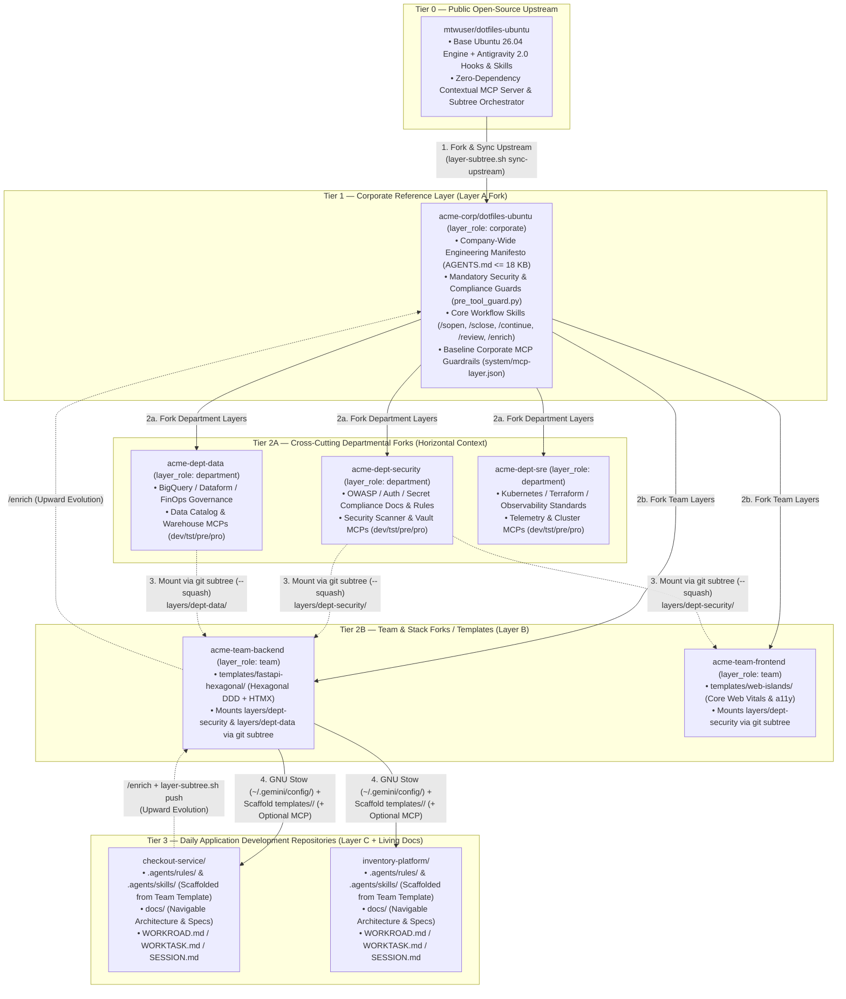

# Enterprise Use Case: Distributed Human-AI Governance ("pAIr programming") at Scale

> **Reference Guide — Organizational Architecture, Living `docs/` & Cross-IDE Portability**
>
> While `dotfiles-ubuntu` begins with a simple, practical goal — managing and reproducing Ubuntu 26.04 LTS environments via a fork-based model — its deeper architectural value lies in **how it distributes, orchestrates, and evolves engineering knowledge between humans and AI agents**.
>
> Implemented natively for **Google Antigravity 2.0 & Gemini** (and directly extrapolable to **VS Code & GitHub Copilot**, **Cursor**, or **Claude Code**), this repository acts as a **distributed governance platform for "pAIr programming"** where environment configuration, engineering standards, living documentation, and agent capabilities are managed as versioned, reusable assets that co-evolve over time.

---

## 1. The Enterprise Challenge in AI-Assisted Engineering

When organizations adopt AI coding assistants across dozens of repositories and teams, three structural problems quickly appear:

1. **Prompt & Architectural Fragmentation**: Every developer prompts the AI differently. Without shared rules, AI-generated code drifts across repositories — mixing architectural layers, bypassing test standards, or introducing inconsistent patterns.
2. **Knowledge Silos**: When a team discovers a high-leverage guardrail, testing pattern, or debugging workflow with an AI agent, that insight remains trapped in a single chat session or local repository instead of benefiting the rest of the organization.
3. **Blind Codebase Exploration (High Token Cost & Latency)**: When an AI agent enters a repository that lacks structured, navigable documentation (`docs/`), it must spend dozens of tool calls running `grep` and reading raw source files just to infer the system's architecture, boundaries, and domain model.

`dotfiles-ubuntu` solves all three problems by combining **hierarchical rule inheritance**, **bidirectional knowledge promotion (`/learn` + `/enrich`)**, and **navigable repository documentation (`docs/`)**.

---

## 2. Multi-Level Governance Topology (Open Source $\rightarrow$ Corporate $\rightarrow$ Department & Team $\rightarrow$ Application)

Beyond individual workstation setup, `dotfiles-ubuntu` is architected so any company can fork the public open-source repository into a **Corporate Reference Layer**, branch out into **Departmental** and **Team/Stack** repositories, and apply the resulting context during daily **Application Development** — **either without MCP** (100% file- and symlink-based) **or with MCP** (active multi-layer and multi-environment orchestration):



### 2.1. Role of Each Organizational Layer

| Governance Level | Repository / Location | What It Defines | Who Owns It |
|------------------|-----------------------|-----------------|-------------|
| **0. Open-Source Upstream** | `mtwuser/dotfiles-ubuntu` | Core Ubuntu 26.04 engine (`bootstrap.sh`, `backup.sh`, `audit.sh`), 4 deterministic Python lifecycle hooks, 11 global skills, `layer-subtree.sh`, and zero-dependency `dotfiles_mcp_server.py`. | Open-Source Community |
| **1. Corporate Reference (`Layer A`)** | Company fork (`acme-corp/dotfiles-ubuntu`) | Organization-wide rules (`AGENTS.md`): security boundaries, zero-secret policies, strict typing, AAA testing, commit discipline, `PreToolUse` safety hooks, and corporate `baseline_guardrails`. | Architecture Board / DevEx |
| **2A. Departmental (`Layer D` Subtrees)** | Departmental forks (`acme-dept-security`, `acme-dept-data`, `acme-dept-sre`) mounted at `layers/<dept>/` | Cross-cutting departmental compliance rules, reference `docs/`, and departmental MCP servers (`dev`, `tst`, `pre`, `pro`) that multiple teams consume without bloating `always_on` `AGENTS.md`. | Security, Data Platform, Cloud/SRE Teams |
| **2B. Team / Stack (`Layer B`)** | Team fork (`acme-team-backend`) & `templates/<stack>/` | Stack-specific architectures and blueprints (e.g., Hexagonal DDD boundaries, FastAPI + HTMX patterns, `HANDS OFF` Alembic migrations) plus mounted `layers/*` subtrees relevant to that squad. | Staff Engineers / Team Leads |
| **3. Application Repo (`Layer C`)** | `<app-repo>/.agents/` + `docs/` + `WORKTASK.md` | Domain-specific invariants, bounded-context rules, project startup sequences (`/start`), active roadmap tracking (`WORKROAD.md` $\rightarrow$ `WORKTASK.md` $\rightarrow$ `CHANGELOG.md`), and session state (`SESSION.md`). | Product Squad / Application Developers |

---

### 2.2. Step-by-Step Company Integration Playbook (With or Without MCP)

A major design strength of `dotfiles-ubuntu` is that **the exact same repository structure works in two complementary perspectives**:
- **Perspective A (Without MCP — Pure Git + GNU Stow + Templates)**: Zero MCP processes; 100% static file symlinks and project templates.
- **Perspective B (With MCP — Multi-Dimensional Context Mesh)**: Adds on-demand cross-layer rule/doc queries (`layers/*`), container/SSH drift diagnostics, and environment-scoped (`dev/tst/pre/pro`) MCP discovery with inherited guardrails.

Organizations can start with **Perspective A** on Day 1 and enable **Perspective B** at any time without changing their repository hierarchy:

#### Phase 1 — Establish the Corporate Reference Fork (`Tier 1`)
1. Fork `https://github.com/mtwuser/dotfiles-ubuntu` into your corporate Git organization (e.g., `acme-corp/dotfiles-ubuntu`).
2. Customize [`antigravity/.gemini/config/AGENTS.md`](../../antigravity/.gemini/config/AGENTS.md) (keeping it $\le 18,000\text{ bytes}$) and [`antigravity/.gemini/config/scripts/pre_tool_guard.py`](../../antigravity/.gemini/config/scripts/pre_tool_guard.py) with your company's non-negotiable engineering and security mandates.
3. Update [`system/mcp-layer.json`](../../system/mcp-layer.json) to set `"layer_id": "acme-corp/dotfiles-ubuntu"`, `"layer_role": "corporate"`, and your organization's `"baseline_guardrails"`.
4. Periodically pull upstream open-source improvements via:
   ```bash
   ./scripts/layer-subtree.sh sync-upstream https://github.com/mtwuser/dotfiles-ubuntu.git master
   ```

#### Phase 2 — Create Departmental & Team Layers (`Tier 2A` & `Tier 2B`)
1. **Departmental Forks (`Tier 2A`)**: Cross-cutting departments (e.g., Cybersecurity, Data Platform, SRE) fork `acme-corp/dotfiles-ubuntu` (`layer_role: "department"`), document their domain standards in `docs/`, and declare their departmental MCP servers and `dev/tst/pre/pro` guardrails in `system/mcp-layer.json`.
2. **Team Forks (`Tier 2B`)**: Product/engineering teams fork `acme-corp/dotfiles-ubuntu` (`layer_role: "team"`), add or customize their stack starter templates under `templates/<stack>/` (e.g., `templates/fastapi-hexagonal/`), and optionally mount the Departmental forks they depend on under `layers/<dept>/`:
   ```bash
   # Inside acme-team-backend:
   # 1. Stay synchronized vertically with the Corporate Reference Layer:
   ./scripts/layer-subtree.sh sync-upstream git@github.com:acme-corp/dotfiles-ubuntu.git main

   # 2. Mount cross-cutting Departmental forks horizontally under layers/* (--squash):
   ./scripts/layer-subtree.sh add dept-security git@github.com:acme-corp/dotfiles-dept-security.git main
   ./scripts/layer-subtree.sh add dept-data     git@github.com:acme-corp/dotfiles-dept-data.git main

   # 3. Update all mounted departmental/service layers whenever needed in one command:
   ./scripts/layer-subtree.sh pull-all
   ```

#### Phase 3 — Apply During Daily Application Development (`Tier 3`: Without MCP vs. With MCP)

Every developer on the team clones their Team fork (`git clone git@github.com:acme-corp/dotfiles-team-backend.git ~/dotfiles-ubuntu`) and runs `./bootstrap.sh --antigravity` (or `./bootstrap.sh --all` on an Ubuntu 26.04 workstation).

From there, each application repository (`checkout-service`, `inventory-platform`, etc.) integrates as follows:

| Integration Step | Perspective A: **Without MCP** *(Pure Git + GNU Stow + Templates)* | Perspective B: **With MCP** *(Contextual MCP Server + `layers/*` + `dev/tst/pre/pro`)* |
|------------------|--------------------------------------------------------------------|----------------------------------------------------------------------------------------|
| **1. Workstation Setup** | Run `./bootstrap.sh --antigravity` once. GNU Stow links `~/.gemini/config/{AGENTS.md,hooks.json,scripts/,skills/}`. | **Identical** (`AGENTS.md` and `hooks.json` stay stowed locally for zero-latency enforcement), **plus** register `scripts/dotfiles_mcp_server.py` in `~/.gemini/config/mcp_config.json` (either via local `python3`, via a pre-built hermetic Hub container `docker run -i --rm --read-only --network=none ghcr.io/<org>/dotfiles-mcp:latest`, or via `docker exec -i` / `ssh` against service nodes). |
| **2. Application Repo Scaffolding** | Copy `~/dotfiles-ubuntu/templates/<stack>/{rules,skills}` into `<app>/.agents/` and `governance/*.md` into `<app>/`. | **Identical** — `<app>/.agents/` holds the application's local rules and `WORKTASK.md`. |
| **3. How Corporate & Team Rules Load** | Loaded automatically inline by the IDE from `~/.gemini/config/AGENTS.md` (`Layer A`) and `<app>/.agents/rules/*.md` (`Layer B/C`). | Primary `Layer A/B/C` rules load inline via Stow, **and** the agent queries mounted Departmental (`layers/dept-*`) and Sibling-Service (`layers/svc-*`) rules/docs on demand via `query_governance_rules(layer="all")` and `read_layer_document(layer="dept-security")` with **0 idle token cost**. |
| **4. Multi-Environment & Multi-Service Orchestration** | Managed manually by developers per repository. | Agent calls `discover_federated_mcps(layer="all", environment="pre")` to discover downstream database/cloud/telemetry MCPs filtered by environment (`dev`, `tst`, `pre`, `pro`) with automatically merged **`effective_guardrails`**. |
| **5. Runtime Observability & Drift Audits** | Local hook checks (`post_invocation_lint.py` checks `AGENTS.md` 18 KB cap & 80 KB workspace budget; `./audit.sh` run manually). | Live MCP `audit_node_drift` across local host, Docker containers (`docker exec -i`), or remote SSH servers, plus structured JSONL telemetry & alerts in `logs/mcp_events.jsonl` and `logs/mcp_alerts.jsonl` (`dotfiles://mcp/diagnostics`). |
| **6. Continuous Knowledge Sync** | `/sopen` pulls `~/dotfiles-ubuntu`; `/enrich` promotes local `<app>/.agents/` discoveries upstream to Team/Corporate repos. | `/sopen` pulls `~/dotfiles-ubuntu` and inspects `layers/*` & `logs/mcp_alerts.jsonl`; `/enrich` uses `compare_layer_patterns(layer=...)` and `./scripts/layer-subtree.sh push <dept> <branch>` to promote patterns to any layer in the graph. |

---

## 3. Bidirectional Organic Knowledge Evolution (`Downward` & `Upward`)

Static corporate coding guidelines fail because they are written top-down and quickly become disconnected from daily engineering reality. In `dotfiles-ubuntu`, knowledge is **organic and bidirectional**:

```
   DOWNWARD DISTRIBUTION (Standardization)           UPWARD PROMOTION (Innovation)
  ─────────────────────────────────────────         ───────────────────────────────
   Corporate Repo (Layer A)                          Corporate Repo (Layer A)
        │  git pull + stow -R antigravity                 ▲  /enrich (stack-agnostic)
        ▼                                                 │
   Team Templates / Framework (Layer B)              Team Templates / Framework (Layer B)
        │  template copy / scaffold sync                  ▲  /enrich (stack-wide)
        ▼                                                 │
   Project Repository (.agents/ — Layer C)           Project Repository (/learn in chat)
```

1. **Birth at the Project Edge (`/learn` & Daily Practice)**:
   - New rules and skills are born where real problems happen: inside a specific project (`Layer C`).
   - When a developer corrects an AI agent or solves a subtle bug (for example, preventing orphan test files when decommissioning a module, or avoiding a FastAPI `from __future__ import annotations` runtime trap), that lesson is captured locally in `<project>/.agents/`.
2. **Maturation & Upward Promotion (`/enrich`)**:
   - Periodically or at the end of a milestone, the developer runs **`/enrich`**.
   - The `/enrich` skill scans the active workspace's `.agents/rules/` and `.agents/skills/`, compares them against `Layer B` (Team/Framework) and `Layer A` (`~/dotfiles-ubuntu`), and classifies every new pattern:
     - **Domain-specific?** Stays in `Layer C` (`<project>/.agents/`).
     - **Applicable to all projects using this framework/stack?** Promotes to `Layer B` (`templates/<stack>/` or framework `.agents/`).
     - **Universal across any tech stack?** Promotes to `Layer A` (`antigravity/.gemini/config/AGENTS.md` or global `skills/`).
3. **Immediate Organization-Wide Distribution (`/sopen`)**:
   - Once a promoted rule or skill is merged into the corporate or team `dotfiles-ubuntu` repository, every developer who starts a session with **`/sopen`** automatically pulls the update (`git pull --ff-only`) and applies it across all their local workspaces via GNU Stow symlinks.

---

## 4. The 4th Pillar: Navigable Repository Documentation (`docs/`) & Google AI Tooling

Hierarchical rules tell the AI agent **how** to work, but the agent also needs to understand **what** the system is and **why** it is structured that way.

This is where maintaining a structured, navigable **`docs/`** directory inside each repository (just like [`docs/README.md`](../README.md) in this repository) acts as a force multiplier for the entire governance model.

### Why Navigable `docs/` Transforms Agentic Performance

When a repository maintains an up-to-date, indexed `docs/` hierarchy (`docs/README.md`, `docs/architecture/`, `docs/reference/`):

- **From Blind Code Scanning to Indexed Comprehension**: Instead of burning context window tokens on dozens of exploratory `grep` and file-reading calls to reverse-engineer the codebase from scratch, the AI agent reads the documentation index first, locates the authoritative specification, and jumps directly to the relevant module or contract.
- **Higher Precision in Implementation & Refactoring**: Because `docs/architecture/` defines the intended invariants, component relationships, and data contracts, the agent's implementation plans and refactorings stay faithful to the system design rather than introducing ad-hoc shortcuts.
- **Self-Verifying Code $\leftrightarrow$ Docs Loop**: By pairing `docs/` with `AGENTS.md` Mandate §5 (*Documentation Hierarchy & Discrepancy Scans*) and Mandate §10 (*Documentation Coherence After Structural Changes*), documentation is treated as code: every structural change updates `docs/`, and any discrepancy between `docs/` and `src/` is flagged immediately.

In every interaction, the AI agent operates with **four simultaneous sources of context**:

```
┌───────────────────────────────────────────────────────────────────────────┐
│                   AI Agent Active Context ("pAIr programming")            │
├───────────────────────────────────┬───────────────────────────────────────┤
│ 1. Corporate Rules (Layer A)      │ Universal rigor, security, AAA tests  │
│ 2. Team / Stack Rules (Layer B)   │ Architecture patterns, tech stack     │
│ 3. Project Rules & Tasks (Layer C)│ Domain invariants, WORKTASK, SESSION  │
│ 4. Navigable Docs (docs/...)      │ System map, specs, ADRs, relationships│
└───────────────────────────────────┴───────────────────────────────────────┘
```

### Recommended Google Ecosystem Tools for Living Repository Documentation

To generate, maintain, and ground AI agents on repository documentation (`docs/`) with minimal manual overhead, organizations can combine the workflow skills in this repository with Google's AI developer ecosystem:

| Google Tool / Capability | Role in the `docs/` Lifecycle | How It Integrates with This Governance Model |
|--------------------------|-------------------------------|----------------------------------------------|
| **[Google Antigravity 2.0](https://antigravity.google/) (`architecture-review` & `governance` skills)** | **In-Flow Architectural & Bilingual Doc Maintenance** | During feature development (`WORKTASK.md`), Antigravity agents enforce `AGENTS.md` §5/§6/§10 and the `architecture-review` skill's **5-Dimension Pre-Development Gate** to keep `docs/architecture/`, Mermaid diagrams (`.mmd`), and `CHANGELOG.md` synchronized in real time. |
| **[Google Jules](https://jules.google/) (Autonomous Coding & Documentation Agent)** | **Asynchronous PR-Based Documentation Generation & Audits** | Connect Jules to your GitHub repositories to autonomously generate or refresh module documentation, API references, and architecture guides in a cloud VM. Because Jules natively reads `AGENTS.md`, it automatically respects your repository's documentation hierarchy and formatting rules when opening Pull Requests. |
| **[Gemini Code Assist Enterprise](https://cloud.google.com/products/gemini/code-assist) (Code Customization & Knowledge Indexing)** | **Organization-Wide Private Codebase & Docs Grounding** | Indexes your organization's private repositories and `docs/` directories in Google Cloud so Gemini responses across IDEs are grounded in your internal architecture specifications, shared libraries, and ADRs. |
| **Google Developer Knowledge MCP & Context Grounding** | **Live Official Documentation Retrieval** | Connects Antigravity agents via Model Context Protocol (MCP) to official Google Cloud, Gemini, Android, Firebase, and Web documentation so `docs/` and code always use current, non-deprecated APIs. |
| **[Google NotebookLM](https://notebooklm.google/) (Powered by Gemini)** | **Legacy Codebase Synthesis & Onboarding Briefings** | Ingests a repository's `docs/` tree, `WHITEPAPER.md`, or raw architectural discussions to synthesize onboarding guides, system briefings, and interactive Q&A notebooks for new team members, which can then be distilled back into `docs/reference/` via the `governance` skill's 3-Stage Extraction Pipeline. |
| **[Google GenAI SDK (`google-genai`)](https://github.com/googleapis/python-genai) in CI Pipelines** | **Automated AST-to-Docs Drift Detection** | Enables lightweight Python CI scripts using Gemini 2.5 Flash to compare AST changes in Pull Requests against `docs/architecture/` and `README.md` directory trees, flagging undocumented public symbols automatically. |

---

## 5. Extrapolating the Model to VS Code & GitHub Copilot (Cross-IDE Portability)

Although `dotfiles-ubuntu` is implemented out of the box for **Google Antigravity 2.0 & Gemini**, the underlying architecture is **100% tool-agnostic** because it is built on plain-text Markdown specifications, deterministic Python CLI hooks, and POSIX shell scripts.

Organizations using **VS Code + GitHub Copilot** (or mixed environments where some teams use Antigravity and others use VS Code / Copilot, Cursor, or Claude Code) can apply the exact same 4-pillar governance model using the 1:1 mapping below:

| Architectural Concept | Google Antigravity 2.0 & Gemini (Native in Repo) | VS Code & GitHub Copilot Equivalent | Cursor / Claude Code Equivalent |
|-----------------------|--------------------------------------------------|-------------------------------------|---------------------------------|
| **Layer A: Global / Corporate Rules** | `~/.gemini/config/AGENTS.md` (linked via GNU Stow) | `AGENTS.md` (supported natively by GitHub Copilot Agent Mode) + VS Code User `settings.json` (`github.copilot.chat.codeGeneration.instructions`) | Global Cursor Rules / `~/.claude/CLAUDE.md` |
| **Layer B & C: Scoped Project Rules (`always_on` vs conditional)** | `.agents/rules/*.md` with YAML frontmatter (`trigger: always_on` or `trigger: model_decision`) | `.github/copilot-instructions.md` (always-on) + `.github/instructions/*.instructions.md` with `applyTo: "**/*.py"` frontmatter | `.cursor/rules/*.mdc` (`alwaysApply` / `globs`) or project `CLAUDE.md` |
| **Reusable Workflow Slash Commands (`/sopen`, `/sclose`, `/review`, `/enrich`)** | `~/.gemini/config/skills/<cmd>/SKILL.md` & `.agents/skills/start/SKILL.md` | `.github/prompts/<cmd>.prompt.md` (invoked as `/<cmd>` in Copilot Chat) or Copilot Agent Skills | Custom slash commands / `.claude/commands/<cmd>.md` |
| **Deterministic Safety & Quality Hooks (`PreToolUse`, `PostToolUse`, `Stop`)** | `~/.gemini/config/hooks.json` + `scripts/*.py` (`pre_tool_guard.py`, `post_edit_format.py`, `stop_verify_tests.py`) | Git hooks (`pre-commit`, `pre-push`) + VS Code Tasks (`.vscode/tasks.json`) + `runOnSave` / GitHub Actions CI | Claude Code `settings.json` `hooks` (`PreToolUse`, `PostToolUse`, `Stop`) |
| **Navigable Repository Knowledge (`docs/`)** | `docs/README.md`, `docs/architecture/`, `docs/reference/` | Identical (`#file:docs/README.md` or `@workspace` indexing over `docs/`) | Identical (`@docs` / repository indexing) |
| **Work & Session Lifecycle State** | `WORKROAD.md` $\rightarrow$ `WORKTASK.md` $\rightarrow$ `CHANGELOG.md` + `.agents/SESSION.md` | Identical (Markdown state files tracked in Git, readable by any AI agent) | Identical |

> **Zero Vendor Lock-In**: Because the intelligence lives in structured Markdown files (`AGENTS.md`, `SKILL.md`, `.agents/rules/`, `docs/`, `WORKTASK.md`) and standard Python/Bash scripts rather than proprietary database state, an enterprise can migrate between or simultaneously support **Google Antigravity**, **VS Code + GitHub Copilot**, and **CLI agents** without rewriting its engineering standards.

---

## 6. Concrete Enterprise Walkthrough: A Day in the Life

Consider a technology company (**Acme Corp**) with 150 engineers across Backend, Data, and Frontend squads:

1. **Onboarding a New Engineer (15 Minutes)**:
   - The engineer clones the corporate workstation fork (`git clone git@github.com:acme-corp/dotfiles-ubuntu.git ~/dotfiles-ubuntu`) and runs `./bootstrap.sh --all`.
   - Their Ubuntu 26.04 environment, CLI tools, Git identity isolation (`~/.gitconfig.local`), and global AI governance rules (`~/.gemini/config/AGENTS.md`, lifecycle hooks, and 11 skills) are immediately active.
2. **Starting a Feature on a Microservice (`/sopen`)**:
   - The engineer opens `checkout-service` and types `/sopen`.
   - The AI agent automatically pulls the latest corporate rules from `~/dotfiles-ubuntu`, reads `.agents/SESSION.md` and `WORKTASK.md`, loads the project's Hexagonal DDD rules (`.agents/rules/`), and consults `docs/README.md` to understand the payment bounded contexts.
3. **Executing with Guardrails ("pAIr programming")**:
   - As the agent and engineer pair-program, `post_edit_format.py` formats every modified file automatically, `pre_tool_guard.py` prevents accidental manual migration edits or destructive Git commands, and `stop_verify_tests.py` ensures 100% unit test and architecture linter compliance before any task finishes.
   - As architectural changes are made, the agent updates `docs/architecture/` in lockstep with the code.
4. **Promoting a Discovery to the Whole Company (`/enrich` $\rightarrow$ `/sclose`)**:
   - During the sprint, the squad discovers a new security validation pattern for webhook signatures and codifies it in `checkout-service/.agents/rules/coding.md`.
   - At the end of the milestone, the tech lead runs `/enrich`, promotes the webhook validation rule upstream to the Backend Team template (`templates/fastapi-hexagonal/`) and the universal test-pruning rule to the Corporate `AGENTS.md`, and closes the session with `/sclose`.
   - On the next morning's `/sopen`, every squad in the company automatically inherits the improved standard.

---

## 7. Extending to Distributed Topologies: Contextual Layer & System MCP Federation

On a single developer workstation, GNU Stow symlinks (`~/.gemini/config/`) distribute rules with zero latency. However, enterprise systems rarely live on a single machine: they span **multiple Docker containers, microservices, staging/production servers, and separate team forks** where local filesystem symlinks cannot reach.

To bridge this boundary without adding external dependencies, `dotfiles-ubuntu` can also operate as a **lightweight, read-only Model Context Protocol (MCP) Server** (`scripts/dotfiles_mcp_server.py`) at any layer or node:

- **As a Standalone Node / Container MCP**: Any Ubuntu container, Devcontainer, or remote server hosting `dotfiles-ubuntu` can expose its declarative manifests (`system/*`), live drift status (`audit_node_drift`), and local `docs/` over standard `stdio` (`docker exec -i` or `ssh` — zero open network ports required).
- **As an Enterprise Federated Context Mesh & Multi-Dimensional Subtree Graph**: Customized forks of `dotfiles-ubuntu` across **Corporate (`Layer A`)**, **Departmental (`dept-security`, `dept-data`, `dept-sre`)**, **Team (`Layer B`)**, and **Service Node (`Layer C`)** dimensions can be composed via [`scripts/layer-subtree.sh`](../../scripts/layer-subtree.sh) (`git subtree --squash` under `layers/<name>/`) and queried across `dev`, `tst`, `pre`, and `pro` environments via `scripts/dotfiles_mcp_server.py`, allowing an orchestrating AI agent to:
  1. Query corporate, departmental, and team architectural standards across repositories with zero `always_on` token overhead.
  2. Diagnose environment and package drift across multiple microservice containers simultaneously.
  3. Discover downstream domain MCPs (databases, queues, observability) filtered by target environment (`dev`, `tst`, `pre`, `pro`) **together with the mandatory safety guardrails** that govern them before executing any tool call.

📖 **Full Use Case & Step-by-Step Configuration Guide**: **[`docs/reference/contextual_mcp_and_multi_service_orchestration.md`](contextual_mcp_and_multi_service_orchestration.md)** (and normative protocol specification at **[`docs/architecture/03_contextual_mcp_and_federation.md`](../architecture/03_contextual_mcp_and_federation.md)**).

---

## 8. Summary: The Compound Effect of Distributed "pAIr programming"

By treating **environment configuration**, **hierarchical AI rules**, **procedural skills**, **navigable repository documentation (`docs/`)**, and **optional MCP layer federation** as a single unified system:

- **Organizational Knowledge Compounds**: Best practices flow upward from real project trenches (`Project → Team → Corporate`), while strategic architecture decisions distribute downward (`Corporate → Team → Project`) automatically.
- **Inter-Team & Cross-Container Variability Drops**: Every repository and service container shares the same testing rigor, commit discipline, security guards, auditable system manifests, and task-tracking lifecycle (`WORKROAD → WORKTASK → CHANGELOG`).
- **AI Agents Operate with Maximum Precision**: Armed simultaneously with corporate standards, team blueprints, project rules, a navigable `docs/` knowledge graph, and live MCP node introspection, AI agents spend less time guessing and more time delivering production-grade software alongside human engineers.
